# 【截止2026/10/26】Jev 与 System One 决策模型：技术调研与综述报告

> 版本：v1.0；
> 
> 证据数据：最新论文证据核验到10-26，完整核验截止2026-10-08；
> 
> 研究方法、来源分层与证据标准见附录 D；
> 
> 日期：2026-10-30
> 
> 

# 目录

- [1 摘要与核心论点](#ch01)
- [2 问题定义与基本概念](#ch02)
- [3 校准机制与数学原理：严格适当评分规则与 RLCD 家族](#ch03)
- [4 官方体系与公开信息的边界](#ch04)
- [5 架构与实现形态：官方逆向与开源方案](#ch05)
- [6 训练方法与数据：范式分类与数据组织【参考】](#ch06)
- [7 评测与验证：基准解剖、指标体系与评估协议](#ch07)
- [8 应用与落地：已公开场景、两种生产模式、成本与选型](#ch08)
- [9 失败模式与安全：上下文翻转、选项语义、训练域瓶颈与输入侧攻击](#ch09)
- [10 共识、争议与开放问题](#ch10)
- [11 历史谱系：从 Brier 1950 到 Jev 发布后的System 1 决策模型涌现](#ch11)
- [12 实践指南：评估协议、阈值与成本、上线清单与相邻范式边界](#ch12)
- [13 研究前沿与发展趋势](#ch13)
- [14 结论与展望](#ch14)
- [参考文献](#refs)
- [附录&辅助材料](#appendix)

---

<a id="ch01"></a>
# 1、摘要与核心论点

## 1.1、背景

> <strong>不写文字的 AI：如何训练、如何计算、如何复现、如何选型</strong>
> 
> 

2026 年 9 月 15 日，TypeSafe AI 发布了名为 Jev 的 System One 模型：对调用方声明的选项集合，模型经单次前向计算直接返回带类型的决策与概率分布，不生成任何文本。其后公开生态快速扩张，截止10月15号，短短一月，arxiv上相关研究论文就不下百篇，直接引爆了决策模型与系统1决策等相关研究方向。在 github 上相关复现与开源项目接连涌现，广受关注。

## 1.2、核心结论

那么什么是Jev模型？就技术范式上来讲，Jev 不是一个新的生成模型类别，而是一层"决策读出层"：

- 对调用方声明的选项集合，用单次前向直接读出带类型的概率分布、不生成决策文本；

> 直观理解：<strong>不"回答"问题，对用户声明/指定的选项集合，它只返回每个选项的概率！</strong>
> 
> 

<strong>它的技术内核是把"校准"写进目标的严格适当评分规则，而冻结的通用 LLM 经读出协议即可达到同型能力。以下是五条核心技术判断，可以将这类技术范式的边界画得更清楚：</strong>

1. 范式实质是读出层的改变（带校准的类型概率）与创新而非新的模型：

  - "是否采用决策模型范式"与"是否采用 Jev 商业产品"是两个独立决策，前者有大量公开证据，后者只是商业选型；

  - 目前在技术复现上，基本可以确定“<strong>开源模型可在零训练下追平效果、微调后可以进一步超越闭源 Jev</strong>”；

  - 【LLM2Jev，2610.02076，微软】证明冻结的通用 LLM 经适当读出协议即可达到同型能力；

  - 提出 <strong>LLM-as-Jev</strong> 框架，在不修改模型架构、分词器或词汇表的前提下，通过结构化前缀（`Best answer: [`）与括号数字标识符（`[1]`, `[2]` 等）从next-token概率中提取决策分布；

  - 论文：<https://arxiv.org/pdf/2610.02076>

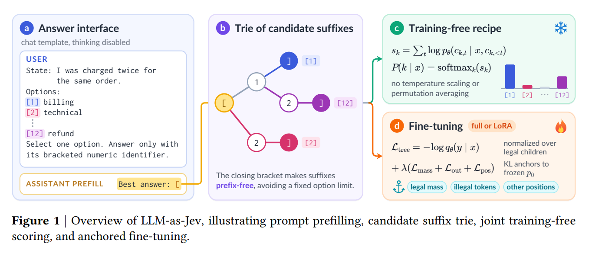

  - 【Inner Jev/Jeff，2610.17205，Harvard】给出了"无需 Jev 专用架构与 RLCD"的极简实证——把现成开源指令模型（Gemma 4 31B）的答案字母 logit 直接读出当决策概率，零样本即可逼近 Jev（79.6 vs 80.1）；再花约 5 个 GPU-小时做一轮 rank-32 LoRA 微调（400 步，不用 RL、不用 reward model），分数到 84.4、反超 Jev 4.3±2.5 —— 论文消融进一步显式其微调增益几乎全来自 LoRA 让主干学会读判断，decision head 本身近乎多余；

  - 信息：

  - <https://arxiv.org/pdf/2610.17205>

  - <https://github.com/j-geuter/jeff-serve>

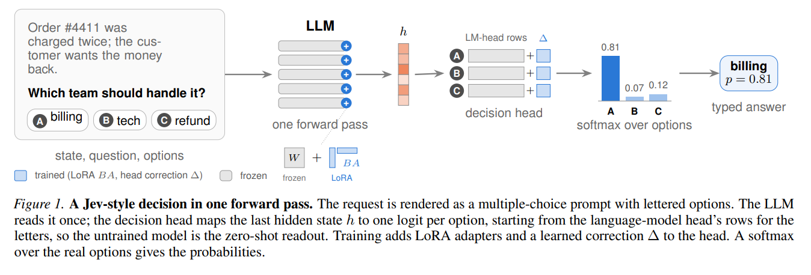

> 这个工作进一步削弱了<strong>"专用架构+RLCD 构成壁垒"的隐含预期：</strong>
> 
> - 决策读出作为范式是低成本、可复现的，Jev 的价值转向开箱即用与接口契约、而非训练配方不可替代；
> 
> - 但需要进行进一步验证；
> 
> 

2. 与生成式模型相比，成本与延迟优势明显（同模型对照读出快 5.21 倍、官方输入 \$0.042/MTok、输出免费），但准确率优势不属于接口本身：

  - 【2609.32160，早期证据地图】对目前出现的15类 Typed Decision Models（TDMs）开源系统独立审计发现 typed 接口相对同 backbone 的 label-logprob 读出无独立精度收益；

  - <https://arxiv.org/pdf/2609.32160>

| 模型 (Model)| 骨干网络 (Backbone)| 读出机制 (Readout)| 训练方式 (Training)|
|---|---|---|---|
| this-that-model-1.0<br>        【2609.23886】<br> | 1.88B 混合线性注意力解码器 (hybrid linear-attention decoder)| 答案槽隐藏状态与单token选项标签的输出嵌入行进行评分；受限 softmax (restricted softmax)| 全量微调；交叉熵 + Brier 损失<br> |
| JevLite<br>        【2609.23959】| Qwen3-4B, LoRA| 对允许的标签 token logits 进行 Softmax| 交叉熵 + Brier 损失；温度缩放 (temperature scaling)|
| Visual Jev<br>        【2609.25845】<br> | Qwen3-VL-4B/8B, LoRA| 选项字母的 LM-head logits，在候选项上重新归一化| 答案 SFT（监督微调）；尝试了专用类型头但最终放弃|
| SemIf-4B<br>        【2609.24574】| Qwen3.5-4B, 冻结 (frozen)| 选项字母 logits| 无 (None)|
| Qwen3-0.6B-RLCD<br>        【2609.24574】| Qwen3-0.6B-Base| 字母 token 读出| 用于校准决策的 RL（强化学习）（第三方复现）|
| PixelJev<br>        【2609.29283】| Qwen3.5-2B/4B, 可选 LoRA| 第一个答案位置的选项字母 logits，限制在候选槽位内| 少样本 LoRA；在留出数据 (held-out data) 上拟合温度|
| Laya<br>        【<https://github.com/NandhaKishorM/laya>】<br> | ModernBERT-large| 放置在每个选项处的掩码标记 (mask marker) 的上下文嵌入| n.r. |
| Open-Jev<br>        【2609.26758】| DeBERTa-v3-large| 对选项名称与定义的表征做均值池化后评分| n.r. |

  - System1-Arena【2610.21244 ，评估基准】 佐证：Jev 72.6% vs GPT-6 Luna 71.2%、Brier 0.349 更优、延迟约 1/4；

  > 《<strong>System1-Arena: Which Decisions Can Be Left to System 1?</strong>》该工作主要讨论的是：<strong>哪些离散决策可以交由快速的 System-1 模型（单次前向传播返回概率分布）处理，哪些仍然需要慢速的、基于生成式推理的 System-2 大语言模型（LLM）？得到的总体结论为：</strong>
  > 
  > - <strong>在非智能体（non-agentic）任务上</strong>：最大的 System-1 模型（如 Decision-2.0-Vega-27B、Jev）在准确率上已能匹配甚至超过低推理强度的闭源 LLM（如 GPT-6 Luna），且概率校准更好（Brier 分数更低），延迟仅为四分之一；
  > 
  > - <strong>需要最高精度的场景</strong>：推理型 LLM（如 Claude Opus 5.5）仍然最准确，但成本约为快速 LLM 的 70 倍；
  > 
  > - <strong>智能体（agentic）与闭环任务</strong>：大参数量的开源 LLM 在长程闭环任务中成功率最高（如 Gemma-4-31B 达 32.9%），而小型 System-1 模型成功率极低（不超过 3.1%），表明长程规划和错误累积仍是 System-1 的显著短板；
  > 
  > 》》 通过 30 个模型的系统对比，明确 System-1 模型的适用边界：在多数静态决策上，大型 System-1 模型以<strong>更低延迟、更好校准、更低成本</strong>匹配快速 LLM；但在需要最高精度或长程规划的复杂场景中，System-2 推理仍不可替代。
  > 
  > 

3. 置信度/概率校准是决策模型范式的主要核心优势，但也是最需要本地验证的性质：

  - 它本身是"模型 × 分布 × prompt × 版本"的联合性质，ECE 合格不等于概率可逐点消费；

  - 存在过度自信的风险在尾部极端分布（如System1-Arena 实验评估中，Gemma-4（31B） 在 87% 的题目给出了 ≥0.999 的概率），也就是说整体ECE校准合格的模型依然可能在尾部极端过度自信；

  - 同时System1-Arena也证实了—— "拿通用指令模型原始 logit 当概率"的典型后果就是校准概率（Brier分数）会很差（即便精准指标高），这主要是因为通用模型并未经评分式校准训练，logits 会被压成尖锐分布 —— <strong>只有经评分训练的决策头才自带校准，裸读出/小模型的极端置信必须上线前在自有负载上重新校准</strong>；

4. 实践中级联路线是当前研究与实践证据下的主流落地形态：

  - 已有相互独立的研究（阈值公式 / Jev-LiteMAS / JevCoder / Selective Reasoning）都复现支持了这一结论；

  - JevAgentHarness 按决策点拟合阈值 $τ(d)=q(L)−ΔC/V$（2610.21412）解决何时回退/触发的问题；

  - Jev-LiteMAS 通过路由+评审分离（2610.21411）解决选谁/路由去哪里的问题；

  - JevCoder 通过代码修复委派（2610.19596）把可记录判断交廉价 judge/委派；

  - Selective Reasoning 将这种范式用于推理深度早停（2610.19644）解决何时停思考/深度的问题；

  - 已公开的生产场景无一把最终决定权单独交给决策模型【见2609.29769】；

5. 就生产系统安全来讲，安全面已经从"输入侧"扩展到"程序消费侧"：

  - 【输入侧目前是最薄弱的安全面】目前证据表明：

  - 对封闭 choice 接口做对抗攻击，其攻击成功率 ASR（Attack Success Rate） 仅 1.8% 相对抗【《Decision Hijacking: Prompt Injection Attacks on Jev’s Typed Probabilistic Decisions》，2609.28613】；

  - Jev 是<strong>受限选择接口</strong>：不自由生成文本，只能从预先固定的选项里选一个决策，附带概率输出（closed choice /typed probabilistic decision interface）；

  - 论文证明了，尽管限制输出为固定候选集，但并不等于就免疫了Prompt注入攻击，<strong>概率分布依然会被恶意内容偏移</strong>，只是很难稳定劫持最终选择；

  > 简单来讲，攻击者往输入里塞提示注入话术，想骗它固定选到恶意选项，但实测真的能稳定骗成功的概率只有 1.8% —— 两个方面：能被引导偏移的概率相对高些，稳定偏移到特定目标选型上就比较难些；
  > 
  > 

  - 【2609.30243】不改变问题与选项、仅向上下文添加约 31 个词的自然背景句，可翻转 61.4% 的初始正确决策；

  - 【2609.26758】仅对调选项名与定义的绑定，可使 marker-token 读出的模型 AUC 从 0.94 反转至 0.23；

  - 【2609.31142】向 state 注入一条未经核实的旁观者意见可翻转 12.1% 的决策；

  - 【威胁面向消费侧转移】程序消费的是决策的概率分数数值而非接口标签：

  - 【2610.18612】表明，通过决策劫持， 在 228 个常用的真实 Jev 应用和 2273 个测试用例中，81.5% 的用例都出现了决策翻转，其中 98.6% 的决策翻转会导致潜在的下游安全影响；

  - 也就是说攻击者根本不必让标签翻转，只需要影响数值即可 —— 威胁面从"文本侧接口"扩展到"程序消费数值阈值口"；

---

## 1.3、快速决策

以下是进行实际技术选型与决策的核心关切：

- <strong>它是什么？</strong> 一个决策读出层，不是新模型类别，主要是对调用方声明的选项集做单次前向、直接输出带类型答案与概率分布的结果，不生成任何文本：

  - 内核可追溯至 P(True) 读出（2207.05221）与严格适当评分规则理论；

  - 冻结的通用 LLM 经适当读出协议即可复现同型能力；

- <strong>该怎么训练？</strong> 目前公开生态有两条主路径：

  - 零训练读出：即冻结基座、只改读出协议与后处理温度，典型：SemIf/LLM2Jev/reflex等；

  - 以严格适当评分规则为奖励的强化学习：即 RLCD/RLCR 类的训练范式，官方 Jev 声明走此路线但配方未公开，学术版 RLCR（2507.16806）与开源复现 OpenJev-RLCD（2609.38850）证明了校准能力可做进模型；

  > 实际中间状态还有其他路线，但基本就是这两种方案的混合，不再说明；
  > 
  > 

- <strong>各路线差在哪？</strong> 可以按照结果读出的位置分三类：

  - 以 Laya与von 为代表的“双向编码器+决策头”范式，特征为：端侧低延迟、上下文短；

  - 以 SemIf/kev 为代表的“因果解码器字母/logit 读出”范式，特征为：零成本、受单 token 上限约束；

  - 以 Jeva 为代表的“原生 decision-native”范式，其特征为：在单一架构内系统性地统一了空感知、排列不变性、选项可扩展性与跨请求缓存等结构化决策计算；

  > 根本差异在于：选项的隔离方式、是否重训基座与校准位置；
  > 
  > 

- <strong>技术选型该怎么选？</strong> 按成本/延迟、校准需求、数据主权等维度进行决策：

  - 延迟优先选自托管小型编码器（laya-mlx 端侧约 5ms）；

  - 概率直接驱动动作则必须经评分校准训练，并必须在自有负载数据上拟合温度；

  - 数据不能出域选纯本地推理，否则托管 API + 置信度级联是最简单的方案；

  > 无论哪条路线，在落地时必须注意的三条纪律：
  > 
  > - 上线前必须做影子评估【系统与工程实践】
  > 
  > - 即正式流量切过去之前，先跑影子（旁路并行） —— 线上真实请求同时送给旧系统 + 这个封闭 choice 模型，但模型输出<strong>不接管业务决策、不生效</strong>，只默默记录预测结果、概率分布、异常 case；
  > 
  > - 定位：测的不只是正常样本，重点灌提示注入、混淆 prompt、边界样本，统计：攻击下目标选项概率漂移多少、会不会偶发劫持、哪些输入容易踩决策边界；
  > 
  > - 目标：提前发现 “看着 ASR 很低，但少数场景概率悄悄偏移” 这类隐性风险，而不是等上线后才撞见偶发劫持；
  > 
  > - 关键点：影子阶段要和真实线上分布对齐，不能只用干净测试集。
  > 
  > - 阈值在本地标注上冻结【业务严格一致】
  > 
  > - 用来判定决策的置信阈值，<strong>不能上线后凭感觉调、不能在模型侧动态自动更新</strong>，阈值必须基于一套固定的离线标注数据集一次性定好并锁定；
  > 
  > - 定位：封闭 choice 是靠各选项的概率 + 阈值做分支（比如置信高于 0.8 才自动放行，低于就转人工）；
  > 
  > - 如果阈值不冻结：
  > 
  > - 后续迭代模型、换版本、微调后概率分布整体平移，阈值跟着乱动，安全基线直接失效；
  > 
  > - 攻击者哪怕只有小幅概率漂移，也有可能跨过阈值劫持结果；
  > 
  > - 冻结&要做版本固化：阈值和标注集绑定，变更阈值属于一次正式变更，要重新走一轮对抗评估。
  > 
  > - 选项名与顺序探针必须进行测试【安全面与鲁棒性】
  > 
  > - 专门做探针测试，验证模型会不会被【选项叫什么名字、选项排列先后顺序】带偏，这是封闭 choice 接口独有的问题；
  > 
  > - 两类探针：
  > 
  > - 选项名探针：改选项文字别名、同义替换（比如把 “拒绝” 改成 “拦截”），看模型概率会不会异常变化 —— 很多模型会对关键词敏感，名字本身就自带偏见；
  > 
  > - 顺序探针：打乱候选选项的排列顺序，保持选项含义不变，看输出概率和最终选择是否稳定 —— 大模型普遍存在位置偏置，靠前选项更容易被选中；
  > 
  > - 目标：摸清外部风险/攻击/扰动对决策的影响【呼应论文2609.28613与上述的第5条判断】
  > 
  > 

---

<a id="ch02"></a>
# 2、问题定义与基本概念

## 2.1、为什么"生成"是决策的错误抽象

> 核心观点：<strong>将决策视作文本生成问题，是一种昂贵的、不可靠的、且不可信的错误抽象！</strong>
> 
> 

要讨论这一观点，我们先看Jev官方的数据：

- <strong>在同一个端点上并行评估任意多个问题，端到端延迟 70–500ms，输入按 42 美元/10 亿 token 计费、输出免费【</strong><https://docs.typesafe.ai/models.md><strong>，2026-1005】；</strong>

- <strong>与同期前沿 LLM 相比，"40x–200x faster for the same levels of frontier intelligence"；并且在其工作流评测中宣称 193.6x faster、444.6x cheaper【</strong><https://typesafe.ai/blog><strong>，2026-09-15 发布】；</strong>

这里的核心在于 —— 将文本生成从决策链当中彻底移除，直接生成决策所需的判断数值！

其后续的开源工作和生态基本延续了这一核心范式与判断。这里从三个层面说明“文本生成”在决策链路当中的架构性浪费。

### 2.1.1、计算与费用：生成路径的信息冗余

> 核心：决策不需要生成完整文本
> 
> 

一个二值或少量选项的决策，信息论上只需要一到两个比特。通用 LLM 的回答路径却是：自回归生成一整段 token——包括理由、格式、模板、客套——再让调用方解析这段文本，从中推断其选择了哪个选项及相应的确定程度。

开源方案，零训练路线的 SemIf 【github.com/TheoLeeCJ/SemIf-OpenJev】给出了一个干净的同模型对照：

- 在同一冻结模型（Qwen3.5-4B）、同一 GPU（RTX 3090）、同一组二值判断任务上，把"让模型生成一句带答案的 JSON"与"直接读两个选项 token 上的 logits"做对照

- 读出路径耗时 1.023 秒（产出 0 个 token），生成路径耗时 5.332 秒（产出 111 个 token），前者快约 <strong>5.21×【尽管生成路径的首 token 只要 0.489s】；</strong>

| 读出路径| 输出 token 数| 端到端耗时|
|---|---|---|
| 自回归生成 JSON 数组| 111| 5.332s|
| 直接读选项 token logits| 0| <strong>1.023s</strong>|

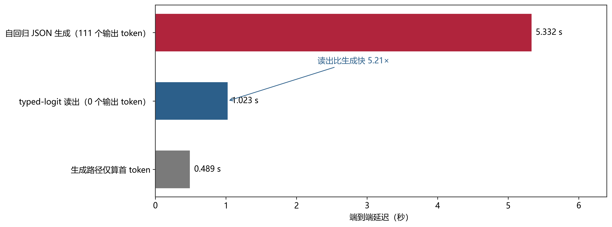

结合官方的数字来看，在这一范式下：<strong>决策的边际成本被压到了可以"滥用"的水平 —— 而Jev的命名也正来源于此。</strong>

> - 官方：[<https://typesafe.ai/blog](https://typesafe.ai/blog>)
> 
> - 直接借鉴 <strong>Jevons悖论的含义【蒸汽机效率提升反增煤耗】：智能成本下降反增用例 ——</strong>`单次智能推理的成本下降（算力、token 成本变便宜） → AI 能力变得廉价易得 → 开发者、业务方想出更多新场景、新用例，到处接入 AI → 整体 AI 调用量、算力总消耗大幅上涨`；
> 
> 

---

### 2.1.2、协议可靠性：解析与顺序敏感性

> 核心：文本解析是脆弱协议
> 
> 

生成式决策把"决策"编码在自然语言里，调用方必须事后解析。

- 解析协议隐式依赖措辞、标点、模板，任何一个环节变化都可能让工作流静默断裂；

- 更隐蔽的是<strong>选项顺序与措辞敏感</strong>：开源生态的实证（von 的选项隔离架构、Jev 与多个开源模型在选项乱序下的翻转率差异，详见 后续的 失败模式 讨论）显示，生成式模型对"哪个选项排在前面""选项叫什么名字"高度敏感，而 Jev 式直接决策模型至少将这一点转化为可测量、可攻击、可防御的显式问题；

---

### 2.1.3、概率可信度：语言化置信与校准

> 核心：置信度不是校准
> 
> 

LLM 的文本回答可以附带一句"我很确定"，但这句话不是概率【甚至可以输出口头概率，但它依然是不准确的】。

而概率校准（calibration）则要求：给 0.2 概率的事件，长期看恰好约 20% 发生。生成式模型的 verbalized confidence 与其真实正确率之间的鸿沟，是 2022 年以来大量实证研究的主题，如 Kadavath 等首次系统测量了 P(True) 与真实校准的差距【2207.05221】。

在现实世界当中，当决策要驱动自动化动作、级联路由、风险判断时，<strong>没有校准的概率和没有概率一样危险</strong>——它本质上只是将错误包装为置信度。

---

## 2.2、System One 范式的操作定义

> 范式本质：读 logits，不生成文本
> 
> 

如果要总结的话，Jev 与整个 System One 生态的范式本质可以压缩成一句话：

> 将决策从生成中分离出来：对调用方声明的选项集，用一次前向计算直接读出选项概率分布，不生成任何决策文本。
> 
> 

总结来看，这条范式有四个公开的形态要素（主要是官方生态与体系，开源技术架构与体系讨论见后）：

- <strong>声明式问题</strong>（primitive）：Choice/Score/Noul 三种原语，选项由调用方给出，模型不自由发挥；

- <strong>概率输出</strong>：对每个选项给概率，且公开承诺<strong>"和为一（归一化）"与按单个问题选项基数限制（K≤255）的两阶段打分【即对于超出基数限制的选项拆成两步，见</strong><https://docs.typesafe.ai/primitives/choice.md><strong>】</strong>；

  - <strong>阶段 1：打分粗筛</strong>：用 Score / Noul 类打分逻辑，对全部候选集合做相关性打分、排序，捞出 Top-N 短名单（N ≤ 255）

  - <strong>阶段 2：原生 Choice 精判</strong>：把短名单送入标准 Choice 原语，输出最终选择、概率分布、置信度

- <strong>并行独立评估</strong>：同一 state 上的多个问题并行求值，"adding more questions does not create context-rot"【官方，docs.typesafe.ai】，这是对生成式模型"上下文污染"问题的结构性解决应对；

- <strong>训练目标与生成解耦</strong>：官方路线是 RLCD（Reinforcement Learning for Calibrated Decisions，校准决策强化学习）——训练模型返回决策与校准概率，而非生成文本；

---

## 2.3、必要的基本概念与术语：System One 模型与类型化决策

> 定位：
> 
> - 做概念与基本术语对齐：
> 
> - 主要包括：Jev、System One 模型、typed decision model、三种原语、三条后训练路线、校准及其度量、四类实现路线、两类生产模式，各自指什么、出自哪份证据、彼此如何区分
> 
> 

### 2.3.1、顶层概念：System One 模型、Jev、typed decision model

在学术论文与开源项目当中，这三个词常被混用，但层级不同：

- System One 模型是类名；

  > 实际上按照按照system-1的内涵来讲，其意义更丰富，就比如之前 LLM 推理领域的系统1推理与系统2推理的差异，不过这里将这个差别的比较范围提到了生成式与判别式的边界；
  > 
  > 

- Jev 是该类的官方商业产品，即特指 Jev 官方；

- typed decision model 是学术文献对同类对象的描述性称呼，论文当中常见；

如下为详细对比表：

|术语|一句话定义|出处|区分&差异|
|---|---|---|---|
|<strong>System One 模型</strong>（System One model）|一类不生成自由文本、对调用方声明的问题单次前向即返回“带类型答案 + 概率分布”的模型；类名借自 Kahneman《Thinking, Fast and Slow》的快思考系统|TypeSafe 官方博客 FAQ|是<strong>类别</strong>，不是某一个模型；<br>与之相对的是自回归“System Two”式生成模型；|
|<strong>Jev</strong>|TypeSafe AI 发布的 System One 模型产品本身|TypeSafe 官方文档|是 System One 类的<strong>官方商业实例</strong>|
|<strong>typed decision model</strong><br>（类型化决策模型）<br>|学术界对同类对象的描述性称呼，核心特征为输出被约束为固定类型（选项、量表分、0–1 概率）而非自由文本的决策模型|最早见论文2609.23886|是<strong>描述性类别词</strong>，与厂商命名无关；this-that-model 是该词下的独立实现，不等于 Jev|
|<strong>state</strong>|一次请求内所有问题共享的上下文输入（如工单、日志、文本对象），类型可为 string / object / array等【Jev 官方】|官方概念页|state 与 question 分离：state 只算一次、跨问题复用；问题（question）才是每次独立求值的对象|
|<strong>decision head</strong>（决策头）|模型末端<strong>专门读出选项/概率的小参数模块</strong>；<br>官方是否有使用独立决策头目前技术<strong>未公开</strong>，开源方案则形态各异|众多开源实现（如laya、kev等）|与“整个 backbone”相对：决策头只负责读出，不负责理解 state|

这类范式的本质描述之前已经说过（`对调用方声明的选项集，用一次前向计算直接读出选项概率分布，不生成任何决策文本`），这个描述当中有三个可操作的对象：<strong>“声明的选项集”、“直接读出”、“概率分布” —— 这正好一一对应下边的概念展开：决策原语（2.3.2）、读出路线（2.3.5）以及校准度量（2.3.4）</strong>。

如下为与<strong>生成式 LLM “接口”的直观对照，来更好理解“typed”到底类型化了什么：</strong>

|维度|生成式 LLM|System One / typed decision model|
|---|---|---|
|输入|自由 prompt|state（结构化上下文）+ typed question（枚举选项/量表）|
|输出|自回归 token 流|结构化字段：choice/probabilities/score/noul + confidence|
|调用方解析|需正则/JSON 抽取，<strong>协议脆弱</strong>|无文本解析，字段即答案|
|概率|需额外提示“你多确定”，且 verbalized 通常是未校准的|<strong>概率是一等输出</strong>|

注意，state 与 question 的分离是整套并行独立决策的结构性前提：

- state 表示的是“这段文本讲了什么”，question 是“你要就它问什么”；

- 同一 state 上挂 N 个互不相关的问题，语义上仍然是 N 次独立判断而不是 N 个互相干扰的提示词；

如下为官方 API 一次请求的调用时序示意：

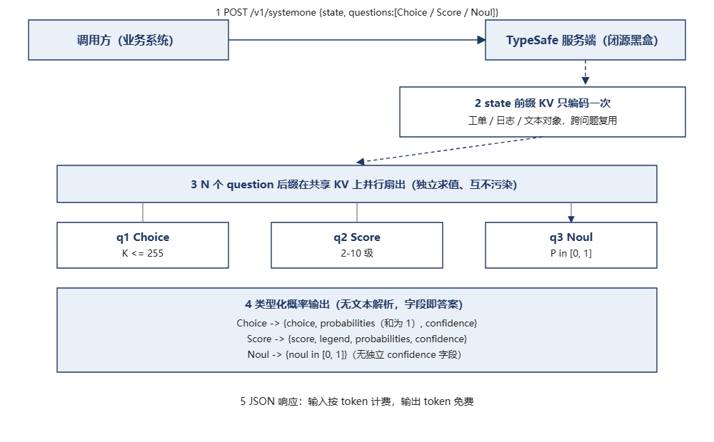

---

### 2.3.2、三种决策原语：Choice / Score / Noul

Jev 官方将API的调用方式（问法）分为收窄为三种原语（primitive），对标了“选、评、判”三类决策，且可在单次请求内混合调用。

三原语具体含义如下：

|原语|一句话定义|返回字段|硬约束|区分|
|---|---|---|---|---|
|<strong>Choice</strong>|从调用方声明的 K 个选项中选一个，返回全选项概率分布|`choice`（最高概率选项）、`probabilities`（和为 1 的全分布）、`confidence`|K ≤ 255 选项|选项由调用方枚举、模型不自由发挥；K 个互斥选项，输出是离散分布|
|<strong>Score</strong><br>|把对象放到一条有序 rubric 层级<strong>[量表]</strong>上打分，返回概率加权的期望位置<br>|`score`（可落在两层之间的连续值）、`legend`、`probabilities`、`confidence`<br>|至少 2 级、至多 10 级|与 Choice 的区别在“层级有序”：$score = \sum {level × p(level)}$ 是期望位置而非档位整数；<br>与 Noul 的区别在量表 ≥2 档；|
|<strong>Noul</strong>|对单一命题做 yes/no 判断，返回“yes”的概率|`noul`（0=no、1=yes 的概率）|二值，无独立 confidence 字段|命名一说源自 "Bernoulli distribution" 的缩写【转引见第三方插件 github.com/simonw/llm-typesafe ，官方文档未见词源说明】；<br>是 Score 量表压到 2 档时的特例，但 API 形态独立|

这里有四点补充：

- <strong>Choice 的概率分布和为 1</strong>，`confidence` 是该分布上派生的标量（官方未给 confidence 的精确计算公式，<strong>未公开</strong>）；

- Score 的 `score` 是连续期望位置，可外部验算；

  - 示意：某对象在 3 级量表 \{0,1,2\} 上的概率分布为 p(0)=0、p(1)=0.57、p(2)=0.43，则 score = 0×0 + 1×0.57 + 2×0.43 = 1.43——落在 1 与 2 之间而不必取整；

- <strong>Noul 是二值特例但独立成原语</strong>：对命题“X 为垃圾内容？”返回 0.72，即 yes 概率 0.72；它与“Score 压到 2 级”语义重合，<strong>但 API 上没有</strong>`confidence`<strong>字段、也不需要 legend</strong>，调用方解析路径不同；

- 两阶段打分只作用于高基数 Choice 情况：

  - 选项多时先独立打分、再显式选择；

  - 低基数 Choice 与 Score/Noul 不涉及该阶段；

- <strong>三原语可混合调用</strong>：一次请求里同时放 Noul（要不要看）、Choice（分到哪类）、Score（打几分），所有问题对同一 state 并行求值；

<strong>如下为示意图【可以删除】</strong>：

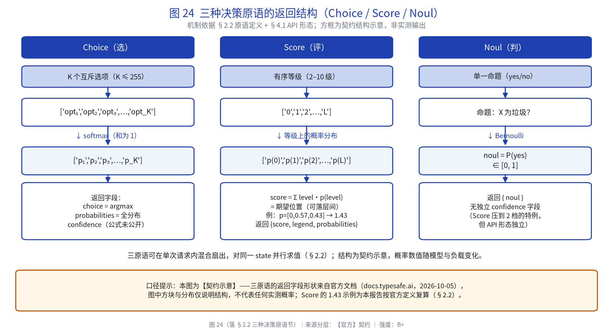

---

### 2.3.3、三条后训练路线：RLHF / RLVR / RLCD

在 Jev 官方的宣传中，其将Jev的训练定位为继 RLHF 和 RLVR 之后的第三条后训练技术路线。那么什么是 RLCD ？这里对这三个概念做简单说明【有关RLHF/RLVR等RL强化学习的技术路线，见额外的技术总结】。

|技术路线|一句话定义|奖励/信号来源|输出形态|已知代价/副作用|本报告可引证据|
|---|---|---|---|---|---|
|<strong>RLHF</strong><br>（Reinforcement Learning from Human Feedback，人类反馈强化学习）|用人类标注员偏好训练模型生成“更好/更符合人类偏好”的文本|人类更喜欢哪个回答|生成文本|谄媚、模式坍缩（mode dropping）|Jev 官方定位中作为对照系（创始人 Almeida 为 RLHF 共同发明人之一）|
|<strong>RLVR</strong><br>（Reinforcement Learning with Verifiable Rewards，可验证奖励强化学习）|用程序可机械验证的正确性（测试通过、答案相等）作奖励训练推理模型|自动判分的对错|生成文本（常含推理链）|推理慢且贵；奖励与置信度无关，模型学会“全押最可能答案”|代表论文 arXiv:2402.03300（DeepSeekMath）【官方论文】；<br>其校准代价机制见后续讨论|
|<strong>RLCD</strong><br>（Reinforcement Learning for Calibrated Decisions，校准决策强化学习）|训练模型返回<strong>“带类型决策 + 校准概率”</strong>而非生成文本，奖励指向报告概率与真实频率的匹配|报告置信度与真实正确率的匹配程度|带类型答案 + 概率分布|<strong>未公开</strong><br>|官方原文：`trains TypeSafe to return decisions and calibrated probabilities instead of generated text`【[<https://docs.typesafe.ai/introduction/machine-learning-primer.md](https://docs.typesafe.ai/introduction/machine-learning-primer.md>)】|

概况来讲，三种技术路线都是以RL为基本学习/优化方法，仅目标/任务有所差异：

- 关于RLHF与RLVR，在LLM的后训练当中已经讨论很多，这里不再展开；

- 官方把 RLCD 与 RLHF、RLVR 并列，依据是三者奖励信号的来源不同<strong>（人类偏好 / 可验证正确性 / 概率与频率匹配）</strong>；但实际，就技术路线的边界来讲，RLCD 在输出形态上与前两条路线彻底分野 —— 前两条训练的都是“生成文本”，只有 RLCD 训练“返回结构化决策”—— 这是很重要的差异与边界；

> 简单来讲，RLCD 的第三条路线，即是奖励层面的分类，也是输出契约层面的分裂！
> 
> 

就具体细节来讲，在Jev提出 RLCD 时并未公开具体技术方案，但在学术讨论当中通常都会将其与MIT于2025年7月提出的RLCR（Reinforcement Learning with Calibration Rewards）【2507.16806】进行关联，认为两者在目标上基本一致，都是使用有界的恰当性评分规则（<strong>proper scoring rule</strong>）作为奖励来训练模型输出概率校准。

实际上，在开源方案当中，或多或少的都借鉴了这一思路，如下为开源复现当中容易混淆的概念区分：

||区别|证据|
|---|---|---|
|<strong>官方 RLCD vs 学术公开配方</strong>|- 官方 RLCD 只声明目标、未公开损失函数与配方；<br>- 学术侧同目标配方是完全公开的 RLCR（Reinforcement Learning with Calibration Rewards；论文题《Beyond Binary Rewards》，MIT，arXiv:2507.16806，Brier 形式奖励 + 正确性项）；<br>> 二者数学内核同源（严格适当评分规则），差异在奖励组成、数据组织与公开程度；<br>> <br>> |【官方论文，arXiv:2507.16806】|
|<strong>RLCD vs verbalized-confidence 微调</strong>|- ConfTuner（arXiv:2508.18847）、Rewarding Doubt（arXiv:2503.02623）等早期工作训练的仍是“模型在文本里说出置信度”；<br>- RLCD 把概率做成结构化输出本身；|【官方论文，arXiv:2508.18847 / arXiv:2503.02623】|
|<strong>verbalized confidence vs 校准概率</strong>|- Kadavath 等（arXiv:2207.05221）系统测量了“模型嘴上说的确信度”与真实校准的差距：<strong>True/False 式读出优于自由文本置信度，但依然不是校准概率</strong>——这是整条路线的动机起点|【官方论文，arXiv:2207.05221】|
|<strong>RLCD vs 开源 RLCD 复现</strong>|开源侧以公开配方复现同目标，包括：<br>- github.com/NandhaKishorM/laya<br>- 《OpenJev-RLCD: A Working RLCD Implementation》【arXiv:2609.38850，实际提出了一套“先校准后强化”的训练方法来让模型在生成推理链后给出的概率分布真正反映其决策的准确性，并非这里定义的TDM模型训练】；<br>> 这些都是第三方实现，配方差异在后续讨论<br>> <br>> ||

---

### 2.3.4、概率校准及其度量：Calibration / ECE / Brier

这里主要对TDM相关的概率校准的概念进行简单介绍，后续会对核心技术做详细机制说明。

|概念|一句话定义|出处|区分|
|---|---|---|---|
|<strong>校准</strong>（calibration）|报告概率为 q（真实分布记为 p）的预测结果，长期看恰好以比例 p 正确；官方明示这是<strong>在整体样本分布上的比率，不是对单个答案的保证</strong>|`"Outcomes assigned a probability of 0.2 should occur about 20% of the time… groups of predictions, not a guarantee about any single answer"`【官方，[<https://docs.typesafe.ai/introduction/machine-learning-primer.md](https://docs.typesafe.ai/introduction/machine-learning-primer.md>)】|校准与准确率正交：很准但不知道自己何时错 —— 等价于：高 Acc、高 ECE|
|<strong>ECE</strong>（Expected Calibration Error，期望校准误差）|把预测置信度分桶，加权平均<strong>“桶内平均置信度 − 桶内正确率”</strong>的绝对差<br>|【参照 RLCR 论文中 HotpotQA 对照主表使用】<br>|ECE 越小越校准；它是<strong>单标量汇总</strong>，<strong>不区分系统性过度/不足自信</strong>|
|<strong>Brier 得分</strong>（Brier score）|预测概率与真实 one-hot 结果之差的平方，<strong>同时惩罚“答错”与“过度自信”</strong><br>|【RLCR 论文中 奖励第二项即 Brier 形式】|Brier 把准确率与校准压进一个标量；<br>ECE 只管校准不管对错，二者互补|
|<strong>温度缩放</strong>（temperature scaling，T）|冻结模型后用 $p=softmax(logits/T)$ 压平/锐化分布，不改 argmax，只在留出集上拟合标量 T|开源项目：<br>- github.com/bespokelabsai/nimble T=2.179<br>- github.com/NandhaKishorM/laya 按题型×选项数分组|属<strong>后处理校准</strong>，不训练权重；粒度缺陷的实测讨论见后续内容；|
|<strong>内禀校准 vs 后处理校准</strong>|- 内禀校准指校准由训练目标本身保证（RLCD/评分规则 RL，严格适当性）；<br>- 后处理校准指冻结模型后另拟合参数（如上边的温度缩放）|内禀侧的代表就是RLCR；后处理侧见上一行，通常代表是Laya；|二者可叠加不互斥；开源实践几乎都“<strong>先内禀/监督、再以后处理补充校准”</strong>|

需要注意，上述提到的校准度量（ECE/Brier/温度缩放）回答的是"报告概率 p 的预测是否长期以比例 p 正确"——即模型对<strong>同一答案</strong>置信得准不准。与早期 Kuhn 等（2023，2302.09664）提出的<strong>语义不确定性不同，</strong>其主要关注另一类问题：当多个回答只是同一答案的不同措辞/同义改写时，模型是否把它们当成了互斥的不同选项、从而稀释概率！

> 其做法是先用句向量把同义回答聚类、在簇内聚合证据，再区分"模型拿不准该选哪一个真实答案"（epistemic，可随数据改善）与"答案本身措辞不一、没有唯一真值"（linguistic 不确定性）之间的差异。
> 
> 

这里实际涉及到了类型决策模型TDM本身的特征：其定位为对调用方<strong>枚举声明</strong>的选项集读出概率，恰好就把"选项是否互斥/同义"的责任前置给了调用方！【

> 这个实践当中需要注意：若声明的选项之间存在语义重叠或可互相改写，ECE 再小也会把语言学不确定性误算成决策不确定性！
> 
> 

---

### 2.3.5、实现路线术语：零训练读出 / 专训权重 / 扩散读出 / 视觉决策

因为Jev官方未公布具体技术细节，这里仅围绕开源生态当中所出现的技术进行4类实现形态的概念说明，更详细的技术方案与架构实现等见后续内容。

|路线|定义|代表性工作|差异&特征|
|---|---|---|---|
|<strong>零训练读出</strong><br>（frozen / training-free readout）|冻结现成 LLM，不改任何参数，只在答案 token 或指定 hidden state 上直接读出选项概率分布（可后接温度缩放）|- github.com/TheoLeeCJ/SemIf-OpenJev<br>- 2610.00831 AnyJev；<br>- 2610.02076 LLM2Jev；<br>- github.com/hr98w/jev-visual|不碰权重，能力上限随基座；<br>代价是概率普遍未校准（如 SemIf 自报 uncalibrated）|
|<strong>专训权重</strong><br>（purpose-trained / fine-tuned decision weights）|在冻结或半冻结基座上加决策头（pointer/slot/候选头）或做 LoRA/SFT，用标注或评分规则奖励专门训练决策能力|- github.com/NandhaKishorM/laya<br>- github.com/jaredpalmer/kev<br>- github.com/bespokelabsai/nimble<br>- github.com/wfzyx/von<br>- github.com/malevrigns/agent-jev|参数被更新；<br>与零训练读出的<strong>分界是“是否反传梯度更新权重”</strong>；<br>上限更高但要数据与训练预算；|
|<strong>扩散读出</strong><br>（diffusion readout）|不在自回归解码器上读 logits，而用扩散模型在“决策画布”上并行去噪出选项分布|- github.com/razorback16/openjev<br>> 注意区分与OpenJev-RLCD不同；<br>> <br>> 其主要是基于 DiffusionGemma（离散扩散模型）做 “读取推理” —— 这里牵扯到扩散生成的机制，简单来讲存在一个画布结构，要求只有答案位置被 mask（掩码、被噪声盖住），<strong>一个问题对应一个答案槽位（slot），这个槽位只允许输出 1 个 token，然后读取对应的概率分布（每个槽各个候选标签的概率，这个概率分布本身就是答案）</strong><br>> <br>> |与因果/自回归读出的骨架不同；<br>保持线协议兼容但推理机制非自回归；|
|<strong>视觉决策</strong><br>（visual decision model）|把 shared visual context（图像/帧）作为 state，对图像内容做 Choice/Noul 式 typed 决策|- 论文 2609.25845 提出Visual Jev；<br>- 论文 2609.29283 From Text Decisions to Pixels 也聚焦与视觉决策；<br>- 开源项目 github.com/hr98w/jev-visual<br>    > 使用 Qwen3.5-0.8B 和 MLX，对同一张图片回答多个问题，并不进行训练，而是在推理范式上进行相应的工程化改造<br>    > <br>    > |官方 Jev API 输入仅文本，视觉路线全部来自开源/学术侧；state 模态从文本扩展到像素|

这里需要进一步进行澄清的概念：

- <strong>pointer head / slot head</strong>：前者在锚点 token（如 `</opt>`）的隐藏状态表示上读出打分，后者用专用槽位做 256 路 softmax：

  > - 代表分别为 github.com/jaredpalmer/kev 与 github.com/iapp-technology/openthai-systemone；
  > 
  > - 都属 权重训练 路线内部的读出头选型差异；
  > 
  > 

- <strong>listwise / pointwise</strong>：含义区别为选项间互相可见、联合打分（listwise），还是各选项独立打分（pointwise）；

  > 官方高基数 Choice 的“先独立打分再显式选择”即 pointwise 阶段；选项交互的是外部的一种技术推断；
  > 
  > 

- <strong>数值解码路线</strong>：对“数值类决策”用多路决策树/多分支读出代替单 softmax——【见论文 2609.28587 NumericJev】，是专训权重路线在数值输出上的变体，具体见论文；

- <strong>部署/运行时路线：这</strong>不是第五种训练路线，而是将决策模型的机制与思想引入到模型部署与推理当中，改变了推理服务的形态，主要方法是 prefill-only + radix 缓存的生产推理服务；

  > - github.com/ekzhang/openjev-sglang
  > 
  > - 端侧/移动端部署如 github.com/mizorewww/laya-mlx、github.com/mizorewww/laya-coreml
  > 
  > 他们不改读出机制，只改权重在哪里跑！
  > 
  > 

---

### 2.3.6、生产模式术语：置信度级联 / 影子评估

两类已被公开案例反复验证的落地形态，如下：

|术语|定义|代表工作|区分|
|---|---|---|---|
|<strong>置信度级联</strong><br>（cascade / confidence routing）|便宜的决策模型处理高置信度多数，把低置信度尾部升级给贵模型或人工；<br>> <strong>成立前提是置信度本身可信</strong><br>> <br>> |- 论文 2609.26550 JEV-as-a-Judge：Accept When Confident, Escalate When Unsure】；<br>- 开源项目：github.com/0xNatoshi/jev-codex-router|级联是“选择性预测”在工程上的形态；<br>> 与单纯阈值分流的区别在于上游必须是校准概率<br>> <br>> |
|<strong>影子评估</strong><br>（shadow evaluation）|候选系统与现系统并行跑历史样本、<strong>只记录不执行</strong>，在调用方自己的数据分布上摸真实表现|- 开源工作 github.com/abhishek085/open-spark-jev：按数据源分别报告、不混分|影子评估是上线前动作，不产生对外决策；<br>> 与离线基准的区别是用调用方真实流量分布而非公开集<br>> <br>> |

这里重点说明比较重要的置信度级联模式，其能成立的逻辑链：`校准 → 阈值可解释 → 尾部可升级`，三个环节缺一不可，就目前公开研究案例来讲，主要如下：

|应用实例|形态|证据|
|---|---|---|
|反诈一通筛查|Noul 式 one-pass 二值判断|【论文，arXiv:2609.23959（CallScreenBench）】|
|渗透测试 harness|Jev/Laya 作 agent 的 System One 决策层|【论文，arXiv:2609.28940】|
|手机 GUI 执行|Jev 作移动端 executor|【论文，arXiv:2609.30186（Jev-Mobile）】|
|代码仿真评估|代码负责仿真、Jev 负责评判|【论文，arXiv:2610.01834】|

关于影子评估的最小可落地协议/方案，可简化如下：

> <strong>选 1000–2000 条带已知标签的历史样本（工程经验值，与 ECE 分桶最小样本量相关） → 用与线上相同的 state/question 结构调决策模型 → 只记录不执行 → 在调用方自己的数据分布上算 acc 与 ECE，不引用厂商基准；</strong>
> 
> 

## 2.4、本章小结

本章关于效率、协议与校准的论据分别来自 SemIf 同模型延迟对照（5.21×）、TypeSafe 官方定价与延迟区间，以及 Kadavath 等关于 P(True) 与 verbalized confidence 的实证 [6]。官方性能数字为厂商自报；SemIf 延迟为本综述对公开 README 的复算。跨厂商基准不可直接比较。

相关基础概念与术语速查表如下：

|缩写/词|展开|
|---|---|
|state|跨问题共享的上下文输入|
|Choice / Score / Noul|三种决策原语|
|RLCD / RLCR / RLHF / RLVR|四条后训练/训练路线|
|ECE / Brier / 温度缩放|校准度量与后处理|
|零训练读出 / 专训权重 / 扩散读出 / 视觉决策|四类实现路线|
|pointer/slot head、listwise/pointwise、数值解码|读出头与打分方式细节|
|cascade / shadow eval|两类生产模式|

---

<a id="ch03"></a>
# 3、校准机制与数学原理：严格适当评分规则与 RLCD 家族

> 定位：这部分主要是对Jev背后涉及的数学机制进行基础铺垫 —— 
> 
> - 校准概率"在数学上是什么？
> 
> - 训练它们的关键机制（评分规则 RL）为什么成立？
> 
> - 朴素方案为什么失败？
> 
> - 后处理校准能做到什么、做不到什么？
> 
> 

## 3.1、校准的数学定义

设模型对问题 x 给出选项 i 的概率 $q_i$，真实结果为 y（i 为正确选项）。<strong>校准（calibration）</strong>要求模型报告的概率与经验频率一致：

> 概率为 p 的预测，长期看恰好以比例 p 正确
> 
> - 官方定义，outcomes assigned 0.2 should occur about 20% of the time；
> 
> - 来源：[<https://docs.typesafe.ai/introduction/machine-learning-primer.md](https://docs.typesafe.ai/introduction/machine-learning-primer.md>)；
> 
> 

两个最常用的量化指标：

- ECE（Expected Calibration Error）：把预测置信度分 M 个桶，对每个桶比较平均置信度与桶内正确率：

  $\mathrm{ECE}=\sum_{b=1}^{B}\frac{n_b}{N}\,\left|\,\mathrm{acc}(B_b)-\mathrm{conf}(B_b)\,\right|$

  - 其中 $B_b$ 为第 b 个置信度桶，$n_b$为该桶样本数，$\mathrm{conf}(B_b)$ 为桶内平均预测概率，$\mathrm{acc}(B_b)$ 为桶内经验准确率；

  - ECE=0 是理想校准 —— 它惩罚的是"置信度与正确率的系统性偏差"，<strong>与准确率正交；</strong>也就是一个 95% 准确率但全部报 0.6 置信度的模型可以有很高的 ECE；

  - <strong>简单来讲：ECE 度量"准不准"，但它不惩罚"该自信时不自信"</strong>—— 要把准确率与校准压进同一个可优化的标量里，用的是 Brier 分数。

- <strong>Brier 得分</strong>：在二元情况下，q 为预测正类概率、$c\in\{0,1\}$ 为真实标签：$\mathrm{S}(q,c)=(q-c)^2$；多分类情况下推广为：

  $\mathrm{BS}=\sum_{k=1}^{K}(q_k-y_k)^2$

  - 其中，$q_k$ 为模型对选项 k 的报告概率、$y_k\in\{0,1\}$ 为 one-hot 真实结果；

  - 实际操作当中，对BS分数的最小化，即等价于对负BS分数进行最大化，可以转化为我们的最大化目标函数；

  - <strong>实际意义上来讲：Brier 会同时惩罚"答错"与"过度自信"</strong>：

  > 报 0.9 答对得 $(0.9−1)^2=0.01$的小罚、答错得 $(0.9)^2$=0.81 的大罚；
  > 
  > 

- <strong>如上所示，Brier 得分</strong>把准确率与校准压进一个标量，是评分规则 RL 类算法（RLVR）的核心零件【进一步3.2内容】—— 这里解释下；

  > 论文：《Strictly Proper Scoring Rules, Prediction, and Estimation》Gneiting & Raftery 2007
  > 
  > 

  二元情形下，期望 Brier 可分解为<strong>校准项与锐度项</strong>之和（Rewarding Doubt 谱系共享的性质）：

  $\mathbb{E}_{y\sim p}\,\mathrm{BS}(q,y)=\underbrace{(q-p)^2}_{\text{校准偏差}}+\underbrace{p(1-p)}_{\text{与 }q\text{ 无关的锐度项}}$

  - *第二项 *$p(1-p)$* 是无论怎么报都存在的不可约噪声，因为真实结果本身的不确定性；第一项严格凸、存在唯一零点在 *$q=p$*；*

  - <strong>这就解释了 Brier 为何同时压准确率与校准：它把两者合并进一个标量，因而成为评分规则 RL 的核心零件；</strong>

---

## 3.2、严格适当评分规则：为什么"报真实概率"是最优策略

<strong>定义</strong>：一个评分规则 $S(q,c)$ 是严格适当（strictly proper）的，当且仅当在真实条件概率 ($p_y$) 下，报 ($q=p_y$) 使期望评分最优：

$p_y=\arg\max_q\ \mathbb{E}_{c\sim\mathrm{Bernoulli}(p_y)}\,S(q,c)$

> 直觉：
> 
> - 如果模型的真实置信是 p，那么无论它怎么在 q≠p 处夸大或压低，期望得分都严格更低；
> 
> - 这就把"如实报告概率"变成一个最优策略，而不是靠额外约束去要求；
> 
> - 其数学依据可以追溯至 Brier（1950）与 Gneiting & Raftery（2007）的严格适当评分规则理论，这里不在展开，如下所示就是<strong>恰当评分规则（proper scoring rule）+ Bregman 散度 + 凸共轭 / 熵的</strong>经典框架：
> 
> - 下图解释：光滑广义熵函数G（实心凸曲线）、配套得分函数以及 Bregman 散度之间关系的示意图
> 
> - 对任意概率预报$p\in[0,1]$，期望得分$S(p, q) = qS(p, 1)+(1−q)S(p, 0)$，等于G在p点处切线【斜率为$G'(p)$的实线】在$q\in[0,1]$处的纵坐标；
> 
> - 特别地，得分$S(p, 0) = G(p) − pG'(p)$、$S(p, 1) = G(p) + (1 − p)G'(p)$，可以通过把该切线分别取$q=0$和$q=1$读出；
> 
> - Bregman 散度$d(p, q) = S(q, q) − S(p, q)$，等于函数G在q点的值减去G在p点的切线在q点的值；
> 
> 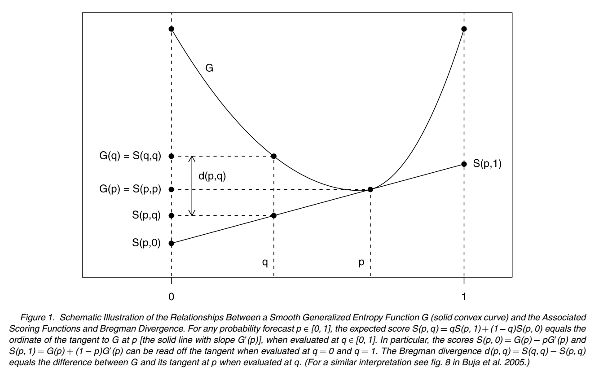
> 
> - 目标：构造一类公平打分规则，同时附带一个衡量预测偏差的散度，保证评分是恰当合适的；
> 
> - 准确性要求：给预测打分，预测的越好则打分越高；
> 
> - 恰当性要求：模型如实报出真实概率 q，长期期望得分最高；故意谎报别的概率，期望得分只会更低；
> 
> - 附带一个散度指标（距离），来衡量分布 p 和真实分布 q 之间差多少；
> 
> - 问题是什么：随便写一个打分公式行不行？
> 
> - 很多打分方式<strong>不恰当</strong>：模型撒谎、报一个不是自己真实信念的概率，反而期望得分更高 —— 激励造假；并且得分、散度之间关系看不清！！
> 
> - 那么满足恰当性的一大族得分规则，有没有统一的 “母结构”？
> 
> - 怎么做：用一个光滑凸的广义熵函数 G 作为母函数，从它上面 “切一刀（切线）”，得到全部东西；
> 
> - 核心直觉：<strong>凸函数</strong>G<strong>+ 它在</strong>p<strong>处的切线 = 得分规则的生成器</strong>
> 
> - 选一个<strong>凸、光滑的广义熵函数</strong>G（图里那条向下凸的实线），这是 “母函数”。
> 
> - 固定一个预报值 p，求 G 在 p 点的切线，切线斜率就是导数 G′(p)。
> 
> - 这条切线本身，<strong>就是期望得分函数</strong>S(p,q)：输入真值概率 q，<strong>切线高度就是期望得分；</strong>
> 
> - 取 q=0，切线高度 = S(p,0)：事件不发生时的得分；
> 
> - 取 q=1，切线高度 = S(p,1)：事件发生时的得分；
> 
> - 直觉：<strong>一条切线，同时装下两种场景的得分，加权就是期望得分！！！</strong>
> 
> - 定义 Bregman 散度 $d(p,q)=S(q,q)−S(p,q)$【这里不是定义出来的哈，Bregman 散度本身就凸函数相对于自身切线的残差】
> 
> - S(q,q)：拿真实概率 q 自己给自己打分（也就是 G(q)，曲线本身高度）
> 
> - S(p,q)：拿预报 p 的切线在 q 处打分（切线高度）
> 
> - 也就是散度 = <strong>凸曲线高度 − 切线高度，两点间的竖直距离</strong>
> 
> - 直觉：<strong>曲线和切线之间的竖直空隙，就是预报的损失 / 偏差 —— 空隙越大，预报越差！</strong>
> 
> - 注意：G 是熵（母函数），<strong>不是得分本身，</strong>切线才是得分！
> 
> 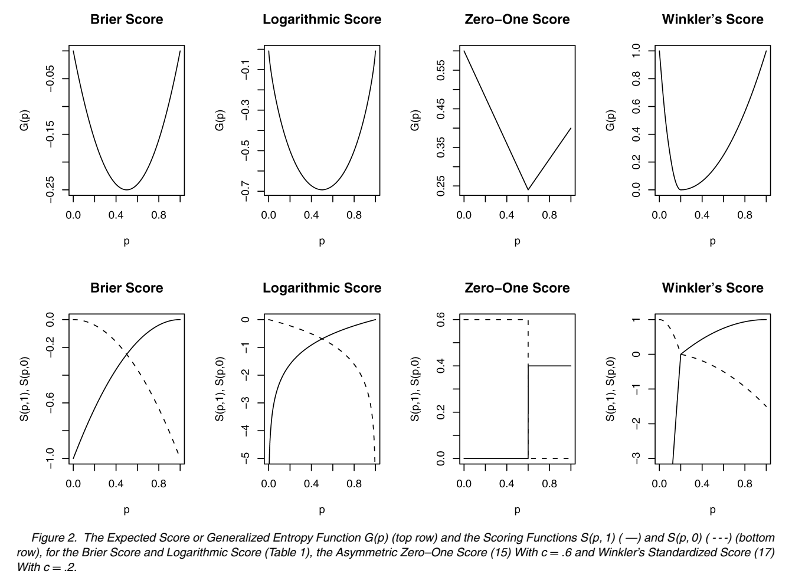
> 
> 

- Brier、spherical、对数评分都是 proper 的，但 线性评分（报 0 或 1 的期望最优）不是；

  - 在恰当性得分体系下，二元 Brier 对应的体系概念为：

| 概念| Brier 实例|
|---|---|
| 母函数 $G(p)$| $G(p)=p(1-p)$|
| 导数 $G'(p)$| $1-2p$|
| 预报 p 对应的切线（期望得分）| $S(p,q)=q\,S(p,1)+(1-q)\,S(p,0)=q\cdot(-(1-p)^2)+(1-q)\cdot(-p^2)$|
| 发生（$y=1$）单点得分 $S(p,1)$| $-(1-p)^2$|
| 不发生（$y=0$）单点得分 $S(p,0)$| $-p^2$|
| Bregman 散度 $d(p,q)$| $(q-p)^2$（平方损失，Brier 损失）|

- 严格适当性的意义在于：<strong>如果模型以"最小化期望评分"为目标训练，它的唯一不动点就是报真实概率——校准不是正则项，而是目标函数本身的性质 —— 也就是说，把校准写进目标函数！</strong>

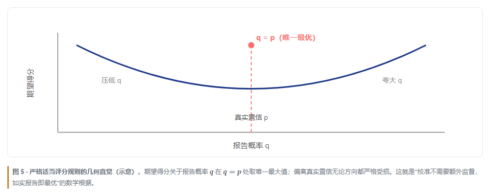

【RLCR的背景扩展】RLCR 论文在理论上将该性质转化为可训练的 RL 奖励，并给出了两个关键定理，奠定了相应的理论基础。

- <strong>RLCR 奖励</strong>：

  $R_{\mathrm{RLCR}}=\mathbb{1}[\text{correct}]-\lambda\,S(q,c),\qquad S(q,c)=(q-c)^2$

- 其中第一项保留"答对"激励（就是普通 RLVR），第二项是则是二元 Brier 惩罚；

- <strong>定理 1（双目标同时最优）</strong>：在 $Bernoulli(p_y)$ 结果下，该奖励同时满足：

  - (i) 校准激励——对任意 y，期望奖励在 $q=p_y$ 处最大；

  - (ii) 正确性激励——在所有已校准预测中，期望奖励随 $p_y$ 单调递增;

- 附录 A 进一步证明该结论对任意<strong>有界</strong> proper scoring rule 成立，条件是正确性系数 λ 满足$\max_p [S(p,1)-S(p,0)]\le\lambda$；

【RLCD训练范式把严格适当评分写入奖励的训练循环，如下示意图】

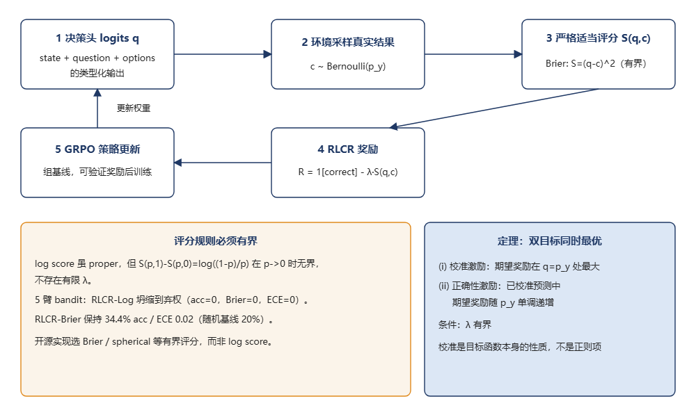

---

## 3.3、朴素方案为什么失败：零训练 logits 读出不等于天然校准

所谓的朴素方案即直接从LLM的输出头直接读出 option-token logits 来作为概率与置信度，这种方式看似免费，但它拿到的是<strong>条件于所给选项的分数</strong>，不是校准置信度。即便是走这种路线的开源方案 SemIf-OpenJev 也诚实声明：` SemIf 返回概率 "conditional on the supplied options"，需在负载上自行校准`。

就目前得到研究来看，可以从以下三个层面的机制分别讨论这个问题：

- 【训练方法层面】<strong>0/1 奖励 RL（RLVR）会把模型推向过度自信【主要论文 RLCR】</strong>

  - RLVR（0/1奖励RL）仅依据答案对错给奖励，不区分可靠答对和蒙对两种情况，容易让模型过度自信；它在域内（in-domain）降低ECE、改善校准，<strong>但域外（OOD）ECE上升，校准变差</strong>；

  - RLCR额外加入Brier惩罚，域内准确率几乎持平（63.0%→62.1%），同时大幅优化域内、域外ECE（OOD ECE 0.46→0.21），是该设置下唯一兼顾域内准确率、显著提升域外校准的方案。

  - RLCR 原文的对照实验（Qwen2.5-7B，HotpotQA）：RLVR域内准确率大幅提升（39.7%→63.0%），域内ECE 0.53→0.37，OOD ECE 0.40→0.46。

| 训练信号| in-domain Acc| in-domain ECE| OOD Acc| OOD ECE|
|---|---|---|---|---|
| Base（提示输出置信度）| 39.7%| 0.53| 53.3%| 0.40|
| RLVR（仅正确性奖励）| 63.0%| 0.37| 53.9%| <strong>0.46</strong>|
| RLCR（+Brier 惩罚）| 62.1%| <strong>0.03</strong>| <strong>56.2%</strong>| <strong>0.21</strong>|

> 注意：“0/1奖励RL会恶化校准”不能一概而论，仅在域外平均上成立。
> 
> 

- 【评分规则/奖励层面】<strong>评分规则必须"有界"——log score 会诱发 reward hacking</strong>

  - 对数评分（log score）虽是恰当评分，但<strong>无界</strong>：当预测置信度$p \to 0$时，对错回报差趋于无穷，无法找到有限系数保证激励单调，会引发奖励投机（reward hacking），<strong>模型倾向故意答错、报0置信度；</strong>

  - RLCR 论文的5臂老虎机实验佐证：基于对数评分的RLCR-Log坍缩为弃权策略，准确率为0；RLCR-Brier准确率34.4%、ECE=0.02，表现稳定;

  - <strong>结论：评分规则需要有界，这也是Laya等开源方案选用Brier、球形评分的原因；</strong>

- 【关于口头置信度的方案】<strong>verbalized confidence 未校准（语言化置信度 ≠ 概率）</strong>

  - 口头置信度是另一种朴素方案，但 Kadavath 等（Anthropic，2022）系统测量了"模型嘴上说的确信度"与真实校准的差距：<strong>通过提示语（"True/False"）读出的 P(True) 明显优于自由文本置信度，但依然不是校准概率；</strong>

  - 实际这也是上述讨论的<strong>生成式决策"的第三层浪费的机制根源 —— 也是 TDM "把概率当一等的输出结构"的核心动机；</strong>

---

论文 LLM2Jev 【2610.02076 & 微软《LLM-as-Jev: LLMs Are Already Jev-Style Decision Models -- When and How to Fine-Tune Them》】通过实证进一步说明了“朴素读出为何不够”，如下为论文在4B与0.6B模型上的对比情况：

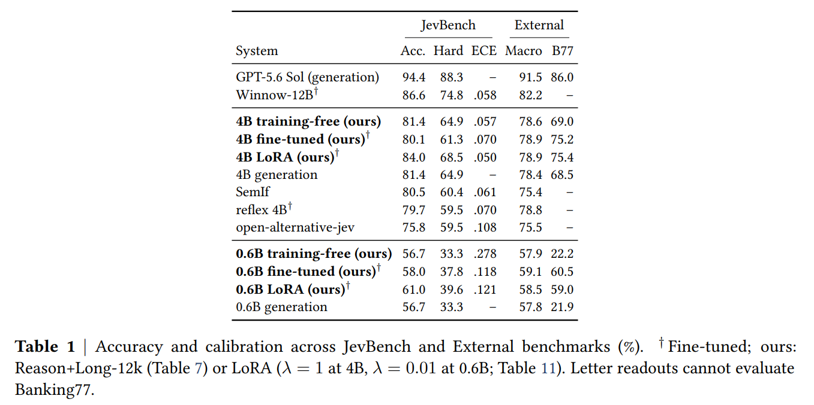

- Qwen3.5-4B（开箱冻结）：JevBench 81.4%，ECE 0.057，大基座（≥4B）原生表现尚可；

- Qwen3-0.6B（开箱冻结）：JevBench 56.7%，ECE 0.278，初始交叉熵高于均匀随机，小基座判别力不足、校准崩溃【微调后可以提升，但具有条件性】；

- 对 4B基座 使用 95461条纯意图数据进行一轮训练后：在 JevBench 上指标 81.4% 反而降至 76.2%，ECE由0.057升至0.116 —— <strong>域内拟合提升越好，分布外（OOD）校准会越差</strong>

  > - 训练数据的<strong>任务格式多样性</strong>与<strong>输入长度分布对齐</strong>至关重要；
  > 
  > - 仅堆砌短文本推理数据会损害长上下文决策能力；
  > 
  > 

    

<strong>整体核心结论：朴素读出不可靠【够大的基座（≥4B）开箱即可用、判别力不足的小基座（0.6B）校准直接崩溃】，进行微调训练能条件性提升性能，但纯意图数据训练容易损害OOD校准！</strong>

---

## 3.4、后处理校准：温度缩放与实测效果

另一个关键认识或教训是：<strong>"判别训练"与"校准"是两个不同的目标</strong>

- 把前者拟合得更狠不会顺带拿到后者；<strong>小基座甚至需要先补判别力，再谈校准</strong>；

- 温度缩放是成本最低的后处理补救——把 logits 除以 T 再 softmax，通常 T 是需要在留出集数据上按照ECE/Brier 最小化进行拟合的：

  \$p_k=softmax(\frac{z_k}{T})_k,\\
T^∗=\argmin_T NLL(留出集;T)\$

  - $z_k$ 为选项原始 logits，T\>1时会压平分布、T\<1 会锐化分布；

  - 温度只重标定置信度、不改变 argmax，因此救不了判别力本身的缺陷；

如下为4个独立的开源项目关于温度缩放的使用和定位，目前看统一的结论为：<strong>全局使用单一温度对异构负载（不同数据集/领域）是不够，必须按题型/选项数/原语分桶拟合才会有效！！</strong>

|开源实现|温度策略|校准效果|实际情况|
|---|---|---|---|
|Nimble|全局 T=2.179|整体 ECE 0.128→0.066；<br>Score 题型 0.105→0.177|对比式数据整编后拟合【github.com/bespokelabsai/nimble】|
|Laya|<strong>按（题型×选项数）分组拟合</strong>|ECE 0.466→0.081|分单元温度，非全局【github.com/NandhaKishorM/laya，见作者文档】|
|SemIf|每负载 T（1.23/2.50/1.71）<br>|WANLI ECE 0.208→0.069；其余组置信区间重叠|out-of-fold【github.com/TheoLeeCJ/SemIf-OpenJev】|
|agent-jev|分原语温度|Typed Decisions ECE 0.1687|120 留出校准【github.com/malevrigns/agent-jev】|

- Laya 按（题型×选项数）分组拟合温度把 ECE 从 0.466 压到 0.081，说明校准误差的分布是结构化的——这也是官方 K≤255 的两阶段打分（先独立打分再显式选择）背后要处理的同类问题；

- 直观效果比较【仅Nimble在使用全局单一温度时<strong>Score 题型 ECE 反升</strong>】：

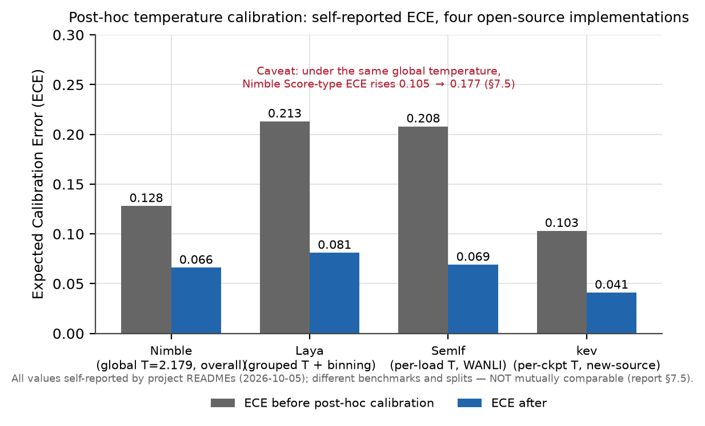

- 但也需要注意一点：是不是仅需要做后处理温度缩放就够了？能不能在模型的微调与训练目标里就把校准优化掉？—— 显然是可以的！

---

## 3.5、校准的语义边界

- <strong>校准是组率（统计样本上的结果），不是单例保证</strong>：官方明示"these rates describe groups of predictions, not a guarantee about any single answer"，也就是单个决策的 0.6 概率既不保证对也不保证错；

- <strong>概率是条件的</strong>：SemIf 明示返回概率"conditional on the supplied options"，须在使用负载上自行校准验证 —— 同一问题换选项措辞，概率含义也会随之变化（选项敏感性问题见后续讨论）；

- 评分规则 RL 是"校准训练"的机制核心：RLCD（官方）、RLCR（学术）、Laya/OpenJev-RLCD（开源）等均基于同一数学内核实现，它们的差异仅在奖励组成、数据组织与公开程度，更具体的内容会在后续训练方法与数据部分讨论。

---

<a id="ch04"></a>
# 4、官方体系与公开信息的边界

> 定位：完成了上述的基本铺垫，我们在开始正式讨论训练方法、模型结构与训练数据之前，先简短的看下Jev官方
> 
> 最新的情况
> 
> 

## 4.1、从三原语到四原语的API形态

<strong>截止目前为止10-21，官方文档仅对三种原语有明确的契约定义，但 jev‑1.14 发布的博文当中公布了一个实验性质的第四种独立原语，专门做图像目标框检测（bounding box）：</strong>

- <strong>Box：图像定位，在输入图像里找出描述目标的包围框</strong>

  - TypeSafe 内部描述它是 “处于决策灰色地带的新类型”：它不是分类打分，但同样是<strong>类型化、固定 schema 的结构化输出</strong>，延续 System One“不生成自由文本、输出强类型”的整体范式；

  - 输入侧的state里会携带图像（PNG/JPEG，单文件上限 16MiB，单请求图像总上限 32MiB，边长范围 256–1568px），然后在 `questions` 里定义一条 `type: "box"` 的问题，附带文本指令 `instructions`，描述你要找什么目标；

        ```HTML
        {
          "model": "jev-1.14.0",
          "state": "<base64图像>",
          "questions": {
            "obj1": {
              "type": "box",
              "instructions": "图中的猫"
            }
          }
        }
        ```

- 约束：<strong>一个 box 问题只能输出单个框</strong>；如果图里有多个同类目标，不能一次返回多个 bbox，需要多 question 或者业务层循环。

  - 返回的 box 字段是归一化坐标（相对图像宽高，值域 `[0,1]`，左上角原点）:

        ```JSON
        {
          "obj1": {
            "box": {
              "left": 0.12,
              "right": 0.55,
              "top": 0.20,
              "bottom": 0.81
            },
            "confidence": 0.87
          }
        }
        ```

- 这实际之前讨论的“Jev仅处理文本模态”相对应，<strong>官方最新修正了对外说法来回应对多模态的支撑问题：多模态/长上下文能力一直存在、只是此前未在公开文档显式承诺！</strong>

其余三种原语这里不再多做解释，开源方案也多遵循相应的原语设计，其核心根源在于：<strong>三原语覆盖的决策空间恰好对应了 “选、评、判” 三类原子动作：选（K 个互斥选项里挑一个，Choice）、评（在有序量表上定位，Score）、判（单一命题是否成立，Noul）—— 任何更复杂的决策（多标签、多目标、层级路由）都被可以被设计为 “把复杂问题拆成多个三原语问题、在一次请求里调用”，而不是新增第四种原语。</strong>

---

官方文档：<https://docs.typesafe.ai/primitives>

|原语|语义|返回字段|硬约束|
|---|---|---|---|
|Choice|从 K 个枚举选项中选一个；K 较大时先对各选项独立打分、再做显式选择（两阶段）|`choice` / `probabilities`（和为 1）/ `confidence`|<strong>每 Choice 最多 255 个选项</strong>；api.md："You can have a maximum of 255 options per Choice"|
|Score|在有序 rubric 层级上打分，`score` 为概率加权期望位置（可落在两层之间）|`score` / `legend` / `probabilities` / `confidence`|<strong>至少 2 级、最多 10 级</strong>；api.md："A Score should have at least two levels; the API accepts up to 10"|
|Noul|单一命题 yes/no，返回 yes 的概率|`noul`（0=no、1=yes 的概率）|二值；命名一说源自 Bernoulli 分布【转引，第三方插件 README；官方文档未见词源说明】|

---

如下为一个调用和响应示例，仅做说明：

```Shell
# 请求调用，一次多个
POST /v1/systemone
{
  "model": "jev-latest",
  "state": "<工单/日志/待判断文本>",
  "questions": {
    "q1": { "type": "noul",   "body": "此工单是否需人工处置？" },
    "q2": { "type": "choice", "body": "归入哪类？", "options": ["骚扰","垃圾","自伤","其他"] },
    "q3": { "type": "score",  "body": "紧急度？",    "legend": [0,1,2,3,4] }
  }
}
# 响应示例
{
  "q1": { "noul": 0.72 },
  "q2": { "choice": "垃圾", "probabilities": {"骚扰":0.10,"垃圾":0.72,"自伤":0.03,"其他":0.15}, "confidence": 0.72 },
  "q3": { "score": 1.43, "probabilities": {0:0,1:0.57,2:0.43,3:0,4:0}, "confidence": 0.35 }
}
```

---

## 4.2、可外部验证的计算语义

|语义|官方原文 / 数值|对调用方的含义|
|---|---|---|
|并行独立评估|"Every question is evaluated independently, so <strong>adding more questions does not create context-rot</strong>"|同一 state 上独立承载多少问题，问题之间互不污染；这是对生成式模型“多问共上下文导致提示干扰”的结构性回答|
|扇出延迟近常数|fan-out.md："sending many questions in a single API call… adding more questions usually has little effect on response time"|多问题摊销的是同一次 state 处理成本；官方<strong>未给</strong>单请求问题数硬上限【问题数量不上限】|
|上下文窗口|<strong>64k tokens / 请求</strong>；<br>其中 state + 最长问题 ≤ <strong>32k；</strong>|长 state（工单、日志全文）占用的是 32k 子预算|
|限流|<strong>100K tokens/second + 80 requests/second</strong>（动态调整中，超限返 429）|官方标注“动态调整中”，非 SLA 承诺|
|输入计费规则|按 input token 计费，<strong>output token 免费</strong><br>|响应是结构化字段而非逐 token 生成，输出没有边际成本|

除了上述偏向服务验证的部分，我们还需要关注的是两个可外部复核的语义点：

- Choice 的 probabilities 与为 1、Score 的 score = $\sum{level × p(level)}$ 都是纯算术，调用方可本地复算；

  - 比如：3 级量表 \{0,1,2\} 上 p=(0, 0.57, 0.43) → score=1.43（算术为本报告按官方定义复算）；

  - 这是官方输出契约里少数不依赖厂商说法即可验证的部分【[<https://docs.typesafe.ai/primitives/choice.md](https://docs.typesafe.ai/primitives/choice.md>)】。

- <strong>高基数 Choice 走两阶段</strong>：

  - 官方博客原文 "Jev supports a cardinality up to 255. For the higher cardinality choices, we do a 2 stage-system of scoring independently then making an explicit choice"【官方，[<https://typesafe.ai/blog](https://typesafe.ai/blog>)】

  - 这解释了为什么 255 不是“模型一次能看见多少选项”的语义上限，而是“显式选择阶段”的工程上限；

另外，一些关于成本/上下文预算的限制与推测也需要关注：

- 64k 是模型单次请求的总上下文，其中 state + 最长问题不得超过 32k【[<https://docs.typesafe.ai/models.md](https://docs.typesafe.ai/models.md>)】

  - 这意味着长工单/长日志可以整段塞进 state，但任何单个 question 的文本长度仍受 32k 子预算约束；

  - 多问题同时决策时，各问题共享 32k 中的 state 部分，问题本身逐条计费进 input token；

  > 调用方做长 state 集成时，应把 state 长度与最长 question 放在一起核算，而不是只看 64k 总量；
  > 
  > 

- 尚不明确：`state 是否前缀 KV 复用、选项间是否 listwise 交互、读出头是 pointer 还是 slot、后向信息流是否存在`；

---

## 4.3、命名来源

|名字|出处|含义|
|---|---|---|
|<strong>System One</strong>（类名）|Kahneman《Thinking, Fast and Slow》的快思考系统<br>- [<https://typesafe.ai/blog](https://typesafe.ai/blog>) FAQ|对应“快速、直觉、低功耗”的系统；与慢速推理/生成式 System Two 相对|
|<strong>Jev</strong>（模型名）|纪念 William Stanley Jevons（威廉·斯坦利·杰文斯）<br>- [<https://typesafe.ai/blog](https://typesafe.ai/blog>) FAQ|取“杰文斯悖论”之意：蒸汽机效率提升反而增加煤耗——类比决策智能的单位成本下降后，用例总量反而上升|

> 杰文斯悖论放在本产品语境里的具体主张是：当单个决策的边际成本压到可忽略量级（\$0.042/MTok、输出免费、70–500ms），调用方不会因此少做决策，反而会把决策嵌入到以前“不敢自动化”的高频链路里（每工单多个危害检查、每帧一次 GUI 判断）——总用量随单位效率上升而上升
> 
> 

---

<a id="ch05"></a>
# 5、架构与实现形态：官方逆向与开源方案

> 定位：因为Jev是不开源的，但效果与相应计算范式又极具价值，因此不仅催生了大批的开源方案，还因其了外部对Jev内部黑盒的反推猜测。
> 
> 关于开源方案，这里主要按照<strong>“读出位置 / 是否训练 / 校准机制 / 延迟量级”开展讨论现有论文和项目可以分成哪几条架构路线。</strong>
> 
> 

## 5.1、对 Jev 的逆向黑盒重建：Jev 内部形态的外部证据

如上讨论的，官方仅对<strong>三种原语、选项基数上限、并行独立评估、延迟/成本等服务侧信息进行了公开，目前全部的公开信息都停留在目标层面：用严格适当评分规则作奖励，让模型报真实概率 —— 包括RLCD的推断也都是外部参照RLCR论文进行的推断。</strong>对于如下更关键、更受关注的信息均未进行公开：

- 骨干网络结构（双向编码器 / 因果解码器 / 扩散骨干 / 参数量 ）；

- 读出头形态（独立分类头 vs 复用 LM head vs slot head vs pointer head）；

- RLCD 的奖励组成、采样算法、数据规模与来源、是否用了人类标签；

- confidence 字段的具体计算公式；

- 两阶段打分的内部实现细节（先独立打分如何再组合为全分布、独立打分阶段是否真的相互独立）；

---

因此外部一些工作【《Jev's Architecture Unmasked》<https://archerhume.com/posts/jevs-architecture-unmasked>】通过构造约10000次API调用来制造输入扰动以推断内部结构，整体上可以将实验分为5项：

|\#|实验|观察|推断|
|---|---|---|---|
|1|多问题共享 state，改问题顺序与组合|延迟与计费符合“state 前缀只编码一次”，加问题不涨成本|因果骨干 + 共享 state 前缀 KV + 隔离问题后缀|
|2|向 Choice 注入无关选项|原两选项概率比变化 −0.28（95% CI [−0.36,−0.19]）|排除“各选项独立 logit”，存在 listwise 选项交互|
|3|输出数值精度分析|概率值符合 `z=W·h+b` 后 softmax 的数值特征|存在数值读出头（slot head 与 pointer head 两候选未定）|
|4|伪造选项边界字符|无法伪造选项边界|选项分割发生在 tokenizer / 结构层，而非文本层|
|5|把关键信息放在选项之后（参考卡片）|16/16 对实验显示模型利用了选项之后的信息|读出不是严格“选项处截断”，存在后向信息流|

- 实验 1 与官方加问题不会上下文衰减的承诺直接互证——只有当 state 被算一次、多问题在其上分叉，加问题才既不重算 state、又不互相污染；

  > - 开源项目 kev 也有提到 "the shared-state trick only needs the KV cache of the state to be computed once and reused across questions"，直接支持了这一推断；
  > 
  > - github.com/jaredpalmer/kev；
  > 
  > 

  > <strong>state 前缀有复用！</strong>
  > 
  > 

- 实验 2 排除了“每个选项一个独立打分器、互不相关”的推断：

  - 若各选项独立，注入无关选项就不应牵动原选项的概率比，但实证 −0.28 的牵引说明选项间有 listwise 比较；

  - 这实际与官方声明的“两阶段打分先独立、后显式选择”表述相互冲突 —— 要么“独立打分”阶段并不真独立，要么“显式选择”阶段引入了归一化耦合；

  > <strong>目前确定的应该是：Jev 不是“每个选项独立调一次小模型”</strong>
  > 
  > 

- 实验 5 对<strong>因果解码器读出路线</strong>是个挑战：如果读出真在选项处截断、后向信息被屏蔽，那么参考卡片实验应失败，但实际试验反而说明：

  - Jev 的读出位置比“在 `</opt>` 处停”更靠后——这与 von/agent-jev 把整个前提+所有选项一次编码、再读锚点位置的信息的技术思路更接近，而非 SemIf 式的“读完选项即停”；

  > <strong>读出不是严格选项处截断</strong>
  > 
  > 

【图：Jev 内部形态的黑盒逆向重建【图12】】

> 整体架构应该符合：共享 state 前缀 KV + 隔离问题后缀 + listwise 选项交互 + 常数时间读出（$z=W·h+b$ → softmax）
> 
> 实际不能确认：
> 
> - 骨干到底是 BERT 类编码器还是 GPT 类解码器（实验 1 对两者都成立）；
> 
> - 读出头是 slot head 还是 pointer head（实验 3 的数值特征两者都符合）；
> 
> - RLCD 怎么进的训练循环（外部黑盒看不到训练）；
> 
> 

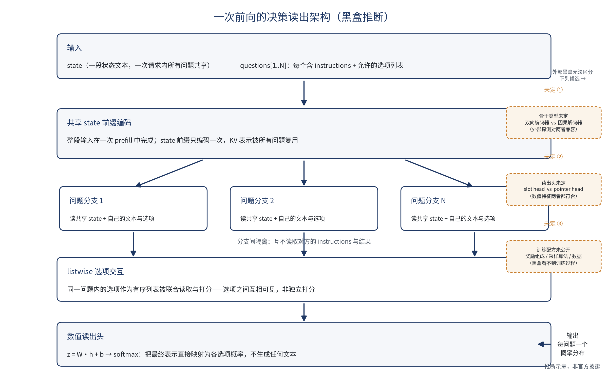

---

## 5.2、开源实现谱系：从冻结读出到评分规则 RL，再到跨领域应用

Jev 发布（2026-09-15）到本报告（材料截止2026-10-19）的一个多月内，开源生态已分化出六条可辨识的架构路线（实际上对决策模型自身来讲，应该是5条）。这里整体按照“<strong>读出在哪里、用什么骨干、是否训练</strong>”的组织原则对已有工作进行划分：

|路线|读出位置|骨干|是否训练|代表仓库|核心优势|主要短板|
|---|---|---|---|---|---|---|
|<strong>A</strong> 双向编码器+决策头|选项锚点 token 隐状态|双向编码器（ModernBERT/Qwen3）|是|Laya、von、verdict-2.0、NanoJev|一次前向读完所有选项、无自回归、端侧可跑|上下文偏短、高基数（\>20 选项）明显弱|
|<strong>B</strong> 因果解码器+字母/槽位读出|指定位置 next-token logits|因果 LLM（Qwen3.5/3.8 等）|混合：零训练 vs LoRA/全参|SemIf、LLM2Jev、kev、Nimble、jevk5、openthai、reflex、decider|零架构改动，任何能出 logits 的 LLM 均可|4B+ 微调易负迁移；小基座才需微调|
|<strong>C</strong> 决策头训练变体|候选最后 token 隐向量|小模型（0.6B–1.7B）|是（成本最低）|agent-jev、Astro-Han-RLCD、OpenJev-RLCD|把校准/置换等变性做成架构属性，单卡可复现|均为小基座，规模上限受限|
|<strong>D</strong> 扩散画布读出|整幅 token 画布去噪|离散扩散骨干（DiffusionGemma）|是|openjev|并行去噪、一次前向读出多槽位分布|底层机制与官方差异根本；质量=基座质量|
|<strong>E</strong> 视觉/多模态|视觉特征上的槽位读出|多模态骨干（Qwen3-VL 等）|混合|AnyJev、jev-visual、Visual Jev、PixelJev、PlayJev|视觉特征一次编码、多问共享前缀，吞吐极高|单图单问时共享反成负担|
|<strong>F</strong> 推理服务形态|已有权重的工程化部署|现成引擎（MLX/CoreML/ONNX/SGLang/vLLM）|—（复用已训权重）|laya-mlx、laya-coreml、receptron、openjev-sglang、open-spark-jev、daf-jev、llm-typesafe|嵌入主流推理栈、协议收敛、落地门槛低|创新最低，聚焦生产而非建模|
|G decision-native<br>|专属 L=1 紧凑决策 Block 作为读出模块；不依托 LLM 最后一层输出做打分|<strong>无 LLM 骨干</strong>；共享 Backbone 对请求 request、各个选项 option 做独立编码；选项向量 + 各层 K/V 投影构成可缓存静态记忆|整套决策架构原生内置集合条件化、null 感知、置换不变性质，依靠架构命题闭式保证，<strong>不依赖多顺序采样、事后聚合去偏</strong>；区别于零训练读出，但本文为单团队自研模型，权重未公开|<https://github.com/LiQiiiii/Jeva>|架构原生|属于全新 decision-native 范式，生态、落地验证空白；<br>有效性尚待验证|
|<strong>支线</strong> 数值解码（NumericJev）|黑箱 Choice 之上的区间搜索树|不造模型|否|NumericJev|把 Choice 原语扩展到连续数值输出|精度受外层搜索树约束|
|<strong>消费层</strong> Agent 集成|决策端点接入 agent 工作流|—|—|hermes-jev-skills、QuantDinger、daf-jev、llm-typesafe|决策端点成为 agent 运行时原语|上线风险在运维（置信门/熔断/授权）|

开源谱系划分示意图：

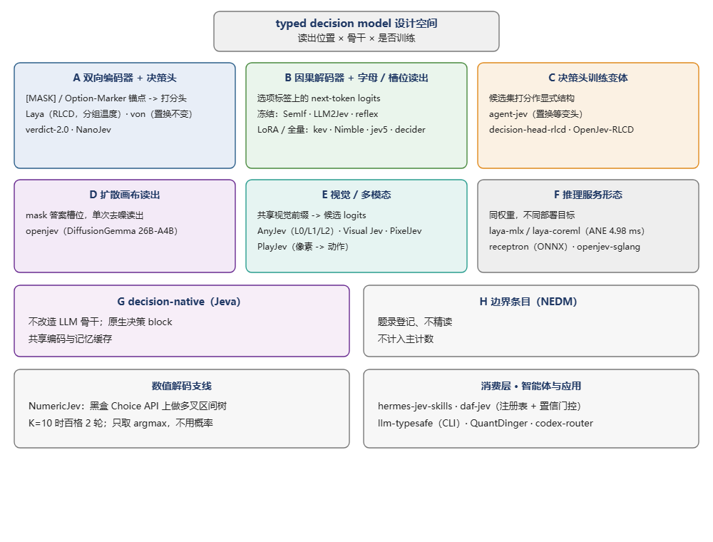

---

### 5.2.1、路线 A：双向编码器 + 决策头

- <strong>机制</strong>：用双向（非自回归）编码器把 state + 问题 + 所有选项打成一条序列，每个选项由一个锚点 token（`[MASK]` 或 Option-Marker）定位，取该锚点的隐状态过一个小型打分头，softmax 即得全分布。

- <strong>核心优势</strong>：双向注意力让每个选项同时看到全文——这是相对因果解码器路线的主要优势：比如“退款请求”的 `[MASK]` 位置能同时看到工单里前后两段互相矛盾的陈述（“被自动续费”与“上个月已取消”），而因果解码器只能向右看，做不到这一点；

- <strong>固有约束</strong>：编码器上下文窗口普遍偏短、高基数选项退化；

- 相关工作对比：

| 仓库| 骨干 + 决策头| 是否训练| 关键指标| 亮点 / 教训| 来源|
|---|---|---|---|---|---|
| <strong>Laya</strong>| ModernBERT-large（395M）+ 决策头（≈26.5M，合计 421M）| 是（完整公开 RLCD 配方）| T4 延迟：单问英文 39.5ms / 多语 32.8ms；<br>    10 问批量 158.6ms（15.9/q）/ 72.3ms（7.2/q）；<br>    50 问 337ms（6.8/q）。<br>    校准：typed raw ECE 0.213→0.081（温度后）、意图分类 0.206→0.111| <strong>本路线标杆，且唯一把"怎么做"完整公开</strong>：别人只给目标不给方法，它把 Jev 的 RLCD 训练配方（怎么设计奖励、怎么探索）全部开源，别人能照着复现；还老实承认标签很多时表现差（77 类只 0.425）| github.com/NandhaKishorM/laya|
| <strong>von</strong>| ModernBERT-large（395M）+ Option-Marker 头| 是（listwise softmax CE + Brier 监督，不走 RL）| JevBench hard（111 题×4 排序）：1.1 翻转 49.5% → 1.2 降到 0%；score 任务翻转熵 0.61→0.00。<br>    延迟 p50 0.096s（4 vCPU Xeon 8488C，OpenVINO）/ 0.023s（A10G）| <strong>解决"选项顺序影响答案"的洁癖方案</strong>：改一处结构（选项只看共享前提+自己、位置编号从前提后重数），让"打乱选项"在数学上根本不改变判断——原来一打乱就错一半，现在彻底免疫（顺序不变性）| github.com/wfzyx/von|
| <strong>verdict-2.0</strong>| ModernBERT-base（149.6M）+ GLiClass| 是| 自报 \~20–25ms/决策、浏览器 WebGPU 内 \<600MB 推理；<br>    flip rate 7.41%（Kev-0.5B）→ 4.76%| <strong>两套头分工管"对不对"和"信不信"</strong>（Distribution Head 对齐答案 + Confidence Head 专门管置信度），再用"打乱选项"的对称惩罚把"换个顺序就翻答案"从 7.4% 压到 4.8%；<br>    <strong>坑</strong>：所有数字都是自己报的、跑在自己整理的数据上、没经第三方复核，要打折看| 全部数字跑在作者自定义留出集、未经第三方复核；github.com/Heman10x-NGU/openJev-verdict-2.0|
| <strong>NanoJev</strong>| Qwen3-0.6B + 三种按统计结构分的决策头<br> | 是（CE 训练；RLCD 后训练 roadmap 标注）| <br> | <strong>证明决策头可以又小又专</strong>：用最小 0.6B 模型跑通"按题型分头"（单选/是非/打分各配一个头），一个前向算完全部；<br>    <strong>坑</strong>：只在游戏（Maze/Snake/ViZDoom）上测过，换到客服/路由场景迁移性要自己验证| github.com/TianyuCodings/NanoJev|

- <strong>路线小结</strong>：

  - 路线 A 的共性是<strong>一次前向读完所有选项、无自回归解码、端侧可跑</strong>；

  - 代价是编码器上下文普遍偏短（Laya 英文 checkpoint 512 token、von 8,192 token），且高基数（\>20 选项）时明显偏弱—— 如 Laya 在 Banking77（77 标签）上仅 0.425，远低于 Jev 的 0.870，归因于 head\_max\_len 的 token 预算使每标签仅 3–4 token；

  - <strong>这暴露了路线 A 的根本问题：双向编码器单次前向读完全部选项，在低延迟场景优势明显；但选项数增多时，每个选项分到的上下文预算即被摊薄。</strong>

---

### 5.2.2、路线 B：因果解码器 + 字母/槽位读出

- <strong>机制</strong>：保留因果（自回归）语言模型骨干，不生成文本，而是在指定读出位置取 next-token logits，把选项映射成单 token 标签（字母 A/B/C… 或 1…[K]），在这些标签 id 上做 softmax；

- <strong>路线特征</strong>：“零架构改动”——任何能出 next-token logits 的 LLM 都能当决策端点，这也是生态里分支最多、与 SemIf 名字绑定最深的路线；

- 进一步按照是否进行训练，可以分为 零训练读出类（SemIf / reflex / LLM2Jev）与 LoRA/全参微调类（kev / Nimble / jevk5 / decider）；

- 仓库对比：

| 仓库| 骨干 + 读出| 是否训练| 关键指标| 亮点 / 教训| 来源|
|---|---|---|---|---|---|
| <strong>SemIf</strong>| 冻结 Qwen3.5-4B，字母读出（首 token 挑 A/B/C softmax）| 否| 在 RTX 3090（21 条二值判据，median of 3）上：直接读 typed logits 1.023s（0 输出 token） vs 自回归生成 JSON 数组 5.332s（111 token）—— 快 5.21×| <strong>"只读不说"比"让它写答案"快 5 倍</strong>：完全不用训练，冻结模型直接读分数；同时很诚实——<strong>它明确说返回的是"给定选项下的概率"、不是真实置信度，用之前得自己校准</strong>| github.com/TheoLeeCJ/SemIf-OpenJev|
| <strong>LLM2Jev</strong>| 冻结 Qwen3.5-4B，前缀自由（prefix-free）数字编号（[1]…[K]，后缀 k]）| 否（微调仅对小模型/高基数有 targeted 收益）| 冻结开箱 JevBench 81.4% / ECE 0.057，与同基座微调社区模型打平；<br>    三后端 P50 48ms / P95 346ms（对照 Jev 1.13.0 P50 652ms）| <strong>两个贡献</strong>：一是编号办法打破"最多 16 个选项"的天花板（前缀自由编号），任意多选项都能一次打分；二是给给出了见解——<strong>4B 以上的大模型不训练就够准，硬微调反而更差</strong>| arXiv:2610.02076<br> |
| <strong>kev</strong>| Qwen3.5/3.8 + rank-16 LoRA + 小 pointer head| 是| H100 上 Kev-4B 6 问短文本 18.1/12.9ms（新文本/缓存后）；<br>    温度 0.8B 2.35 / 4B 2.41 / 9B 2.19 / 27B 1.32| <strong>全生态最透明的踩坑记录</strong>：本想"把多个问题打包成一条、用掩码隔开"省算力，结果发现底层注意力机制（Gated DeltaNet）根本不理会你设的隔离，<strong>打包在机制上不成立；只好退回"每问一行、state 缓存复用"，两种做法差距 \<4e-6</strong>| github.com/jaredpalmer/kev|
| <strong>Nimble</strong>| Qwen3.5-9B + LoRA r16，单 token 直接读 logits| 是（CE；创新在数据整编）| H100 中位 106ms（对照同报告 Jev 1.13.0 API 中位 246.7ms）；温度 T=2.179| <strong>创新在"怎么造训练数据"不在算法</strong>：改一个关键事实就让答案翻转、删掉证据就让它"我不知道"，用这套对比式数据训练；<br>    <strong>坑：训练算法还是老一套，且"打分"类题型越训越离谱（ECE 反升），被当"全局单一温度对异构负载不够"的反例</strong>| github.com/bespokelabsai/nimble|
| <strong>jevk5</strong>| Qwen3.5-4B/9B + 蒸馏 LoRA，SemIf 式字母 softmax| 是| H100 短决策 13.2ms（eager ≈70ms）；<br>    CUDA graph 预编译<br> | <strong>选项多就走"分组淘汰赛"</strong>（≤16 一次算，\>16 分几轮淘汰）；配了双温度修补淘汰造成的失准；<strong>坑：两个温度都只在 500 条小数据上拟合、且不敢动最终答案</strong>| github.com/allebee/jevk5<br> |
| <strong>openthai</strong>| Qwen3.5-0.8B（手术摘除 vision encoder，LM head 换 256-way slot softmax）| 是（全参重训 slot head）| 训练管线 = 5B 泰语 tokens CPT（≈1 天）+ 决策 SFT（≈0.5 天）+ 后校准，1× H100 约 1.5 天完成全流程<br> | <strong>把整套范式搬去低资源语言（泰语）的完整配方</strong>：1 张卡 1.5 天跑完；也是这条路线里少见的"整个脑袋重训"（全参重训 slot head）而不是只加小补丁| github.com/iapp-technology/openthai-systemone|
| <strong>reflex</strong>| 冻结 Qwen3.5-4B，靠读出技巧| 否（核心发现“微调反而是陷阱”）| —| <strong>核心发现：微调反而是坑</strong>——花大力气做的 4 套 LoRA + 27B 教师蒸馏，只在"长得像训练数据"的输入上赢，<strong>一遇到又长又模糊的真问题就失灵</strong>；真正有用的<strong>是几个读出技巧（字母化 yes/no、拆"证据/标准"、正反两遍平均）</strong>| github.com/kshetrajna12/reflex|
| <strong>decider</strong>| Qwen3.5 2B/4B/35B-A3B + Gemma-4 12B/31B，slot 读出 + CE| 是| 现成 instruct 基座 + 拟合温度在 Decision Index 上排 \#2/\#8<br> | <strong>"现成模型 + 调个温度"就能上榜</strong>，没蒸馏 Jev 任何东西；<strong>它提醒大家：动手训练前先证明"微调真比现成模型直接读出更好"</strong>| github.com/Mapika/decider<br> |

- <strong>路线小结【核心是LLM2Jev 2610.02076 的工作，之前有过部分讨论】：</strong>

  - LLM2Jev 论文的实证结论是——<strong>4B 级强基座上，冻结读出（81.4%）与微调社区模型打平，全参微调甚至负迁移</strong>；只有小基座（0.6B，JevBench 56.7% / Banking77 22.2%）和高基数路由才从微调显著受益（0.6B Banking77 22.2%→59.8%）；

  - <strong>路线 B 特有陷阱（LLM2Jev 揭示的微调过拟合反面教材）</strong>：纯意图数据训 4B 模型，在 in-distribution dev loss 从 0.65 单调降到 0.002，但 JevBench 却从 81.4 掉到 76.2——<strong>即“分布内 loss 越降越准、分布外越训越差”，这是路线 B 微调方法最需警惕的失败模式！</strong>

---

### 5.2.3、路线 C：决策头训练变体

- <strong>机制</strong>：不改读出位置的方法论，而是在“怎么给选项集打分”上做文章——把选项间的交互做成显式结构，而非靠数据增强碰运气；

- 具体仓库情况如下：

| 仓库| 骨干 + 决策头| 是否训练| 关键指标| 亮点 / 教训| 来源|
|---|---|---|---|---|---|
| <strong>agent-jev</strong>| Qwen3-0.6B（整体移除 LM 头）+ 置换等变候选头| 是（598M 全参，\~1.2GB bf16）| Typed Decisions 官方测试切分 top-1 79.25%（对照 Laya 77.00%、Jev 1.13.0 零样本 72.7%）；<br>    共享前缀 KV 复用，砍掉冗余 backbone token 操作 92.4%（延迟 609.65→298.91ms，约 −51%，最大概率差 0.000508 且答案不变）| <strong>让"选项怎么排列"在数学上彻底不掺进打分</strong>（置换等变头），比"训练时打乱选项"更根治；多个问题共用一段计算能省约一半时间；<strong>全生态唯一给"比 Laya 高 2.25 个点"配了置信区间 [+0.65,+3.90]</strong>，不是空口报数<br> | github.com/malevrigns/agent-jev|
| <strong>Astro-Han/decision-head-rlcd</strong>| Qwen3.5-4B + 4.9M LoRA（rank 8，仅 attention）| 是| —| <strong>把 RL 当严谨实验做</strong>：固定种子、只按"测试数据和训练数据像不像"分组（同集/同结构近料/同结构异料/结构缺失）报告；<strong>结论扎心：训练时没见过的结构，RL 不但没帮上忙、还比不训练更差</strong>| github.com/Astro-Han/decision-head-rlcd<br> |
| <strong>OpenJev-RLCD</strong>| Qwen3-1.7B 两阶段 RLCD| 是| Cov@5% 从 GRPO 的 19% 提到 81%<strong>（相同风险预算下覆盖更多可回答样本）</strong>；MMLU-Pro acc 42.3→47.7| <strong>把 RLCD 拆成两段做</strong>（先校准答案、再强化推理过程），同样风险预算下能答对的题明显变多；<strong>注意：准确率提升不大，主要改善的是"自信程度/校准"</strong>| github.com/ZimmyGao/openjev-rlcd<br>    论文：2609.38850 |

- <strong>路线小结：</strong>

  - 路线 C 的共同信号是 —— 社区已经从“照 Jev 样子训一个”转向“把校准与等变性做成架构属性”；

  - 如 agent-jev 的置换等变头、Astro-Han 的数据覆盖消融、OpenJev-RLCD 的两阶段，都在回答同一个问题：<strong>怎么不靠更多数据、而靠结构/算法使概率正确，同时使训练成本也最低！</strong>

  > agent-jev 598M 全参、Astro-Han 4.9M LoRA r8、OpenJev-RLCD Qwen3-1.7B——都在单卡可复现范围内，与路线 B 动辄 4B/9B LoRA 形成对比
  > 
  > 

---

### 5.2.4、路线 D：扩散画布读出

- <strong>机制</strong>：读出对象从“自回归单 token logit”换成离散扩散模型的整幅 token 画布；

  - 扩散语言模型一次前向对整幅画布去噪（而非从左到右写），因此可以只把要决策的槽位 mask 掉、一次只读前向就读出每个槽位的分布；

- <strong>仓库对比表：</strong>

| 仓库| 骨干| 是否训练| 关键指标| 亮点 / 教训| 来源|
|---|---|---|---|---|---|
| <strong>openjev</strong>| DiffusionGemma 26B-A4B（MoE 26B 总参/4B 激活）| 是| 自报 Server-Timing 单请求 total 44.0ms（仅一次示例读数、非基准分布）| 首个基于扩散语言模型的决策服务器：只 mask 答案槽位、每题一 token，canvas 一次只读前向，每标签 token 归一化概率即答案；<br>    【工程上】完整复刻 Jev 线协议（错误形状 422/400/401/429/529 对照 live API 核对），typesafe-sdk 改 base URL 即可用；<br>    <strong>坑</strong>：它自己承认答案好不好全看底座模型行不行，要自己评估| github.com/razorback16/openjev|

- <strong>路线小结</strong>：

  - 这条路线证明“读出位置”不必绑死在自回归 LM head——<strong>任何能对指定槽位输出条件分布的生成式骨干，都可以做成决策端点</strong>

  > 它与官方 Jev 的机制差异是根本性的：官方是因果前缀+后缀，openjev 是整画布并行去噪；但对外契约层完全一致
  > 
  > 

---

### 5.2.5、路线 E：视觉 / 多模态

- <strong>机制</strong>：把“state”从文本扩展到图像/像素，在共享视觉上下文上做多问题 typed 决策；

  > 它把“共享前缀算一次”的抽象从文本 state 推广到视觉特征。
  > 
  > 

- 项目对比：

| 仓库| 骨干| 是否训练| 关键指标| 亮点 / 教训| 来源|
|---|---|---|---|---|---|
| <strong>AnyJev</strong>| 任意 LLM（实测 Qwen3-8B）+ 分级读出头<br> | 否（L0/L1 无梯度；L2 闭式解读出头）| Banking77 20-way（300 题）：准确率 0.747→0.807、ECE 0.240→0.095、≤5% 错误下可自动决策比例 7.7%→52.0%；order-flip 率 0.230→0.073| <strong>最优雅：不用训练</strong>——从模型中间层"解一道线性方程"就得到打分头（闭式读出头），再让选项转着圈各看一遍、平均掉位置偏见（K 次旋转去偏）；<strong>效果：校准好了，能放心自动拍板的比例从 7.7% 涨到 52%</strong><br> | 论文：2610.00831（Nokia Sunnyvale + 腾讯混元）|
| <strong>jev-visual</strong>| Qwen3.5-0.8B-4bit（Apple Silicon，MLX）| 否（无训练无校准）| 64 决策独立 vs 共享评分中位 37.30s→2.40s；生成 JSON 在 4/16/64 决策下未通过完整 schema| <strong>只算旁证、不算质量证据</strong>：在苹果芯片上只跑到早期 demo（输出的 JSON 格式都不完整），能证明"多个问题共用一次图像特征能省约 15 倍时间"，但别拿它当"效果好不好"的证据| github.com/hr98w/jev-visual|
| <strong>Visual Jev</strong>| Qwen3-VL-4B-Instruct| 是（含专用 typed head 对照）| 独立串行 50.7ms/题 → 批量不共享前缀 19.3ms（2.6×）→ 共享前缀+同批 5.7ms/题（176 Q/s，相对串行 8.9×）| <strong>全生态唯一把两个提速来源分开测</strong>：<strong>"一次处理多个问题"和"复用算过的部分"各值多少，结论是两样都得要（正交）</strong>；还严谨证明：专门加个打分头并不比直接读模型原分数更准（macro 0.761 vs 0.761）| 论文:2609.25845|
| <strong>PixelJev</strong>| Qwen3.5-VL 2B/4B| 混合（frozen / 语言侧 LoRA / held-out 温度校准三阶段分离）| Pets frozen 2B 60.13% → 64-shot adapted 92.40%（+32.3pp）| <strong>把"看图做决定"定义成一套标准合同</strong>（图+运行时的选项清单+程序返回稳定 ID）；严谨证明效果提升<strong>全来自小适配器（LoRA）、"换读出方式"贡献是 0</strong>| 论文:2609.29283（南大/MSRA）|
| <strong>PlayJev</strong>| Qwen3.5-0.8B-Base（全量微调 + 3 轮 DAgger，共 2,166,984 条决策）| 是| H200 上 43ms/步；mean vs teacher 归一化 0.57（10 款 HTML5 游戏）| <strong>最激进</strong>：不告诉它游戏名、不喂文字，只看一帧画面就直接输出该按哪个键；但只在 10 款 HTML5 小游戏上测过| github.com/OmniJev/PlayJev|

- <strong>路线小结</strong>：“共享前缀算一次”在视觉域比文本域更值钱——<strong>图像编码是视觉管道里最贵的部分</strong>，

  - Visual Jev 用“视觉特征只在前三层 image-token 位置重注入、全在缓存前缀内”这一架构事实，把多问共图的吞吐推到 176 Q/s，但在N=1 单图单问时共享反而是负担（82.9 vs 48.1ms）；

  > 是生态里唯一将批量与复用各自的收益分别量化的实验，结论是<strong>两者收益正交、需同时采用：</strong>
  > 
  > - independent serial 50.7ms/题 → 已批量但重算前缀 19.3ms（2.6×，纯批量收益）→ 共享前缀+同批 5.7ms/题（再 3.4×，纯复用收益）
  > 
  > - <strong>核心：更换骨干提升质量、保留 LM-head 读出、共享执行换取效率</strong>
  > 
  > 

  - <strong>AnyJev 闭式读出头（路线 E 最优雅机制）</strong>：其核心思想是不在骨干上微调，而是取某中间层隐状态、闭式解一个线性读出头 —— 把“训一个 head”变成“解一个线性方程”：

  > 实际很抽象、很理论；
  > 
  > 

---

### 5.2.6、路线 F：推理服务形态【工程化】

- <strong>定位</strong>：这条路线<strong>不发明新读出机制</strong>，而是把已有的决策权重/读出工程化部署，回答“决策端点怎么上线” —— 工程密度最高、创新最低，但对生产采用最关键；

- <strong>仓库对比表：</strong>

| 仓库| 部署载体| 关键指标| 亮点 / 教训| 来源|
|---|---|---|---|---|
| <strong>laya-mlx</strong>| Laya 权重的 Apple MLX 原生运行时（零 PyTorch）| M3 Max 单短问题 P50：421M 英文 13.42ms、322M 多语 7.39ms；<br>    峰值分配 943.6/687.6 MiB| <strong>最值得抄的运维细节——防"过度自信"</strong>：上游给的温度会把"硬币两面"都报成"几乎确定"，运行时把它钳回安全区间（[0.5,5.0]），还逐个警告你每个被钳的桶| github.com/mizorewww/laya-mlx<br> |
| <strong>laya-coreml</strong>| Laya 的 Core ML / Neural Engine 端口| M3 Max 单短多语 P50 4.98ms / P95 5.31ms；每决策系统能耗 0.154J（较编译 MLX FP16 好 2.78×）| <strong>在苹果神经引擎上又快又省电</strong>（每个决策能耗好 2.78 倍）；<strong>坑</strong>：硬件只认 96 个 token，长文要 91.7ms——作者自己用反例说明"短文的快别外推"| github.com/mizorewww/laya-coreml|
| <strong>receptron/laya</strong>| 单个 ONNX 图，Node.js/TypeScript 直接 import（零 Python）| Apple-silicon CPU 三问题热身后约 140ms| <strong>导成一个文件、Node.js 直接用、不用 Python</strong>；导出时打印"和原版差约 1e-5"当作转换质量的签名，输出和 Python 版四位小数一致| github.com/receptron/laya|
| <strong>openjev-sglang</strong>| Qwen3.6-35B-A3B 跑 SGLang 0.5.19 Rust 前端、单容器一张 B200 prefill-only 端点| —| <strong>已是历史</strong>：README 顶部自己写明这是早期实验、已被 SGLang 官方原生决策端点取代，只当参考| github.com/ekzhang/openjev-sglang|
| <strong>open-spark-jev</strong>| DGX Spark 完整栈（数据工厂 → SFT → NVFP4 量化 → 本地 API），Qwen3.5-4B+LoRA| vLLM bf16 p50 74.9ms、NVFP4 53.3ms| <strong>诚实负面样本</strong>：自己试了两种 RLCD 路线、两次都变差、没好意思发模型——说明"RLCD 复现还没稳定赚钱"| github.com/abhishek085/open-spark-jev|
| <strong>daf-jev</strong>| 应用侧适配层：wire 合同 + provider 注册表（jev/jeff/kev/localjev/openthai-systemone/openrouter）| —| <strong>"接线"样板</strong>：一个标准接口背后可以接 Jev/kev 等好几个后端，自带置信门槛、熔断这些生产保护；也揭开了生态里各种别名到底是哪个| github.com/docxology/daf-jev|
| <strong>llm-typesafe</strong>| Simon Willison 的 llm CLI 单文件插件| —| <strong>最省事的上手方式</strong>：一个单文件插件，让 llm 命令行工具直接用上 Jev| github.com/simonw/llm-typesafe|

- 总结&评论：

  - 先看一个事实：openjev、LLM2Jev、openjev-sglang、laya、kev、von、openthai、open-spark-jev 都实现 `/v1/systemone` 兼容——<strong>Jev 的 API 形状可能比 Jev 本身更长寿；</strong>

  - 因此，一个新模型只要吐同形状 JSON 就能顶替，这意味着生态的竞争点<strong>正在从 谁更准 转向 谁能把这个契约跑在最省的硬件上；</strong>

  - 目前看<strong>服务路线收敛方向为：把读出嵌进现有推理栈而非另起炉灶</strong>

  - 如 laya-mlx / laya-coreml / receptron 把 Laya 分别装进 Apple MLX、Core ML/ANE、ONNX（同一个 395M 编码器权重在 GPU/神经引擎/CPU 三种后端上跑）

  - 如 openjev-sglang 把 Qwen3.6-35B-A3B 挂上 SGLang 的 radix 缓存与 CUDA graph（后被官方 decisions 端点吸收）；

  - <strong>意义</strong>：

  - 这意味着 typed decision 不再需要专用 serving 框架，主流 LLM 推理引擎（SGLang/vLLM/MLX/CoreML）都已开始原生支持 prefill-only 读出——<strong>门槛从“造一个模型”降到“在已有引擎上读 logits”；</strong>

  > laya-mlx 的温度钳制（[0.5,5.0] 防自欺）是这条路线最值得借鉴的运维细节！
  > 
  > 

---

### 5.2.7、其他支线：数值解码（NumericJev）

- 背景：Choice 接口只暴露离散类别，不能以指定精度直接输出任意数值 —— 这是这一方向的核心动机，要解决的问题是将离散类型的决策扩展到连续类型上！

- 典型工作：NumericJev（2609.28587，东京大学）

  - <https://github.com/Bring-AI/jev-numeric>

  - <https://arxiv.org/pdf/2609.28587>

  - 核心方法：

  - 核心思路是将<strong>数值定位视为一系列区间决策问题，然后通过构建多路决策树，在保留原始问题上下文的前提下，递归缩窄数值所在的区间；</strong>

  - 具体来讲：

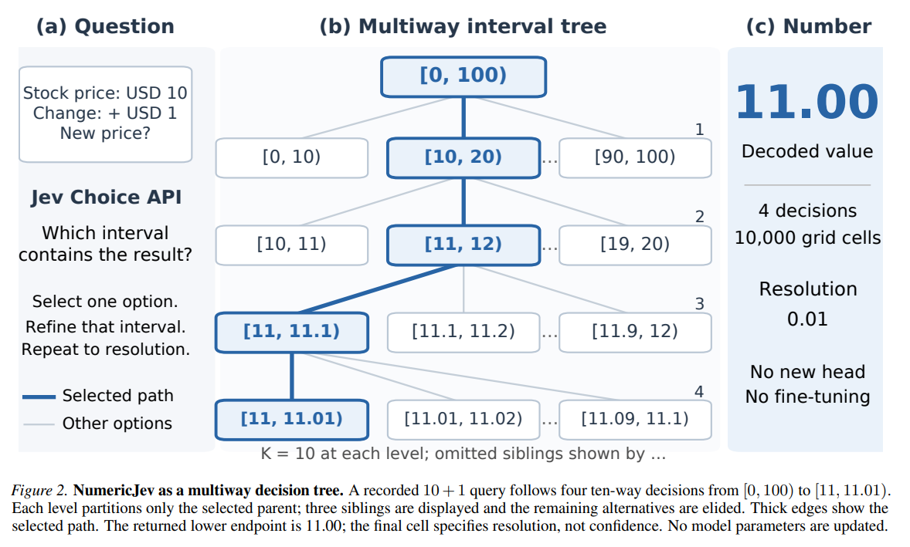

  - <strong>初始化</strong>：将用户指定的范围 [L,U) 按分辨率 ϵ 离散为 $N=(U−L)/ϵ$ 个单元格，索引区间为 [0,N)；

  - <strong>多路细化</strong>：在每一层，将当前索引区间划分为至多 K 个子区间，构造自然语言描述的候选区间，调用 Jev-like 接口选择包含目标的子区间；

  - <strong>终止</strong>：当区间长度为 1 时，返回该单元格的下端点 $\hat{y}=L+ϵa$；

  - 该算法<strong>无需模型训练、无需访问隐藏状态</strong>，仅利用现有的结构化选择端点；

---

### 5.2.8、数据面横切：训练数据与配方生态

在读出路线之外，真正拉开各个方案差距的往往是<strong>标签从哪来</strong>。把主要各仓的数据做法横切出来，能看到三条数据哲学：

- <strong>结论</strong>：<strong>数据组成 \> 训练时长，任务结构匹配 \> 表层词汇重叠【LLM2Jev证实】；</strong>

- 就可信度上来讲：最诚实的仓库都在主动公布失败与反例，可信度最低的仓库（metask-jev 2星、verdict-2.0）在自定义留出集上产出数字、对照基线引自他人套件！

> <strong>选择实现时，其是否主动公布失败案例比是否宣称 SOTA 更能反映可信度</strong>
> 
> 

|仓库|标签来源|训练成本|诚实度信号|
|---|---|---|---|
|Laya|自报合成 + 真实客服分布混合；<br>RLCD 奖励不依赖人工标签；|RLCD 配方完整开源|明确报 Banking77 高基数失败（0.425）|
|Kev|4B 完整训练约 \$1（H100）|LoRA r16|工程教训（Gated DeltaNet 掩码泄漏）|
|Nimble|对比式数据整编：改焦点事实翻转标签、删证据变不可知，去重后 2676个样本训练，324个样本留出|LoRA r16，9B|双集预注册协议拟合温度，主动声明 Score 题型 ECE 反升|
|jevk5|蒸馏（教师生成标签）|4B/9B LoRA|上独立 JevBench 板（v0.2 读数时点列第 2/76 系统；2026-10-05 v1.4.2.2 榜快照 JevK5 v0.2.0 列第 5、62.04 分，见 §8.1.1），密封 308 题上未胜出（33.1 vs Jev 36.7）也公布了|
|LLM2Jev|全部公开人工标注集（不用教师合成标签），13-gram 污染去重|4×A100，Reason-9k 约 41 分钟|主动说明“纯意图数据训整 epoch 反而 81.4→76.2”的过拟合反面教材|
|open-spark-jev|自建数据工厂|DGX Spark<br>|两条 RLCD 实验均变差、未发布 checkpoint<br>|
|agent-jev|合成（Qwen 系教师 + 规则）|598M 全参|配 case 级 bootstrap 95% CI，为既有 37 仓中唯一：对 Laya +2.25pp|
|reflex|不训练，靠读出技巧|\$0|负面发现（4 套 LoRA + 27B 教师蒸馏只在分布内赢）当主要优势|

---

### 5.2.9、下游应用：Agent 怎么调这些决策端点

- <strong>定位</strong>：读出路线（A–E）与服务路线（F）之外，还有一层 <strong>怎么把决策端点接进 agent 工作流</strong>的消费层 —— 它<strong>不发明模型</strong>，但决定 typed decision 能不能真用起来；

- 仓库信息：

| 仓库| 用途| 关键信息| 来源|
|---|---|---|---|
| <strong>hermes-jev-skills</strong>| 将 Jev 封装为 agent skills，让 agent 在分支点调 typed decision 而非自由文本<br> | MIT，1,013星，9 天 +25%（消费层增长最快）<br>    <strong>把 Jev 包成 agent 的"技能"</strong>：让 agent 在岔路口调用它做判断、而不是自己乱写文本；是消费层里涨得最快的| github.com/kerpopule/hermes-jev-skills|
| <strong>QuantDinger</strong>| 交易操作系统，将 Jev 接入 live/paper trading| Apache-2.0 后端，12,435星（stars 最高的 Jev 集成项目，<strong>非复现模型</strong>）；专设 legal notice 节声明不提供投资建议、live trading 默认 paper-only 需双重授权| github.com/OpenByteInc/QuantDinger|
| <strong>llm-typesafe</strong>| llm CLI 单文件插件<br> | Apache-2.0，19★，最轻入口| github.com/simonw/llm-typesafe|
| <strong>daf-jev</strong>| provider 注册表 + confidence gate + 熔断 + 贝叶斯网| MIT，6★，“多后端路由”样板| github.com/docxology/daf-jev|
| <strong>jev-codex-router</strong>| 将 Jev 作为 agent 路由后端| 该尝试已被 owner 放弃维护| 官方|

- <strong>小结</strong>：决策端点正在从“研究玩具”变成 <strong>agent 运行时的一个原语</strong>——但接进生产前要解决<strong>confidence gate、熔断、授权、paper-only 这些运维问题</strong>，而不是模型本身！

---

## 5.3、各实现路线的对比

- 官方 Jev 契约白盒、架构黑盒：对外仅暴露 HTTP+JSON 的 Choice/Score/Noul 形状，骨干、读出头、confidence 公式全未公开；

- 【<strong>Archer Hume《Jev's Architecture Unmasked》</strong>】约一万次的调用仅能确定性的逆向出“因果骨干 + 共享 state 前缀 KV + listwise 选项交互 + 常数时间数值读出”的判断；

- 训练走 RLCD —— 以严格适当评分规则为奖励让模型报真实概率，但奖励组成、采样算法、数据规模全部未公开 —— 尽管恰当性评分规则相关理论已经被研究的很透彻，但怎么用起来还不明确；

- 关于开源方案的复现，在复现判别式决策能力的同时，更多关注的是一些边界问题：生产级稳定、成本与并发、审计与校准！

如下按照核心架构的维度，对这些路线进行对比【注意，各个标准与测试条件不一致，相互比较无意义】：

|路线|代表实现|读出位置|是否训练|校准机制|延迟量级（自报硬件）|生态代表 stars|
|---|---|---|---|---|---|---|
|官方黑盒|Jev API|未公开（逆向：数值读出头）<br>|RLCD（配方未公开）|RLCD（闭源）；confidence 公式未公开|70–500ms（官方）；第三方 p50 \~236–276ms|—|
|A 双向编码器+头|Laya / von / verdict|`[MASK]`/Option-Marker 锚点隐状态 → 打分头|RLCD（Laya）/ CE+Brier（von）|按(题型×选项数)温度桶 + 直方图分箱（Laya）；<br>条件温度（von）|T4 单问 33–40ms；M3 Max MLX 7.4–13.4ms；<br>ANE 4.98ms|31k / 839 / 293|
|B 解码器+字母读出|SemIf / LLM2Jev / kev / jevk5|下一 token 位置的选项字母/数字 id logits softmax|零训练（SemIf/LLM2Jev/reflex）/ LoRA（kev/Nimble/jevk5）|每负载/每 checkpoint 温度；SemIf 自认 uncalibrated|RTX3090 1.023s(21判据)；<br>H100 Kev-4B 12.9–18.1ms；<br>H100 jevk5 13.2ms|4.7k / 392 / 8.4k / 135|
|C 决策头变体|agent-jev / Astro-Han|候选末 token 隐状态 → 置换等变/RLCD 头|软CE+0.1Brier（agent-jev）/ RLCD（Astro）|每原语正标量温度（agent-jev）|\~60–70ms/5问；宽候选共享前缀 299ms|338 / 6|
|D 扩散画布|openjev (DiffusionGemma)|mask 答案槽的画布去噪分布|零训练（服务层）|1−H(p)/ln K（模型自身分布）|示例 44ms（单次读数）|601|
|E 视觉/多模态|AnyJev / Visual Jev / PixelJev / PlayJev|共享视觉前缀 + 候选 token logits / 像素→动作概率|零标签 L0 / 闭式头 L2（AnyJev）；LoRA（PixelJev）；SFT+DAgger（PlayJev）|百级标签温度（AnyJev L1）；held-out 温度（PixelJev）|RTX5090 共享批 5.7ms/题（Visual Jev）；<br>H200 PlayJev 43ms/步|1k / 48|
|F 服务形态|laya-mlx/coreml / openjev-sglang / receptron|复用上游权重读出，无新机制|不训练（运行时）|继承上游温度（laya-mlx 钳制[0.5,5]）|ANE 4.98ms；ONNX Node \~140ms(CPU)<br>|6.8k / 1.5k / 337 / 770|
|数值解码|NumericJev|黑箱 Choice API 叠多叉区间树|不训练（算法层）|不用概率，只取 argmax 区间|100格 K=10 仅 2 轮决策||

---

### 5.3.1、各路线数据架构流图与适用

如下为开源七路线数据流并排对照图（输入 → 骨干 → 读出 → 输出）：

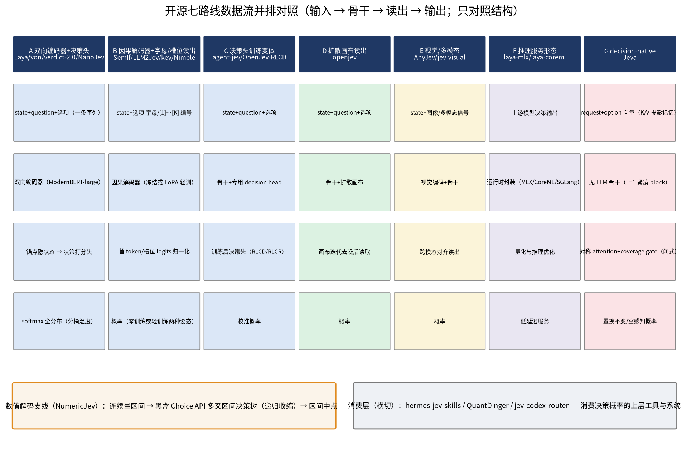

各个路线的适用边界如下所示：

|路线|最适合|不适合|关键约束|
|---|---|---|---|
|A 双向编码器|端侧/低延迟、上下文短（≤8k）、选项数 ≤20|长上下文、高基数（\>26 选项；26 = 英文字母数，SemIf 单 token 字母读出的上限）|选项多则每选项 token 预算被摊薄（Laya 77-way 仅 0.425）|
|B 字母读出|希望零成本先行验证、复用现有 LLM|\>26 选项（字母上限，26 = 英文字母数）、<strong>要校准概率</strong>|字母单 token 约束；SemIf 自认 uncalibrated|
|B 前缀自由（LLM2Jev）|高基数（77/151-way）、想新基座即插即用|要精确校准（强基座微调反而负迁移）|trie 切词引入新偏置<strong>（MMLU-Pro 选项 10 被赶到选项 1）</strong>|
|C 决策头变体|要架构级顺序不变、宽候选|要快速上手（需重训小模型）|agent-jev 598M 全参；Astro 数据覆盖敏感|
|D 扩散画布|想验证非自回归读出可行性<br>|<strong>生产（质量未达官方）</strong><br>|DiffusionGemma 26B-A4B 质量须自评|
|E 视觉/多模态|同图多问、UI 选择、GUI agent<br>|单图单问低延迟（共享反成负担）|Visual Jev 5.7ms/q 是 amortized 吞吐非独立延迟|
|F 服务形态|已有权重、要上线|想改读出机制|继承上游所有校准/质量局限|

结合架构与适用边界来看比较典型的两个路线：

- 路线 A 用 ModernBERT-large 双向编码器（395M）把 state+问题+所有选项打成一条序列，每个选项由 `[MASK]`/Option-Marker 锚点定位，抽锚点隐状态过小型打分头 softmax；一次前向读完全部选项、无自回归解码 —— 

  - 训练分支1：Laya 走 RLCD（log+0.5·spherical−1.0·RPS 复合奖励、GRPO 组基线、logit 层高斯探索退火）

  - 训练分支2：von 走 listwise softmax CE+Brier 监督、不走 RL，并在编码器内做选项 position id 重启获得顺序不变性；

  > 适用边界：
  > 
  > - 端侧/低延迟、上下文短（≤8k）、选项数 ≤20；
  > 
  > - 高基数（\>26 选项）时每选项 token 预算被摊薄；
  > 
  > 

- 路线 B 保留因果 LLM 骨干、不生成文本，在指定读出位置取 next-token logits，把选项映射成单 token 标签（字母 A/B/C… 或 `[1]…[K]` 前缀自由数字编号）做 softmax；零架构改动，任何能出 next-token logits 的 LLM 都能当决策端点：

  - 内部也分为不同路线：SemIf/reflex/LLM2Jev 冻结基座零训练，而kev 加 rank-16 LoRA+pointer head进行训练；

  - 关键见解来自 LLM2Jev 论文，其实证表明 4B 强基座上冻结读出 81.4% 与微调社区模型基本打平，但进行全参微调反而产生了负面效果（JevBench 81.4→76.2、ECE 0.057→0.116），仅小基座（0.6B Banking77 22.2%→59.8%）与高基数路由能从微调显著受益；

  > 适用边界：
  > 
  > - 希望零成本先行验证、复用现有 LLM；
  > 
  > - 字母读出受 26 选项上限（LLM2Jev prefix-free 打破到 77/151-way）；
  > 
  > - SemIf 自认 uncalibrated，须在自己负载上校准；
  > 
  > 

---

### 5.3.2、对架构原生路线的单独说明（G）

上图列出了7条路线，比5.2的详细介绍多了个架构原生的路线，该方案（Jeva）与其他路线不同：

> 论文：<https://arxiv.org/pdf/2610.18773> 《Jeva: System One Models from First Principles》
> 
> 项目：<https://github.com/LiQiiiii/Jeva>
> 
> 

- 其他路线有一个共同前提：<strong>先有一个 LLM/BERT 骨干，再在上面叠加读出/校准/服务工序；</strong>

  > - 拿一个现成 LLM（比如 Qwen、Llama）作为骨干；
  > 
  > - 决策问题：给定一条请求`request` + 候选选项集合`{option₁,option₂,…,option_K}`；
  > 
  > - 把问题序列化塞进 LLM（prompt 拼接、把选项排成文本列表）；
  > 
  > - 再加一层后处理工序：打分读出、偏好校准、多顺序投票 / 平均、reflex 双向顺序平均、旋转去偏（AnyJev L0）等；
  > 
  > 

- 而该方案则不<strong>改造 LLM、也不借 LLM 骨干，</strong>而是从第一性原理原生设计决策模型，从而在架构层面闭式满足四条公理：置换不变、选项可扩展、null-aware、可缓存；

---

具体来讲，其出发点基本直击现有主流设计（先将请求与所有候选选项拼接为单一文本序列，再通过语言模型的自回归 logits 或专用预测头读取决策）的痛点：

- <strong>缺乏空感知（Null-aware）</strong>：

  - 模型无法明确区分“没有候选答案适用”与“在现有候选中难以抉择”；

  - 仅对候选分数做归一化（如 softmax）无法判断答案是否真正存在；

- <strong>违反排列不变性（Permutation-invariant）</strong>：

  - 决策本应不依赖于候选的呈现顺序，但序列化输入使模型受到位置偏差影响，改变选项顺序可能导致预测翻转；

  > LLM 天生是序列生成模型，它对顺序敏感！因此换选项顺序，LLM 的输出偏好可能翻转（decision flip，决策翻转）；
  > 
  > 

- <strong>选项可扩展性不足（Option-scalable）</strong>：

  - 基于固定答案符号表或特定输出头的设计，使得增加候选数量时必须重新定义输出空间，难以自然支持可变大小的候选集；

- <strong>计算不可复用（Cacheable）</strong>：

  - 候选内容（如工具描述、文档、标签）往往在跨请求中重复出现，但联合编码将可复用的候选表示与请求特定计算耦合，导致每次重组候选集或更换请求都需重新编码全部上下文；

---

因此，Jeva 提出了原生决策模型架构要同时满足的 4 个硬性性质：

- <strong>Permutation-invariant 置换不变</strong>：选项打乱顺序，最终选择 / 概率分布不变，不能出现换顺序就换答案（0 flip 就是这个指标）；

- <strong>Option-scalable 选项可扩</strong>：候选数量 K 可以是 2、16、2048、上万，输出空间不用重新定义，不用重新训练；

- <strong>Null-aware 空感知</strong>：区分<strong>“候选中有答案、只是不确定”vs“候选里没有答案，应该 abstain（弃权，Noul 输出）”</strong>；

- <strong>Cacheable 可缓存</strong>：选项向量是请求无关的、不变的，同一个 option 可以提前编码缓存，多个不同 request 复用这套 option embedding，大幅降延迟；

基于此论文提出了原生架构，但实验与数据并未交叉验证过，目前仅做参考：

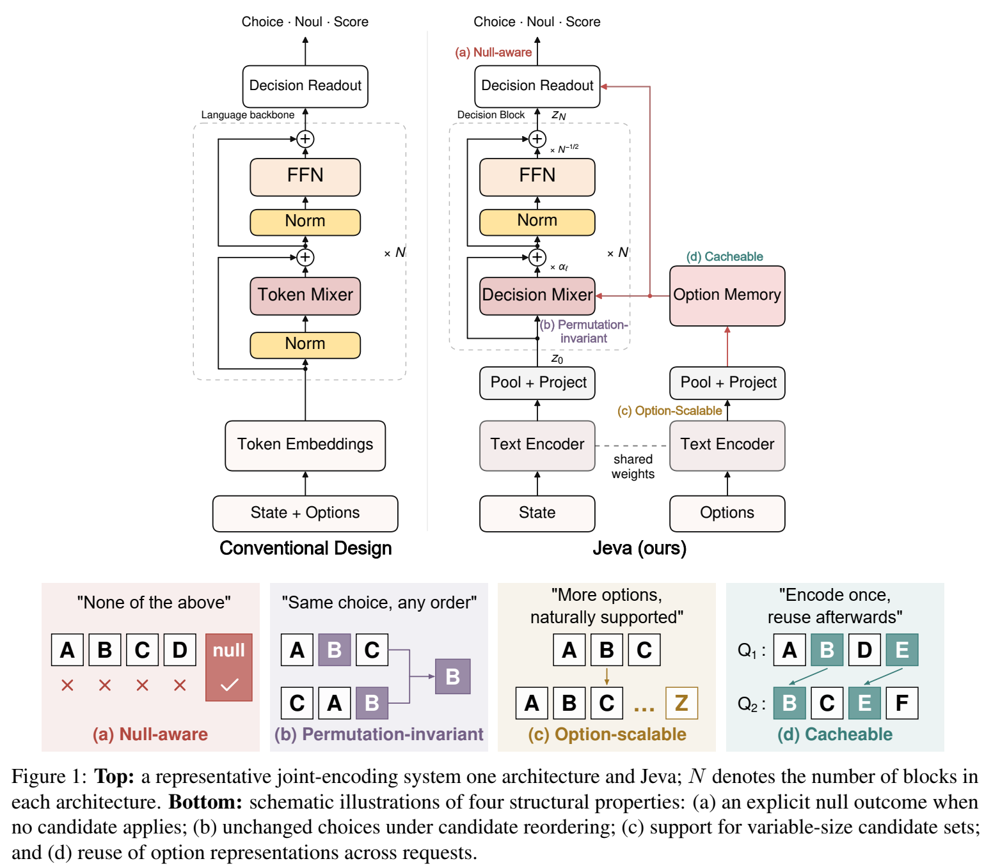

---

### 5.3.3、架构解读与差异

将开源路线与5.1的逆向结果进行对照，可以提炼出多条核心机制差异，分为六个核心维度：选项序敏感性与去偏方案、共享状态 / KV 缓存实现、读出位置与能力瓶颈、概率校准范式、“输出免费” 的工程内涵、黑盒 / 白盒路线分工。另外由于零训练方案的特殊性，这里会单独对零训练读出的三个分支进行对照。

【概览表如下】

|对比维度|核心现象|分支 / 方案划分|关键结论与备注|
|---|---|---|---|
|选项顺序敏感性 & 去偏|原生 LLM 对候选顺序敏感，会出现决策翻转；<br>官方 Jev 自带 listwise 选项交互；|- 后处理去偏：SemIf、AnyJev L0、jevk5、reflex<br>- 架构级置换不变：von1.2、agent-jev|后处理需要多次 prefill；<br>架构方案单次前向，但改动侵入模型结构；|
|共享 State / KV 复用|统一目标：<br>- 共享前提表征、减少重复编码；<br>- 底层载体随模型范式变化|官方 Jev、agent-jev、Visual Jev、kev、openjev-sglang|是 “并行独立评估” 的工程落地；<br>kev 因掩码问题退回到逐行编码；|
|读出位置 & 性能瓶颈|新增读出 head 带来的增益有限，基座与数据才是主变量|LLM2Jev 对照实验，路线 A（重训编码器）、路线 B（冻结解码器）|微调不一定正向，reflex 发现微调存在性能陷阱|
|概率校准|原始读出概率天然不可信，校准必须独立环节|RLCD 系（官方、Laya）、分桶温度系（Laya、jevk5、Nimble）、SemIf 无校准|全局单一温度不适合异构任务；<br>不存在免费的校准置信度；|
|“输出免费” 工程含义|读出为常数时间；<br>自回归生成开销巨大|统一共识：决策端点禁止生成 token|System One（读出决策）和 System Two（生成）的成本分界线|
|黑盒 vs 白盒路线|黑盒侧重生产并发延迟；<br>白盒侧重可审计可控|官方 Jev（黑盒）、全部开源谱系（白盒）|读出机制逐渐开源，黑盒壁垒转移到 RLCD 配方、训练数据|
|零训练读出（不动权重）|三类零训练读出各有取舍，支持组合使用|SemIf、LLM2Jev、AnyJev L0|低成本验证首选；<br>候选规模、去偏能力、计算开销三者权衡；|

---

#### （1）选项隔离 vs 乱序敏感：两种去偏范式

逆向分析显示，官方 Jev 原生存在 listwise 选项交互：即无关选项的注入会改变原有选项之间的概率比值，选项之间相互作用、互相影响打分。

开源社区对此分化为两条技术路线，目标一致（<strong>消除选项顺序带来的决策翻转</strong>），但代价完全不同：

- <strong>后处理去偏路线</strong>：接受底层模型天然的乱序敏感特性，通过多次推理、重排候选顺序再聚合结果抵消偏差

  - 代表方案包括 SemIf 旋转、AnyJev K 次循环旋转（L0）、jevk5 淘汰制、reflex 双顺序平均；

  - 其中 AnyJev L0 原生需要 K 次 prefill，依靠 adaptive\_shifts 把平均轮次从 18 次压缩至 7.2 次，在 vLLM 上实现 2.2× 决策吞吐提升【见论文 2610.00831】。

- <strong>架构级保证路线</strong>：修改模型结构，从数学层面实现置换不变 / 置换等变，单次前向即可规避顺序偏差。

  - 代表为 von 1.2（选项 token 仅关注前提与自身、重置 position id，乱序翻转率由 49.5% 降至 0%）、agent-jev（置换等变候选头）；

---

#### （2）共享 State 的实现：工程实现收敛，载体不同

官方方案的共享逻辑是复用 state 前缀 KV 缓存；各类开源实现虽然底层载体不一样，但在设计目标上也都高度收敛：<strong>状态只计算一次，供多个查询分支复用</strong>，这也是官方 “并行独立评估” 能力在开源工程上的落地形式。

- 具体来讲：

  - 解码器架构（causal LLM）：依靠 KV Cache 复用；

  - 双向编码器：依靠单次前向得到共享表征；

  - 扩散类方案：画布只读复用。

- 典型实例：kev（state KV 缓存复用，因 Gated DeltaNet 掩码泄漏回退至逐行编码）、agent-jev（共享前缀减少 92.4% 冗余 token）、Visual Jev（共享视觉前缀，吞吐提升 8.9 倍）、openjev-sglang（radix 缓存预热）；

---

#### （3）读出位置决定能力上限：基座与数据优先于新增 Head

LLM2Jev 的受控实验给出了一个反直觉的结论：在 4B 强基座上，新增自定义候选头、指针头或者维持原生字母读出，在 JevBench 上的性能差距很小；冻结式字母读出 81.4%，和微调社区模型的成绩基本持平。真正约束决策准确率的是<strong>基座规模、训练数据组成，而不是新增读出头结构</strong>。

该结论解释了路线 A（重训编码器）与路线 B（冻结 / 轻训解码器）在基准上经常互有胜负、反复打平，同时印证 reflex 提出的负面结论：<strong>盲目做微调反而容易落入性能陷阱</strong>【见论文 2610.02076】。

---

#### （4）校准是显式工程，不存在天然校准读出概率

所有路线基本达成一个共识：<strong>读出得到的原始概率不能直接等同于可靠置信度，校准必须作为独立环节显式处理，而不是训练动力学或者调整温度系数就能免费获得</strong>。

具体做法上：

- 官方 RLCD：将校准目标直接写入奖励函数，完整配方未公开；

- Laya / OpenJev-RLCD：对齐 RLCD 的训练范式做复现；

- kev、Nimble、jevk5、agent-jev、PixelJev：基于留出集做温度缩放；

  - <strong>社区普遍观察到单一全局温度无法适配异构任务负载</strong>：比如 Nimble 在部分题型上 ECE 反而上升；Laya 采用“题型 × 选项数量”分桶温度；jevk5 使用双温度机制；

- SemIf：<strong>明确标注读出概率不可直接作为决策置信度（uncalibrated）；</strong>

总结来讲，没有哪个方案宣称读出输出天然经过校准，这是 第3章 底层机制在架构层面的直接体现。

---

#### （5）“输出免费”：不只是定价策略，是架构边界

单从输出Token免费来看，似乎是商业成本问题。但更深层次的本质是技术架构问题：<strong>即决策读出属于常数时间操作 —— 这实际是模型与技术架构的外在工程化与商业化体现。</strong>

上述的六条路线基本共享一条规律：<strong>决策端点不做自回归文本生成</strong>。

- 生成哪怕一个 token 都会带来显著开销，社区对照数据可见：SemIf 的 JSON 生成路径耗时 5.332s，而读出路径仅 1.023s，生成式路径被各个方案视作低效基线；

- 这实际是 System One 快速决策与 System Two 慢速生成在工程成本上的分界线；

---

#### （6）黑盒与白盒：工程化选型与商业化的方案差异

- 官方 Jev：黑盒服务，架构、训练配方、置信度公式均不公开；但核心优势为低延迟（70–500ms）、生产级并发能力；

- 开源谱系：白盒方案，权重、读出逻辑、校准流程完全可审计；但代价是每个实现通常只覆盖官方契约的一个子集。

在产品化/商业化选型上：

- 如果追求短期分工稳定：侧重生产稳定性、高并发选择黑盒；需要自主掌控数据、校准策略、硬件部署的选择白盒；

- 但目前边界正在松动：SGLang 官方 decisions 端点、vLLM prefill-only 栈开始原生支持白盒读出，<strong>黑盒差异化壁垒正在从 “读出机制” 转向封闭的训练数据、RLCD 奖励配方</strong>；

---

#### （7）【扩展】零训练读出路线的三分支对照

上述提到的 SemIf、LLM2Jev、AnyJev L0 都属于零训练读出路线，差异仅在修改读出逻辑或后处理逻辑，不更新模型权重。但三者的适用边界不同，可以互相叠加组合（AnyJev 原文指出 L0 旋转去偏可以和 LLM2Jev listwise 打分结合）：

- SemIf：落地最简单；上限受字母集约束（16/26 候选）；

- LLM2Jev：突破候选上限（77/151-way），且 listwise 联合打分在 External macro 上相比逐选项字母 logit 提升 + 3.2 点（p\<10⁻¹²）；

- AnyJev L0：主打顺序去偏，但代价是多次 prefill 推理；

落地建议：<strong>已有 Qwen 基座、想要低成本验证 typed decision 的使用者</strong>，可以优先从该分支起步，先用 SemIf/LLM2Jev 验证可行性，再根据短板评估是否升级到 A/C 路线的重训方案。

---

### 5.3.4、架构层开放问题

综合本章全部证据，仍存在若干机制层面尚无确定结论的开放问题，逐一整理如下：

- K≤255 两阶段打分的内部实现未知

  - 官方仅描述流程为“先独立打分、再显式选择”，但逆向实验 2 观测到选项间存在 listwise 交互，即注入无关选项会改变原有选项概率比（偏移 −0.28）；

  - 若第一阶段确实是独立打分，第二阶段 “显式选择” 以何种方式引入耦合尚不明确：是归一化带来的隐式耦合，还是存在专门的交互层？

  > 当前证据不足，有待官方披露或更高精度的逆向探测
  > 
  > 

- listwise 交互与“并行独立评估”的实现边界尚不清晰

  - 官方承诺 “新增查询不会引发上下文污染（问题间独立）”，但同时选项之间存在 listwise 相互牵引；

  - 二者在逻辑上并不冲突：<strong>问题之间独立，选项之间可以存在交互</strong>；但问题是在两阶段打分中 listwise 交互具体发生在哪一层，开源侧尚未复现官方 K≤255 高基数原生路径；

  > jevk5 分组淘汰、LLM2Jev 的 prefix-free trie 都属于外部近似方案，并非对官方链路的完整复刻
  > 
  > 

- 专用 decision head 是否优于原生 LM-head 读出，收益边界仍存疑问

  - Visual Jev（论文 2609.25845 ）对照实验显示 typed head 不存在一致准确率优势【并不稳定】；

  - LLM2Jev（论文 2610.02076 ）在 4B 基座上验证：增加自定义读出头无法稳定提升指标；

  - 而 agent-jev 的<strong>置换等变候选头</strong>在 Typed Decisions 任务上带来 + 2.25pp 提升（带置信区间）；

  > 多方研究共同指向：在强基座上，专用 head 通常不提升准确率，<strong>其价值在于引入置换等变性、改善校准稳健性</strong>，增益落在鲁棒性维度而非精度；
  > 
  > 

- Gated DeltaNet 循环层如何实现查询隔离有待验证

  - kev 在 Qwen3.5/3.8 上实测发现，该循环线性注意力会忽略 attention mask，无法维持多分支隔离，只能退化为逐行编码；

  - 若官方 Jev 采用同类<strong>混合线性注意力骨干</strong>，如何在复用共享 state 的同时保证不同查询之间严格隔离，目前缺少公开证据，<strong>也是因果混合注意力架构落地 typed decision 的已知障碍；</strong>

- 经过校准的概率能否直接支撑全自动决策，<strong>存在部署层面风险边界</strong>

  - AnyJev（论文 2610.00831）直接证明：ECE 从 0.240 优化至 0.095 后，在≤5% 错误率约束下可自动决策的占比由 7.7% 提升至 52.0% —— <strong>实际上校准的工程价值，不在于概率数值好看，而在于提升免人工复核的决策占比；</strong>

  - 但 Visual Jev、PixelJev 同时也给出警示：<strong>输出校准概率不等于 “答案正确概率”，当信息不足时模型依旧可能高置信输出；</strong>

  > 直接教训：<strong>上线部署需要额外叠加业务侧风险阈值控制，不可直接采信概率；</strong>
  > 
  > 

---

【汇总表格如下】

|开放问题|核心矛盾|已有证据|待验证方向|
|---|---|---|---|
|K≤255 两阶段打分内部实现|官方宣称先独立打分，逆向检出 listwise 选项耦合|耦合来源未知，无法区分归一化耦合 / 独立交互层|细粒度探针逆向、官方技术披露|
|listwise 交互与并行独立评估边界|问题间独立、选项间交互逻辑可共存，但交互层级未知|jevk5、LLM2Jev 均为外部近似，无官方高基数链路复刻|定位 listwise 交互所在层级、复现原生高基数路径|
|专用 decision head 收益定位|专用头是否稳定优于原生 LM-head 读出|Visual Jev、LLM2Jev：无准确率增益；<br>agent-jev：提升鲁棒性 / 等变性；|跨基座、跨任务对照，区分精度、校准、顺序鲁棒性|
|Gated DeltaNet 循环层查询隔离|共享 state 复用和多查询隔离存在冲突|kev 实测掩码失效，只能逐行编码|验证 DeltaNet 类线性注意力的分支隔离方案|
|校准概率驱动自动决策的边界|校准提升自动决策比例，但置信幻觉风险仍在|AnyJev 给出自动决策占比提升数据；<br>多个论文警示不等于正确性概率|业务侧风险阈值、条件风险校准工程化|

---

### 5.3.5、总结

||内容|
|---|---|
|概括|官方 Jev：架构黑盒、契约白盒的生产级 typed decision 服务；<br>开源生态迅速归纳出“读出位置 × 骨干 × 是否训练”三维设计矩阵，矩阵每个格子均存在可运行实现|
|三大收敛共识|- State 只计算一次，多查询分支复用（KV 缓存 / 共享前缀 / 视觉缓存）；<br>- 决策端点不做文本自回归生成，采用常数时间读出； <br>- 概率校准属于独立显式工程，无法天然获得；|
|三大持续分歧|- 顺序去偏：后处理多次平均 vs 架构原生置换等变<br>- 强基座是否需要微调：多数证据倾向不需要<br>- 专用 decision head 价值：提升准确率，还是仅提升稳健性（主流证据支持后者）|

---

<a id="ch06"></a>
# 6、训练方法与数据：范式分类与数据组织【参考】

> 相当于综述论文当中的“框架”\~\~\~
> 
> 要将一个现成 LLM 变成 TDM 决策模型的具体做法是什么：
> 
> - 各自更新什么参数、用什么损失/奖励、数据从哪来、校准在哪一步做；
> 
> - 仅关注<strong>训练流程、数据配方与工程选择；</strong>
> 
> 

## 6.1、从冻结读出到评分规则 RL 的五类训练方法

公开复现生态内训练方法看似分散，可通过三个核心问题统一归类：

- 是否更新模型参数？

- 使用何种损失 / 奖励信号？

- 训练数据来源是什么？

基于这三个维度，可以把所有实现路线划分成五档范式：<strong>P0 成本最低，P4 为独立的后处理工序。如下所示，实际上大多数的开源项目的工程实现，多为组合范式，并非单一范式支撑。</strong>

|维度|P0 零训练读出|P1 监督头 / 轻量微调|P2 数据中心化|P3 评分规则 RL（RLCD 家族）|P4 后处理校准|
|---|---|---|---|---|---|
|概括|冻结基座，仅修改读出协议<br>|LoRA 替换或新增专用头，CE / 软 CE 监督|资源优先投入数据构造与过滤，常作为 P1/P3 前置|以严格适当评分规则构造奖励做强化学习|冻结模型，在留出集拟合少量标量参数|
|参数更新|否（冻结基座）|少量（LoRA/adapter/ 专用头）|一般不更新参数<br>（一般作为 P1/P3 前置）|更新模型本体 / LoRA|否|
|训练信号|无（前向即推理）；<br>可选负载温度|CE / 软 CE；可附加 Brier 正则|对比对、蒸馏、replay 样本|严格适当评分规则（Brier/spherical/log/RPS）作为奖励；GRPO/PPO/REINFORCE|-|
|数据来源|只需评测集；<br>审计三件套|教师 argmax 标签或软分布标签|多教师交叉核对；公开集 replay；教师合成标注|可验证二元结果，<strong>不需要置信标注</strong>|数百条留出校准集，与训练集同分布|
|<strong>优缺点</strong>|优点：零训练成本；能力上限跟随基座；基座可快速替换；审计友好<br>缺点：原生概率通常未校准（SemIf 原文标注未校准）；对选项顺序敏感；推理延迟随基座线性增长|优点：算力成本可控（Kev 4B 约 \$1）；单卡可训练；推理延迟 10ms 量级；软标签训练自带基础校准<br>缺点：单纯 CE 不保证概率校准，几乎都需要叠加 P4 后校准；判别上限受教师质量与数据集约束；PACT 证明仅改动损失项容易损害稳定性|优点：直接决定判别任务的性能上限；对比对、证书结构可被 PACT 损失复用，数据层与算法层连续<br>缺点：会完整继承教师偏差；合成数据管线实现细节大多不开源|优点：直接优化概率校准目标；理论上收敛到诚实概率；无需昂贵的置信标注<br>缺点：RL 训练不稳定（System-One collapse、score-function 噪声 7–12× pathwise）；<strong>纯 P3 独立成功案例极少（Laya 原文说明需要搭配 P1）</strong>；<strong>不适用于本质随机（aleatoric）任务</strong>|优点：成本极低、快速部署；不改动基座能力；<strong>可叠加在 P0/P1/P3 之后</strong><br>缺点：强依赖留出集分布；分布偏移场景容易失效；<strong>部分题型会出现校准反向恶化（Score 任务）</strong>|
|典型成本|0|单卡小时级|管线人力与算力成本|RL 算力，方差大、稳定性差|分钟级|

【如下为 P0–P4 训练范式坐标系】

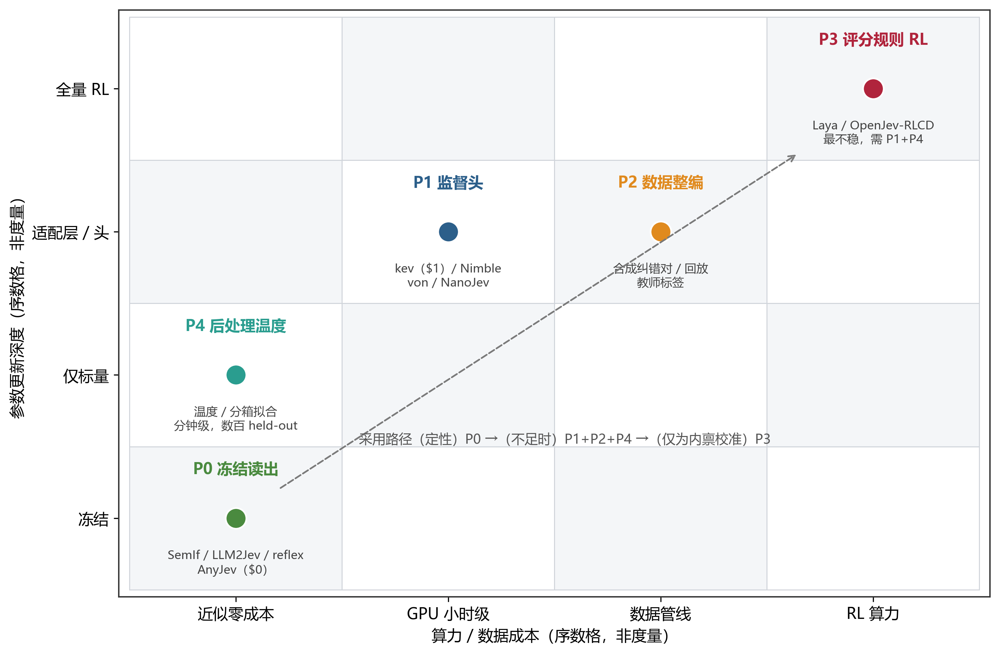

- 横轴为算力 / 数据成本（序数定性），纵轴为参数更新深度（序数定性）；

- 坐标仅用于定性归类，无量纲；

> 通常 P0 → 效果不足再叠加 P1+P2+P4 → 需要内禀校准再引入 P3；
> 
> P4 后处理校准与 P0–P3 正交，可叠加在任何一档之上；
> 
> 

---

### 6.1.1、P0：零训练读出（frozen readout）

- 流程：选取现成因果大模型基座 → 将决策问题序列化，约束答案落在单 token 空间（字母标记 A/B/C 或候选拼接 prefill 打分）→ 在答案位置 logits 上取出对应选项分量做 softmax →（可选）在业务负载上拟合温度系数。

- 全程不更新任何模型参数。

---

关键算法：

- <strong>单 token logit 读出（SemIf 范式）</strong>：

  - prompt 约束模型仅输出单个字母，取首生成 token 位置 logits 向量，提取对应选项 token 分量做 softmax；

  - 强制校验选项必须为单 token、分词边界合法，非法候选直接拒绝；

  > 【[github.com/TheoLeeCJ/SemIf-OpenJev](https://github.com/TheoLeeCJ/SemIf-OpenJev)】。
  > 
  > 

- <strong>prefill-only staged 候选评分</strong>：所有候选共享 state 前缀，先对真实候选构建 Radix 缓存并复用，冷请求也可复用前缀表征【[github.com/Yinsongxu/LLM2Jev](https://github.com/Yinsongxu/LLM2Jev)】。

- <strong>双选项顺序平均</strong>：同一 state 下使用两种候选顺序推理，结果取平均，低成本同时提升准确率与顺序鲁棒性【[github.com/kshetrajna12/reflex](https://github.com/kshetrajna12/reflex)】。

- <strong>分级去偏（AnyJev L0/L1/L2）</strong>：

  - L0 = 每个候选位置循环 K 次推理，对数空间聚合、去除标签先验，零标签消除位置偏置；

  - L1 = L0 + 温度缩放；

  - L2 = 在中间层隐状态闭式求解读出头（100–300 标签闭式求解，非梯度训练）；

  > 论文 2610.00831， [github.com/nokia-applied-research/AnyJev](https://github.com/nokia-applied-research/AnyJev)
  > 
  > 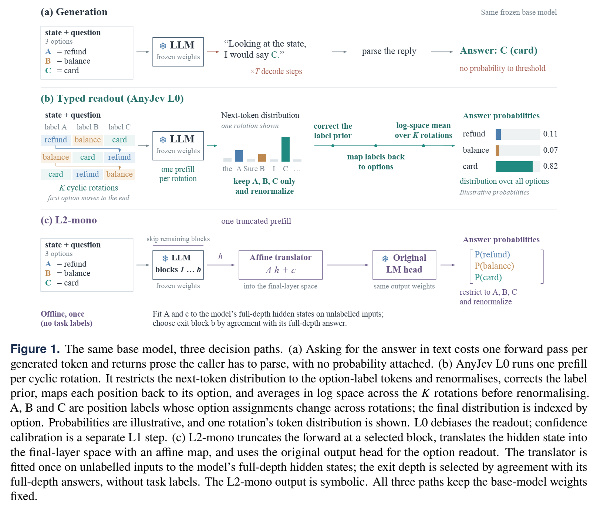
  > 
  > 

---

代表性工作（论文与仓库并列）：

- SemIf-OpenJev（冻结 Qwen3.5-4B）：验证 “只读候选 logit、不做自回归生成” 无需训练；读出路径耗时 1.023s，对比自回归 JSON 生成 5.332s（RTX3090，21 条二值判据）【[github.com/TheoLeeCJ/SemIf-OpenJev](https://github.com/TheoLeeCJ/SemIf-OpenJev)】；

- LLM2Jev（Qwen3.5-4B，SGLang/Transformers/MLX 三后端）：JevBench 公开集 231 项 76.2%，P50 延迟 48ms；对照官方 Jev 1.13.0 P50 652ms【论文 2610.02076 + [github.com/Yinsongxu/LLM2Jev](https://github.com/Yinsongxu/LLM2Jev)】；

- reflex（冻结 Qwen3.5-4B）：把 “是否需要训练” 作为假设验证；

  - 实测 LoRA 混合微调、27B 教师蒸馏仅在分布内提升性能，长模糊输入场景下泛化能力下降，最终上线冻结读出方案；

  - JevBench public hard ECE 0.081；MMLU1200 题温度校准后 ECE 由 0.090 降至 0.039

  > [github.com/kshetrajna12/reflex](https://github.com/kshetrajna12/reflex) 
  > 
  > 

- jev-visual：将范式拓展至多模态，共享 prefill、fork 缓存图像 state，无训练、无内置校准声明

  > [github.com/hr98w/jev-visual](https://github.com/hr98w/jev-visual)
  > 
  > 

如下为基于当前资料梳理的P0 读出协议谱系：

|读出形态|实现方式|去偏手段|代表项目|
|---|---|---|---|
|单 token 字母 logits|Prompt 约束输出单个字母，取首 token 选项分量 softmax|单 token + 分词合法性校验|SemIf、jevk5（蒸馏后）|
|prefill-only staged 评分|候选共享 state 前缀，Radix 缓存复用|staged candidate scoring|LLM2Jev、openjev-sglang|
|双选项顺序平均|同一输入两组候选顺序推理，结果取平均|顺序平均|reflex|
|截断层 + 闭式头|截断至中间隐状态，闭式解读出头|L0 旋转去先验 / L2 闭式头|AnyJev L0/L1/L2|
|多模态 fork 缓存|共享 prefill，分支缓存图像 state|无原生去偏|jev-visual、LLM2Jev 多模态|

---

优缺点与适用场景： 

- 优点：零训练成本；性能上限跟随基座能力；基座可随时替换；审计友好（SemIf 固定版本、prompt SHA256、原始 logits 随结果输出）。 

- 缺点：原始读出概率通常未校准（SemIf README 明确标注返回概率是候选条件概率，需要业务侧校准）；天然对选项顺序敏感；延迟随基座规模线性上升。 

- 适用：快速验证方案、低校准要求的路由场景、在已有大模型部署上低成本附加决策能力；

  - reflex 的结论具备规范意义：它是通过受控对照证明，在其测试分布上微调反而损害泛化，确立了<strong>优先跑零训练基线，再判断是否投入训练</strong>的工程范式【[github.com/kshetrajna12/reflex](https://github.com/kshetrajna12/reflex)】；

---

争议点：零训练读出是否 “够用”

- SemIf、reflex 认为冻结读出已经接近官方 Jev 水平、微调容易损害泛化；另一派（LLM2Jev）则报告了 4B 基座零训练读出经后处理后 ECE 可达 0.057【2610.02076】；

- <strong>分歧根源在校准定义与测试负载</strong>：

  - SemIf 输出的是<strong>未校准条件分数，</strong>而 LLM2Jev 的低 ECE 结果是在自有负载、叠加后处理得到；

  - 当切换到异源 / 困难负载时，Nimble 在 Score 题型上出现了 ECE 反弹、Laya 对于高棉文高置信错判 —— 这预示着零训练概率不能直接作为置信度；

- 共识：<strong>P0 适合想法验证与路由，一旦要将概率用于自动化决策，必须叠加 P4 业务侧校准</strong>；

---

关于 AnyJev 方案：其去偏是<strong>按标签量阶梯投入的方</strong>案：

- L2 在中间隐状态闭式求解读出头（100–300 标签闭式求解，开销低于一次前向）。实测 LocalLLaMA typed-decisions 基准：Qwen3-4B（24/36 截断）0.786、Qwen3-32B（52/64 截断）0.798，高于官方 Jev 的 0.727【论文 2610.00831 + [github.com/nokia-applied-research/AnyJev](https://github.com/nokia-applied-research/AnyJev)】；

- <strong>工程启发：</strong>冷启动决策端点时，可以<strong>随可用标签量逐步增加投入</strong>：L0 零标签消除位置先验 → L1 <strong>百级标签温度缩放</strong> → L2 闭式头，不需要一开始就训练基座；

---

### 6.1.2、P1：监督头 / 轻量微调（SFT）

- 流程：准备 (state, question, 选项集，标签) 样本 → <strong>冻结基座 + LoRA / 替换专用头（pointer head / 候选头 /slot softmax）</strong>→ 交叉熵或软交叉熵训练（可增加 Brier 正则）→ 留出集选最优 checkpoint →（几乎总是搭配 P4 温度拟合）。

- 核心设计原则：<strong>按输出统计结构设计读出头</strong>

  - 如 NanoJev 将决策头拆分为三类，和官方 Jev Choice/Score/Noul 三原语对齐：

  - Choice：2–255 候选，共享打分标量 + set attention + softmax

  - Boolean：单命题，sigmoid 输出真概率

  - Ordered Score：2–10 档有序评分，期望加权支持非整数档位

  > github.com/TianyuCodings/NanoJev
  > 
  > 

- 将 proper scoring 写进 SFT 损失，也在置信度相关工作当中有所体现：

  - ConfTuner（论文 2508.18847）：改造了 Brier 损失用于 verbalized confidence，$\ell(q,y)=\sum_i q_i(y-i/N)^2$，属于把校准纳入监督损失、而非依赖后处理的最轻方案；

  - PACT（论文 2609.35865）：则对单 token typed-decision 的目标进行改进，直接替换 Nimble 推理后端，将总损失设置为 $L=L_{CE}+0.5L_{CF}+0.5L_{PC}+0.2L_{NR}+0.3L_{EMD}$，其中反事实 pair margin $L_{CF}$、证据缺席无偏约束 $L_{NR}$是核心，论文实验移除$L_{NR}$后 flip rate 由 8.0% 上升至 17.6%；

  > 结论：PACT 不提升主指标准确率（84.6 vs Nimble 85.2），收益在于顺序偏置、有序 rubric 误差、种子稳定性；
  > 
  > 

---

P1 代表单元汇总：

|项目|读出 / 头结构|损失函数|
|---|---|---|
|kev|Qwen3.5 + LoRA r16 + pointer head|正确答案交叉熵，基座冻结<br>|
|decider|Qwen3.5 各尺寸 + 答案槽隐向量投影|交叉熵微调|
|openthai|Qwen3.5-0.8B，移除 vision encoder，LM 头替换 256 路 slot softmax|CPT 预训练 → 决策 SFT → 后校准|
|NanoJev|Qwen3-0.6B，三分支决策头：Choice softmax / Boolean sigmoid / Score 期望加权|标准交叉熵，备 Brier/paired-reward 变体|
|PlayJev|Qwen3.5-0.8B-Base 全量微调，像素→动作概率|行为克隆 SFT（1epoch lr2e-5）+3 轮 DAgger|
|von|ModernBERT-large + Option-Marker 头，选项间零注意力泄漏|listwise softmax CE + Brier|
|agent-jev|Qwen3-0.6B 移除 LM 头，置换等变候选头|软交叉熵 + 0.1× 候选求和 Brier|

---

P1 的两条重要工程教训：

- <strong>多问打包在 Qwen3.5/3.8 上失效（kev 事后回顾）</strong>：

  - 理想方案将 state + 多问题拼成单序列，block-causal mask 隔离问题；但 Qwen3.5/3.8 内 Gated DeltaNet 循环线性注意力会无视 mask、跨分支信息泄漏；

  - 工程回退方案：<strong>每个问题独立成行、state KV 只计算一次并复用；该方案和 Jev 逆向形态概率差 \< 4e-6</strong>【官方

  > 仓库 [github.com/jaredpalmer/kev](https://github.com/jaredpalmer/kev)，所有在 Qwen3.5/3.8 做多分支并行决策必须阅读！！！
  > 
  > 

- <strong>必须先证明微调优于零训练基线再投入训练（decider）</strong>：

  - decider 使用现成 instruct 权重 + 仅拟合温度的零梯度基线，在 Decision Index 上排 \#2/\#8，而训练后的 4B/2B/35B 专训模型反而低于基线；

  - 项目指出：`the base model sets most of the score`

  > - [github.com/Mapika/decider](https://github.com/Mapika/decider)
  > 
  > 

  - 这个教训基本和 reflex 结论互相印证：<strong>P1 的增益不是天然存在，必须对照“冻结基座 + 读出 + 温度”基线验证；</strong>

---

优缺点与适用： 

- 优点：成本可控（kev 4B H100 训练约 \$1）、单卡可训练，延迟可做到 10ms 级别，软标签训练自带部分校准属性；

- 缺点：

  - 性能上限由教师与数据覆盖决定；

  - 单纯 CE 不保证校准，因此几乎所有 P1 方案都搭配 P4；

  - PACT 对照显示纯 CE 训练稳定性差，附加结构损失才可以修复；

- 适用：业务分布稳定、计划自建小决策模型的团队；规范流程为先跑 P0 基线，验证微调正向收益再训练。

---

### 6.1.3、P2：数据中心化（data-centric curation）

- P2 不是特定损失函数，而是<strong>预算优先投入数据构造，而非网络结构</strong>的工程立场。

  - 绝大多数 P1、P3 项目都将其作为前置工序。

  - 它把生态里核心 know-how（数据构造方案）显性化，也是 decision-head-rlcd 受控实验 “泛化来自数据而非算法” 之后，社区形成的共识。

- 流程：构造对比样本对 → 多教师交叉标注 → 公开集 replay → 合成 / 教师标注 → 过滤查重 → 按 case 划分训练 / 验证集。

- 目前的方案汇总：

| 项目| 数据工序| 规模| 标注与来源说明|
|---|---|---|---|
| Nimble| 对比式四步法：<br>    - 修改焦点事实翻转标签；<br>    - 删除证据后答案不可知；<br>    - 过滤、去重；| 2676 训练 / 324 留出；Choice 856/146、Noul 888/114、Score 932/64| 全部模型自标，无人工复核|
| jevk5| 双教师蒸馏（Qwen3.6-27B + GPT-6 Luna）交叉核验；<br>    公开集 replay| 17408 教师题 + 30052 replay 样本，26 种公开划分| replay 仅使用训练划分，对 test/val 做 8 词查重|
| decider| 公开集混合 + Qwen3.5-27B 本地教师标注| \~95 公开集 + 形状增强| 27B 教师标注与通用标注一致性仅 72%|
| metask-jev| 教师软标签合成 + 等价视图增强，同一 state 多视图共享软标签| 配方未公开；<br>    13 子集宏平均 79.6%| 管线骨架公开，详细合成方案 withheld|
| PACT| 复用 Nimble 对比对 + 证书结构，转化为无需新增标注的损失| 2676 记录 /1338 pair /34 source family；<br>    holdout 324/162 pair| 不新增标注，消费已有对比数据集|

  - Nimble 对比式整编的机制：目标是迫使模型学习判别证据，而不是表面文本捷径

  - 首先在同一段 state 内修改≤8 个词的焦点事实，构造标签翻转样本对；

  - 然后删除任意一条证据，答案应当变为不可知，给每个 pair 附带机器可校验 certificate；

  - 普通 CE 独立看待单样本，无法利用 pair 和 certificate 结构；

  > 类似的，PACT 正是把该结构转化为$L_{CF}$（pair margin）、$L_{NR}$（证据缺席约束），P2 数据结构和 P1 损失函数在这里衔接。
  > 
  > 

- <strong>优缺点与定位：</strong> 

  - 优点：直接决定判别上限；只要可以获取教师模型就可以落地；对比对、证书结构可以被 PACT 这类损失复用，数据与算法衔接。 

  - 缺点：教师偏差会完整继承；agent-jev 备注：榜单提升不等于业务效果提升；decider 自曝教师标注不一致；Nimble 全自标，存在模型系统性错误重复风险；合成管线是各家核心壁垒，很多 builder 不开放。

  - <strong>定位：P2 不是可选项，是 P1/P3 的前置必要环节。</strong>

---

### 6.1.4、P3：适当评分规则强化学习（RLCD 家族）

> 这里需要先强调：
> 
> - P3 是官方 Jev 采用路线（RLCD = Reinforcement Learning for Calibrated Decisions），但官方只公开了训练目标，完整方案是闭源的，且 RLCD 仅是 TypeSafe 的产品命名；
> 
> - 与之同源的学术方案包括：
> 
> - RLCR（Brier 惩罚 GRPO，论文 2507.16806）；
> 
> - Rewarding Doubt（对数评分 PPO，论文 2503.02623）；
> 
> - 相应的开源实现包括 Laya、OpenJev-RLCD、decision-head-rlcd 尽管都自称 RLCD，但也仅仅是共享严格适当评分的数学内核，在具体的奖励构成、数据组织以及训练细节上均有差异。
> 
> 

- 公开的复现流程：模型输入 (state, question) 输出分布q → 使用严格适当评分规则（Brier / 球面 /log/RPS），基于可验证真值y计算奖励 → 策略梯度更新（GRPO/PPO/REINFORCE）→ 收敛后叠加温度缩放。

  > 之前数学基础3.2节已经证明了：严格适当评分规则的期望最小化不动点就是真实概率。
  > 
  > 

- RLCD 家族方案汇总表如下：

| <strong>单元</strong>| <strong>奖励组成</strong>| <strong>RL 算法</strong>| <strong>数据/规模</strong>| <strong>公开程度</strong>|
|---|---|---|---|---|
| <strong>Jev 官方（闭源）</strong>| 官方声明以严格适当评分规则做校准决策训练| 未公开| 官方称全合成数据| <strong>目标公开、配方未公开</strong>|
| <strong>Laya</strong>| $Reward = (S_{\log}+0.5\,S_{\mathrm{sph}}-1.0\,S_{\mathrm{rps}})$（log/球面/RPS 三适当评分）；<br>    logit 层高斯探索、每组 G=8、σ 1.0→0.3<br> | GRPO 式组基线 $A_i=R_i-\bar R$<br>$L=-\mathrm{mean}(A\log p)$<br> | Kaggle 免费 2×T4 上 DDP| 奖励公式与 σ 调度，详细说明见：<https://dev.to/nandakishor\_m\_6cc0adfde9f/i-built-non-autoregressive-decision-models-a-year-ago-then-a-frontier-lab-called-it-a-18me>|
| <strong>OpenJev-RLCD</strong>| shifted Brier $J(u,y)=2u_y-\|u\|^2$；<br>    两阶段：stage1 pathwise 梯度训读出，stage2 REINFORCE| score-function，c=0.3，leave-one-out 基线，KL anchor β=0.04<br> | Qwen3-1.7B；ChaosNLI/MMLU-Pro/GSM8K-Verify；每任务 400 步×3 seeds| 论文：2609.38850 + github.com/ZimmyGao/openjev-rlcd|
| <strong>agent-jev（监督式近邻）</strong>| 软 CE + 0.1× 候选求和 Brier，Brier 作为 SFT 正则，非 RL| 监督微调| Typed Decisions| github.com/malevrigns/agent-jev|
| <strong>decision-head-rlcd</strong>| RLCD：对选项字母 logits 加高斯噪声作动作、leave-one-over-8 作基线| RLCD one-pass| Qwen3.5-4B + <strong>4.9M LoRA(r8)</strong>，32000 条 typed decisions，lr 5e-5 / 2000 步；<br>    三 seed 固定算法、只变数据覆盖度| github.com/Astro-Han/decision-head-rlcd|
| <strong>RLCR（学术版）</strong>| $R_{RLCR}=\mathbb{1}[y=y^*]-(q-\mathbb{1}[y=y^*])^2$（Brier 惩罚）| GRPO| Qwen2.5-7B / HotpotQA| 论文：2507.16806|

---

<strong>【深入解析与原理】</strong>

- <strong>基于严格恰当打分规则（proper scoring rule）的校准强化路线（RLCD/RLCR）</strong>，它和普通 0/1 二元奖励 RLVR/GRPO 构成一组核心对照：<strong>二者都使用可验证的答案正确性作为监督信号，但优化目标完全不同，直接决定模型是 “学会答对” 还是 “学会诚实报出真实胜率”</strong>。

  - <strong>恰当打分规则（proper scoring rule）</strong>：只有当模型输出的置信概率等于这件事真实发生频率时，期望奖励才达到最优；谎报高置信、刻意保守都拿不到最优分；

  - 经典：对数分（log score，无界）、Brier 分（平方误差，有界）、球面分；

  - <strong>0/1 二元奖励不是恰当打分规则</strong>—— 它只奖励最终对错、不惩罚过度自信，天然鼓励模型押极端概率【2507.16806，RLCR】

  - <strong>两种不确定性</strong>

  - 认知不确定性（epistemic）：模型知识不足、推理链条有缺口；可以通过多路径推理、增加 rationale 消除，适合 P3 校准路线;

  - 偶然不确定性（aleatoric）：任务本身存在标注分歧、答案不唯一；上限由标注噪声决定，此时再做 RL 校准收益有限，<strong>最优目标退化为普通交叉熵 CE 监督;</strong>

- P3 路线的核心论据及其实规则选型：

  - 核心论据：<strong>P3 不追求显著拉高准确率，而是在准确率持平前提下，大幅提升可控自动放行比例，把置信度从 “后处理补丁” 变成模型内禀属性</strong>。

  - 在选择打分规则上，【2503.02623】Rewarding Doubt 选用对数打分（log score）：

  > 《<strong>Rewarding Doubt: A Reinforcement Learning Approach to Calibrated Confidence Expression of Large Language Models</strong>》
  > 
  > - 论文：
  > 
  > - <https://arxiv.org/pdf/2503.02623>
  > 
  > - <https://github.com/pasta99/RewardingDoubt>
  > 
  > - 提出了一种新的强化学习方法，通过将信心估计建模为一个赌博游戏，激励模型在训练过程中学习校准其信心估计。具体来说，模型在给出答案的同时预测一个信心分数，奖励函数根据答案的正确性和预测的信心来计算奖励；
  > 
  > - 奖励函数的形式即为对数分数，论文也通过数学证明，当模型预测的信心 $\hat{p}$ 与实际正确性概率 $p^∗$ 相等时，奖励函数达到最大值，从而优化了完美校准；
  > 
  > 

  - <strong>对数分是严格 proper，但无界</strong>，也就是说<strong>模型可以通过输出接近 0 的置信拿到很好的期望分数、同时放弃答对，存在明确 reward hacking 漏洞</strong>；

  > - <strong>Proper（恰当）</strong>：当真实的信念分布就是 $p^*$ 时，<strong>期望得分最优</strong>的策略就是如实输出 $p^*$。 简单来讲：如果模型内心真实概率是 $p^*$，它不会靠撒谎、篡改概率拿到更高分数，也就是激励对齐 ——<strong>说真话收益最高；</strong>
  > 
  > - <strong>Strictly Proper（严格恰当）</strong>：更强一些，也就是<strong>只有输出等于真实分布</strong>$p^*$<strong>的时候，才能拿到最优期望得分</strong>—— 任何偏离真实信念的概率，期望得分一定变差，不存在多个不同概率都能拿到同样最高分；
  > 
  > - 这是 P3 路线的核心刚需：我们要训练模型<strong>校准不确定性</strong>，而不只是选对答案；只有严格 proper 的奖励，才能从数学上保证：<strong>最优策略 = 诚实输出自身真实置信度；</strong>
  > 
  > - 例子：普通的 0-1 奖励（答对 + 1，答错 0，也就是 GRPO/RLVR 常用二元奖励）<strong>不是 proper</strong>
  > 
  > - 一个事件真实胜率 0.6，模型输出 p=0.9、赌它是 1，期望收益更高；
  > 
  > - 模型有很强动机<strong>过度自信、虚报置信</strong>，这就是为什么普通 RL 容易校准崩坏、ECE 飙升。
  > 
  > 

  > 所谓无界，即得分本身的取值范围没有上下界（或者单侧无界），可以趋向负无穷 / 正无穷；
  > 
  > - 对数得分的二元形式为：\$R(a, \hat{p}, j) = 
  > \begin{cases} 
  > \log(\hat{p}), & \text{if } j(a) = 1 \, (\text{correct}) \\
  > \log(1 - \hat{p}), & \text{if } j(a) = 0 \, (\text{incorrect})
  > \end{cases}\$
  > 
  > - 当模型给真实标签分配的概率 $p \to 0$，$\log(p)\to-\infty$ —— 这就是<strong>严格 proper，但无界；</strong>
  > 
  > - 对数分的两条性质打包：
  > 
  > - <strong>严格恰当 strictly proper</strong>：期望得分 $\mathbb E_{y\sim p^*}[S(p,y)]$ 在 $p=p^*$ 处唯一取最大值；适合做不确定性校准的奖励，理论最优。
  > 
  > - <strong>无界 unbounded</strong>：一旦模型对正确项给出极小概率，损失（负的得分）爆炸，数值上会出现巨大梯度，训练不稳定、方差极高<strong>【这也是上边说的“RLCD / 基于 proper 评分规则的 RL 方差大、稳定性差”的根源！】</strong>
  > 
  > 

  - 后续工程选型（RLCD、RLCR）优先换成 Brier、球面这类<strong>有界 proper score</strong>，在诚实校准和任务正确率之间做约束平衡；

  - 【扩展】和 Brier 得分做对照：

  > Brier 得分（布里尔分）：$S(p,y)=-(y-p)^2$
  > 
  > - 严格恰当
  > 
  > - <strong>有界</strong>：二元场景得分区间 $[-1,0]$，不会爆炸
  > 
  > - 代价：Brier 是二次的，尾部低概率区域的梯度强度弱于对数分，对极端不确定性的区分能力弱于对数得分
  > 
  > 

| 得分规则| Strictly Proper| 有界 / 无界| 核心取舍|
|---|---|---|---|
| 对数得分 Log Score| 是| 无界| 理论最优激励；尾部梯度爆炸、RL 训练震荡难收敛|
| Brier 得分| 是| 有界| 激励稳健、工程友好；对极小概率事件区分力度偏弱|
| 0/1 二元奖励 (GRPO)| 不是| 有界| 只优化准确率，鼓励虚报置信，校准效果差|

> 严格 proper = 数学上激励模型不要吹牛、如实报概率；
> 
> 无界 = 一旦猜错且极度不自信，惩罚会无限大，训练很难稳住;
> 
> 

  - 【2507.16806】RLCR 则在二元正确性奖励之外叠加 Brier 校准项，属于<strong>有界 proper score，进一步实验修正了</strong>一个流传很广的片面认知：

  > <strong>“0/1 奖励 RL 一定会恶化校准” 只在分布外 OOD 平均意义上成立</strong>；在同分布 in-domain 场景，RLVR 也有可能小幅降低 ECE；
  > 
  > - <strong>RLCR 是这批方案里唯一在 OOD 同时保住准确率、显著改善校准的方案；</strong>
  > 
  > 

  - <strong>【2609.38850】</strong>OpenJev-RLCD 指出当前的置信度校准当中的两条主流路线存在局限性，并解释了为什么流行的多样本验证 RL（RLVR/GRPO）会破坏校准、鼓励矛盾推理，提出了一个“Calibrate-then-Reinforce（先校准，再强化）”的两阶段的稳定 RLCD 工程流程；

  > 现有 GRPO/RLVR 用混合打分，数学上自带奖励虚假分歧的项，造成过度自信；如果换成理想的单推理 Brier 打分直接端到端训练，模型又会走捷径抛弃推理、直接输出保守分布（System‑One 坍缩）；为此本文提出先冻结推理、校准读出头，再放开推理做 RL 的两阶段 RLCD 方案；消融实验（命题 1、图 1）验证了失效机理，主表格在数学、MMLU-Pro、GSM8K 上验证，这套方案可以得到既会推理、置信又诚实的模型，大幅提升选择性预测指标。
  > 
  > 

  - 当前两条主流路线的局限

  - <strong>SFT + 事后温度缩放（Temperature Scaling）</strong> 监督微调之后，单独用温度参数抹平置信分布。 

  - 缺点：属于事后补丁，没有从推理过程本身学习不确定性；分布偏移、分布外场景很容易失效。

  - <strong>基于可验证奖励的 RL（GRPO / RLVR / STaR）</strong> 奖励只有二元：答案对 = 1，错 = 0，在同一个 prompt 上采样多条推理，对样本集合打分。 

  - 核心结论：这种<strong>对混合样本分布打分（mixture objective）</strong>，数学上自带一个方差奖励项：<strong>它会奖励多条推理互相矛盾、结论不一致 —— 模型学会 “故意猜得不一样” 拿奖励，推理质量崩坏，越训越盲目自信！</strong>

  - 论文用方差恒等式证明：RLVR 本质就是这个混合目标，只是去掉了显式多样性项：

  > 如果用“多条推理先混起来、再打分”（混合目标，GRPO/RLVR 的做法），总收益天然可以拆成两块：
  > 
  > 1. 第一块：每条推理单独打分的平均分（这部分是我们本来想要的）
  > 
  > 2. 第二块：<strong>方差奖励</strong>—— 只要不同推理给出的答案分布不一样，就能白拿额外收益
  > 
  > 也就是说，对一批推理样本先平均再打分，等价于：给平均表现打分，外加一笔 “鼓励大家互相唱反调” 的奖励，随机乱猜分歧也能赚奖励 —— 这将导致策略只要随机给出不一样的结论，就能拿到这笔加分！
  > 
  > 

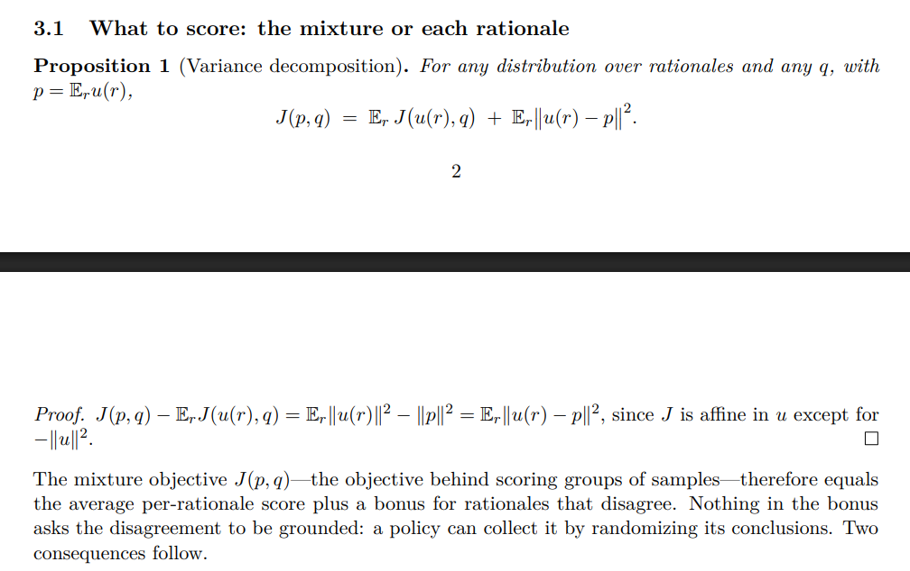

                    

  这解释了典型现象：<strong>二元奖励抹除了不同推理路径之间分歧的奖励项，</strong>模型梯度会单向推向 one-hot 极端分布，也就是过度自信；

  > 通俗理解：只要猜对就拿满分，模型没有任何动力去说 “我把握不大”；它会快速学会赌一个答案、报很高置信；
  > 
  > 

  - <strong>核心理论与核心失效模式</strong>（对两种不同的打分范式进行了分析）：

  - 范式 A：混合样本打分（GRPO/RLVR）【论文命题 1】

  - 对同一个问题，采样多条推理 $r_1,r_2,...$，把所有推理后的答案分布混合成一个混合分布再打分：$J(\mathbb{E}_r[u(r)]) = \mathbb{E}_r[J(u(r))] + \mathrm{Var}_r(u)$

  - 左边：混合目标（GRPO/RLVR 实际优化的目标：先把多条推理的分布取平均，再打分）

  - 右边第一项：每条推理单独打分的均值（我们想要的单推理目标）

  - 右边第二项：方差 bonus，<strong>对推理之间的分歧进行奖励</strong>

  - 额外多出的方差项 $\mathrm{Var}_r(u)$给出的奖励，不区分分歧来源：

  - 只要不同推理的结论不一样，就能拿到额外奖励；

  - <strong>不需要这个分歧是合理的，随机瞎猜制造分歧也能获得奖励：</strong>

  - 合理分歧：信息不足、多条推理走不同合法逻辑路径；

  - 虚假分歧：模型随机抖动、无依据猜不同答案；

  - 这样，优化混合目标的策略最优解不是诚实后验（ “每条推理都诚实给出真实后验”），而是主动制造分歧、不一致，最终表现就是<strong>过度自信、校准崩坏</strong>；

  > 结论：<strong>混合打分范式本身在数学上内置了一个偏向矛盾推理的激励，这是 GRPO/RLVR 校准差的根源，不是调参、数据问题</strong>
  > 
  > 

  - 范式 B：单条推理独立打分（RLCD）【及其失效模式】

  <strong>每一条独立推理链 r 单独读出它自己承诺的答案分布</strong>$u(r)$<strong>，单独用严格恰当得分规则（strictly proper scoring rule，论文主要用 Brier 得分）打分</strong>，不混合多个样本。

  - 恰当得分规则的性质：只有当模型输出的概率等于真实后验概率时，期望得分最优；天然鼓励校准。

  - 理论最优：对每一条推理，$u(r)$ = 该推理条件下真实正确概率。

  - <strong>直接裸端到端进行单推理优化有两个工程失败模式：</strong>

  > 论文进行了 System‑One 坍缩实验，在MMLU-Pro上，为每条单独的推理进行Brier打分，端到端联合优化推理生成头 + 概率读出头；每个 prompt 采样 4 条推理，设置了两组对照：有无 KL anchor（KL 约束，约束策略不要远离 SFT 参考模型）
  > 
  > 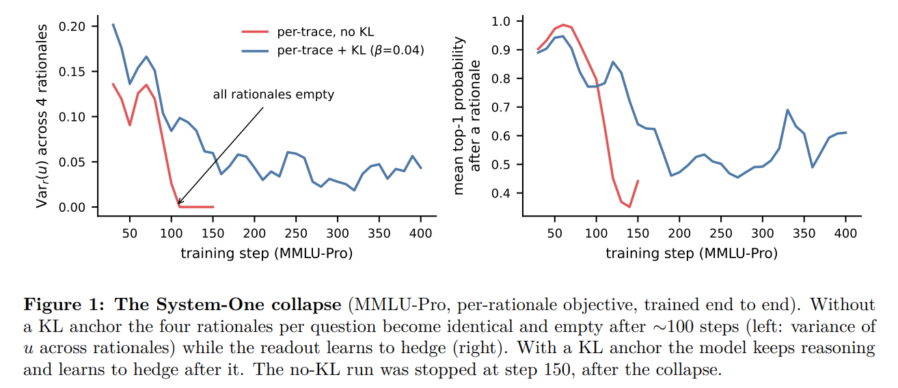
  > 
  > 解读：在没有 KL 锚定项（KL anchor）的情况下，每个问题对应的 4 条推理链，在约 100 步训练后会变得完全一样、内容空洞（左图：不同推理之间u的方差）；而读出头学会了模糊避险（hedge）。 加入 KL 锚定项后，模型能够持续做推理，并在推理完成之后再学会模糊避险。 无 KL 锚定的实验在坍缩发生后，于第 150 步提前终止
  > 
  > - <strong>No KL anchor（无 KL 正则）</strong> 
  > 
  > - \~100 训练步：方差快速掉到接近 0，推理链全部变得简短、无实质推导（System‑One 坍缩：抛弃慢思考 System Two 链式推理，退回直觉捷径）；
  > 
  > - 同步：读出头快速学会 hedge，输出保守平坦分布拿到很好的 Brier 分数；
  > 
  > - 本质捷径：<strong>模型发现不需要做推理，直接输出一个保守分散分布，就能拿到最优奖励</strong>。Brier 得分好看，但推理是空壳，属于伪校准。实验 150 步提前终止。
  > 
  > - <strong>With KL anchor（带 KL 正则）</strong> 
  > 
  > - 方差维持在合理区间，推理保持多样性、保留推理步骤；
  > 
  > - hedge 后置：先完成推理，再由读出头表达不确定性，这是 RLCD 期望行为。
  > 
  > 

  - 策略梯度方差巨大，训练震荡、不稳定；

  - 模型直接学 “放弃推理”，不写思考过程，靠简单分布拿稳定奖励【坍缩、未校准】；

  - 哪怕目标函数选对（per-rationale + proper scoring rule），直接端到端联合训练推理和读出头，依然存在另一个严重捷径：<strong>丢弃推理，直接用平坦分布刷 Brier 指标；</strong>

  - KL anchor 可以抑制这个捷径，但 KL 是一把双刃剑：太强会锁死策略，推理无法优化；太弱抑制不住坍缩；

  > 因此论文提出了分阶段训练配方 Calibrate-then-Reinforce；
  > 
  > 

  - 论文提出了一个两阶段的训练方法：Stage1 先用恰当打分规则把读出头校准到位；Stage2 再低权重 RL 微调（论文配置 c=0.3，β=0.04 的 KL 约束），用 KL 锚守住原有推理能力，防止坍缩；

  > <strong>阶段 1：监督校准阶段（固定推理学习置信输出）</strong> 
  > 
  > 模型生成推理 rationale 之后，训练它读出的后验概率分布符合 Brier 最优； 
  > 
  > - 推理生成策略<strong>冻结不动</strong>，只训练后面的概率读出头 readout；
  > 
  > - 损失：Brier 恰当得分；
  > 
  > 目的：教会模型<strong>在一段推理写完之后，怎么诚实表达自己的不确定性</strong>，先把 “决策头” 校准好，避免 RL 阶段直接崩坏。
  > 
  > - 教会模型：<strong>给定一段固定推理文本之后，如何输出匹配这段推理不确定性的诚实概率分布；</strong>
  > 
  > - 为什么可以防坍缩：推理侧被锁死，模型没有办法删掉推理；它只能在已有推理的基础上学习 hedge；
  > 
  > <strong>阶段 2：RL 强化阶段（优化推理本身）</strong> 
  > 
  > 放开推理策略，继续用同一个 Brier 得分作为奖励（per-rationale，不混合多条样本），去优化推理生成过程； 
  > 
  > - 必须搭配 KL anchor 正则（约束策略不要跑太远，进一步辅助防止坍缩）；
  > 
  > - 优化目标：生成更高质量推理，同时在推理之后维持良好校准；
  > 
  > 目的：让模型学会生成<strong>既能提高正确率、同时又保持置信可信</strong>的推理链，而不是只追求猜对。
  > 
  > 

  方案设计的基本思路：<strong>`先固定推理，把 “什么是合理的不确定性表达” 教给读出头；再去优化推理，此时模型已经知道 hedge 是依附推理的输出，而不是替代推理的捷径`</strong>`。`

> 关键设计：奖励不是 “猜对”，而是<strong>推理之后给出的概率分布本身的统计诚实度</strong>。
> 
> 

  - 通过在 MMLU-Pro（多选知识）、GSM8K（数学推理） 对照实验进行了验证与消融评估：

  - 普通准确率掩盖了置信失效问题，论文核心评价指标是<strong>风险 - 覆盖曲线 AUC（risk–coverage AUC）（在5%的放行错误上限Cov@5%）</strong>：

  > - 覆盖度 coverage：模型敢自动放行多少样本（置信高于阈值）；
  > 
  > - 风险 risk：放行样本里的错误率；
  > 
  > - 好模型：在很低的错误上限下，尽可能放行更多题目；
  > 
  > 

  - 核心结果：

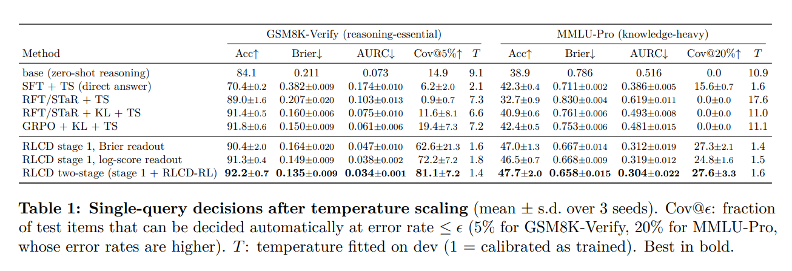

  - 整体准确率：RLCD 与 GRPO、SFT 基线持平或小幅占优，不会为了校准牺牲正确率；

  - 核心指标风险 - 覆盖 AUC：RLCD 显著高于所有基线；

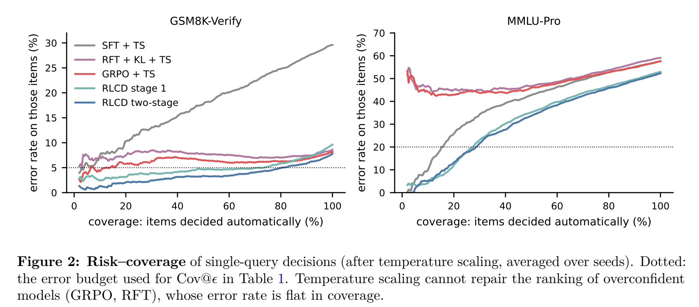

  - GSM8K 定点测试（放行错误率上限 ≤ 5%）：

  - GRPO+KL+TS（0/1 正确性奖励）：Acc 91.8，Cov@5%=19.4%；为勉强校准，后处理温度要拉到 T≈7

  - RLCD 两阶段：Acc 92.2（统计上和 GRPO 接近，没有显著提升），Cov@5%=81.1%；训练结束本身已经接近校准，T=1.4

  > 前提：必须规避图 24 的坍缩。如果直接跑无 KL 端到端 RLCD，表格里这个优势完全消失，模型只会输出空洞推理 + 保守分布，OOD 下风险会失控。
  > 
  > 

  - 消融实验来对打分、训练方式、KL锚点以及评分函数进行消融：

  > - 打分范式：mixture objective /per-rationale objective（验证命题 1）
  > 
  > - 训练方式：端到端联合训练 / Calibrate-then-Reinforce 两阶段
  > 
  > - 是否带 KL anchor
  > 
  > - 是否使用恰当得分 Brier，或二元答对奖励
  > 
  > 

  > 原文结论:
  > 
  > - 核心函数权重（core-function weight）。<strong>表 4：如果不做阶段拆分，只要给得分函数项分配正向权重，效果就会变差</strong>，这和梯度稀释（gradient-dilution）的诊断结论吻合。
  > 
  > 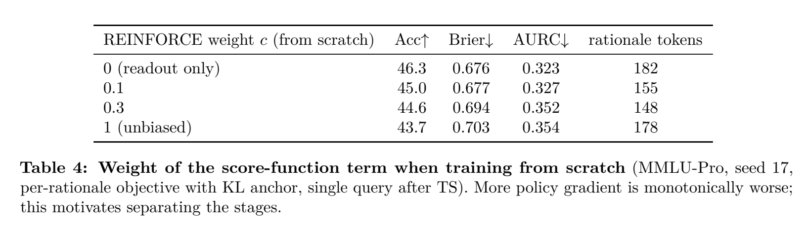
  > 
  > - 只预热读出头是不够的：读出头先训 200 步、再做 200 步强化（两者都从头开始训练），最终性能和只训练读出头的基线持平；表 2 里看到的收益，必须建立在<strong>读出头已经充分收敛</strong>的前提下。
  > 
  > - <strong>由谁来给推理链打分（Who scores the rationale）</strong>：用一份冻结、已经校准好的独立读出头副本打分，而不用策略自身的读出头打分（目的是防止两者互相适配、共谋 co-adaptation），在 GSM8K-Verify 上效果反而更差（随机种子 17：Brier 上升 0.021，AURC 上升 0.030）；表现为推理变短，并且策略自带的读出头变得过度自信。
  > 
  > - <strong>阶段 2 不加 KL 锚定项（No KL anchor in stage 2）</strong>：大约 330 步之后推理发生退化<strong>（模型不再书写推理标记，反复重复结论凑够长度上限）</strong>；基于读出头的奖励本身看不到推理链的格式、结构，因此 KL 锚是必需的;
  > 
  > - <strong>显式概率 RLCD（Explicit-probability RLCD）</strong>：对于没有推理链、直接输出概率打分的模型（直接打分器），带显式分布的 RLCD，其期望梯度等价于 Brier 损失；在 CLINC150、ChaosNLI 数据集上，它始终无法超越交叉熵（CLINC150 准确率 94.6% vs 96.3%）；同一模型上跑 RLVR 则会坍缩到单一主流类别（mode collapse）。
  > 
  > 

  - 同时实验暴露直接联合优化的致命工程问题：

  - policy gradient（score-function 梯度）噪声极大，RMS 是 pathwise 梯度的 7–12 倍，噪声主导训练【原文】；

  > <strong>梯度分解公式（原文 3.1 Estimator）</strong> $\widehat{\nabla}=\frac{1}{M}\sum_{i=1}^{M}\nabla_{\theta}R_{i}+\frac{1}{M}\sum_{i=1}^{M}\Big(R_{i}-\frac{1}{M-1}\sum_{j\neq i}R_{j}\Big)\nabla_{\theta}\log\pi_{\theta}(r_{i}\mid x)$ 
  > 
  > - 第一项：<strong>pathwise 梯度</strong>：对 readout 概率分布的可微梯度，低噪声；
  > 
  > - 第二项：<strong>score-function / REINFORCE policy gradient</strong>：对推理生成策略 $\pi(r|x)$ 的梯度，高方差噪声项。
  > 
  > 

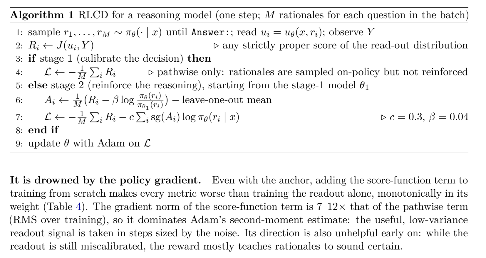

- 不加 KL 锚定（KL anchor）时，100–330 步出现 <strong>System-One collapse（系统一坍缩）</strong>：<strong>模型发现 “不写推理过程、直接输出空 rationale 再猜答案” 更容易拿到奖励，推理链条直接退化，变成无脑打分器，放弃思考【原文图1】；</strong>

  - 标注分歧的特殊实验：

  论文在ChaosNLI数据集上，通过实验证明：当任务本身的不确定性来自标注分歧（没有客观标准答案，标注者之间互相不一致）：

  - RLCD 目标在数学上无法超越交叉熵；

  - 模型会自主学到：继续推理不会降低不确定性，主动停止推理，不再继续消耗算力做无效思考；

  > On a task whose uncertainty is annotator disagreement, the same objective provably cannot beat cross-entropy and, left alone, discovers that it should stop reasoning.
  > 
  > <strong>任务本身就不存在能被推理消除的真值时，恰当得分规则引导模型主动停止推理，是 RLCD 想要的、符合理论预言的正常行为！</strong>
  > 
  > 

  - <strong>原文的边界问题：</strong>

  - RLCD 不能凭空消除任务本身固有的不确定性；它只能<strong>如实表达当前推理下的不确定性</strong>。标注分歧场景，它会停止推理，而不是强行猜一个确定答案。

  - 两阶段方案比 GRPO 工程更复杂：需要分开维护校准阶段、RL 阶段，调参面更大；KL 强度、Brier 权重、阶段切换时机都是敏感超参。

  - <strong>不是所有场景都优先 RLCD：如果你只追求最高 top1 准确率、不需要置信和人机分流，GRPO 更简单，速度更快。</strong>

  - 分布外（OOD）性能依赖推理本身；如果推理在 OOD 下直接失效，RLCD 只能表达 “我不确定”，不能凭空产出正确答案。

  - 本文仅在 Qwen3-1.7B 小模型上验证；大模型上的行为是否一致，尚未验证。

  - <strong>对这些方法的对比简表与论文核心结论：</strong>

  - 结论 1：不能不拆分阶段，不能直接联合加权（core-function weight）

  - 机理：当推理生成头 + 读出头一起优化时，Brier 奖励对读出头的优化更简单、回报更快；梯度会优先流向读出头去刷平坦避险分布，推理支路的梯度被稀释、几乎学不到东西。

  - 本质：<strong>联合优化是天然不稳定的，不是调一个 loss 权重就能修好的</strong>；这就是为什么论文不推荐简单加权，必须强制分阶段。

  - 结论 2：不是简单 “先训一会儿读出头，再 RL” 就行，读出头必须充分收敛

  > 浅预热（各 200 步）只能追到 “只训读出头” 的水平，拿不到表 2 里的超额收益。
  > 
  > 

  - 很多人会猜想：两阶段只是一个简单热身，稍微启动读出头就可以切 RL，论文消融否定了这个猜想。

  - 配方硬性约束：<strong>阶段 1 必须把读出头训练到收敛，让它稳定掌握 “给定一条推理，该输出什么样的诚实分布” 之后，再放开推理做 RL</strong>。 如果读出头还没学明白 hedge 的规则就提前切强化，后续 RL 没法把推理推向高质量、校准一致的方向，增益消失。

  - 结论 3：打分器不能换成独立冻结读出头（反直觉消融）

  > 设想的安全方案：单独训一个校准好、固定不动的读出头，拿它给策略的推理打分，避免策略推理和自己的读出头互相串通共谋（co-adaptation）。 实验结果：效果变差，推理变短、策略自身读出头重新过度自信。
  > 
  > 

  - 论文原本的假设是：独立打分器更客观，防止共谋捷径；

  - 失败原因：<strong>打分读出头和策略推理的分布存在偏移，</strong>策略生成的推理风格，和独立冻结读出头见过的推理分布不匹配；打分信号对策略是 “外来、异构” 的，无法引导推理和置信配套对齐。

  - 最终工程选择：<strong>用策略自己配套的读出头来给它自己的推理打分</strong>（也就是论文主方案），接受存在轻微共谋风险，但收益更高。

  - 结论 4：哪怕已经做了两阶段，阶段 2 依然离不开 KL anchor

  > 就算读出头已经收敛，放开推理做 RL 的时候，如果去掉 KL 约束，330 步左右推理退化：不再写思考标记，循环复述结论凑长度。
  > 
  > 

  - 关键点：<strong>Brier 奖励只评估最终输出的概率分布，它不看推理文本长什么样、有没有真的推导</strong>。奖励函数本身对推理格式、思考步骤是盲的。

  - 对比图 24：图 24 是无 KL、不分阶段快速坍缩；这里是分阶段了、读出头收敛了，但阶段 2 去掉 KL，依然会出现另一种退化捷径 —— 维持长度但内容循环空洞。

  > 推论：KL 在这里的作用不是只防早期坍缩，而是在 RL 阶段持续约束语言生成行为，强制模型维持推理格式、有效思考结构。
  > 
  > 

  - 结论 5：RLCD 的价值，依赖<strong>推理链 rationale</strong>这个载体；无推理直接输出概率的版本竞争力弱

  > 去掉思维链，让模型直接输出类别概率（explicit-probability RLCD）：数学上梯度等价 Brier 损失； 在 CLINC150、ChaosNLI 这类分类任务上，准确率低于普通交叉熵； 同时 RLVR 在这个无推理设置下直接模式坍缩。
  > 
  > 

  - 论文消融划定了 RLCD 的适用边界： RLCD 不是一个通用替代交叉熵的分类损失；它的核心增益来自<strong>“先生成推理，再基于这条推理表达不确定性”</strong>这套结构；

  - <strong>如果任务本身不需要链式推理、只是简单分类，直接交叉熵更稳更好。</strong>

  - 附带对照：RLVR 在这种无推理场景下更拉胯，直接坍缩到高频类别

| 方法| 打分范式| 奖励核心| 天然倾向/失效模式| 适合场景|
|---|---|---|---|---|
| GRPO / RLVR| 多条推理混合分布打分| 答案二元对错| 奖励虚假分歧，过度自信，校准崩坏；<br>            校准崩坏，选择性预测很差| 追求纯准确率、不依赖置信|
| SFT + 温度缩放| 单样本，交叉熵训练，事后修正| 拟合标注| OOD、复杂推理下校准失效，不确定性不是推理内生| 简单分类、不需要强自动放行<br> |
| 裸端到端 RLCD（per-rationale，无约束）| 单条推理独立 Brier 打分| 恰当得分（Brier）| 两类失效模式：System‑One 坍缩，推理空洞、伪校准| 几乎不可直接使用|
| 本文 Calibrate-then-Reinforce RLCD| 单条推理独立 Brier 打分，两阶段| Brier 恰当得分| 置信和真实风险对齐；但工程复杂，超参敏感；无法消除任务固有不确定性，需要先校准预热| 人机分流、自动审批、风控 Agent，要求可信置信|

            

> 【总结】P3 路线依赖<strong>严格恰当得分规则（strictly proper scoring rule）</strong>构造奖励，保证最优策略为如实输出置信分布。
> 
> 典型代表对数得分满足严格恰当性：仅当模型输出和内在真实信念一致时，期望奖励最大；但其代价是<strong>无界</strong>：当模型给真实标签分配趋近于 0 的概率时，奖励趋向负无穷，梯度剧烈爆炸，这也是该范式训练方差大、稳定性难控制的底层数学原因。
> 
> 工程上常用 Brier 这类有界严格恰当得分做折中，换取训练稳定性，但牺牲了低概率区间的分辨能力。
> 
> 

---

<strong>边界问题：</strong>

- 边界 1：当不确定性是标注本身分歧（aleatoric），P3 路线失效

  - OpenJev-RLCD ChaosNLI 实验：数据集样本本身没有唯一标准答案，标注者天然不一致。 此时 per-rationale 恰当打分目标的理论期望等价 Brier 梯度，性能上限和普通 CE 几乎持平（JSD 0.075 vs CE 0.074）；模型最优策略就是<strong>关掉推理增益、不再做多路径思考</strong>。

  > 论文的配套实验：同一个 Stage1 校准好的 checkpoint 继续续训
  > 
  > - 0/1 GRPO：破坏已有的校准，温度从 1.4 反弹到 3.8，Brier、AURC 同步变差
  > 
  > - RLCD proper-score RL：+1.8 准确率、−0.035 Brier 
  > 
  > 再次实证：二元奖励不是恰当打分规则，它的优化目标和 “诚实概率” 本身冲突。
  > 
  > 

  - <strong>指导价值 —— 先区分不确定性来源：</strong>

  - epistemic（模型不知道，推理能补齐）→ 适合 P3 RLCD/RLCR

  - aleatoric（标注分歧、问题歧义）→ 直接用 CE 监督，不要上 P3 RL，投入没有收益

- 边界 2：开源复现项目 Laya、decision-head-rlcd 暴露的落地短板

  - Laya 项目（[github.com/NandhaKishorM/laya](https://github.com/NandhaKishorM/laya)）是 P3 路线一个典型的 “边界案例”，它证明纯 RLCD 不是绝对有效的，依然依赖 P1 轻量微调：

  - 原始 RLCD 零样本能力弱：typed-decisions 0.362/0.352，甚至低于多数类基线 0.461；项目自述 “Fine-tuning is where most of the value is”；RLCD 主训练之后，必须追加 P1 式任务头微调。

  - 微调后指标：Acc 77.0% / Brier 0.062 /raw ECE 0.213；温度校准后 ECE 降到 0.081；但是软分布匹配指标 0.471，显著弱于 Jev 0.580。

  - 高基数分类短板：Banking77，Laya 0.425 vs Jev 0.870；根源是 Option Scorer 头的候选 token 预算限制，高类别任务空间下表达不足。

  - 分布外跨语言风险：英文 checkpoint 直接跑高棉文任务，raw acc≈0，但置信度依然输出 0.952；项目原文原话：<strong>confidence gating cannot save you</strong>—— 置信门控不能解决分布漂移，它只能在训练分布内生效

  > 配套工程解法是前置轻量 router（\<0.5ms）分流到对应语种 checkpoint，而不是指望置信本身泛化。
  > 
  > 

  - decision-head-rlcd（[github.com/Astro-Han/decision-head-rlcd](https://github.com/Astro-Han/decision-head-rlcd)）进一步揭示数据结构的隐性约束：固定基座、算法、超参，只改变留出集和训练数据结构。

  - 同分布留出集：0.955

  - 缺失长策略结构的留出集：0.32，甚至低于未训练基线 0.47；Brier 同步恶化（0.342→0.378） 

  > 结论：<strong>窄分布、结构单一的数据训练出来的校准头，对未见过的推理结构是负债；准确率涨了，但更容易过度自信</strong>。
  > 
  > 

---

<strong>优缺点与适用边界：</strong>

- 优势

  - 目标直接对准概率校准，不是 ECE/Brier 这类代理指标；理论最优就是诚实概率分布

  > 同时对齐排序准确率 + 概率校准，是部署侧风控、自动放行、拒绝机制最需要的能力；
  > 
  > 

  - 不需要人工标注置信度，仅依赖可验证的二元结果 y，适配自动验证闭环

  > 摆脱昂贵的置信标注，只用可验证二元反馈，适配大量自动化评测、工具校验场景；
  > 
  > 

  - 产出内禀置信，而不是推理结束之后用温度缩放、Platt 缩放这类事后补丁

  > 学习到的是原生决策分布，不是事后修正，在分布偏移场景下鲁棒性通常优于固定后处理
  > 
  > 

- 硬约束（也是目前生态里纯 P3 成功案例偏少的原因）

  - RL 训练不稳定：<strong>System-One 坍缩、policy 梯度方差巨大，必须两阶段 + KL 约束</strong>

  - 奖励函数、超参组合各家实现差异大，很多细节属于未公开工程黑箱

  - <strong>存在严格适用域：只适合 epistemic 不确定性、依赖多路径推理的决策任务；标注分歧主导场景收益枯竭</strong>

  - 几乎没有独立自闭环的案例：Laya、OpenJev-RLCD 都必须和 P1（微调 / 换头）组合使用

- <strong>局限、不适合的场景</strong>

  - 仅追求简单选择题正确率、不在乎置信度好坏：直接 GRPO（0-1 奖励）性价比更高；

  - 预算极小、不能跑 RL：优先 P0 零训练读出或者 P4 温度校准；

  - 反馈噪声很高、二元标签本身不可靠：PSR 会把标签噪声直接编码进概率，校准反而崩坏；

  - 对长链条多步决策、不可验证开放式输出：PSR 奖励难以构造，P3 基本不可用；

---

### 6.1.5、P4：后处理校准（post-hoc calibration）

P4 属于模型训练完成之后独立追加的校准工序：冻结模型全部权重，仅在预留的校准集上拟合少量标量参数（绝大多数是温度 T，也有分桶温度、线性条件温度、独立置信头），于推理部署阶段作用于模型输出。

典型如温度缩放是对 logits 做单调变换，<strong>不会改变 argmax 选出的候选，因此不会颠覆模型原有决策结果；但其能力边界同样清晰</strong>：仅当模型本身对候选的排序大体可靠时，校准才能生效，一旦测试分布相对校准集发生漂移，就需要重新拟合参数。正如 Reflex 项目【<strong>github.com/kshetrajna12/reflex</strong>】总结的核心教训：温度缩放只能修正过度自信问题，本身无法提升模型的判别能力。

> 温暖缩放：$\text{new}_{logit} = \frac{\text{logit}}{T}$
> 
> - $T>1$：logit 被拉平，置信度被压低，缓解过度自信（绝大多数 Jev 项目的场景）
> 
> - $T<1$：logit 被锐化，置信度拉高，容易变得更自信（也就是后面 Laya 移植踩坑的情况）
> 
> - 关键数学性质：除以同一个正数 T，<strong>各个选项 logit 的相对大小不变 → argmax 选出的最优选项不变</strong>
> 
> - 安全底线：校准不会把原本选对的答案换成错的； 
> 
> - <strong>能力上限：</strong>
> 
> - 如果模型本身判别排序就乱了，温度救不了；
> 
> - 分布一变（测试集和校准集分布不一样），ECE 直接失效，要重新拟合温度；
> 
> 

> <strong>本质：校准是对“置信度 level”的事后修正，不能修复判别力——温度压平分布但不改变谁对谁错。</strong>
> 
> 

---

在整套 P0–P4 谱系中，P4 与内生校准路线 P3 形成清晰互补：

- P3 依托严格恰当打分规则在强化学习阶段把校准目标内化到模型权重，追求 “训练完毕即自带良好校准”；

- 而 P4 是通用的后置补丁，可叠加在 P0–P3 任意一条路线之上，二者并非互斥方案；

---

Jev 生态各项目形成了一套梯度化的后处理校准实践，核心差异集中在校准粒度的选择，但本质都在做温度缩放，汇总实测方案如下：

- Nimble 采用全局单一温度 $T=2.179$，遵循双集协议：第一集合用于温度寻优，第二集合采用预先注册的准则完成验证；整体异源集 ECE 由 0.128 降至 0.066，但该方案存在明显缺陷，Score 题型上校准误差反向上升，由 0.105 增至 0.177，项目 09‑24 新版因此默认回退至 $T=1.0$【[github.com/bespokelabsai/nimble](https://github.com/bespokelabsai/nimble)】。

- Laya 采用多维度分桶策略：依据选项数量分组拟合独立温度，叠加直方图分箱校准与拒答门控；原始 Typed‑Decisions 任务 ECE 从 0.213 降至温度校准后的 0.081，另一组 0.466 同样收敛至 0.081【[github.com/NandhaKishorM/laya](https://github.com/NandhaKishorM/laya)】。

- SemIf 采用折外（out‑of‑fold）分负载独立温度：Authored 负载 $T=1.23$、WANLI 负载 $T=2.50$、Every 负载 $T=1.71$；WANLI 任务 ECE 由 0.208 下降至 0.069，其余两组校准前后置信区间重叠，改善不显著【[github.com/TheoLeeCJ/SemIf-OpenJev](https://github.com/TheoLeeCJ/SemIf-OpenJev)】。

- agent‑jev 按原语类型拆分温度，Choice、Score、Noul 三类原语各维护一个独立标量，仅基于 120 条校准样本拟合，Typed Decisions 任务最终 ECE 为 0.1687【[github.com/malevrigns/agent-jev](https://github.com/malevrigns/agent-jev)】。

- kev 为每个模型检查点单独拟合温度：0.8B 版本 $T=2.35$、4B $T=2.41$、9B $T=2.19$、27B $T=1.32$；校准后整体误差由 0.103 降至 0.041，高置信（≥0.9）样本中的答错占比由 8.2% 压缩至 2.4%【[github.com/jaredpalmer/kev](https://github.com/jaredpalmer/kev)】。

- jevk5 设置双温度机制：字母打分温度与 knockout 淘汰温度，后者专门缓解选项数 \> 16 的组合淘汰流程带来的失校准；两个参数均在 MASSIVE 数据集的 500 条样本上拟合，全程不改动 argmax；v0.3 4B 参数为 1.22/0.93，9B v0.3.3 为 1.316/1.05【[github.com/allebee/jevk5](https://github.com/allebee/jevk5)】。

- von 使用条件化动态温度，温度值由输入特征实时计算：$T=\text{bias}+w_H H_\text{norm}+w_\text{len}\log_{10}(\text{tokens})/4+w_K(K/8)$，输出钳位至 $[0.3,12]$；整套校准流程可在 CPU 上分钟级完成重拟合，Sealed 任务 ECE 稳定在 0.107；作者同时注明，该校准分布贴合 JevBench，跨域泛化能力有限【[github.com/wfzyx/von](https://github.com/wfzyx/von)】。

- verdict‑2.0 跳出单一温度范式，采用双通道设计：分布头向专家组软标签对齐，搭配独立专用置信头，在折外预测特征空间上训练；置信头 ECE 低至 0.0144，分布头 Brier 得分为 0.0636【[github.com/Heman10x-NGU/openJev-verdict-2.0](https://github.com/Heman10x-NGU/openJev-verdict-2.0)】。

从这些方案中可以提炼一条稳定规律：全局统一温度难以适配异构任务负载，Nimble 的结果就是典型佐证 —— 全局调优虽然优化整体指标，却会造成部分子任务校准恶化。社区方案沿着粒度持续细化：<strong>从全局单一温度，走向按负载、原语、选项数量、模型尺寸分组，再到基于输入特征的条件动态温度，直至解耦式独立置信头</strong>。

|粒度层级|代表项目|做法|痛点|
|---|---|---|---|
|全局单一温度|Nimble|整个模型、所有题型共用一个 T|异构任务不兼容：整体 ECE 变好，但部分题型（Score 题型）校准反向恶化（原文 0.105→0.177），<strong>这是最核心反面证据，说明全局 T 不够灵活</strong>|
|按负载 / 原语分组|SemIf、agent-jev|SemIf：不同任务负载单独 T；<br>agent-jev：Choice/Score/Noul 三类原语各自一个 T|粒度变细，适配不同任务的置信分布；<br>但分组越多，每组可用校准样本变少，过拟合风险上升|
|按选项数量 / 淘汰阶段分组|Laya、jevk5|Laya：按选项数分桶拟合 T；<br>jevk5：普通字母打分一套 T，\>16 选项淘汰分支额外一套 knockout T|适配 K 变化带来的分布偏移<br>（Jev 最核心痛点：选项数量 K 变化，置信分布天然漂移）|
|条件化温度（输入特征动态 T）|von|T 不是固定常数，是 tokens 长度、选项数 K、隐藏层范数的线性函数，实时算出 T|理论上最灵活；<br>代价：拟合参数变多，跨域迁移差，作者自注只在 JevBench 有效|
|脱离温度缩放：独立置信头|verdict-2.0|不再修改 logit，单独训练一个 confidence head 预测正确率，和原始分布头解耦|跳出温度单调变换的限制；<br>但已经从 “简单标量校准” 往轻量 P1 方向靠近了，边界很微妙|
|按模型尺寸|kev|0.8B/4B/9B/27B 每个检查点单独拟合 T|基座越大，最优 T 不一样，大模型本身置信行为不同|


同时可以观察到，所有能够提供可复核 ECE 指标的公开 Jev 项目，均配套了 P4 后处理校准；<strong>方案之间的区别，本质是温度拟合的精细程度取舍</strong>。

---

另外，汇总目前的项目来看，P4的后处理路线存在两个需要辨析的工程陷阱/问题：

- 第一个问题：细粒度分桶温度存在过拟合风险，甚至反向破坏校准。

  - 【实例】Laya 移植至 MLX / CoreML 版本时发现，选项数≥11 的分桶拟合得到温度低至 0.1006，该取值会将 logits 锐化约十倍，把不确定性较高的二分类样本强行推至接近 0/1 的极端置信，制造虚假确定性。移植版本因此增加运行时约束，将所有分桶温度钳制在 $[0.5,5.0]$，原始拟合值保留为 `temperature_raw`，一旦触发钳位自动抛出运行告警【[github.com/mizorewww/laya-mlx](https://github.com/mizorewww/laya-mlx)】；

  - 这个案例说明校准粒度并非越细越好，“<strong>分桶越细、越要防某桶过拟合到离谱</strong>”，因为细分桶样本变少后极易拟合出病态参数，必须配套运行时防护机制。

- 第二个问题：校准目标本身存在内在冲突：对齐专家软分布，和对齐样本二元正误标签，二者无法同时最优。

  - 【实例】verdict‑2.0 项目观察到，专家组标注的平均 top 概率仅为 0.659；若以匹配软分布为目标，模型输出置信会贴近专家分歧，面向 “是否答对” 的 ECE 指标随之变差；若刻意锐化置信去压低 ECE，预测分布又会偏离专家组共识、Brier 指标恶化。该项目的解决思路是双头解耦：<strong>分布头（Distribution Head）负责拟合专家软标签，对齐专家标注的概率分布、优化 Brier；独立置信头（Confidence Head）直接面向预测正确性学习，输出预测是否正确的置信度、压低 ECE</strong>。

  - 这一案例点明一个底层前提：开展校准前必须明确定义目标 —— 我们需要校准到专家的信念分布，还是校准到最终的二元对错标签，<strong>单调的温度缩放无法同时满足两类目标</strong>。

---

最后，需要指出，P4 的产出不只是一个 ECE 指标，更是支撑选择性分类与级联调度的置信曲线，这对实际生产应用当中的级联方案落地更具有价值与意义。

> 【实例】
> 
> - verdict‑2.0 给出了量化结果：覆盖 80% 样本时准确率 83.44%，50% 覆盖度下准确率 91.40%，30% 覆盖度下准确率 95.17%【[github.com/Heman10x-NGU/openJev-verdict-2.0](https://github.com/Heman10x-NGU/openJev-verdict-2.0)，截止1008】；然后使用“选择性分类+人工分流闸门”的级联方案保证落地：
> 
> - 依靠Confidence Head的置信度做筛选：只自动处理置信度高的样本，低置信的交给人审；
> 
> - 覆盖量越低（只留最有把握的一部分自动处理），准确率越高，<strong>方便业务做“人机协同”，可控、可落地；</strong>
> 
> - von 的实测结果同样印证该逻辑，当 Choice 分支置信阈值设为 0.80，仅保留 25% 高置信样本，对应准确率可达 92.4%（剩下 75% 准确率只有 59%，要升级）【[github.com/wfzyx/von](https://github.com/wfzyx/von)】
> 
> <strong>这套置信分流机制构成了部署系统的基础策略：高置信样本自动放行，低置信样本触发升级复核，交由更强模型或者人工介入判断。</strong>
> 
> 

---

## 6.2、项目范式映射与速查

> 基于前文定义的 P0–P4 五档范式坐标系，对开源决策模型复现项目的训练成本、实现方案、数据组织做汇总、归类与归纳；所有提到的指标以项目自报为准，证据等级、不可比警告、闭源声明统一标注。
> 
> 

### 6.2.1、训练成本与规模汇总

下表汇总全部执行<strong>参数更新</strong>的开源项目训练规。注意，这里的硬件与评分、训练时间等均是各个项目独立给出，统计标准并不一致，不具备相互比较的条件，仅做查询参考。

|项目|基座参数量|改动方式|数据规模|步数 / 轮次|硬件|成本说明|来源|
|---|---|---|---|---|---|---|---|
|ConfTuner|Llama-3.1-8B-Instruct|全量 SFT|HotpotQA，2000 条|2k 步收敛|4×A40|4 分钟|论文：2508.18847|
|verdict-2.0|ModernBERT-base 149.6M|全量|typed-decisions|未公开|GTX 1660 Ti 6GB|8.8 小时|[github.com/Heman10x-NGU/openJev-verdict-2.0](https://link.wtturl.cn/?target=https%3A%2F%2Fgithub.com%2FHeman10x-NGU%2FopenJev-verdict-2.0&scene=im&aid=497858&lang=zh)|
|nimble|Qwen3.5-9B|LoRA r16|2676 条|1 epoch|H100|单日完成|[github.com/bespokelabsai/nimble](https://link.wtturl.cn/?target=https%3A%2F%2Fgithub.com%2Fbespokelabsai%2Fnimble&scene=im&aid=497858&lang=zh)|
|kev-4B|Qwen3.5-4B|LoRA r16 + pointer 头|12576 条|2 epoch|H100|约 1 美元|[github.com/jaredpalmer/kev](https://link.wtturl.cn/?target=https%3A%2F%2Fgithub.com%2Fjaredpalmer%2Fkev&scene=im&aid=497858&lang=zh)|
|decision-head-rlcd|Qwen3.5-4B|4.9M LoRA r8|32000 条|2000 步|1×H200|42 美元 / 9 GPU 小时|[github.com/Astro-Han/decision-head-rlcd](https://link.wtturl.cn/?target=https%3A%2F%2Fgithub.com%2FAstro-Han%2Fdecision-head-rlcd&scene=im&aid=497858&lang=zh)|
|OpenJev-RLCD|Qwen3-1.7B|全量|3 个任务集|400× 两阶段 ×3 种子|1×RTX 6000 Ada（48GB）|每 400 步耗时 1–1.5h|arXiv:2609.38850|
|openthai|Qwen3.5-0.8B|CPT+SFT + 换头|5B 泰语文本 + 60 万合成决策题|CPT 约 1 天 / SFT 约 0.5 天|1×H100|合计约 1.5 天|[github.com/iapp-technology/openthai-systemone](https://link.wtturl.cn/?target=https%3A%2F%2Fgithub.com%2Fiapp-technology%2Fopenthai-systemone&scene=im&aid=497858&lang=zh)|
|PlayJev|Qwen3.5-0.8B-Base|全量微调|2166984 帧|SFT + 3 轮 DAgger|1×H200|约 19 小时|[github.com/OmniJev/PlayJev](https://link.wtturl.cn/?target=https%3A%2F%2Fgithub.com%2FOmniJev%2FPlayJev&scene=im&aid=497858&lang=zh)|
|laya|ModernBERT-large 421M|RLCD 全量、评分规则奖励（无需置信标签）|完整训练循环|—|Kaggle 2×T4|免费额度内跑完|[github.com/NandhaKishorM/laya](https://link.wtturl.cn/?target=https%3A%2F%2Fgithub.com%2FNandhaKishorM%2Flaya&scene=im&aid=497858&lang=zh)|
|von|ModernBERT-large 395M|全量微调|\~290k 平衡决策语料|先监督微调、后续 RL|未公开|—|[github.com/wfzyx/von](https://link.wtturl.cn/?target=https%3A%2F%2Fgithub.com%2Fwfzyx%2Fvon&scene=im&aid=497858&lang=zh)|

汇总来看：

- P1 监督路线已经把决策模型训练下压到单卡分钟级～小时级，kev-4B 甚至做到训练成本约 1 美元；

- P3（RLCD）的额外开销，核心瓶颈是强化学习训练方差大、稳定性差，而非绝对算力门槛（Laya 在免费 T4 集群完成训练、OpenJev-RLCD 仅需单卡 48GB 显存）；

- 真正的落地壁垒不在训练算力本身，而属于 P2 数据中心化环节：包括 jevk5 的 30052 条 replay 样本查重、Nimble 对比样本对构造、decider 依赖 27B 大模型做教师标注这类数据组织成本。

基于上述这些成本基线，下面将进一步将众多开源实现映射至完整的P0-P4范式体系当中。

---

### 6.2.2、范式映射：对目前调查的37个仓库的归类

本节将 37 个仓库按照训练姿态归入前文提出的 P0–P4 范式体系，整体区分两类：<strong>训练类（存在参数更新动作）与未训练类（纯读出、服务封装、评测、集成层代码）.</strong>

|仓库|范式组合|数据轴（标签来源）|读出 / 架构方案|校准手段|
|---|---|---|---|---|
|TheoLeeCJ/SemIf-OpenJev|P0(+P4)|—|冻结 Qwen3.5-4B，单 token logit 读出|按负载独立温度（1.23/2.50/1.71）|
|Yinsongxu/LLM2Jev|P0|—|prefill-only，三后端分级打分|无；原生零训练读出|
|kshetrajna12/reflex|P0 (+P4)；<br>附带 P1 训练脚本，但发布权重冻结|脚本依赖 8 个公开集 + 蒸馏数据|冻结 Qwen3.5-4B + 双顺序平均消偏|全局单温度；MMLU ECE 0.090→0.039|
|nokia-applied-research/AnyJev|P0 (+P4；L2 闭式头)|L1 百级、L2 100–300 标签<br>|截断基座 + 闭式读出头|L1 温度缩放 / L2 闭式拟合；聚合 ECE 0.03–0.05|
|hr98w/jev-visual|P0|—|冻结 VLM 共享 prefill、分支打分|无校准声明|
|ekzhang/openjev-sglang|P0（服务层）|—|prefill-only + radix 缓存加速|—|
|razorback16/openjev|P0（服务 / 读出层）|—|DiffusionGemma 26B-A4B 画布读出|README 明确未做校准|
|receptron/laya|未训练（ONNX 导出）|—|ModernBERT+Laya 头导出单 ONNX 图|继承上游校准参数|
|mizorewww/laya-mlx / laya-coreml|未训练（推理权重适配）|—|Apple Silicon / ANE 推理适配|钳制温度区间 [0.5,5.0]|
|abhishek085/open-spark-jev|未训练（服务运行时）|—|—|—|
|jaredpalmer/kev|P1(+P2,+P4)|decision-v7：10k+896+1680|Qwen3.5 + LoRA r16 + pointer 头|按检查点独立温度（2.35/2.41/2.19/1.32）|
|bespokelabsai/nimble|P1(+P2,+P4)|对比样本集 2676/324|Qwen3.5-9B + LoRA r16|T=2.179（新版 T=1.0）|
|allebee/jevk5|P1(+P2,+P4)|双教师标注 17408 + replay 30052|Qwen3.5-4B/9B + SemIf 字母读出|双温度（字母分支 + 淘汰分支独立）|
|Mapika/decider|P1(+P2)|\~95 公开数据集 + 本地 27B 教师|Qwen3.5 各尺寸，答案槽投影|对话版温度公式 T(n)=10.124−1.633lnn，n为选项数量|
|malevrigns/agent-jev|P1(+P2,+P4)|教师软标签；Typed Decisions 1200 例|Qwen3-0.6B 移除 LM 头 + 置换等变候选头|分原语独立温度；ECE 0.1687|
|metask-ai/metask-jev|P1(+P2)|教师软标签合成 + 视图增强（配方未公开）|Qwen3.5-4B candidate-logit|软标签自带，内部配方未披露|
|iapp-technology/openthai-systemone|P1(+P4)|5B 泰语 CPT + 60 万合成题|Qwen3.5-0.8B，替换 256 路 slot softmax|calib.yaml 后校准|
|TianyuCodings/NanoJev|P1|18760 决策题 + 896 专家交互样本|Qwen3-0.6B + 三决策头|校准折减，未报告 ECE|
|OmniJev/PlayJev|P1(+P2)|2166984 帧搜索教师轨迹 + DAgger|Qwen3.5-0.8B 全量微调，纯像素输入|—|
|wfzyx/von|P1(+P4)|\~290k 平衡决策语料|ModernBERT-large + Option-Marker|条件输入温度；密封测试 ECE 0.107|
|Heman10x-NGU/openJev-verdict-2.0|P1（自报 RLCD 式校准训练）|typed-decisions 2000 留出集|ModernBERT-base + GLiClass 双通道置信头|ECE 0.0144|
|NandhaKishorM/laya|P3(+P4)|评分规则奖励，无置信标签|ModernBERT-large + 决策头|分桶温度 + 直方图分箱；ECE 0.213→0.081|
|Astro-Han/decision-head-rlcd|P3（消融实验）|32000 条合成 typed decisions|Qwen3.5-4B + 4.9M LoRA r8|Brier 0.342→0.378，无后校准|
|ZimmyGao/openjev-rlcd|P3（两阶段）|ChaosNLI/MMLU-Pro/GSM8K-Verify|Qwen3-1.7B reasoning|温度缩放 T=1.4|
|0xNatoshi/jev-codex-router|未训练（Agent 路由）|—|调度 Jev / 本地模型|—|
|docxology/daf-jev|未训练（Agent 集成）|—|—|—|
|kerpopule/hermes-jev-skills|未训练（Agent 集成）|—|—|—|
|simonw/llm-typesafe|未训练（零权重 API 适配）|—|远程 API 封装|—|
|OpenByteInc/QuantDinger|未训练（上层应用）|—|Jev 云 API 调用|—|
|sumleo/RLCDAlignBench|未训练（评测）|—|零样本 Jev 检测器|—|
|appliedmachinelearning-lab/jev-benchmarking|未训练（独立评测）|—|对标 2609.37647|—|
|bydeng01/scientific-decision-eval|未训练（独立评测）|—|—|—|
|dhruvmehra/jevbench / fstandhartinger/jevbench|未训练（基准本体）|—|JevBench 数据集与评测脚本|—|
|imaddde867/jev-position-test|未训练（独立评测）|—|位置偏置探测实验|—|
|lytang63/OmniMed-Jev|未公开（论文配套仓，无代码数据）|未公开|—|—|

> - 所有仓库数据抓取为10月8日；
> 
> - 共 13 个仓库归类为未训练 / 未公开（评测 6 个、运行时适配 5 个、Agent / 应用集成多数、OmniMed 空仓），不纳入训练配方对比。
> 
> - 同上节内容，因数据采自各个项目自报，统计标准不一致，因此整体不具备跨项目的可比性：
> 
> - typed-decisions 2000 测试集下 agent-jev、Laya 指标可对比；
> 
> - 但和 Nimble、jevk5 在 JevBench hard 上的数值不能直接比较；
> 
> 

---

## 6.3、各范式训练数据组织对照与来源划分

从仓库映射可见，各个范式的核心差异落地在数据构造策略上，这里专门对比各范式的数据组织规范。

|范式|数据形态|标签来源|核心组织要点|代表项目|
|---|---|---|---|---|
|P0 零训练读出|仅评测集，无需训练集|—<br>|选项字母序列化拼接；<br>审计三件套（固定版本 + prompt SHA256 + 原始 logit 留存）；|SemIf、AnyJev、LLM2Jev|
|P1 监督微调|`(state, question, option set)` → 目标分布|教师 argmax / 软标签|按 case 切分；<br>选项置换增强，抑制位置偏置；|kev、agent-jev、von、decider|
|P2 数据中心化|对比样本对 / 多视图样本 /replay 混合集|多教师交叉校验、公开集回放|构造<strong>“输入微小改动、标签翻转”</strong>困难对；<br>同一状态多等价视图共享软标签；<br>jevk5 教师样本 : replay 样本≈1:1.7；|Nimble、jevk5、metask、decider|
|P3 评分规则 RL|`(state, question)` + 可验证真值 y|可自动判定对错的结果标签，不需要置信标注|任务结构覆盖决定泛化边界；<br>全合成难度课程是核心难点；|Laya、OpenJev-RLCD、RLCR|
|P4 后处理校准|少量留出校准样本|和训练集同分布|dev/calibration/test 严格互斥；<br>温度仅在校准集拟合，分布漂移后重校准；|agent-jev、jevk5、Laya、Nimble|

### 6.3.1、数据来源划分

按和真实业务分布的远近排序，数据来源可以划分为递进的5个来源：

1. <strong>公开集 Replay</strong>：jevk5 的 30052 条来自 26 套公开训练划分、kev 的 10k 样本取自 10 个公开数据集；<strong>成本最低，但上限被公开题库分布锁死；</strong>

2. <strong>对比整编</strong>：Nimble 的 2676 训练 / 324 校准样本，体量小、全部是标签翻转困难对，用单样本质量换取样本规模；

3. <strong>教师蒸馏标注</strong>：decider 本地 27B 教师、jevk5 双教师标注、metask 软标签；<strong>可以规模化生产，但会继承教师模型本身偏差（decider 自报教师一致性仅 72%）；</strong>

4. <strong>全合成生成</strong>：openthai 60 万 OpenAI 合成题、PlayJev 搜索程序生成轨迹帧；<strong>理论上可以无限扩域，但容易复刻生成模型自带系统性偏差；</strong>

5. <strong>可验证真值（P3 专属）</strong>：GSM8K-Verify、ChaosNLI 这类数据，不需要人工标注置信度，只需要一个确定性判分函数，<strong>这也是 P3 路线相比 P1 最大的数据优势</strong>；

---

### 6.3.2、数据“卫生”底线

数据质量直接决定了模型效果上限，这里自 agent-jev、Nimble、jevk5 等项目提炼了几条数据卫生底线，<strong>可以作为决策模型训练的基线规范</strong>：

> 溯源：[github.com/malevrigns/agent-jev](https://github.com/malevrigns/agent-jev)、[github.com/bespokelabsai/nimble](https://github.com/bespokelabsai/nimble)、[github.com/allebee/jevk5](https://github.com/allebee/jevk5)
> 
> 

- <strong>规范1</strong>：数据集按 case 切分，而非按单条问题切分；同一个 case 衍生多道问题必须落在同一划分，防止标签泄露；

- <strong>规范2</strong>：dev /calibration/test 三集合严格互斥，测试集仅在最终验收阶段一次性打开；

- <strong>规范3</strong>：检查点选择、超参筛选，必须在触碰测试集之前完成；例如 agent-jev 在 1200 个 case 中划出 120 dev+120 calibration，基于 dev 软 CE 选定 step-600；Nimble 采用双集温度协议：第一集选温度，第二集验证“log loss 下降且 Brier 不恶化”；

- <strong>规范4</strong>：温度、缩放系数等后处理参数，仅在校准集拟合，禁止在测试集调参；

- <strong>规范5</strong>：Replay 样本仅取用公开集训练划分，如 jevk5 对评测集 val/test 做精确匹配 + 8-gram 查重，杜绝评测数据污染训练；

- <strong>规范6</strong>：报告结果需附带 case 级 bootstrap 95% 置信区间，也就是<strong>在评测每个候选样例（case）的时候，用自助抽样法给出指标的统计不确定性范围</strong>；

  - agent-jev 在该开源决策生态中，唯一公开汇报基于样例级自助抽样（case-level bootstrap）的 95% 置信区间：<strong>`相对 Laya 提升 +2.25pp，95% CI [+0.65, +3.90]`</strong>；

  - 在本综述证据规范下，不附带置信区间的单点 2 个点左右的精度提升，无法排除随机噪声，不视作可靠改进；

---

## 6.4、总结

基于上述的范式归纳、训练成本、项目归类以及数据策略的分析，这里尝试提炼跨范式通用规律、工程选型路径与闭源信息边界。

### 6.4.1、三条跨范式稳定结论

- <strong>范式组合优于单一范式</strong> 

  - 当前开源效果靠前的方案（agent-jev、jevk5、Nimble、kev）统一采用 `P1+P2(+P4)` 组合；纯 P3 路线仅有 Laya 一例，且文档明确说明基座零样本接近随机，全部决策能力来自微调；

  - 推论：P3 本身不足以独立产出可用决策模型，它更适合作为<strong>内禀校准机制底座</strong>；落地通常仍需要 P1 补齐判别能力、P4 做细粒度校准修正；

- <strong>数据工序的优先级高于算法与架构</strong> 

  - decision-head-rlcd 做了固定基座、固定算法、仅改变数据结构覆盖度的消融：同设置下分布内指标 0.955，缺失 long\_policy 结构子集直接掉到 0.32 —— 泛化边界由训练数据覆盖的结构空间决定，而非损失函数选 CE 还是 RLCD；

  > <strong>github.com/Astro-Han/decision-head-rlcd</strong>
  > 
  > 

  - 同为 Qwen3.5-4B，metask（软标签 + 视图增强）、jevk5（双教师 + replay）显著优于朴素监督微调，差异根源就是数据加工管线；

  - PACT 对照实验也反向佐证了：<strong>固定数据、只替换损失结构，主指标几乎无提升，仅鲁棒性小幅改善；</strong>

- <strong>校准是独立工序，不是训练天然产物</strong>

  - 所有可复核 ECE 的项目，都配套独立 P4 校准环节；差异只在校准精细度：单全局温度 → 分原语温度 → 分桶直方图校准；

  - OpenJev-RLCD 是唯一的轻微反例：不依赖P4校准，仅靠两阶段 proper-scoring 训练就把目标温度压低到 T=1.4（对比 GRPO/RFT 通常 T≈7），这尽管说明了在校准目标融入到训练时，可以降低后校准压力，但<strong>尚不能证明可以完全消除对 P4 校准依赖的必要性。</strong>

---

### 6.4.2、资源导向选型路径（成本由低至高）

|团队资源条件|推荐范式组合|参考基线|
|---|---|---|
|现成基座，几百条标注预算|P0 → P4：零训练读出 + 温度拟合|SemIf / reflex / AnyJev|
|单卡资源、固定任务分布、可调用教师模型|P1 + P2 + P4：LoRA 微调 + 对比 / 教师数据 + 校准|kev / Nimble / jevk5|
|拥有可自动验证的真值，希望把校准内化进模型|P1 冷启动 → P3 两阶段训练 → P4 收尾|OpenJev-RLCD / Laya|
|仅需要上层路由、置信度打分，不打算训练|P0 + P4 足够|AnyJev L1 / decider-chat|

整体上，总结来看自建决策模型的推荐迭代顺序为（成本递增）：<strong>`P0 基线验证 → 效果不足再上 P1+P2+P4 → 确有内禀校准诉求，再引入 P3；`</strong>

---

### 6.4.3、小结

首先，截止调研日期止（10月8日），必须承认或声明的是这些项目与论文自身也存在一些未公开的细节：

- Jev 原生 RLCD：官方文档只披露顶层目标：基于严格恰当评分规则做校准决策训练，输出决策与可信概率，不生成自由文本；损失形式、奖励聚合、KL 约束强度、数据配方全部闭源。

- 开源生态里所有 RLCD 实现（Laya、OpenJev-RLCD、decision-head-rlcd、RLCR/Rewarding Doubt）都是独立复现，<strong>不等于官方内部实现</strong>；OpenJev-RLCD 仓库也明确声明：不代表对 Jev 内部训练逻辑的断言。

- Laya 复合奖励式 $\boldsymbol{S_{log}+0.5S_{sph}-1.0S_{rps}}$、高斯探索 $\sigma:1.0\rightarrow0.3$、G=8 —— 这些技术细节并未如实包含在项目仓库，而是独立的blog所发布，仓库本身可核验内容仅为：proper-scoring reward + GRPO 风格策略梯度，typed-decisions 原始 ECE 0.213、温度校准后 0.081；

- metask-jev、decider 核心数据构造器：具体细节并未发布，<strong>对外只开放管线骨架与推理代码</strong>；

但以下总结依然是具有价值的：

- P0 验证了<strong>“直接读取 logit 打分”</strong> 不需要训练，但概率天然失准，性能高度依赖基座特性； 

- P1 借助低成本 LoRA / 换头快速构建判别能力，但上线前必须对照冻结基线验证增益； 

- P2 数据管线是决定模型上限的核心壁垒，也是多数项目不开放的核心资产； 

- P3 是唯一把 <strong>“诚实概率输出”</strong>嵌入训练动力学的路线，但开源复现证明它需要两阶段启动，在随机不确定性任务上受限，通常仍要搭配 P1、P4； 

- P4 几乎是所有成熟方案的收尾独立工序，<strong>校准粒度直接决定置信度是否可信；</strong>

另外，需要注意的是，训练方法基本决定了实际应用的上线形态，会对后续的应用落地与选型造成影响（影子评估、级联路由方案）；训练方法的选择也会引入一些校准失效的失败模式，这些将在后续展开讨论。

---

<a id="ch07"></a>
# 7、评测与验证：基准解剖、指标体系与评估协议

> 本章系统梳理 Jev 与 System One 决策模型的评测体系：两类事实标准基准的定义与可信度、五类核心指标的适用边界、概率公理一致性评测新前沿（RQ6）、专项基准矩阵，并给出可落地的最低评估协议与数据卫生规范。
> 
> 必须强调一个纪律：不同基准/版本/硬件/数据划分的数字不可排进同一张排行榜进行比较
> 
> 

Jev 发布后两周内，评测工作沿四个目标独立生长：<strong>测准不准（Bonn）、测概率数值对不对（Sys1Cal）、测概率自不自洽（公理三连）、测抗输入操纵能力（JevAdvBench）</strong>。四类指标对应决策输出的四种消费方式 ——argmax 决策、数值概率、阈值路由、动作契约，不存在单一通用标尺。

本章内容主要基于如下材料（截止1005）进行汇总，这里说明：

|标识|类型|规模定义|核心度量|
|---|---|---|---|
|fstandhartinger/jevbench|基准本体 + 实时榜|v1.4.2.2：95 系统 / 91 排名|Intelligence/Calibration/Speed/Cost 四轴复合|
|jev-benchmarking（arXiv:2609.37647）|学术零打点评测|37 数据集 / 346,009 请求 /\$9.40|零样本 acc + ECE + 选择性预测 + 记忆探针|
|Sys1Cal-v1（arXiv:2609.35342）|逐点真值数据集|365 样例 / 92 问题|每命题 P (A) 数值吻合度（OVL）|
|arXiv:2609.33209|公理 battery|160 items/\$0.076|negation/partition 等 7 条概率恒等式|
|arXiv:2609.33971|层级相干性评测|3 数据集 / 72,000 问|coarse–fine 概率可加性|
|arXiv:2609.37470|概率契约基准|1,000 worlds/11,913 slots|精确后验真值 + 跨接口动作后果|
|CJ-Bench（arXiv:2609.36965）|中文基准|307,900 held-out|中文 ACC/ECE/ 延迟|
|JevAdvBench（arXiv:2609.31142）|对抗基准|812 题 / 9,744 变体 /\$0.41|输入侧鲁棒性 vs 重跑噪声地板|
|RLCDAlignBench（arXiv:2609.29429）|失效检测基准|10 类失效 × 44 基准 / 7,193 实例|零样本对齐失效检测 AUROC|
|imaddde867/jev-position-test|顺序探针|n=6 单克隆|选项排列不变性|
|bydeng01/scientific-decision-eval|传导式评测|S2：20 组 / 40 题 / 13 模型|单格错误→下游结论错误传导率|
|论文 2609.32160（TDM 审计）|审计综述|28 篇 corpus/14 项清单|评测纪律合规率|

---

## 7.1、生态事实标准基准解剖

### 7.1.1、JevBench：四轴复合榜

<strong>先厘清一个同名陷阱：</strong>GitHub 上有两个都叫 `jevbench` 的仓库，owner 不同、内容无关，引用时必须带 owner。本节的主体是 github.com/fstandhartinger/jevbench（社区基准工程）即 JevBench v1.x 基准本体；另一个 `dhruvmehra/jevbench`（8 stars）是同名独立小横评；

JevBench 由社区独立运营，README 明示不隶属、不被 TypeSafe AI 背书，是包含数据集、冻结评分代码、历史快照与实时榜单的完整工程体系。

JevBench 无对应 arXiv 论文，纯工程基准，被生态内多数项目以 adapter 方式对接，是引用最广的通用基准。其比较好的方面包括：题目冻结并哈希、修订日志明确标注 "冻结后题目与答案永不更改"、v1.2.3 公开修正三处 cost 计算错误且强调不改排名。

下面进行详细介绍。

<strong>评分规则（v1.3.0 起）</strong>：总分 JevBench Score = Intelligence、Calibration、Speed、Cost 四个维度各 25% 的几何平均；Intelligence 低于 50 时整分乘以 (Intelligence/50)²。

|维度|定义|定义说明|
|---|---|---|
|Intelligence|(accuracy − chance)/(1 − chance)，按档位 clip 0|hard 30% / easy 14% / standard 28% / judge 28%|
|Calibration|hard 档 ECE + 对 gold 分布的 fidelity|与 Intelligence 几何平均；纯 label-only 系统记 0|
|Speed|mean(score(p50), score(p95))，score(s)=100−20·log10(s/0.1s)|延迟越低分越高|
|Cost|100−30·log10(cost\_per\_1000\_decisions / 0.001)|按千决策计，不以 token 为单位|

---

<strong>数据组织</strong>：

- v1.2 共 534 道决策，公开档 231 道；hard 档 220 道（111 公开 + 109 留出），由 Claude Opus 5 与 GPT-5.6 Sol 撰写并在运行前冻结哈希；judge 档完全私有；

- v1.4 新增 308 道密封题防过拟合，规定公开 / 密封准确率差 \>25pp 扣 Intelligence 分；

- Cost 轴以 Jev 1.13.0 均 950 input tokens / 决策、\$0.042/M input 折算约 \$0.0399 / 千决策为锚。

---

<strong>榜单关键快照</strong>：

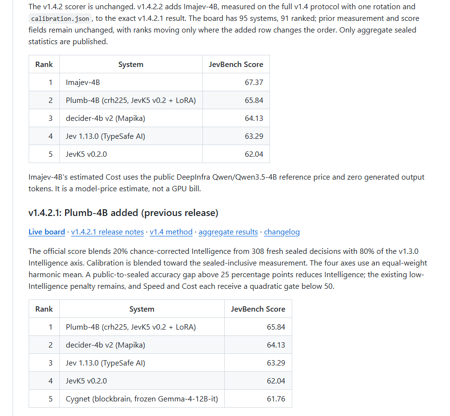

|版本 / 规则|前五节选（总分降序）|规模|
|---|---|---|
|v1.4.2.2 |Imajev-4B 67.37 \> Plumb-4B 65.84 \> decider-4b v2 64.13 \> Jev 1.13.0 63.29 \> JevK5 v0.2.0 62.04<br>|95 系统 / 91 排名|
|v1.2 历史|Jev 1.13.0 74.4 \> SemIf (Qwen3.5-4B) 73.1 \> djev 73.0 \> Winnow-12B Q8 71.2 \> reflex 4B 70.3|48 排名行|

> 注意<strong>跨版本不可比</strong>：v1.4.2.2 与 v1.2 题库、权重均不同，分数随版本漂移，不构成同一标尺下的前后名次对比；另外，v1.4.2.2 榜首 Imajev-4B 高于闭源 Jev 为四轴混合分结果，不等价于特定任务上的精度优势。
> 
> 

---

### 7.1.2、dhruvmehra/jevbench：经典 NLP 基准独立横评

该同名仓库与 fstandhartinger 版本无关，将托管 Jev、开源 Laya、GPT-5-mini、Claude-Sonnet-5、微调 DistilBERT、bart-large-mnli 零样本 NLI 置于 sst2/agnews/banking77 三个经典分类集上并排对比，默认每集 n=500。

> `sst2 / agnews / banking77` 是 NLP 分类领域公认的<strong>标准基准套件</strong>，分别对应二分类、粗粒度多分类、细粒度高基数路由三类典型场景：
> 
> - SST-2（Stanford Sentiment Treebank 2）
> 
> - <strong>基本属性</strong>：斯坦福大学发布的电影评论情感二分类基准，标签只有“正面 / 负面”两类；训练集约 6.7 万句、测试集约 1821 句，输入为单句短文本；
> 
> - <strong>难度定位</strong>：低难度、高共识的入门级二分类任务，是所有分类模型的基础标尺；
> 
> - 验证 Jev 的二值原语（Noul / 二元 Choice）在最简单的经典分类场景下，能否打平微调分类器与通用 LLM 零样本表现，属于“及格线”级别的对照
> 
> - AG News（AG's News Corpus）
> 
> - <strong>基本属性</strong>：来源于路透社等新闻源的主题分类基准，共 4 类（世界、体育、商业、科技）；训练集约 12 万条、测试集约 7600 条，输入为新闻标题 + 短描述；
> 
> - <strong>难度定位</strong>：中难度粗分类，类别语义区分度高，是 4 选项多分类的经典参照；
> 
> - 测试 4 选项 Choice 原语的多分类准确率，验证低基数多选下的读出稳定性；同时对照“零样本决策模型 vs 微调 NLI 模型”在常规主题分类上的相对位置；
> 
> - Banking77
> 
> - <strong>基本属性</strong>：PolyAI 发布的银行客服意图数据集，共 <strong>77 类细粒度用户意图</strong>（如“查询余额”“挂失卡片”“投诉手续费”等）；训练集约 1 万条、测试集约 3080 条，输入为真实用户对话 query，很多类别语义高度接近、边界模糊；
> 
> - <strong>难度定位</strong>：高基数细粒度路由任务，是工业级“意图分诊 / 路由”场景的典型代表，也是三个数据集中最难、最能拉开模型差距的一个；
> 
> - 对应 Jev 最主流的落地场景 —— 客服 / 系统意图路由；专门用来观测高基数选项下，决策模型的读出精度会不会显著衰减；
> 
> 

其特征在于：

- 同一份 label 描述复用到全部范式，保证跨范式公平；

- 主动声明微调 BERT 与零样本方回答的不是同一问题；

- 工程上实现了准确率与延迟分离测量，响应缓存机制使复跑准确率零成本；

- 局限为样本量小（95% CI ≈ ±2.5pp），作者自认排名并列居多，不足得出强结论 —— <strong>其价值在于提供了经典 NLP 基准的外部视角</strong>；

---

### 7.1.3、jev-benchmarking：学术侧零打点评测

论文【2609.37647，《Evaluating and Benchmarking the System One Model Jev》】是首份系统性零打点评测论文，配套仓库为【<https://github.com/AppliedMachineLearning-Lab/jev-benchmarking>】，属于首份在开源基准上的系统评估.

<strong>规模与成本</strong>：37 个数据集，覆盖 3 种原语 × 7 个任务族、200+ 语言变体，全程零样本无 in-context example；

- 针对 Jev 的三种核心原语（<strong>Choice</strong>、<strong>Score</strong>、<strong>Noul</strong>），论文将 <strong>37 个公开数据集</strong> 映射为结构化请求，涵盖七大任务类别：

  - <strong>文本分类</strong>（如 AG News、IMDB、GoEmotions）

  - <strong>意图与主题路由</strong>（如 Banking77、CLINC150、SIB-200）

  - <strong>自然语言推理、释义与事实核查</strong>（如 ANLI、PAWS、LLM-AggreFact）

  - <strong>阅读理解与知识问答</strong>（如 BoolQ、Belebele、MMLU、C-Eval）

  - <strong>常识与推理</strong>（如 HellaSwag、WinoGrande、BIG-bench）

  - <strong>安全、审核与法律文本</strong>（如 ToxiGen、OpenAI Moderation、UNFAIR-ToS）

  - <strong>评分量表</strong>（如 STS-B、SummEval、HelpSteer2）

- 总计 346009 请求、217.9M input token、总成本 \$9.40；平均延迟 0.36s，全量运行 5 小时 15 分；

<strong>核心结果与发现</strong>：

- <strong>准确率</strong>：语言识别与常识类任务接近满分（Language ID 99.6%、BoolQ 91.3%）；情感类 93–97%；路由类 CLINC150 89.5%、Banking77 79.7%；grounding/NLI 类 67.7–85%；最弱项 AGB-DE（德消保条款，4.9% 正例）F1 仅 0.204、AUROC 0.784。

  > Jev 在 IMDB、SST-2、HellaSwag、ARC 上达到 95–99% 准确率；在 Emotion、SST-5、AGB-DE 等细粒度或专业判断任务上性能显著下降；
  > 
  > 

- <strong>校准分层</strong>：22 个 Choice 数据集 pooled ECE = 0.028（median per-dataset 同为 0.028，unweighted mean 0.061）；对照 Qwen 0.063、Gemma 0.208。但三原语校准质量不一致：

| 原语| Jev ECE| Qwen ECE| Gemma ECE| 方向|
|---|---|---|---|---|
| Choice（pooled）| 0.028| 0.063| 0.208| 略过自信|
| 单 Noul| 0.052| 0.113| 0.123| 略欠自信|
| 多标签 Noul| 0.168| —| —| 严重过预测 yes|

- <strong>胜负对比</strong>：Jev 胜 Qwen 27/37、负 9、平 1（11 个领先 CI 不重叠）；Gemma 在全部 37 数据集上低于 Jev、31 个 CI 不重叠。在 <strong>路由与 grounding 族上优势最显著</strong>。

- <strong>选择性预测</strong>：50% coverage 下 Banking77 准确率从 79.7% 升至 96.3%，ANLI 从 73.9% 升至 86.9%，置信度排序有效。

- <strong>阈值重调</strong>：默认 0.5 阈值普遍错位。

  - 在 1000 例验证集上以步长 0.01 重选阈值后，UNFAIR-ToS micro-F1 从 0.499 升至 0.748，GoEmotions macro-F1 从 0.243 升至 0.353；但 AGB-DE 无改善，判断为分离度不足而非阈值错位。

- <strong>多语言</strong>：

  - Belebele 英文 97.2%、122 语言均值 86.7%，但低资源语言如 Nigerian Fulfulde 仅 37.4%；

  - <strong>Score 打 rubric 是唯一 Qwen 追平 / 反超领域，说明生成文本质量判断超出 System1 单步能力</strong>；

---

反常发现：<strong>Jev 在 MMLU 计算密集科目上准确率反而更高（聚合 94.3% vs 其他科目 91.3%），与两个对照模型方向相反</strong>

- 作者通过选项旋转与撤题两轮探针排除了浅层记忆，但明确承认无法区分 "训练见过真题" 与 "真能单步解题"；

- 建议对老牌英文基准结果保持警惕 ——因为存在训练记忆的问题；

---

## 7.2、指标体系：准确率、校准、排序与选择性预测

### 7.2.1、五个核心指标的定义与适用边界

决策模型概率同时被下游 threshold/route/defer 消费，单一准确率远不足够，这里定义5个评价指标，各对一个方面，请注意【参考 TDM 审计】：

- <strong>聚合 ECE 骗人</strong>：pooled ECE 0.047 看似良好，但 median per-benchmark ECE 可高达 0.168，聚合数字掩盖了基线率错配 —— ECE 必须 pooled 与 per-dataset 同报。

- <strong>分桶方式影响结论</strong>：分桶数（10/15/20）与等宽 / 等频选择会改变 ECE 数值，必须随数字一同报告；

  > <strong>2609.33971 在 10/15/20 bins 下重复 Laya MASSIVE 的 ECE 反升结论（0.046→0.124 方向不变），说明该结论对分桶不敏感；</strong>
  > 
  > <strong>但多数论文只报一种分桶；</strong>
  > 
  > 

- <strong>排序好不等于开箱即用</strong>：AUROC 为阈值无关指标，与固定阈值下的 F1 / 召回率是两回事

  > Bonn 里 OpenAI moderation 各类平均 AUROC 0.972，但 prompt injection 在 固定 0.5 阈值下 recall 仅 50%；
  > 
  > 

|指标|度量目标|适用边界与陷阱|
|---|---|---|
|准确率 Acc|argmax 选对比例|只评 "选谁"，对概率数值不敏感；<br>饱和测试上的打平无信息量|
|ECE（15 等宽 bin）|置信度与正确率的系统偏差|仅评 top-label 置信校准；<br>测不出每个选项概率的数值含义，也测不出跨原语一致性|
|Brier 得分|(q−c)²，同时惩罚错误与过度自信|将准确率与校准压缩为单一标量；<br>是评分规则 RL 的核心零件，但平均化改善不保证决策改善|
|AUROC|概率区分正负类的排序能力（阈值无关）|排序好 ≠ 阈值指标好：GoEmotions AUROC 0.873 但多标签 Noul 阈值 F1 很差|
|risk-coverage / AURC|按置信度排序后高置信区准确率|选择性预测核心指标|

需要注意：<strong>五个核心指标互相不可替代——一个通过不代表另一个通过</strong>

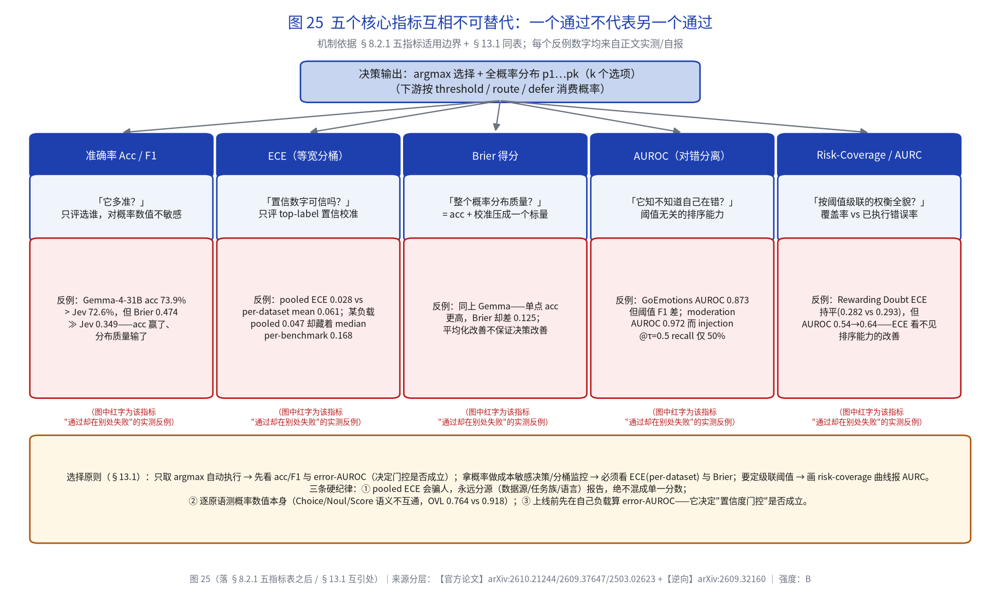

---

### 7.2.2、Sys1Cal-v1：逐点概率真值与第三真值修复

论文 2609.35342《Jev thinks "I don't know", but doesn't say it: Introducing Sys1Cal-v1 Dataset for Probability Calibration》指出了当前的评测盲区：现有基准仅测 top-label 置信校准，不测 P (A) 数值本身的正确性，因为只有 realized label 而无逐点真值分布。

> 简单来讲，<strong>realized label 是单个样本的“最终对错结果”，逐点真值分布是单个样本的“真实概率数值”；</strong>
> 
> 绝大多数分类基准只有前者、没有后者，因此只能测“跨样本的平均校准”，测不出“每个概率数值本身准不准”；
> 
> 

Sys1Cal-v1 的做法是：<strong>不用真实世界的样本，用程序生成受控题目，把每个命题的真实概率 P\*(A) 精确写死，比如其构造了六类概率族：</strong>

- 频率型：罐子里 70 个红球 30 个蓝球，摸出红球的概率 = 0.7；

- 条件型、贝叶斯型、序列型…… 每道题的真实概率都是数学上精确已知的有理数；

这样每个样本就不再只有“对 / 错”标签，而是有一个<strong>精确的逐点真值分布</strong>—— 可以直接拿模型输出的概率 p̂ 和真实概率 p\* 比数值误差，即分布重叠度指标 OVL = 1 − \|p̂ − p\*\|，<strong>本质评价的是“单样本概率数值的吻合度”</strong>：

- 真实 0.7，模型输出 0.7 → OVL = 1.0（完全命中）；

- 真实 0.7，模型输出 0.764 → OVL = 0.936；

- 真实 0.7，模型输出 0.9 → OVL = 0.8；

---

在规模 365 样例 / 92 个 latent 问题上进行了评估：

- 逐点看，Choice 原语输出的概率数值和真实概率平均偏差约 0.236，数值吻合度并不高； 但这和 Bonn 测出的 Choice pooled ECE = 0.028 并不矛盾 —— 因为 ECE 是跨样本平均校准，高估和低估抵消后看起来很好

| 输出| Mean OVL|
|---|---|
| Jev-Choice| 0.764|
| Jev-Noul| 0.918|
| Jev-Score| 0.886|
| SemIf-Choice（基线）| 0.629|

---

启发：概率校准与逐点校准不是一回事，其对应的是不同的决策模型下游用法

- 只有 realized label 的基准，只能验证频率校准（ECE） ——<strong>ECE 合格不等于概率可逐点用于决策，ECE 好看只说明平均上对，不说明每个概率值本身准；</strong>

- 有逐点真值的基准，才能验证概率数值本身的质量；

| 校准维度| 度量指标| 对应下游用法|
|---|---|---|
| 频率校准（top-label 校准）| ECE| 只拿 argmax 做决策、用置信度做粗粒度阈值 / 升级|
| 逐点数值校准| OVL / Brier / TV 距离| 拿概率数值做计算：贝叶斯更新、期望损失、风险定价、级联精确阈值|

---

### 7.2.3、统计纪律现状：TDM 早期证据审计/综述

论文 2609.32160《Typed Decision Models: An Early Evidence Audit and Evaluation Checklist》（Northeastern，2026-09-26）对 Jev 发布后 9 天内涌现的 28 篇论文做系统综述，给出 14 项评测清单与合规率统计（对<strong>27 篇评测论文统计</strong>），是本章评估协议的主要依据：

|清单项|合规率|说明|
|---|---|---|
|B1 同 backbone label-logprob baseline|5/26|绝大多数无对照，无法归因 typed 接口收益|
|B2 廉价生成级联 baseline|1/5|几乎无人对照便宜生成级联|
|B3 任务特定模型 baseline|7/13|专用分类器对照不足|
|T3 选项名不变性测试|1/27|几乎无人测选项重命名 / 重排|
|R2 headline 置信区间 / 显著性|15/27|近半数头条结果无 CI|
|C1 calibration 度量|13/17|—|
|C3 阈值与评测集分离冻结|7/7|适用者基本全合规|
|C4 latency 报缓存前后|3/20|延迟测量方式普遍缺失缓存区分|

- 14项清单的详细扩展：

| 分组| ID| Report| Why it matters / failure observed<br>    意义 & 观测到的失效案例| Count|
|---|---|---|---|---|
| <strong>Baselines</strong><br>    <strong>基线设置</strong>| B1| A baseline that reads label log-probabilities from an ordinary or same-backbone LM.<br>    基线：使用普通大模型 / 相同骨干模型读取标签对数概率。| Otherwise interface gains cannot be separated from model gains; the same backbone is the most informative choice; where tested, the readout added little accuracy (Finding 1).<br>    否则无法区分效果提升来自 TDM 接口本身还是骨干模型；同骨干对照是最有参考价值的基线；已有对照实验发现，这套读出方式几乎不带来精度提升（核心结论 1）。| 5/26; 1 unclear|
| | B2| Where a confidence threshold passes decisions to another model: a cheap generative cascade as a baseline.<br>    基线：如果依靠置信阈值把请求转交其他模型，必须设置廉价生成式级联作为对照基线。| On external τ²-bench a cheap generative cascade was cheaper than the TDM cascade and not less accurate [71]; two of six open-weight LLMs in Jev’s price range had higher median macro-F1 [28].<br>    在 τ²-bench 基准上，廉价生成模型级联比 TDM 级联成本更低、精度不差 [71]；和 Jev 同价位的 6 个开源大模型里，有 2 个中位数 macro-F1 更高 [28]。| 1/5|
| | B3| Where labeled data suffice to train one: a task-specific model (encoder, classical classifier, reward model or probe) as a baseline.<br>    基线：标注数据充足时，使用任务专用模型（编码器、传统分类器、奖励模型、探测头）作为对照基线。| Fine-tuned encoders were not significantly worse than an open TDM in ranking and had nominally lower ECE (but higher Brier) and were faster [54]; trained quality models stayed well ahead [56].<br>    微调编码器在排序任务上和开源 TDM 差距不显著，ECE 更低（但 Brier 更高）且速度更快 [54]；专门训练的质量评估模型效果持续领先 [56]。| 7/13; 3 unclear|
| <strong>Test design</strong><br>    <strong>测试设计</strong>| T1| Spread between models on the test; avoid parity claims on saturated tests.<br>    测试设计：报告模型间性能差异；禁止在天花板饱和任务上宣称效果等价。| Several parity results come from tests on which strong models are at or near ceiling (Finding 2).不少 “效果持平” 结论来自强模型已经接近满分的测试集（核心结论 2）。| –|
| | T2| Correctness or agreement of individual decisions across repeated, reordered or reworded requests, not only aggregate accuracy.<br>    测试设计：除整体准确率外，还要评估请求改写、重排、重复提交后，单条决策结果是否一致、正确。| Equal aggregate scores hid different decisions [79]; correct final labels hid wrong intermediate choices [16].总体得分相同，背后决策结果可能完全不一样 [79]；最终标签选对了，中间判断步骤依然可能出错 [16]。| 17/26; 1 unclear|
| | T3| Option-name invariance test: swap names across rubrics or compare neutral with semantic names.<br>    选项名称不变性测试：在评判细则之间调换选项名称，或者对比无含义代号名称和带语义名称两种形式| Swapping no/yes across rubrics moved Jev AUC from .815 to .581 with zero type errors [61]; asking through Score instead of Choice moved graded accuracy by up to 10.5 points [53].<br>    在评判细则互换 yes/no 标签后，Jev 的 AUC 从 0.815 跌到 0.581，且没有出现类型报错 [61]；调用接口时改用 Score 原语而不是 Choice 原语，分级准确率最高可达到10.5个点| 1/27|
| | T4| T4 Data provenance: synthetic or real, gold-label source, and whether a public benchmark predates the model.<br>    测试设计：披露数据来源：合成数据 / 真实数据、金标来源、公开基准数据集是否早于模型发布。| The corpus includes agent-generated texts with agent-generated labels [36] and unresolved contamination concerns [28,79].这批研究里存在智能体自生成文本 + 自标注数据 [36]，还有尚未排除的数据污染风险 [28,79]。| –|
| <strong>Reproducibility and statistics</strong><br>    <strong>可复现性与统计</strong>| R1| R1 Exact model version and run date<br>    可复现性：写明精确模型版本、调用时间。| Hosted TDMs are closed and may change under a stable name; several papers provide neither.<br>    商用托管 TDM 是闭源的，同名版本可能静默更新；多篇论文两项信息都没有提供。| –|
| | R2| R2 Confidence intervals or significance tests on headline results<br>    可复现性：核心结果提供置信区间或者显著性检验。| Twelve of the 27 report neither for their headline results. Because the hosted model is not deterministic [61,79], repeated-run stability should also be reported where feasible.<br>    27 篇里面有 12 篇核心结果两者都不给。托管模型本身具有非确定性 [61,79]，条件允许时还应报告多次运行的稳定性。| 15/27|
| | R3| R3 Disclose prompts, recipes, baselines, or thresholds chosen after seeing test data.<br>    可复现性：披露所有看完测试结果之后才选定的提示词、实验方案、基线、阈值。| At least seven papers make such choices; one series of redesigns moves the headline metric from .576 to .797 [56].<br>    至少 7 篇论文存在这类事后调参；有一项工作反复调整方案，核心指标从 0.576 提升到 0.797 [56]。| –|
| <strong>Confidence & deployment</strong><br>    <strong>置信度与部署</strong>| C1| Where the TDM’s probabilities are used or described as calibrated: calibration measured with ECE, Brier score, reliability analysis or an equivalent metric.<br>    置信部署：如果使用 TDM 概率、宣称概率经过校准，必须用 ECE、Brier 分数、可靠性分析等指标评测校准效果。| Held-out data, a metric suited to label prevalence, and results before and after any recalibration are preferable. Raw probabilities are miscalibrated in some workloads; recalibration reduces error by 3.3×, while a 0.01 grid limits rare-label resolution [52].<br>    优先使用留出集、适配标签分布的指标，同时上报重校准前后结果。原始概率在部分任务校准很差；重校准可以把误差降低 3.3 倍，但两位小数（0.01 步进）限制了稀有标签的分辨能力 [52]。| 13/17; 1 unclear|
| | C2| Accuracy among the highest-confidence examples, by task.<br>    置信部署：按任务统计高置信样本子集的准确率。| The corpus contains high confidence at near-base-rate accuracy [28] and wrong tool calls with mean confidence .778 [71]; under optimized answer-preserving context, 45% of Jev’s initially correct decisions (73% of those redirected) end with probability ≥ 0.7 on the wrong option [73]<br>    已有文献发现：高置信样本正确率接近随机基线 [28]；错误工具调用的平均置信度高达 0.778 [71]；在精心构造的上下文下，Jev 原本正确的决策里，45%（被篡改样本里 73%）最终把≥0.7 置信分给错误选项 [73]。| –|
| | C3| Where confidence thresholds gate acceptance or escalation: thresholds fitted on data separate from the evaluation set, or fixed before evaluation and not tuned on it.<br>    置信部署：置信阈值用于放行 / 转交时，阈值只能在测试集之外的数据拟合，或者实验前固定，禁止在测试集调参。| Frozen thresholds should also be tested for transfer across workloads or fallback models, since thresholds fitted on a selection set did not hold on held-out items for every fallback, and fitted temperatures differ across workloads [39]; some fixed thresholds are applied to scores the authors explicitly do not assume to be calibrated [29].<br>    固定阈值还要跨任务、跨复核模型测试泛化能力；在筛选集调好的阈值不一定在留出集生效，最优温度参数随任务变化 [39]；部分论文直接把阈值套在作者自己都不认为已经校准的分数上 [29]。| 7/7; 3 unclear|
| | C4| Where TDM latency is reported or a latency advantage is claimed: latency both with and without caching.<br>    置信部署：宣称延迟优势时，同时上报开启缓存、关闭缓存两套延迟数据。| Serving location, concurrency and measured cost per correct outcome should also be stated. Caching removes one reported latency advantage [36]; two sibling papers report opposite cost directions on different workloads [36,37].<br>    还应标注服务地域、并发量、每一次正确推理的成本。缓存会抹平一部分延迟优势 [36]；两篇同源论文在不同任务上得到相反的成本结论 [36,37]。| 3/20; 1 unclear|

    

- 另外，论文定义了TDM的三要素：

  - 选项集合<strong>在请求时动态传入</strong>，不是训练时固定标签；

  - 单次请求可以批量跑多个独立问题，各问题决策互不干扰；

  - 直接输出归一化概率分布，下游代码基于概率做分流、阈值判断、转交复核，而不是只取最大概率答案；

- 定义了8个核心构成组件：

| TDM 核心组件（Component）| Closest ancestor <br>    技术前身| What TDMs change<br>    （TDM 改造点，原文）| 详细解读|
|---|---|---|---|
| Scoring a label set by LM probability<br>    基于大模型概率对标签集合打分| Cloze/verbalizer classification（完形 / 文本化分类）Likelihood scoring（似然打分）| Options declared per request rather than fixed verbalizers<br>    选项随单次请求传入，不再是训练阶段固定的 verbalizer 标签词| 传统 verbalizer 分类：训练时就定好每个类别对应的提示词（如`yes`/`no`），标签集合固化；<br>    TDM 保留 “拿模型 token 概率打分” 这个底层能力，但标签集合<strong>每次 API 调用由调用方自定义</strong>，同一个模型可以今天做 3 分类、明天做 7 分类，不需要重新 SFT。论文核心结论 1 的来源：<strong>很多宣称 TDM 更强的效果，本质只是同骨干模型的标签概率打分，TDM 专用接口本身不带来稳定精度增益</strong>|
| Option-label readout<br>    选项标签读出层| Multiple-choice symbol binding<br>    多选题符号绑定| Named options may include rubrics rather than letters<br>    选项可以附带评判细则（rubric），而不只是 A/B/C 字母| 传统多选打分一般只用简短字母 / 代号区分选项；<br>    TDM 支持每个选项带上完整判定规则。例如：选项 A 附带判定标准 “属于合同违约：满足 XX 条件”；模型不是单纯匹配文字，而是按 rubric 做判断。<br>    风险点（后文实验 T3）：TDM 很容易被选项字面名称干扰，<strong>调换选项文字名称、含义不变时，决策会大幅漂移</strong>，这是鲁棒性短板|
| Guaranteed valid output<br>    输出合法性保证| Grammar-constrained decoding<br>    语法约束解码| Returns a renormalized distribution without token generation<br>    输出归一化概率分布，不生成自由文本 token| 约束解码（如 CFG、JSON-gram）是限制生成文本只能在合法集合里；TDM 更进一步：<strong>放弃逐 token 生成文本，直接输出在传入选项上归一后的概率</strong>。对外接口承诺：输出一定落在你给的候选集合里，不会跑出额外答案；这是面向软件系统最关键的契约，程序不需要做输出校验、解析、容错。注意：论文提示，底层实现很多开源 TDM 依然在内部算 token logit，只是对外屏蔽文本|
| Fine-tuned label-token head<br>    微调标签 token 输出头| Yes/no rerankers（二选一重排器）generative verifiers（生成式校验器）| Arbitrary option sets; many questions per call<br>    支持任意选项集合；单次请求批量处理多个独立问题| 早期重排器、校验器大多固定少量候选、单次一问；<br>    TDM 输出头支持：一个上下文（同一段文本），一次性提交 K 个互不干扰的决策问题，各自有独立候选集，批量返回各组概率。<br>    工程价值：减少多次轮询开销，适合 Agent 里批量判断多个条件；但代价：问题之间依然存在隐性上下文污染风险|
| Runtime labels in small encoders<br>    编码器动态标签| NLI zero-shot classifiers（NLI 零样本分类）GLiClass| Presented as a general decision interface<br>    封装成通用决策接口| GLiClass 这类编码器零样本分类，已经支持动态标签；<br>    TDM 的创新不在编码器打分机制，而是<strong>把这套能力标准化成统一 API 契约（Choice/Score/Noul 原语）</strong>，统一输入输出范式，不管底层是 Decoder、BERT 式编码器，对外都是同一套调用方式。<br>    开源 TDM（Open-Jev、Laya）大多走这条技术路线|
| Rubric-conditioned judging<br>    评判细则驱动打分| Prometheus、G-EvalLLM <br>    评判模型| Rubric attached to each option<br>    评判细则绑定到每一个选项| G-Eval、Prometheus 是用自然语言标准让大模型打分；<br>    TDM 把评判标准从全局 prompt 里拆出来，<strong>绑定到单个选项上</strong>。典型场景：内容审核、医学报告判读、人工标注自动化；每个选项自带判定规则，模型基于规则分配概率，而不是自由写评语。<br>    短板：模型容易 “读字不读义”，对 rubric 理解不稳定，是 T3 鲁棒性测试重点考察项|
| Confidence-based escalation<br>    基于置信度的逐级转交| Reject option（拒绝选项）LLM cascades（大模型级联）| Cheap first stage with a native probability<br>    原生概率输出，作为低成本第一级<br> | 选择性分类、模型级联早已有 “低置信交给更强模型 / 人工”；<br>    TDM 的差异化：置信度（概率）是原生一等公民输出，不是后算出来的附属指标。<br>    这就是业界最主流的<strong>TDM 级联部署范式</strong>：TDM 做廉价初审；置信低于阈值，路由到强生成模型复核。<br>    论文明确局限：<strong>如果两级模型错误高度相关，复核几乎无效；不能默认置信度可靠</strong>|
| Calibration training<br>    校准训练目标| RL with proper scoring rewards<br>    基于恰当打分函数的强化学习| Calibration is part of the product objective (RLCD)<br>    概率校准是主训练目标（Jev 称为 RLCD）| 以往分类模型的校准大多是后处理（温度缩放、Platt 缩放）；Jev 宣称在训练阶段就用 RLCD（Reinforcement Learning for Calibrated Decisions），把概率校准直接放进奖励目标，希望输出概率和真实正确率匹配。<br>    但论文实测结论：<strong>RLCD 不能跨场景保证校准；分布漂移、陌生任务下 ECE/Brier 会明显恶化，高置信样本依然大量出错</strong>，对应评估清单 C1/C2|

---

## 7.3、概率一致性与公理评测

校准是跨样本的平均性质：报 p 的事件长期以 p 频率发生。但它不要求同一 case 上逻辑相关问题逐项自洽。违反概率公理的模型在 pipeline 中表现为 "动作取决于提问措辞"。

> <strong>一个模型可以给"claim is supported" 0.7、同时给"claim is not supported" 0.6，这违反 Kolmogorov 补事件公理，在 pipeline 里表现为"动作取决于正面还是负面措辞"！</strong>
> 
> 

这对应了我们的一个RQ：<strong>决策模型的概率是否满足一致性/公理。</strong>相关证据主要由如下独立评测构成。

### 7.3.1、否定 / 划分公理（arXiv:2609.33209）

论文<strong>2609.33209《Beyond Calibration: Do a Typed-Decision Model's Probabilities Obey the Probability Axioms?》</strong>（东北大学沈阳，2026-09-27）构造 label-free 的 7 恒等式（negation complement、disjunctive complement、partition additivity、disjunction additivity、description invariance、monotonicity、cross-format consistency）160 items（ChaosNLI 100 + PubMedQA 60），对照 Jev（jev-1.13 经 OpenRouter）与 Qwen3.8-27B 两种读出：

- 这 7 个恒等式，等于 <strong>7 条概率必须遵守的数学铁律（公理）</strong>，用来自检：<strong>不需要正确答案，也不用和外部事实比，只看模型自己输出的概率 “前后矛不矛盾、内部自不自洽”；</strong>

- 它测的既不是准确率（答得对不对），也不是 ECE（平均校准好不好），而是<strong>概率输出的内部逻辑一致性</strong>—— `同一件事换个问法、换个接口、拆成不同选项，模型给的概率能不能自圆其说`；

> 前面看到的两类评测都有局限：
> 
> 1. <strong>准确率 / ECE</strong>：要和外部真实标签比，测的是 “和事实对不对得上”；
> 
> 2. <strong>Sys1Cal OVL</strong>：要和逐点真实概率比，测的是 “数值准不准”；
> 
> 

> 这里评测覆盖的情况是：<strong>哪怕模型整体校准不错、准确率也高，它输出的概率本身可能在数学上是 “自相矛盾” 的；</strong>
> 
> 

所有的7个恒等式均基于同一个逻辑：<strong>对同一个事件，换一种等价问法，模型输出的概率应该满足数学恒等关系——如果存在偏差且偏差越大，说明越不自洽；</strong>

|恒等式名称|数学含义|测的核心问题|Jev 实测偏差（越小越好）|
|---|---|---|---|
|<strong>1. 否定互补</strong><br><strong>Negation complement</strong>|P(A) + P(¬A) = 1<br>一件事发生的概率 + 不发生的概率 = 100%|最基础的正反问法一致性：正着问反着问，概率加起来是不是 1|0.064（偏差很小，表现最好的一项）|
|<strong>2. 析取互补</strong><br><strong>Disjunctive complement</strong>|P(A∨B) + P(¬A ∧ ¬B) = 1<br>“A 或 B 发生” 的概率 + “AB 都不发生” 的概率 = 100%|把单个否定扩展成两个事件的并集，测扩展后的互补性是否成立|0.054（和否定互补接近，偏差小）|
|<strong>3. 划分可加性</strong><br><strong>Partition additivity</strong>|所有互斥且穷尽的选项，概率之和 = 1；<br>比如三个选项覆盖全部可能，加起来必须是 100%|<strong>Jev 最严重的缺陷</strong>：单标签概率之和平均 = 1.14，相当于三个选项各给 38%，加起来 114%，数学上不可能<br>|<strong>0.141</strong>（偏差最大，核心短板）<br>|
|<strong>4. 析取可加性</strong><br><strong>Disjunction additivity</strong>|若 A、B 互斥，则 P (A∨B) = P (A) + P (B)两个互斥事件 “至少一个发生” 的概率 = 两个概率相加|互斥事件的并集概率，是不是等于分别概率之和|0.138（偏差第二大）|
|<strong>5. 拆包一致性</strong><br><strong>Unpacking</strong>|同一事件，拆不拆开描述概率相等比如 “生病” 和 “得甲病或乙病” 如果等价，概率应一致|表述拆分 / 合并会不会扭曲概率，测 “表述形式对结果的影响”|0.060（中等偏差）|
|<strong>6. 单调性</strong><br><strong>Monotonicity</strong>|若 A 能推出 B，则 P (A) ≤ P (B)子集概率不能大于母集（比如 “北京人” 概率 ≤ “中国人” 概率）|会不会犯合取谬误：子集反而比母集概率更高|0.013（偏差极小，表现很好）|
|<strong>7. 跨格式一致性</strong><br><strong>Cross-format consistency</strong>|同一个问题，用 Choice / Noul / Score 不同原语问，概率应一致|接口格式会不会改变结果，对应 “跨接口动作分裂” 的底层原因|0.091（偏差中等偏上）|

整体评估来看，与 Qwen的First-Token相比，v 在几乎每条恒等式上更自洽，但 partition 与 disjunction 仍是最大短板；偏差随置信度升高而缩小。

---

### 7.3.2、层级相干性（arXiv:2609.33971）

论文2609.33971《Do System One Decisions Add Up? A Study of Probabilistic Coherence》测试了另一类相干性：同一决策先分粗类再选细类，是否满足"粗类概率 = 其细类概率之和"；

- 本质是把前面 7 个恒等式里的“划分可加性（Partition additivity）”放到真实的两级分类任务中做落地验证；

- 验证的是<strong>层级分类场景下的概率可加性</strong>：如果分类树逻辑自洽，那么 “一个粗类的概率” 应该严格等于“它下属所有细类的概率之和”；

- 基本假设：如果模型输出的概率满足概率论公理，那么<strong>“直接从所有细类里选”和“先选粗类、再选细类，最后汇总概率”</strong>两种方式，得到的最终准确率应该基本一致 —— 偏差越大，说明层级概率越不自洽；

具体来讲，论文用了 3 个天然带“粗 - 细”两级分类的经典意图 / 分类数据集：TREC（问题分类）、CLINC150（对话意图）、MASSIVE（语音助手意图）进行测试，分为两种测试模式：

|模式|做法|
|---|---|
|<strong>Flat</strong><br><strong>（扁平模式）</strong>|直接把所有细类选项全部列出来，让模型一次选出答案，直接算细类准确率。|
|<strong>Marginalization</strong><br><strong>（分层边际化）</strong>|分两步走：<br>- 先问“属于哪个粗类”，得到每个粗类的概率；<br>- 再分别对每个粗类，问“属于该粗类下的哪个细类”，得到细类条件概率；<br>- 用贝叶斯公式汇总：P（细类）= P（粗类）× P（细类｜粗类），再算最终准确率；|

论文在上述3个数据集的72K问题上，对比了Jev和Laya模型，但得到了反直觉的结论：

- 最反直觉：Jev 分层后准确率暴跌，Laya 分层后反而上涨

  - flat→marginalization 后，Jev 在 CLINC150 掉 22.9pp（91.0%→68.1%），Laya 反而涨 21.3pp（23.1%→44.4%），6 个 CI 全部排除 0；

  - <strong>Jev 暴跌的原因</strong>：正好对应前文公理评测里<strong>“Partition additivity 偏差 0.141”</strong>的短板 ——Jev 给每个单标签的概率普遍偏高，所有细类概率加起来会超过粗类概率（相当于 “概率预算超支”）—— 分层汇总后概率分布被系统性扭曲，准确率直接跳水；

  - <strong>Laya 上涨的原因</strong>：Laya 基座小、单步区分上百个细类的能力很弱；分层提问相当于给了它结构化提示，先缩小到粗类范围再选细类，相当于做了 “分而治之” 的辅助，反而帮它提升了判别力；

  > 两者的错误来源完全不同：Jev 输在“概率数值不自洽，但单步判别力强”；Laya 赢在“分层结构补了判别力短板，但概率数值更不准了”
  > 
  > 

- 准确率与校准可脱钩

  - Laya 在 MASSIVE 上，分层后准确率涨了 9.2pp，但 ECE 从 0.046 升到 0.124；

  > 分层虽然帮它选对了更多答案，但输出的概率数值离真实正确率更远了 —— 猜对的题概率给低了、猜错的题概率给高了，整体置信度和正确率的匹配度变差；
  > 
  > 这里实际印证了全文反复强调的一个核心判断：<strong>准确率和校准是两个完全独立的维度，不能用准确率高低推断校准好坏；</strong>
  > 
  > 

- 顺序鲁棒性不等于层级自洽性

  - flat 模式下，选项顺序翻转率 Laya 高达 62.5%–76.7%（换个排列顺序答案就变，非常脆弱），Jev 仅 5.8%–20.0%（顺序基本不影响结果）；

  - <strong>但顺序稳不代表概率自洽</strong>：Jev 抗顺序扰动的能力远强于 Laya，但层级可加性反而更差

---

### 7.3.3、概率契约与跨接口决策后果（arXiv:2609.37470）

论文 2609.37470《Probability Contracts: Accuracy, Coherence, and Decisions Across LLM Interfaces》把评测推到"有精确后验真值"的受控有限世界 —— 构造了一套“真实后验概率完全已知”的受控环境，同时度量三个经常被混淆的目标：<strong>数值精度 accuracy（离真后验多近）、内部一致性 coherence（跨等价表示是否自洽）、最终决策价值 decision value（按它动作损失多少）</strong>，把 “违反公理” 从抽象数学问题落地成了 “会不会导致业务动作出错” 的工程问题，具体来讲：

- 普通评测基准只有 “对 / 错” 标签（realized label），只能算 ECE 这种跨样本平均校准，测不出单个样本的概率数值本身准不准；

- 论文通过程序生成了 1000 个独立的有限世界，每个世界里每个事件的<strong>真实后验概率都是精确的有理数</strong>（类似 “罐子里拿球” 的经典概率题，真值可由数学规则严格算出），共 11913 个可测槽位。这样就可以直接拿模型输出和真实概率比数值误差，不需要靠统计平均；

- 具体实验，对每个事件，用 Jev 的两种合法原语分别查询：

  - <strong>Event 接口</strong>：二元事件原生接口，直接问“事件 A 发生的概率”

  - <strong>Choice 接口</strong>：二选项选择题接口，问“A 和 ¬A 哪个对”

- 使用两个独立指标进行评估：

  - <strong>一致性残差</strong>：比如补事件 P (A)+P (¬A) 和 1 的偏差，越小说明越自洽；

  - <strong>TV（总变差）距离</strong>：模型输出概率和真实后验的数值差距，越小说明越精准；

---

<strong>关键发现</strong>：

- <strong>跨接口动作分裂</strong>：32.8% 的事件输出相反动作

  - <strong>现象</strong>：同一个事件，用 Event 和 Choice 两种接口问，得到的概率数值存在系统性偏差。当业务设置了固定决策阈值（比如置信度 ≥0.9 自动执行，否则人工复核）时，有 <strong>32.8% 的事件会因为接口不同，刚好跨过阈值，得到完全相反的动作；</strong>

  - <strong>细节</strong>：所有分裂都发生在 act/defer（执行 / 复核）边界，没有出现正反答案完全颠倒的极端情况，但对生产已经足够致命 ——<strong>同一个事件，A 模块用 Event 接口放行了，B 模块用 Choice 接口卡了，系统逻辑完全不一致。</strong>

  - <strong>原文典型案例</strong>：同一事件真实后验 ≈0.694，Event 接口输出 0.84（低于 0.9 → 人工复核），Choice 接口输出 0.97（高于 0.9 → 自动执行）；

  - <strong>本质原因</strong>：Jev 的不同原语（Choice/Noul/Score）有各自独立的概率语义，不是同一个概率的不同格式包装 —— <strong>这和 7.2.2 Sys1Cal 里“三原语 OVL 差异巨大”的结论完全呼应。</strong>

- <strong>精度序与一致性序可反转</strong>：一致性残差只暴露 "可证部分错误"，共享错误须有真值才能发现

  - 两个指标：一致性残差、TV距离

  - 反直觉现象：

  - 单看补事件一致性：Jev 残差 0.0929，远好于 Kev 的 0.5055，看起来 Jev 更 “靠谱” —— <strong>一致性残差更小，更自恰；</strong>

  - 但看整体数值精度：Kev TV=0.2350，反而优于 Jev 的 0.2677 —— 更精确；

  - 这说明致性<strong>只能测出“自己和自己矛盾”的错误，测不出“大家一起错”的共享偏差</strong>，也即：

  - 不能用“公理一致性排名”代替“准确率排名”，两者是完全独立的维度；

  - 只看一致性选模型，可能选出 “自洽但不准” 的选项；

  > - 模型甲：P (A)=0.7，P (¬A)=0.6，加起来 1.3，一致性很差，但数值和真值接近
  > 
  > - 模型乙：P (A)=0.3，P (¬A)=0.7，加起来 1.0，一致性完美，但数值全错
  > 
  > 

- <strong>可重复性</strong>：exact repeat pass 率仅 74.5%，均值接近不等于逐例稳定

  - 也就是完全相同的请求重复调用两次，只有 74.5% 的样本两次输出概率差小于 0.02，剩下 25.5% 的样本存在不可忽视的逐例抖动；

  - 需要辨析：

  - 这不是“整体准确率不稳定” —— 平均误差变化非常小；

  - 但<strong>单个样本的抖动足以跨过业务阈值，</strong>比如阈值 0.5，第一次输出 0.51 通过，第二次 0.49 驳回，出现“同请求不同结果”的非确定性；

---

<strong>论文明确的立场为</strong>：总排名分数（或基于单一分数的合成分数）是不可靠的 —— 不能使用一个总分或合成评分排序所有模型——

- 不同类型的不一致对应不同的业务风险（补事件不一致、跨接口不一致、分层不一致影响完全不同），每条残差都有独立的含义；

- 不能随便加权合并成一个数字，否则关键信息会被平均掉；

---

### 7.3.4、小结：与校准评测的关系

三篇公理评测（从“否定 / 划分公理”“层级相干性”到“概率契约”）与 Sys1Cal 共同构成了一条完整的证据链（如下RQ6），覆盖了从<strong>“纯数学自洽”→“真实任务层级自洽”→“落地决策影响”</strong>的完整链条：

|评测工作|核心命题|是否需要真值|核心结论|本质缺陷|落地影响|定位|
|---|---|---|---|---|---|---|
|<strong>7 恒等式公理</strong>（2609.33209）|单事件的正反 / 拆分表述，概率是否满足基本公理<br>> 基础数学公理自洽性<br>> <br>> |否<br>（纯自洽测试）|三选项概率和平均 1.14，划分可加性偏差最大|单标签概率普遍高估，互斥事件概率和严格大于 1|正反提问结果不一致；<br>拆分 / 合并表述会改变概率输出；|抽象层：基础公理守不守得住|
|<strong>层级相干性评测</strong>（2609.33971）|粗类概率是否等于下属细类概率之和（真实两级分类任务）<br>> 真实任务层级可加性<br>> <br>> |否<br>（纯自洽测试）|Jev 分层后准确率掉 22.9pp；<br>Laya 分层后准确率涨 21.3pp 但 ECE 恶化；|层级概率可加性不成立，分层汇总后概率分布系统性扭曲|层级分类、贝叶斯汇总、分域路由不能直接概率相加，会出现精度损失|任务层：真实分类场景下的自洽影响|
|<strong>概率契约基准</strong>（2609.37470）|跨接口概率是否一致、精度与一致性是否相关、对最终动作的影响<br>> 精度 + 一致性 + 决策价值 三维度<br>> <br>> |是<br>（精确已知真实后验）|跨接口动作分裂 32.8%；<br>精度序与一致性序可反转；<br>逐例重复通过率仅 74.5%；|不同原语概率语义不互通；<br>逐例非确定性抖动；|多接口混用会出现动作不一致；<br>阈值边界存在非确定性翻转；|落地层：对实际业务动作的影响|

三者证据都共同支撑的判断：

- <strong>ECE 合格 ≠ 概率可用于逻辑运算：</strong>Bonn 【2609.37647】测出的 Choice pooled ECE=0.028 看似优秀，但三篇一致证明：聚合校准会掩盖逐点的自洽性缺陷，一旦拿概率去做相加、拆分、跨接口对比、贝叶斯更新，系统性偏差就会暴露。

- <strong>不一致是结构性的，不是随机波动：</strong>三篇分别从<strong>`数学公理、真实任务、落地决策`</strong>三个独立维度复现了概率不自洽，且偏差远大于重跑噪声地板，属于模型输出的固有属性，不是测量误差；

- <strong>自洽性、准确率、校准是三个独立维度，</strong>三者没有必然正相关：

  > - 准确率高的模型（Jev）自洽性可能有明显短板；
  > 
  > - 自洽性差的模型，整体精度反而可能更高；
  > 
  > - 不能用一个维度的表现推断另外两个；
  > 
  > 

---

## 7.4、专项基准：从领域单步评测到 Agentic 闭环评测

除两类事实标准基准与公理评测外，生态内还演化出多个面向特定维度的专项基准，覆盖跨语言、对抗鲁棒性、对齐失效检测、闭环 agent 等场景。以下列表进行简单概述:

|基准|文献 / 仓库|类型|核心规模|核心结论|关键局限|
|---|---|---|---|---|---|
|<strong>CJ-Bench</strong>|arXiv:2609.36965|中文跨语言基准|307900 条 held-out 决策（通用 100,000 / 医学 200,000 / 法律 4,300 / 金融 3,600）;<br>被测模型为 322M 参数 mmBERT 底座的 Chinese-Jev|通用子集：Chinese-Jev ACC 69.20% / ECE 3.78% / 14ms，准确率反超托管 Jev 0.85pp、ECE 降 67%、延迟低约 20×；<br>医学域超 Jev 3.36pp，法律 / 金融仍落后且法律域 ECE 反升|域微调数据量不均（医学远多于法律金融）|
|<strong>JevAdvBench</strong>|arXiv:2609.31142|对抗鲁棒性基准|首个 RLCD typed-decision 对抗基准：812 题 / 66 场景 / 9,744 个单编辑变体，以同请求干净重跑为参照系|词 / 空格编辑≈噪声地板级（翻转率）；<br>旁观者意见翻转率 12.1%，与最强权威冒用注入（10.1%）统计持平；<br>至少一种递送攻击总翻转率 29.2%；<br>38% 的自信答案可被压过 0.8 复核阈值；|单版本、弱模板化攻击者，为鲁棒性下界|
|<strong>RLCDAlignBench</strong>|arXiv:2609.29429|对齐失效检测基准|10 类失效 × 44 基准 × 5 个 ≤7B 模型7193 标注实例<br>> 将答案作为概率分布读取 vs 作为 argmax 决策读取差异显著<br>> <br>> |零样本检测中位 AUROC 0.886，25/31 基准击败 TF-IDF 与长度基线；<br>相对 TF-IDF +0.132 AUROC，代价约 63×；<br>概率分布读取（SCORE soft）优于 argmax 读取（CHOICE）|目标模型均为小开源；数据 gated|
|<strong>jev-position-test</strong>|imaddde867 仓库|选项顺序探针|n=6 单克隆<br>|开源克隆选项重排可造成严重翻转，托管 Jev 36/36 标签一致；<br>提供十分钟自检法(换排列看答案动不动）|样本量极小，仅作方法演示，不可外推|
|<strong>scientific-decision-eval</strong>|bydeng01 仓库|传导式评测|20 组 / 40 题 / 13 模型<br>|单格错误可放大为下游结论错误；<br>发布即提供 sha256 清单与无网络复现命令;|开发集结果，不证明泛化|
|<strong>System1-Arena</strong>|arXiv:2610.21244|闭环 agent 评测|92k 题 / 105 任务 / 138 闭环环境 30 个模型<br>> 非 agentic 侧对照：Jev 单步准确率与 Vega-27B、GPT-6 Luna 相当，Brier 更优、延迟约 1/4<br>> <br>> |<strong>step acc 不预测闭环成功率</strong>：step acc 同为 67.8% 的三个模型，闭环成功率 26.5% / 17.4% / 5.7%；<br>≤4B 小 System-1 闭环成功率 ≤3.1%；<br><strong>直接证伪 "小 System-1 可直接做 agent 动作" 的设想</strong>|单实验室产出，待第三方复现|
|<strong>AgentDecisionBench</strong>|arXiv:2610.21412|三层级 agent 评测|在 agent shadow 轨迹上逐点拟合阈值；<br>评测分 L1（孤立模型题）/ L2（带回退级联）/ L3（完整 agent 任务）三层<br>|核心结论：<strong>孤立基准高分不迁移到 agent 闭环</strong><br>- L1 层模型差异仅 5.1pp，L3 层拉到 57.5pp；<br>- must-ask 状态是关键失败点（Jev 仅 58.3%）；<br>> <strong>L1/L2/L3 三层框架可复用</strong><br>> <br>> |自建环境|

> 注意：
> 
> - JevAdvBench 的 <strong>delivery control 校验</strong>：用账单 token 增长确认编辑到达模型，schema 外字段的无效编辑从鲁棒性证据中剔除，避免把“没到达”误记为“防御成功”。
> 
> - RLCDAlignBench 的消融直接支撑<strong>“概率是一等输出”</strong>的范式主张：用完整概率分布做检测显著优于只用 argmax 标签；
> 
> - 两个闭环新基准共同修正了认知边界：<strong>单步准确率与闭环成功率脱钩，小决策模型不能直接替代 agent 动作层；</strong>
> 
> 

---

## 7.5、评测执行规范：最低协议、数据卫生与方法论边界

> 整合评测全流程的执行规范，包括：
> 
> - 最小的评测协议规范；
> 
> - 数据卫生红线与规范清单；
> 
> - 评测方法论选择；
> 
> 

---

### 7.5.1、最低评估协议配置

综合 TDM 审计清单与 Bonn 工程教训【2609.37647】，总结 System One 决策模型评测的最低可复用配置如下：

> 特别强调：2609.37647 论文的核心贡献在于它的评测工程规范做得非常完整；
> 
> 

|环节|最低要求|依据|
|---|---|---|
|指标组合|主 acc + ECE（pooled 与 per-dataset 同报）+ Brier + AUROC（不平衡二分类）+ risk-coverage/AURC；<br>跨原语场景加测 negation/partition/ 跨接口动作改变率；|Bonn 评测；<br>概率公理评测|
|对照基线|同 backbone label-logprob 读出；<br>任务特定模型 / 廉价生成级联；<br>> 缺一不得声称“typed 接口带来精度收益”<br>> <br>> |TDM 审计合规率 5/26、7/13、1/5|
|统计纪律|case-level bootstrap 95% CI（500–2000 次）；<br>跨配置配对检验；<br>报重跑噪声地板并比较观测效应；|JevAdvBench；<br>公理评测|
|阈值与校准|阈值只在 validation 集选择、原样应用 test；<br>温度只在校准集拟合；|Bonn；<br>TDM C3|
|影子评估|上线前与现有系统并行 1000–2000 已知答案决策，在自有分布上摸底|open-spark-jev|
|复现性|pin 模型版本 / 数据版本 / 种子；<br>原始响应全量公开 + 请求哈希缓存；<br>付费 API 加预算护栏；|Bonn Zenodo 数据集|
|生产阶段|阈值带非对称代价惩罚与延迟 SLO 约束；<br>报 ECE/Brier/ 延迟分位数（p50/p95）；|COGNIT-Guard<br>【论文2609.33671】|

> OGNIT-Guard 是将校准写成约束优化问题的生产范例：<strong>将校准、假阳性代价、延迟 SLO 纳入同一目标函数，线上实测 mean 41.63ms（P95 76.25）、94.62% 请求落 CPU 快路径、ECE 1.12%；</strong>
> 
> 

---

### 7.5.2、数据“卫生”规范与检查清单

必须在评估前进行10项内容核对：

|\#|核对项|理由|
|---|---|---|
|1|划分按 case 不按问题；同源材料同划分|防泄漏|
|2|dev/calibration/test 三集合互斥，test 仅最终打开一次|TDM C3|
|3|温度 / 阈值只在校准集拟合，不在 test 上调|Guo 2017；Bonn|
|4|检查点 / 对照 / 指标选择在开 test 前确定并写入报告|TDM 审计后验设计|
|5|报 case-level bootstrap CI，<strong>无 CI 的小幅提升不可采信</strong>|统计纪律底线|
|6|固定种子、数据 revision、运行时版本；<strong>付费 API 加预算护栏</strong>|Bonn 缓存机制|
|7|区分 "与教师一致" 与 "真实正确"|蒸馏基准上限由教师决定|
|8|概率按原语分别报告|三原语校准质量不一致|
|9|latency 报缓存前后|TDM C4|
|10|公开 / 密封榜准确率差 \>25pp 扣减评分|JevBench 防过拟合机制|

另外，在进行结果比较时，必须强调如下信息不可纳入同一排行比较：

- 版本不同：如 JevBench 不同版本题库、权重均不同

- 基准不同：四轴复合分 ≠ 零样本 acc ≠ 专项基准

- 硬件 / 端点不同：托管 API 含网络 RTT，自托管测量方式混杂

- 划分不同：各项目 split 与 prompt 模板不统一，跨论文不可横比

---

### 7.5.3、关于评测方法的“批评”

- JevBench 不是厂商基准，但也不是中立排行榜；

  > 它由社区独立运营，比厂商自营中立；但 系统硬件端点混杂、单请求串行、四轴几何平均后分数不可分解 —— 总分高不等于特定任务更好，更适合视为时点系统快照，而非模型智商排名
  > 
  > 

- 官方的性能主张（70–500ms、\$0.042/MTok、193.6x/444.6x）为官方自报，其中倍率为官方标注上界，并未独立实测；

- <strong>第三方复现的差异</strong>：

  - Bonn 测出的 Choice ECE 0.028 与官方 "校准概率" 主张方向一致，是少有的独立正面证据；

  - 但同时发现 <strong>MMLU 反常、多标签过预测、AGB-DE 弱项、rubric 打分被 Qwen 追平等</strong>不在官方说法中的结论；

  - TDM 审计进一步发现难任务上 Jev 反而落后，<strong>"打平" 多发生在饱和测试上</strong>；

如下为整体对照参考，<strong>整体上官方说法回答的是“快不快、便宜不便宜”（量级方向在多源验证上一致），而第三方评测回答的则是“准不准、校准好不好、难任务上行不行”（结论分层，有支持有保留）</strong>：

|命题|官方 / 基准方的说法|第三方实测 / 审计【反例】|
|---|---|---|
|概率校准|官方承诺 0.2→20% 频率|Bonn：Choice pooled ECE 0.028（支持）；但多标签 Noul 0.168、Sys1Cal Choice OVL 0.764（限定）|
|零样本高准确率|官方博客 193.6x/444.6x 上界|Bonn：MMLU 计算科目反常，<strong>疑真题记忆</strong>|
|难任务竞争力|营销未强调|TDM 审计：<strong>社会科学标注、JudgeBench 落后；打平多在饱和测试</strong>|
|接口新颖性带来精度|typed readout 的说法|TDM 审计：同 backbone 对照一致显示精度收益不归因于接口|
|响应可重复|未主张|公理评测 NF=0.013；<br>概率契约 exact-repeat 通过率仅 74.5%|

---

## 7.6、本章小结

- <strong>两把尺子分开看</strong>：

  - JevBench 是四轴复合实时榜，v1.4.2.2 当前 95 系统、Imajev-4B 居首；

  - Bonn 评测是 37 数据集零打点评测，Choice ECE 0.028 但 MMLU 反常且论文也自认无法排除真题记忆；

- <strong>ECE 不够</strong>：

  - Sys1Cal 与公理评测的三篇论文证明 pooled ECE 会平均掉逐点与自洽性缺陷；

  - <strong>概率用于决策时必须加公理 / 逐点真值评测</strong>；

- <strong>统计纪律是最大短板</strong>：TDM 审计显示 label-logprob baseline、廉价级联 baseline、选项不变性测试、headline CI 合规率普遍偏低；

- <strong>可比性纪律</strong>：

  - 不同版本 / 基准 / 硬件 / 划分的数字不可排排行榜；

  - 引用必须带版本号、读数日期与来源分层；

---

<a id="ch08"></a>
# 8、应用与落地：已公开场景、两种生产模式、成本与选型

> 本章以 2026-09-15 模型发布后三周内（截至2026-10-05）的公开落地实践为样本，系统考察 Jev 式决策模型在真实生产链路中的接入形态、有效边界与成本收益。全章核心围绕两条主线展开：一是当前主流的两种生产模式 —— 置信度级联与影子评估 —— 的成立前提、实证基准与失效条件；二是基于“校准需求 — 成本约束 — 数据主权”三维度的部署选型决策框架。
> 
> 

## 8.1、已公开使用场景全景

截止1005关于Jev的公开可考落地横跨了反诈筛查、渗透测试 harness、移动 GUI agent、视觉决策、代码路由、agent 记忆、量化交易、医疗与交易决策等九类场景。大致信息如下：

|领域|系统 / 仓库|关键数字|来源|
|---|---|---|---|
|流式反诈筛查|JevLite on CallScreenBench|AUROC 97.4% [93.3,99.7]、ECE 5.2%、p50 64.5 ms（p95 110.5）；41 个新场景/577 个 turn-end 决策；预注册 .02 非劣（ΔAUROC +.027 [−.011,.065]，下界越过 −.02 margin 0.009，<strong>非劣但不优</strong>）|arXiv:2609.23959|
|渗透测试 harness|NeuroSploit + Jev/Laya|单目标 exploratory：墙钟 32m12s→26m53s（−16.5%，单轮无统计功效）；Jev API p50 236–276 ms、Laya(T4) p50 33–40 ms、batched 10 时 7.2 ms/q；15 个 Noul 一批约 \$0.0001|arXiv:2609.28940|
|移动 GUI agent|Jev-Mobile on AndroidWorld|成功率 0.79（Step-wise VLM 0.84、SeeAct-V 0.78）；成功轨迹均时 132.67 s（−32.7% vs Step-wise）；executor 时间 5.16 s（−94.5%）；模型 API 成本 \$0.073/成功（−73.4%）|arXiv:2609.30186|
|视觉决策|PixelJev（Qwen3.5-VL）|Pets 冻结→LoRA +32.3pp；温度缩放后 ECE 0.0143|arXiv:2609.29283|
|代码路由|jev-codex-router（仓库已归档）|一次 Jev ask 联合选模型档+思考深度+租约|项目：`0xNatoshi/jev-codex-router`|
|agent 记忆 / 分诊|hermes-jev-skills|sshadow 模式先记录后切换；模型路由 \~0.4 s/轮、377 技能选择 \~2.8 s、分诊 \~0.4 s/条 \$0.00006；web 注入筛查自报 70/79 拦截|项目：`kerpopule/hermes-jev-skills`|
|量化交易闸门|QuantDinger|Jev 在确定性硬检查之后、真实下单之前出 6 维 typed Choice（证据质量/信号一致性/regime/账户风险/执行质量/入场 pass-reject）；出场/止损/紧急动作<strong>全部绕过 AI</strong>；<strong>未公开</strong>任何闸门准确率指标；|项目：`OpenByteInc/QuantDinger`|
|医疗多模态|OmniMed-Jev|<strong>HF 权重 xmutly/OmniMed-Jev-4B（MedGemma-1.5-4B backbone）</strong>，8 模态 15 数据集 4 任务族，报告 reliability error 降 9.1×/44×/126×；对应论文 arXiv:2610.00381|项目：`lytang63/OmniMed-Jev`|
|交易决策权重|metask-jev|自报 13 子集宏平均 79.6%、JevBench 公开 231 题 80.1%（@4096）、\~24 ms/决策（RTX 4090）；蒸馏配方 withheld；2 stars（2026-10-05 实测），SOTA 主张未独立复核|项目：`metask-ai/metask-jev`|

<strong>三条结构性观察</strong>：

1. <strong>加法原则</strong>是反复出现的安全姿态 ——System One 层只能降置信度、标人工、剪枝 agent，不能覆盖确定性 validator 的拒绝，最坏情况等价于该层不存在：

  > - 渗透测试 harness 明文规定 System One 层只能降置信度、标记人工、剪枝 agent，但不能覆盖确定性 validator 的拒绝结果；
  > 
  > - 量化交易系统将出场、止损等核心路径完全绕过 AI 闸门，AI 宕机时 fail-open 照常下单并留痕；
  > 
  > <strong>两者的出发点一致：决策模型是增强项而非替换项，最坏情况等价于未接入该层，都不让决策模型成为不可回退的单点；</strong>
  > 
  > 

2. <strong>场景高度集中于初筛 / 路由 / 闸门等环节，而非终判 ——</strong>九个场景无一把最终决定权单独交给决策模型，均设升级阈值、人工复核或确定性收敛器；

  > - 反诈挂升级阈值与人工复核、渗透挂人工终审、交易挂确定性收敛器、代码路由挂 kill switch；
  > 
  > - 这一分布与模型的能力边界高度匹配：<strong>Jev 式模型在“从已有信息做分类、排序、筛选”类任务上表现稳定，但在“需推导、需原创、需因果判断”类任务上能力不足，因此自然被限定在决策链路的前端环节</strong>。
  > 
  > 

3. <strong>样本与统计功效普遍偏薄；</strong>

  > - 九类场景中，仅反诈筛查执行了预注册非劣检验、三种子集、场景级 bootstrap 的严格评估流程，符合统计纪律要求；其余多为单目标探索性测试、历史回溯仿真或小样本验证，普遍存在赢家诅咒与过拟合风险。
  > 
  > 这也是本章将“模式成立前提”置于“性能数字”之前的核心原因 —— 脱离前提的数字不具备迁移价值。
  > 
  > 

---

## 8.2、生产模式一：置信度级联

置信度级联是当前证据最充分、落地最广泛的生产形态，其核心思想是<strong>“分层处理、按需升级”</strong>：用低成本的决策模型处理大部分简单样本，仅将低置信的复杂样本升级给高成本的前沿大模型或人工，在质量可控的前提下实现整体降本提效。

### 8.2.1、成立前提

置信度级联不是通用方案，它的成立依赖三个刚性前提，缺一则会退化为“纯省钱丢质量”或“纯加延迟不省钱”，三个前提均与校准特性、模型能力边界直接相关：

1. <strong>第一级置信度单调追踪错误，即高置信样本上第一级与第二级准确率相当，错误集中分布在低置信区间</strong>；

  - 这一前提的本质是模型具备良好的置信度校准能力（对应 ECE 与 Brier 得分指标）—— 置信度得分能够真实反映输出正确的概率；

  - JEV-as-a-Judge 实测显示，双序一致的高置信接受项上，JEV 与 GPT-6 准确率基本持平（94.7% vs 94.4%，3744 题），错误主要集中在低置信区间，置信度的错误检测 AUROC 跨任务分布在 0.73–0.88 区间，这为级联提供了基础可行性；

2. <strong>两级错误互补，即即第二级模型能纠正第一级的错误，而非重复第一级的偏差；</strong>

  - 这是级联模式最容易被忽略的核心前提 —— 级联的质量收益本质来自两级模型的错误不重叠；

  - 该前提并非天然成立，在评分标准模糊、存在共性认知偏差的场景中，两级模型的错误会高度相关，导致级联完全失效；

3. <strong>阈值可在少量本地标注上冻结迁移；</strong>

  - 由于官方校准参数仅在训练分布上有效，跨域后会出现校准漂移（对应跨域校准失效结论），因此必须在目标业务的少量本地样本上重新拟合阈值。

  - JEV-as-a-Judge 的实践显示，仅需约 100 条本地标注，通过下置信界（lower confidence bound）策略选择阈值，即可将<strong>“严重失分（\>2 分）”</strong>的概率从～45% 压缩至～5%；

如下为流程示意图：

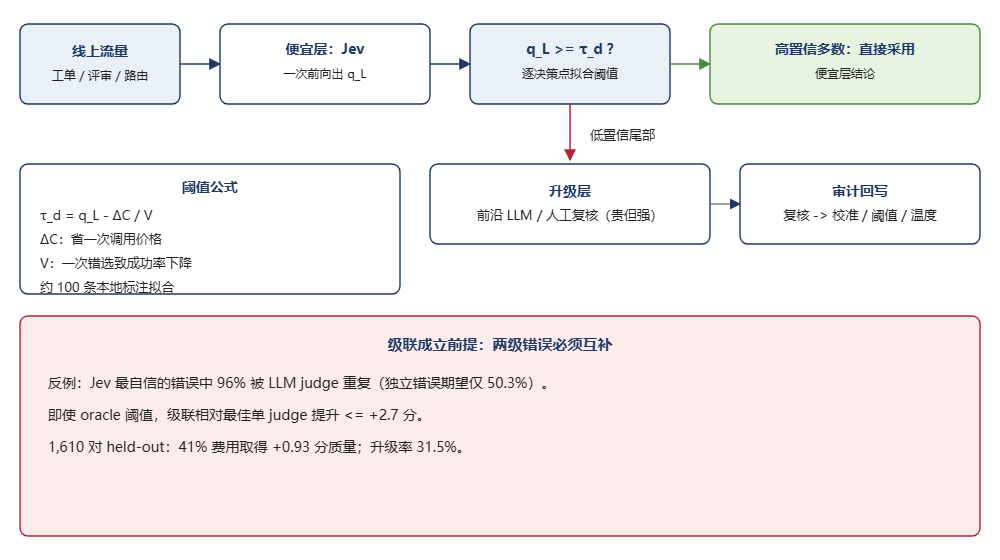

### 8.2.2、基准数字：JEV-as-a-Judge（2609.26550v3）与 2026-10 新证据四单元

2609.26550v3提出的JEV-as-a-Judge是目前公开项目与论文最典型的级联实证：

|测量条件|规模|结果|升级率|费用比|
|---|---|---|---|---|
|held-out 级联（τ=0.9）|1,610 偏好对（1,340 RewardBench + 270 JudgeBench）|级联 93.4% vs GPT-6 92.5%，<strong>+0.93 分 [0.24,1.66]</strong>|31.5%|0.414|
|前瞻性 live test|570 对全新负载|级联与 GPT-6 完全打平（90.2% vs 90.2%）|74.2%|0.755|

这里存在边界条件需要指出：

- 置信度的错误检测能力在“推理型”任务（专家知识−7.0、代码−12.9、数学−14.3、逻辑题−27.6）、风格对抗（劣质答案表述更华丽时，准确率从 85.4% 降至 76.6%）、无参考散文类任务（AUROC 0.498，接近随机）上基本失效；

- 能力差距的分布直接决定了级联的优化方向：<strong>JEV 与 GPT-6 的差距不是均匀的，而是集中在特定任务切片上</strong>——“结论可从文本读出”的任务差距≤3 分，“需要推导”的任务差距 7–28 分；

- <strong>因此最优级联策略不是按统一阈值无差别升级，而是将“可从文本读出”的初筛留给 JEV，把“须推导 / 须专家知识”的切片整批升级！</strong>

---

目前看到的既有级联证据集中在评审、反诈、渗透、代码仿真四个单元，任务域<strong>偏智能体、安全与内容审核</strong>。而在2026 年 10 月新增了四个跨域独立复现单元，分别覆盖级联的四个互补环节，使级联模式的证据强度达到 A 级（多域独立复现）：

- <strong>JevAgentHarness：按决策点拟合阈值（arXiv:2610.21412）</strong>

  > 《JevAgentHarness: Benchmarking, Deploying and Training Decision Models That Share Control with LLMs》
  > 
  > - <https://arxiv.org/pdf/2610.21412>
  > 
  > - <https://github.com/JevAgentHarness/JevAgentHarness>
  > 
  > 

  - 该研究补充了级联模式的关键细节：统一阈值不适用于多决策点的长链路任务；不同决策点的错误代价、回退成本差异极大，<strong>必须基于“错误导致的任务损失”与“升级调用的成本”逐点计算</strong>最优阈值 $τ_d=q_L−ΔC/V$；

  - 论文实测显示，逐点拟合阈值可在 DecisionGym 上实现 0 质量损失 + 14.2% 成本节省，而固定 0.5 阈值会导致 21.5 分的质量损失；在 Terminal-Bench 2.0 上实现成本下降 64%、耗时缩短 43%，质量仅下降 2.7 分；

  - 结论：校准阈值是级联生效的必要条件，而非可有可无的调参；

  - <strong>边界：成本节省高度依赖两级模型的价差，价差缩小时收益大幅收窄；</strong>

  - 详细扩展：

  > 背景&出发点：
  > 
  > - 典型 Agent（mini‑SWE‑agent、Claude Code、客服 Agent 等）由<strong>Harness（调度器 / 执行脚手架）</strong>驱动：Agent 每一步状态转移，都调用一次昂贵的生成式大 LLM，由 LLM 输出文本 / 结构化工具调用。 作者观察到一个结构性事实：<strong>Agent 循环里大量调用，本质不是自由创作，而是有限选项的离散决策，比如：</strong>
  > 
  > 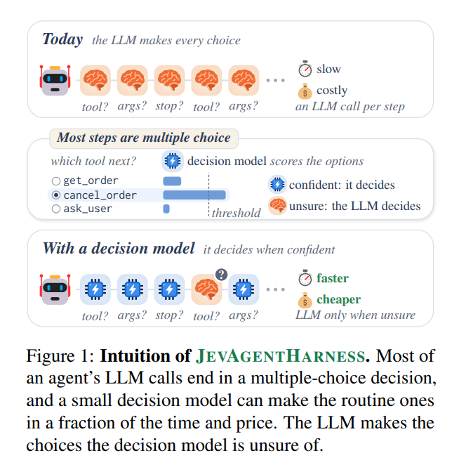
  > 
  > - 选哪一个工具；
  > 
  > - 工具参数从枚举候选里选哪一项；
  > 
  > - 是否停止任务、是否发起反思、是否校验、是否询问用户；
  > 
  > - 是否批准 / 否决大模型输出（Guard 模式）；
  > 
  > 这类问题天然是<strong>多选分类问题</strong>，不需要大模型做自回归文本生成 —— 天然适合Jev决策模型；
  > 
  > - 现有方案存在三个核心未解决问题，也是本文的研究锚点：
  > 
  > - <strong>评测鸿沟（Evaluation Gap）</strong>：离线单独测试决策模型的选择题准确率很高，一旦放到闭环 Agent 里，决策错误会改变环境状态，错误沿着轨迹链式放大；离线指标和真实任务成功率相关性弱。之前没有分层基准，区分 <strong>“孤立做题”、“静态打分”、“闭环控制”</strong>三种难度。
  > 
  > - <strong>置信度门控的陷阱</strong>：简单固定置信阈值（比如 0.5）做级联，会带来巨大成功率跳水。原文数据：<strong>不加拟合阈值直接下放工具选择，任务成功率直接下降 19 个百分点</strong>。
  > 
  > - <strong>训练数据分布缺陷</strong>：现有 Jev 等决策模型训练样本大多来自<strong>成功轨迹</strong>，很少覆盖 Agent 自己犯错之后进入的异常状态；而真实 Agent 运行中大部分高风险决策点恰恰出现在出错后的状态，模型对这类分布外状态校准差、置信度不可靠。
  > 
  > - 研究问题分解：能不能让 Agent 脚手架安全地把离散决策委派给低成本决策模型，把任务成功率的损失控制在很小范围内？
  > 
  > 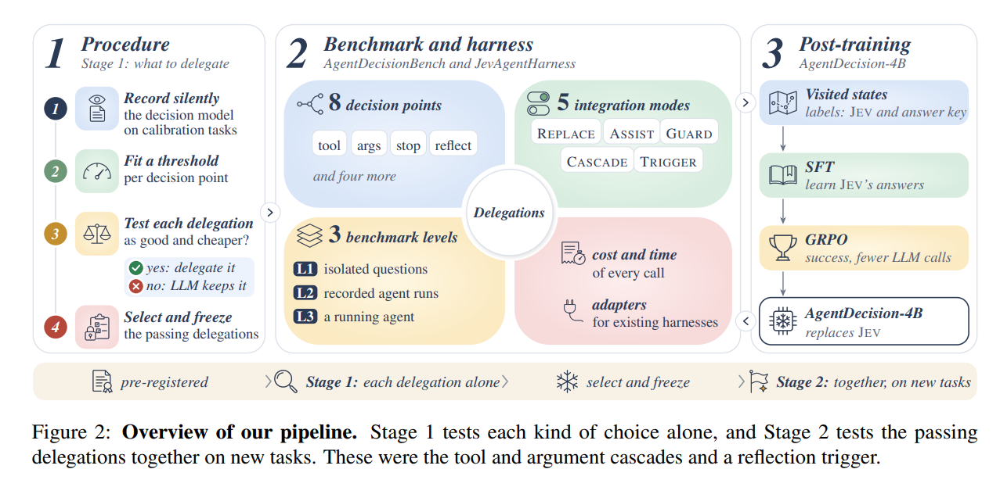
  > 
  > - RQ1：如何分层评测决策模型在 Agent 闭环场景下的真实能力？ 
  > 
  > - RQ2：如何设计自适应、感知代价与风险的置信门控策略，实现大小模型级联共享控制？
  > 
  > - RQ3：如何训练一个开源决策模型，覆盖 Agent 失败后的坏状态，在闭环任务上优于闭源 Jev？
  > 
  > - 核心产出一：AgentDecisionBench 分层评测基准 + DecisionGym 仿真环境
  > 
  > 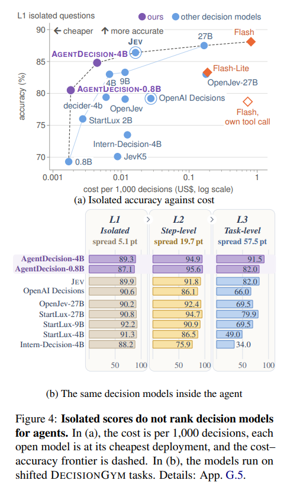
  > 
  > - 三层递进评测阶梯，用来诊断 “离线分数虚高” 问题，三层严格对应从易到难、从脱离环境到闭环控制；
  > 
  > - L1 Isolated（孤立问题）：把决策抽成独立选择题，脱离 Agent 环境 —— 答案不会改变后续状态，传统评测方式,只能看静态选择题识别能力，预测性很差；
  > 
  > - L2 Step-level（步骤级）：在已经录制好的固定轨迹上打分 —— 模型输出选项，但不执行，环境状态固定，错误不会传导,和真实闭环成功率相关性更高，是性价比高的中间验证
  > 
  > - L3 Task-level（任务级）：决策模型真实接管 Agent，动作会被执行 —— 状态随模型选择变化，错误链式传播；最贴近上线,最终真实性能指标，也是作者重点推荐的评测方式
  > 
  > - 配套自研仿真环境 <strong>DecisionGym</strong>：面向客服类任务，环境内置每个状态下全部合法、正确的可选动作，因此可以自动给出每一步决策的 Ground Truth，不需要人工标注。
  > 
  > - 实证结论：<strong>在 L1 上准确率最高的模型，L3 闭环任务成功率仅 69.5%</strong>，直接证明离线榜单不可信；
  > 
  > - 核心产出二：JevAgentHarness 级联共享控制框架（主体工程）
  > 
  > - JevAgentHarness 是一套<strong>可插拔适配器层</strong>，不需要大规模改写原有 Agent 代码；它在 Agent 循环的决策点上注入钩子，把结构化多选问题喂给决策模型，再根据置信策略决定 “采纳小模型结果” 还是 “回退给原生 LLM” —— 整体由三块组成：
  > 
  > - <strong>类型化决策接口（Typed decision interface）</strong>：统一 Jev 风格输入规范
  > 
  > - 把一次工具调用拆成两层独立决策：工具名称选择 + 每个枚举型参数选择；自由文本参数仍然留给大 LLM 生成。
  > 
  > - 也就是说，框架天然区分【离散决策】和【开放式生成】，不强行让小模型生成文本。任何兼容该接口的决策模型都可以接入。
  > 
  > - <strong>基于影子轨迹拟合的感知风险阈值器（核心数学组件）</strong>
  > 
  > - 阈值 τ 不是全局固定值，<strong>每个独立决策点单独拟合；</strong>
  > 
  > - 拟合数据来自影子模式（Shadow Mode）：决策模型后台并行预测，但不接管控制，由原始大模型继续执行，收集大量真实轨迹；
  > 
  > - 阈值优化目标同时权衡三项成本： 
  > 
  > - 大模型一次调用的货币 / 延迟成本；
  > 
  > - 当前决策如果选错，造成整个任务失败的损失；
  > 
  > - 决策模型在该状态下的校准概率
  > 
  > - 高风险不可逆动作（取消订单、退款、高危操作）会自动得到接近 1.0 的阈值：只有极高置信才允许下放；普通查询动作阈值更低；
  > 
  > - 当底层 LLM、决策模型、业务规则变更后，阈值必须重新拟合；
  > 
  > - <strong>适配器、服务层与记账模块</strong>：对接 mini‑SWE‑agent、Claude Code 等现有 Agent 脚手架；自动统计 LLM 调用削减比例、延迟、成功率、成本；
  > 
  > - 将AgentLoop循环当中8个决策插入点与有哪些模式对应，提出了五种控制模式：
  > 
  > 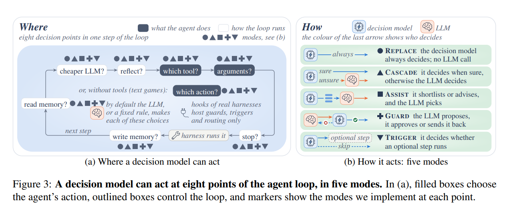
  > 
  > - <strong>Cascade（级联，本文主推）</strong>：先问决策模型；置信≥τ → 直接采用；低于 τ → 交给大 LLM。代价收益最好，主实验默认模式。
  > 
  > - <strong>Replace（全权替代）</strong>：所有决策永久交给决策模型，不回退 LLM；成本最低，但成功率暴跌，只适合极低风险场景。
  > 
  > - <strong>Assist（候选压缩）</strong>：决策模型输出 Top‑k 候选选项，缩小搜索空间，再把精简后的选项交给 LLM 最终选择；不直接做决定。
  > 
  > - <strong>Guard（审查 / 守卫）</strong>：LLM 先给出决策；决策模型做二分类：同意 / 否决；否决则重新生成。
  > 
  > - <strong>Trigger（触发判定）</strong>：二元决策：要不要启动反思、要不要停止、要不要进入子流程。
  > 
  > - 核心产出三：AgentDecision‑4B，开源决策模型
  > 
  > 基于 Qwen3‑4B 基座，用 LoRA 微调得到 AgentDecision‑4B，训练分为两个阶段：
  > 
  > 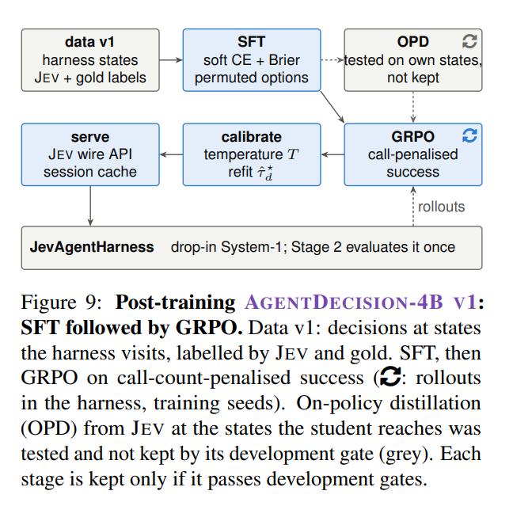
  > 
  > - <strong>SFT 监督微调（主增益来源）</strong>
  > 
  > - 训练轨迹包含 <strong>30.9% 来自 Agent 失败 / 错误状态</strong>（这是和原版 Jev 最大的数据差异）；
  > 
  > - 标签采用 Jev 输出的软概率标签，不是硬 one‑hot；
  > 
  > - 损失 = 交叉熵损失 + Brier 分数损失，目标是让模型输出的概率置信度被校准（减少过度自信）。
  > 
  > - <strong>GRPO 强化学习（增量很小，算力开销大）</strong> 在 DecisionGym 环境内在线交互优化；奖励信号包含：任务成功、减少 LLM 调用次数、对不可逆错误动作施加惩罚。 消融明确指出：<strong>绝大多数性能提升来自 SFT；GRPO 带来的收益微弱，性价比不高</strong>。
  > 
  > - <strong>比较有意思的是</strong>：论文原本想拿 OPD 作为 SFT 之后、GRPO 之外的另一条后训练路线，用来把决策模型对齐到大 LLM（教师）的决策分布；经过小批量预跑之后，作者直接放弃，主实验只保留 SFT (+Brier) + 少量 GRPO，列出的原因如下：
  > 
  > 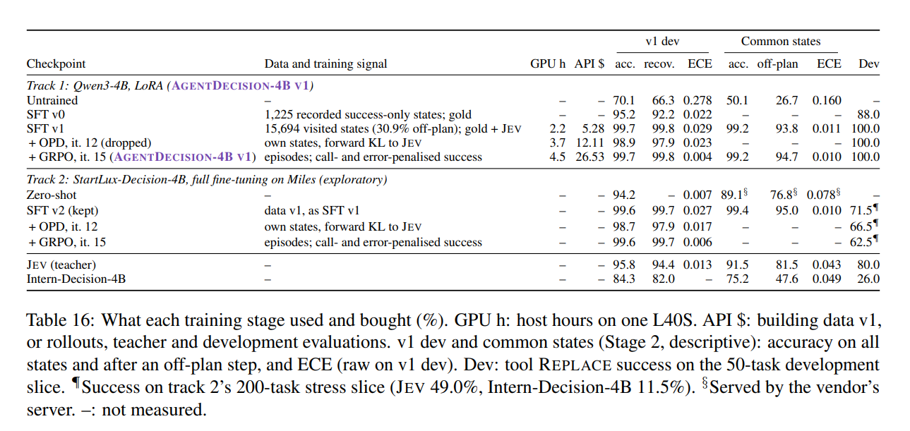
  > 
  > - OPD 会破坏置信度校准 —— OPD 是 KL 对齐教师分布，目标是让学生的动作分布贴近教师；它<strong>不优化概率校准</strong>；
  > 
  > - 预实验观察：OPD 训练之后，模型变得<strong>过度自信</strong>，高置信错误（confident catastrophic mistake）变多；
  > 
  > - 而这个项目最怕的恰恰就是：高置信选不可逆坏动作（直接取消订单这类）；
  > 
  > - SFT + Brier 目标是显式压 Brier 分数，天然鼓励校准，刚好匹配 JevAgentHarness 的级联阈值机制；OPD 会把前面校准收益毁掉。
  > 
  > - 学生自采样轨迹带来分布漂移 + 前缀污染（prefix conditioning bias）—— 
  > 
  > - 学生 policy 一开始弱，会大量进入<strong>坏状态、分布外状态</strong>；教师要基于这些 “被学生搞坏的前缀” 给出监督信号；
  > 
  > - 教师在学生生成的错误前缀上给出的分布本身就是有偏、不可靠的；
  > 
  > - 结果：OPD 会<strong>放大坏状态下的错误策略</strong>，而不是学会从坏状态恢复；
  > 
  > - 本文恰恰专门把 30.9% 的训练样本设置为 Agent 失败后的坏状态，目的是学会在坏状态里谨慎决策；OPD 的在线 rollout 机制反而和这个数据设计冲突。
  > 
  > - 想对比下： SFT 用<strong>固定收集好的影子轨迹</strong>（shadow rollout），状态分布可控，可以人为控制好状态 / 坏状态比例，不会一边训练一边自己制造分布偏移。
  > 
  > - 收益很低、算力开销巨大，性价比远不如 SFT，甚至不如 GRPO
  > 
  > - 在 DecisionGym 客服闭环任务上，OPD 带来的闭环成功率提升极小，很多时候甚至不如单纯 SFT+Brier；
  > 
  > - OPD 需要训练循环里持续在线启动 Agent 环境、学生 rollout、调用昂贵教师 LLM 打分；Token / 算力成本远高于离线 SFT；
  > 
  > - GRPO 已经是作者眼里 “收益微弱、算力贵” 的选项，OPD 比 GRPO 还要更贵、增益还更小；
  > 
  > - <strong>【原文】绝大多数性能收益来自带 Brier 损失的 SFT；在线交互类方法（GRPO、OPD）边际回报很差</strong>。OPD 属于边际回报最差一档，直接砍掉。
  > 
  > - 决策空间是离散有限选项，OPD 的 dense token-level KL 目标不匹配任务形态
  > 
  > OPD 原生是为自回归 token 生成设计的（逐 token KL）； 而 Jev 决策模型的输出是<strong>有限离散选项的分类分布</strong>（工具 A / 工具 B / 询问用户 / 停止），不是长文本 token 序列：
  > 
  > - 把 OPD 套在离散决策上，目标函数形式别扭；KL 约束容易让分布坍缩、熵过低；
  > 
  > - 相比之下，交叉熵 + Brier 是原生适配分类概率校准的损失，简单、稳定、更容易调试。
  > 
  > - 和 GRPO 的对比：
  > 
  > - GRPO 是基于<strong>任务结果稀疏奖励</strong>（成功 / 失败、惩罚不可逆动作），至少直接优化端到端任务指标；它虽然增益小，但方向和最终目标对齐；
  > 
  > - OPD 目标只是 “模仿教师分布”，是一个代理目标，不直接奖励任务成功、不惩罚灾难性不可逆动作；
  > 
  > - 所以最终取舍：GRPO 保留做消融对照，但不放到主推荐流程；OPD 直接全部放弃，不进入主实验；
  > 
  > OPD 在线蒸馏会污染状态分布、破坏置信校准（而置信校准是这套级联调度的根基）、算力昂贵、闭环增益微弱；加上它原生是为 token 生成设计，和离散决策模型 + 阈值调度的整套体系不兼容，因此在预实验之后被放弃，最终训练管线锁定为 <strong>SFT（软标签 + Brier 校准损失）为主，可选少量 GRPO 为辅</strong>
  > 
  > 

- <strong>Jev-LiteMAS：路由 + 评审分离（arXiv:2610.21411）</strong>

  - 该案例拓展了级联的应用边界 —— 从单一判断点扩展至多智能体工作流的全局资源分配。

  - 其核心判断是：多智能体系统中 31.7–43.5% 的生成式 token 消耗在<strong>“路由、评审、分诊”</strong>等选择类任务上，这类任务恰好匹配 Jev 式模型的能力范围，将其从生成式大模型中剥离出来，可在几乎不损失质量的前提下显著降低成本。

  - 论文实测相对 LAS 框架能够节省生成式 token 12.7–54.6%，准确率差距≤1.34 点；决策层开销仅占端到端延迟的 2.92–6.85%、模型费用的 1.56–2.14%；

  - 详细扩展：

  > 核心：<strong>把多智能体流程里“选谁干活、半成品要不要放行”这类二选一 / 有限候选的决策，交给轻量决策模型 Jev；只在确实有问题的时候，才调用昂贵的生成式大模型做复核、写修改意见，大幅省 token、降延迟，同时任务准确率几乎不掉；</strong>
  > 
  > 背景&出发点：
  > 
  > - LLM 多智能体系统，包含两类工作： 
  > 
  > - 专家生成工作：写代码、解数学题、产出方案（需要自由文本生成）
  > 
  > - 协调控制工作：选下一个该哪个智能体干活（路由）；判断中间输出是否合格（评审）
  > 
  > - 现在主流多智能体框架（MetaGPT、AgentNet、LAS 等）有一个很大的浪费：<strong>路由（下一步派哪个专家）、中间产物评审（这个结果能不能往下走）全都靠生成式 LLM 来做</strong>。论文实测：这两块控制逻辑，会吃掉整个流程 31.7%–43.5% 的 LLM token，延迟占比 29.5%–46.1%；
  > 
  > 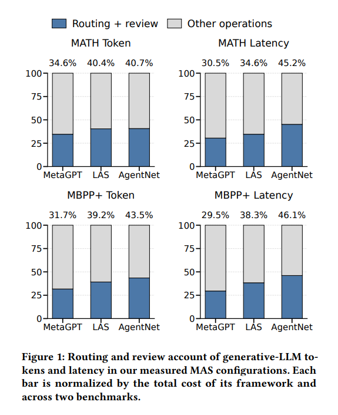
  > 
  > - 但<strong>直接替换会遇到两个接口Gap：</strong>
  > 
  > - <strong>规划鸿沟 Planning gap</strong>：传统生成式规划器输出完整多步计划、交接指令；但 Jev 这类<strong>选择型决策模型只能从给定候选里面选动作，不会写自然语言计划 ——</strong>直接替换会丢失计划和交接指令。
  > 
  > - <strong>评审鸿沟 Review gap</strong>：生成式评审不仅判断好坏，还输出可落地的修改建议；但 Jev 只能输出`pass/escalate`二分类判决，<strong>无法生成修复用的反馈文本</strong>。
  > 
  > - 核心研究：怎么用边界决策模型做协调，同时不丢失规划上下文、错误修复需要的生成反馈？
  > 
  > 核心思路与设计：
  > 
  > - 核心思路：决策与生成分离（Capability Division） —— 把 “选下一个专家、判断半成品是否放行” 这类有限输出的<strong>决策任务交给轻量决策模型 Jev</strong>；<strong>只有遇到可疑产物才调用昂贵生成大模型做复核 + 写修改反馈；</strong>
  > 
  > - <strong>Jev-LiteMAS 架构</strong>：一套可插拔、信息保留的工作流，把路由、初审交给选择式决策模型，只有可疑样本才走昂贵的生成复核 + 修复 —— 在 AutoGen 基础上搭的双层控制流，两个核心机制：
  > 
  > 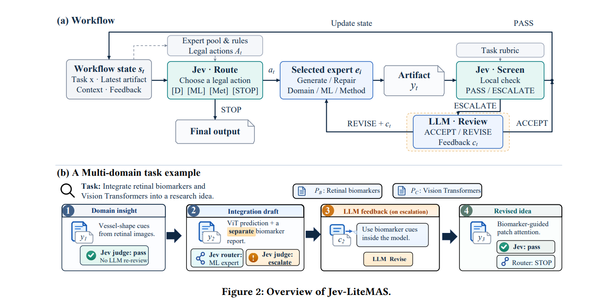
  > 
  > - <strong>反馈驱动的专家交接（Routing）</strong>：不是提前写死路线；每一步看完上一个专家实际产出后，Jev 从合法候选专家里选下一个执行者，适配真实进展；
  > 
  > - <strong>Jev 门控的分级复核（Gated Re-review）</strong>： 
  > 
  > - 第一步：Jev 快速筛查：`pass`直接放行，不碰 LLM；`escalate（升级）`才送给 LLM 评审；
  > 
  > - 第二步：LLM 复核升级上来的产物：要么认可放行，要么给出可落地的修改反馈，交给对应专家返工；
  > 
  > - 返工后的产物，再次进入筛查流程。
  > 
  > 

- <strong>JevCoder：代码修复委派边界（arXiv:2610.19596）</strong>

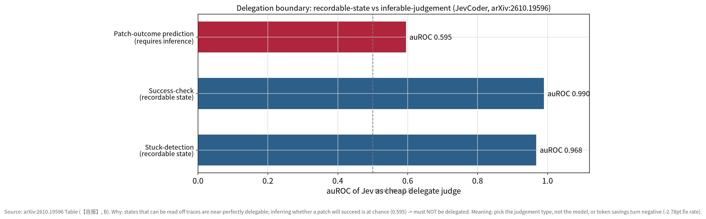

  - 该研究清晰划定了决策模型的委派边界，与 后续章节的能力分界结论完全一致：<strong>可从历史轨迹直接读出的“状态类判断”（如是否卡住、测试是否通过），Jev 可以接近完美地完成（卡住检测 auROC 0.968、成功检查 0.990）；而需要推导预测的“推断类判断”（如补丁是否正确），Jev 表现接近随机（auROC 0.595）</strong> —— 选对判断类型可降低修复阶段 token 消耗 21.6–50.6%，选错则会导致修复率下降。

  - 这一边界为所有级联场景提供了通用选型原则 —— <strong>只委派“可记录、可验证”的判断，绕开“需推导、需创意”的环节；</strong>

  - 扩展：详细说明

  > 核心命题：<strong>代码修复 Agent 里，把哪些判断交给廉价小打分模型才真的划算？不是判断越便宜越好，而是要看这个判断能不能砍掉后面大模型的无效工作量</strong>。
  > 
  > 背景&出发点：
  > 
  > - 现在主流 SWE Agent（自动修 bug 智能体）的模式：一个主大模型包揽全部思考和决策。 拿到 issue 之后，它要反复做全套事情：检索仓库、挑代码片段、分析 bug、写补丁、跑测试、看测试结果、判断要不要继续改、判断是否修好、决定要不要提交 —— 每一轮交互都要带上越来越长的历史上下文（轨迹、代码、日志），token 开销爆炸、成本高、容易进入无限试错循环。
  > 
  > - 已经有很多 “自我校验、反思、Self-verification” 的做法：让主模型自己反问自己、自己判断补丁对不对。但这套方案有两个硬伤：
  > 
  > - 校验本身也要消耗昂贵大模型 token；
  > 
  > - 模型经常陷入 “反复改、反复自检、反复无效迭代”，校验本身没有减少后续工作量；
  > 
  > - 一个自然的想法：“能不能用一个便宜小模型专门做 “是 / 否 / 多选打分”，只输出概率，不写长篇理由，把判断活外包出去？” —— 这就需要回答一个问题：“<strong>什么样的判断适合外包给小模型？是不是只要小模型能答对，就可以了？</strong>”
  > 
  > 论文将修复流程拆成三类不同时机的判断，单独做消融研究，看每一类判断单独上线，分别带来什么效果：
  > 
  > 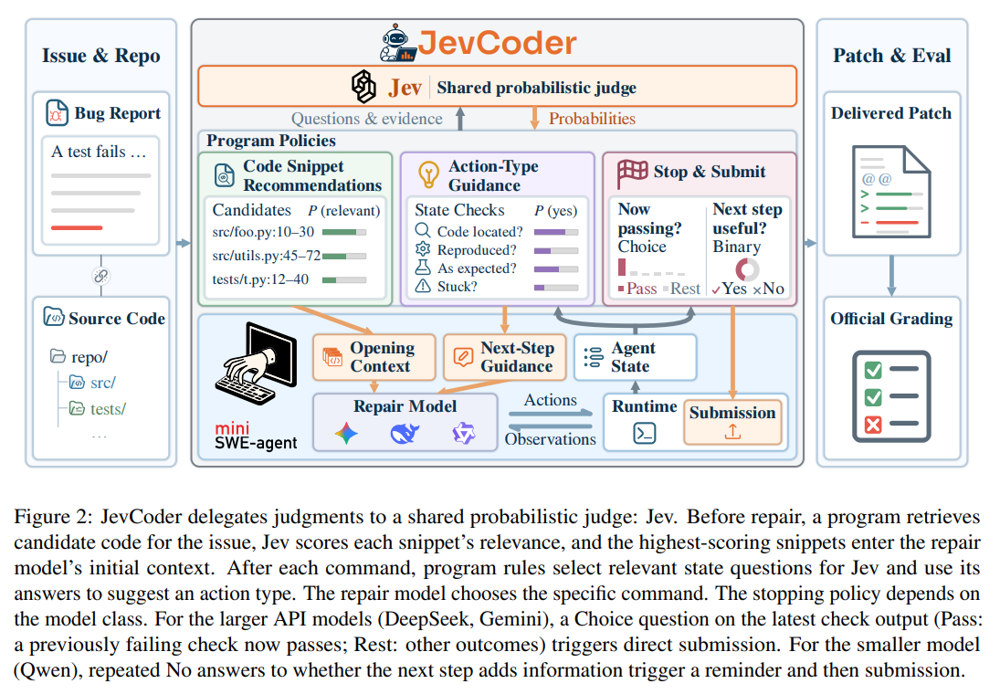
  > 
  > 1. <strong>前置阶段：代码片段相关性打分（Snippet Recommendation）</strong> 
  > 
  > - 问题：仓库里几百上千个文件，哪些代码片段和当前 bug 相关？ 
  > 
  > - 作用：提前过滤无关代码，只把高分片段塞进主模型上下文。 
  > 
  > - 结论：收益很稳 —— 它能缩短定位阶段，让模型在第一次修改之前就聚焦到正确区域，减少大量漫无目的的检索和阅读。
  > 
  > 2. <strong>迭代中间：动作类型引导（Action-type Guidance）</strong> 
  > 
  > - 问题：跑完一轮测试失败之后，下一步应该做哪一类动作？继续读代码？新增修改？回退？跑更多测试？ 
  > 
  > - 作用：给主模型一个动作方向提示，而不是让模型每次从零思考策略。 
  > 
  > - 结论：Jev 对<strong>修复状态（当前走到哪一步、有没有进展）</strong>的区分能力很强；但对 “这个补丁最终能不能修好” 的预判能力偏弱。<strong>它擅长判断 “现在处于什么状态”，不擅长预判未来结果</strong>。
  > 
  > 3. <strong>终止判断：是否可以提交补丁、停止循环（Stopping）</strong>
  > 
  > - 问题：现在测试通过了吗？要不要停止，还是继续微调？ 
  > 
  > - 结论：终止策略不能一刀切，要适配主模型本身能力： 
  > 
  > - 大 API 模型（DeepSeek、Gemini）：看到测试成功就停；
  > 
  > - 开源中等模型（Qwen3.8-27B）：不要单看一次成功，改成<strong>连续多轮没有进展时停止</strong>，避免假阳性提交；
  > 
  > 最终给出的判断是：
  > 
  > - 判断外包的收益不等于小模型本身便宜，收益来自<strong>这个判断改变了后续修复轨迹，减少了昂贵主模型后续要做的工作量；</strong>
  > 
  > - 优先外包那些<strong>能压缩上下文、能阻止无效迭代、能引导 Agent 少走弯路</strong>的判断 —— 单纯做结果校验、不改变后续动作的判断，外包价值有限；
  > 
  > 具体实验上。论文设计了<strong>四层递进的实验体系，在SWE-bench真实的仓库上进行：</strong>
  > 
  > 1. 判决质量隔离实验（先单独测 Jev 本身能不能把各类判断做好）
  > 
  > 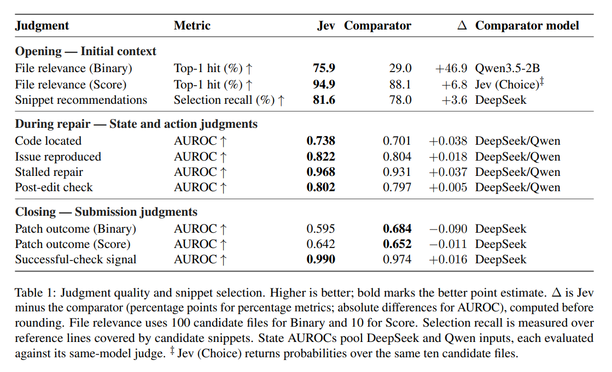
  > 
  > - 把修复流程拆成三个独立的判断任务，单独拿出来，给 Jev 输入固定证据（bug 描述、候选代码、修复轨迹、测试日志），单独评测 Jev 在三类判断上的<strong>独立准确率</strong>，不接入 Agent 闭环，不影响后续动作。 
  > 
  > - 三类判断： 
  > 
  > - A. 片段相关性打分（Snippet Recommendation）：候选代码片段和当前 bug 是否相关，排序 
  > 
  > - B. 动作类型引导（Action-type Guidance）：失败后下一步应该走哪一类动作（读代码 / 修改 / 跑测试 / 回退） 
  > 
  > - C. 终止判断（Stopping）：当前是否满足提交补丁、停止迭代的条件
  > 
  > - 结论：
  > 
  > - Jev 在<strong>状态分类、相关性排序</strong>上有不错的区分能力；但是<strong>直接预判 “补丁最终是否正确” 的能力偏弱</strong>。它擅长识别 “现在走到哪个修复阶段、有没有进展”，不擅长预判未来修改能否成功。
  > 
  > - 一个关键前置观察：<strong>单独看准确率，不足以判断这个判断任务外包有没有价值</strong>。有些任务 Jev 准确率很高，但就算交给它判，也几乎不会改变 Agent 后续要做的工作，外包没有净收益。
  > 
  > 2. 单干预因果实验（单独打开某一类外包判断，看它会不会改变后续修复轨迹，验证核心命题）
  > 
  > - 对同一个主模型、同一批 bug，跑 4 组对照：
  > 
  > - 对照组：完全无引导（Unguided），所有决策由主模型自己做
  > 
  > - 实验组 A：只开【片段相关性打分】，其余决策还是主模型自己来
  > 
  > - 实验组 B：只开【动作类型引导】，其余决策还是主模型自己来
  > 
  > - 实验组 C：只开【终止判断】，其余决策还是主模型自己来
  > 
  > - 结论：
  > 
  > - <strong>片段相关性打分（A）：收益稳定、幅度最大</strong> 
  > 
  > - 提前过滤无关代码，压缩初始上下文，减少漫无目的文件检索；
  > 
  > - 显著降低主模型 token，同时提升修复率；是三者里收益最稳的模块；
  > 
  > - <strong>动作类型引导（B）：收益中等，有边界</strong> 
  > 
  > - Jev 给主模型一个动作方向提示，避免模型每次从零思考策略；
  > 
  > - 但局限：它只能给大类方向，不能告诉模型 “具体改哪一行”；如果 bug 本身定位已经很清晰，这个引导的收益会变很小。
  > 
  > - <strong>终止判断（C）：收益高度依赖主模型能力，不能一刀切</strong>
  > 
  > - 强 API 模型（DeepSeek/Gemini）：适合 “测试通过就停”，防止继续画蛇添足改坏补丁；
  > 
  > - 开源中等模型（Qwen3.8-27B）：单次测试成功有大量假阳性，不能看到测试通过就停，改用<strong>连续多轮无进展停止策略</strong>； 如果终止策略配错，反而会提前提交错误补丁、拉低修复率。
  > 
  > 综合结论：<strong>三类干预的价值不是由 Jev 判得准不准决定，而是由干预能不能砍掉后续无效搜索、无效迭代决定</strong>。
  > 
  > 3. 全流水线主对比实验（JevCoder 完整系统 vs 两类基线，端到端指标）
  > 
  > - 把上面三个有正向收益的干预组合成完整闭环 JevCoder，和无引导基线（Unguided）在完全相同 400 任务上做头对头对比；3 个主模型分别独立跑。
  > 
  > - 结果：
  > 
  > - DeepSeek：token 下降 <strong>50.6%</strong>，修复率上升
  > 
  > - Gemini：token 下降 <strong>21.6%</strong>，修复率上升
  > 
  > - Qwen：token 下降 <strong>33.6%</strong>，修复率上升
  > 
  > - 结论：
  > 
  > - 把三类高价值判断打包交给廉价概率裁判，整套 Agent 闭环是有效的；
  > 
  > - 这套分工方案对商用 API、开源本地模型都通用，不是只对某一类模型有效；
  > 
  > - 收益来源不是 “Jev 帮模型直接想出正确补丁”，而是<strong>压缩上下文、减少无效检索、减少无效试错循环、及时刹车</strong>，让主模型的算力 /token 集中在生成补丁这个核心任务上。
  > 
  > 4. 组件消融 + 同模型自校验对照实验（分离收益来源、区分 “小模型裁判” 和 “大模型自己判”）
  > 
  > - 关于组件消融：在完整 JevCoder 上，每次拿掉一个组件，其余保留，看指标退化：去掉片段推荐、去掉动作引导、去掉自适应终止判断；
  > 
  > - 结果：<strong>去掉任意一个组件，修复率下降、主模型 token 消耗上升、中位数运行时间变长</strong>；拿掉片段推荐的 token 涨幅最大（每任务 + 0.174M token）。
  > 
  > - 结果：三个组件是互补的，不是单一模块独揽收益；三者组合才是最优。
  > 
  > - 片段推荐：前置降开销（最大贡献）
  > 
  > - 动作引导：迭代过程减少迷路
  > 
  > - 自适应终止：防止无限循环、防止假阳性提交
  > 
  > - 关于自我判断：不使用 Jev；把完全一样的三类判断问题，交给同一个主修复大模型自己回答（也就是主流 Self-reflection / Self-verification 方案），对比 JevCoder
  > 
  > - 观测结果：
  > 
  > - 自校验也能减少一部分主模型的修复轮次、工具调用；但是<strong>新增的裁判请求本身也是昂贵主模型 token</strong>；
  > 
  > - DeepSeek 的自校验方案中位数耗时反而上涨 58.2%；JevCoder 是同时降 token、降耗时；
  > 
  > - Qwen 自校验有一定提速，但幅度远小于 JevCoder；
  > 
  > - 结论：
  > 
  > - 传统 “大模型自己反思、自己校验” 的方案有硬成本：校验本身消耗昂贵主模型资源；
  > 
  > - JevCoder 的优势不只是 “加一个校验环节”，而是<strong>用低成本概率裁判承接路由类判断，并且整套策略是基于 “轨迹干预” 设计，而不是单纯校验补丁对错</strong>；
  > 
  > 

- <strong>Selective Reasoning：推理深度早停（arXiv:2610.19644）</strong>

  - 该技术与置信度级联形成互补：级联解决“交给谁做”的路由问题，早停解决“做到什么深度”的资源问题 —— 具体会通过在小模型上训练极轻量的线性头，<strong>用收益门、状态触发、熵规则三门</strong>控实现按需可中断推理；

  - 论文实测证实熵早停可在准确率下降 \< 2 个百分点的前提下节省 34.09% 的推理时间，与固定深度方案相比实现了更优的成本 - 质量平衡 —— <strong>二者共同构成了“按需分配计算资源”的完整框架</strong>；

---

四个新增单元加上9月份的原有评测，使置信度级联模式的证据覆盖了内容审核、智能体、代码、安全、推理控制等多个领域，是当前 Jev 式模型最成熟、证据最充分的生产形态。

---

### 8.2.3、反例与边界：错误互补前提不成立时

独立的第三方评测（arXiv:2609.29769）通过 9 个评测面板在 5003 对样本评测上，给出了级联失效的干净反例，具体分析来讲其本质是“错误互补”前提被破坏所导致的：

> - Jev 最自信的错误里，96.0% 的大模型评审也重复了相同的错误答案（242/252），远高于独立错误的理论期望值 50.3%；
> 
> - 即使使用最优阈值，级联相对最佳单模型的提升不超过 + 2.7 分；交叉验证阈值下，9 个面板中有 6 个的级联效果反而不如最佳单模型；
> 
> 

这一现象与 后续总结的失败模式所揭示的“大模型共性偏差”一脉相承：<strong>当两级模型基于相似的训练数据、相似的架构范式时，会共享大量认知偏差，对同一问题产生相同的错误判断，导致第二级无法起到纠错作用</strong>。这也提示选型者：<strong>级联的两级模型差异越大，纠错收益越高；若两级是同系列模型的大小版本，级联效果会大幅打折</strong>。

agent 安全评测（arXiv:2609.33401）则从另一侧验证了同一结论：<strong>在注入攻击场景下，多数复核Judge都会复现 Jev 的高置信漏检，仅靠模型级联无法解决安全类的极端偏差问题，必须引入确定性规则与人工复核作为最终兜底。</strong>

> - WAInjectBench 上 Jev 高置信漏检（max(p,1−p)≥0.95）130 个 FN，7 个复核 judge 每个最多只纠正 5/130，每个 judge 都复现 \>80% 的高置信错误；
> 
> - AgentHarm 上 Kimi 虽纠正 Jev 全部 14 个漏检，却复现全部 42 个误报并新增 54 个；
> 
> 延伸结论：复核 judge 的纠错收益不能从聚合 accuracy 推断，必须实测错误重叠。
> 
> 

---

### 8.2.4、其他级联形态与 Jack & Jill 客户案例

除标准的双模型级联外，落地实践中还演化出了多种适配不同场景的级联变体：

|形态|结构|关键数字|来源|
|---|---|---|---|
|渗透决策级联|L0 确定性 validator（零成本）→ L1 System One Noul → L2 Choice+Score → L3 LLM deliberation → L4 人工复核|加法原则；<br>最坏等价于关闭 System One 层；单<br>轮实测墙钟 −16.5%|arXiv:2609.28940|
|agent 安全选择性自动化|双阈值（allow τ\_L /block τ\_H 独立搜索），1%/5%/10% miss 预算|1% miss 预算下 WAInjectBench Jev coverage <strong>0.00%</strong>（全升级 review）；<br>R-Judge Jev 仅 7.63% coverage；<br>独立阈值后 R-Judge 47.03% 但 allow 仅 1 条 —— <strong>最严预算下靠多 block 提 coverage、allow 几乎不动</strong>|arXiv:2609.33401|
|CPU–NPU 异构级联（COGNIT-Guard）|CPU 浅分类器（TF-IDF+XGBoost）快门控出 p\_fast；c≥θ\*=0.70 落 CPU，否则升级 NPU 常驻 Laya-322M|<strong>94.62% 请求落 CPU / 5.38% 升级 NPU</strong>；<br>live 级联均值 41.63 ms（P95 76.25）、99.23% acc、0/48 benign 误报；<br>纯 NPU Laya 21.77 ms|arXiv:2609.33671|
|Code/Simulation 分工|代码（游戏副本 lookahead / 物理仿真）提供后果 z，Jev 只做 evaluation|ALFWorld 单局 Jev 单独 42/134（31%）→ +lookahead v1 79 → +v2（加新解锁命令）<strong>116/134（87%）</strong>；<br>Robot Stacker raw torques 0/20 → 代码技能间选 9/20 native、22/40 新指令局|arXiv:2610.01834|

【注意】其中 COGNIT-Guard 是少数将校准、延迟 SLO 与假阳性惩罚纳入同一优化问题的案例：阈值仅在验证集上选取，带非对称假阳性惩罚与延迟约束，其在干净未见样本上级联准确率 98.85%、良性样本假阳性率 0.42%、ECE 1.12% —— 但其OOD能力依然十分弱，远未达到“通用安全护栏”的水平。

---

<strong>Jack & Jill：首个完整真实业务客户案例</strong>

> 此前所有证据均来自科研与开源场景，没有真实生产客户的端到端业务数字。2026-10 官方公布的 Jack & Jill 招聘平台案例补上了这一缺口
> 
> 

招聘平台用 Jev 做候选人初筛，每千候选人成本从 \$0.755 降至 \$0.092（−88%），中位筛选时长从 20.3s 缩短至 10.3s，筛选 AUC 从 0.924 升至 0.933，整体上线周期 10 天；

- 该案例的核心价值不在于“−88%”这个数字本身（单客户、官方自报），而在于它第一次在真实业务负载上同一测量条件下验证了本报告的核心判断：<strong>收益几乎全部来自成本与时延，质量基本持平 —— 这与执行摘要判断二“成本延迟优势坚实、精度优势不成立于接口”完全一致；</strong>

- 它同时验证了落地场景的最优特征：招聘初筛这类<strong>“候选集明确、评价标准清晰、对错可离线验证”</strong>的任务，正是 Jev 式决策层最适配的落点；10 天的上线周期也说明，<strong>基于影子评估的灰度接入模式，集成成本与风险均处于可控范围</strong>。

---

## 8.3、生产模式二：影子评估

影子评估是决策模型上线前的标准灰度流程，是应对模型域偏移、校准漂移、场景适配性未知的核心风险控制手段。其完整协议规范（取样方法、并行运行规则、分源报告要求、对抗性小测）见前述内容，对抗性验证方法见将在后续展开，本节仅提炼生产环境中的落地实践要点。

---

<strong>标准落地步骤</strong>

综合 hermes-jev-skills 与 codex-router 的运维实践，标准影子评估流程分为四步，每一步都对应风险控制的一个环节：

1. <strong>只决策、不执行，旁路全量日志</strong>

  - 影子模式下 Jev 正常输出结构化决策，但执行端完全忽略结果，所有决策日志仅写入本地存储并做哈希脱敏；

  > <strong>核心是确保业务链路零风险，避免模型异常对真实业务造成影响。</strong>
  > 
  > 

2. <strong>真实流量回放与人工抽样核对</strong>

  - 开源社区的实践经验明确指出“安静的日志证明不了任何事”—— 必须基于真实业务流量回放，人工抽样核对决策质量，确认模型在本地负载上的表现符合预期，而非仅依赖官方评测指标；

  > hermes 项目专门提供了标准化的 PASS/FAIL 调参报告模板，确保评估可复现。
  > 
  > 

3. <strong>可复现的成本收益测算脚本</strong>

  - 成本收益测算必须基于真实观测数据，采用公开统一的费率标准，同时明确标注反事实估算的局限性 —— 未经过 AB 实验验证的质量与成本数字，仅作参考不作承诺；

  > codex-router 的`report_routing.py`工具可生成第三方可复现的节省报告，并明确标注反事实估算的边界。
  > 
  > 

4. <strong>切流后保留兜底降级机制</strong>

  - 全量上线后必须保留一键绕开开关与故障降级策略，模型异常时自动回退到原有链路，确保业务连续性；

---

<strong>两个开源仓库的诚实样本</strong>

> 开源社区的两个典型案例，体现了可靠落地的自证边界意识：
> 
> 

- <strong>codex-router 的−60% 成本节省声明</strong>。作者在 BACKTEST.md 中如实做了三重限定：

  - ①这不是实测的配额节省；②不是当前策略的证据；③是 237 轮对话、旧策略下的历史仿真；

  - 引用时绝不能简化为“省 60% 配额”的已证事实。

- <strong>daf-jev 的置信门与批量化优化</strong>。

  - 其报告 ECE 0.0730、Brier 0.0252，同时明确声明：正确标签采用“重复选择众数”的自一致性代理，并非真实准确率 —— 对照上述的校准基准，该水平属于中等校准；

  - 批量化处理方面，<strong>`一次 N 问批量调用比 N 次单问快 4.0×–18.6×，token 节省 2.8×–4.2×，是降低影子评估旁路成本的关键技巧`</strong>；

---

【注意】影子评估的主要成本是“双跑开销”—— 真实链路照常运行原有模型，同时让 Jev 旁路输出决策；<strong>批量化合并调用的优化思路，同样适用于正式上线后的生产链路，可进一步摊薄边际成本。</strong>

---

## 8.4、成本模型：成本结构与选型视角

> 本节从结构层面分析两种生产模式的成本构成，分析成本背后的核心驱动因素。实测数字（各部署形态 p50 延迟、吞吐、单次成本）横向上不具有比较意义，不做讨论。
> 
> 

### 8.4.1、级联成本结构

级联的期望成本公式为：

期望成本 = (1-升级率) × 第一级成本 + 升级率 × 第二级成本 + 固定旁路成本

- 其中<strong>升级率是成本的第一驱动因素/一阶变量</strong>，它由三方面共同决定：第一级模型的能力、任务本身的难度分布、设定的质量要求；

- 能力越强、任务越简单、质量要求越低，升级率越低，成本节省越明显；

JEV-as-a-Judge 论文的两组数据清晰展示了负载难度的影响：

> 留存测试集升级率 31.5%，对应费用比 0.414；全新负载升级率 74.2%，对应费用比 0.755。
> 
> 即新负载（live）比旧负载（held-out 同 benchmark 族）升级率高 42.7pp，费用比几乎翻倍。
> 
> 

- <strong>因此选型时不能直接套用公开场景的节省比例，必须基于自身业务的难度分布做影子测试估算</strong>。

---

### 8.4.2、API vs 自托管的权衡

两种部署模式的核心差异不在成本数字，而在<strong>成本结构、数据安全与运维责任的分配</strong>，对应选型决策树中的“成本约束”与“数据主权”两个分叉：

- <strong>托管 API 模式</strong>：固定成本为零，按调用量付费，无需承担模型运维、版本迭代、硬件采购的成本，上线速度快；但数据需要出域，延迟包含网络往返，且长期来看边际成本固定，规模效应有限。<strong>适合数据敏感度低、调用量波动大、希望快速上线验证的场景。</strong>

- <strong>自托管模式</strong>：边际成本极低（仅电费与硬件折旧），规模越大成本优势越明显，数据全程不出域，延迟可控；但需要承担权重获取、校准迁移、版本迭代、硬件运维的固定成本，且存在量化保真、校准漂移等技术风险（详见 §6.4 与 §7.4）。<strong>适合数据敏感度高、调用量稳定、有技术运维能力的场景。</strong>

需要特别注意的是，<strong>自托管不仅是成本与延迟问题，更是安全问题</strong>。

- 根据后续章节“state 即攻击面”的结论，将业务状态数据发送给第三方 API，本质是扩大了系统的攻击面；

- <strong>自托管模式下数据闭环在内部，可显著降低数据泄露与注入攻击的风险</strong>；

---

## 8.5、选型决策树

选型决策树基于本章所有落地案例的共性规律提炼，核心逻辑是“先匹配能力边界，再匹配约束条件”，避免为了省钱而把模型放在不适合的位置。如下为基于“延迟 / 成本预算 × 校准需求”的部署选型矩阵（每个维度给出代表性方案）：

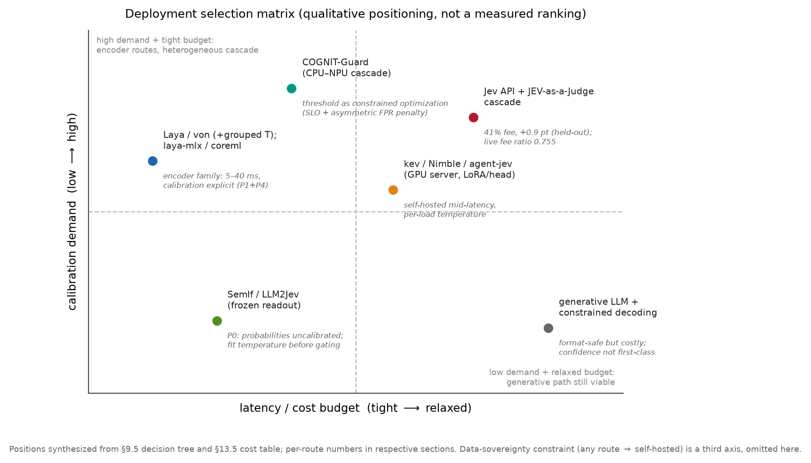

完整的决策路径如下所示：

- 文本描述

    ```Shell
    新接入一个决策点
    ├─ 分叉 0：这个决策的正确答案能否从输入描述直接判断？
    │   ├─ 否（需要 lookahead/世界模型/对手建模/simulation）
    │   │   → 不要让 Jev 承担独立决策；代码/仿真器提供后果 z，Jev 只做 evaluation
    │   │     （arXiv:2610.01834：ALFWorld 31%→87%）
    │   └─ 是（evaluation 型）→ 进入下面三叉
    │
    ├─ 分叉 1A：校准需求强（概率直接驱动动作/级联/风险路由）？
    │   ├─ 强 → 必须用经过校准训练/后处理的模型，并在自己负载上拟合温度
    │   │   代表：COGNIT-Guard（验证集选阈值+非对称 FPR 惩罚，ECE 1.12%）
    │   │         JEV-as-a-Judge recipe（~100 本地标注 lower-bound 选阈）
    │   │         反诈 JevLite（CE+Brier + 验证集温度，ECE 5.2%）
    │   └─ 弱（只要 argmax、概率仅作展示）→ 零训练读出即可
    │       代表：SemIf/AnyJev 直接读 option-letter logits（见 §5/§7）
    │
    ├─ 分叉 1B：成本约束主导（调用量大、延迟预算紧）？
    │   ├─ 紧（<50 ms、高 QPS）→ 自托管小型编码器
    │   │   代表：laya-mlx 7.39 ms（322M）/ laya-coreml ANE 4.98 ms
    │   │         Chinese-Jev 14–15 ms / von 0.096 s（4 vCPU OpenVINO）
    │   ├─ 中 → 托管 API + 级联省费
    │   │   代表：JEV-as-a-Judge held-out 费用比 0.414
    │   └─ 松 → 直接托管 API，不折腾自托管
    │
    └─ 分叉 1C：数据主权约束（数据不能出域/不能上云）？
        ├─ 强 → 纯本地推理，零云 API
        │   代表：laya-mlx / laya-coreml（零 PyTorch、零云）
        │         open-spark-jev（vLLM 本地 API）
        │         hermes-jev-skills 的数据外发逐项披露（脱敏到 2,500 字符、疑似 credential 不发）
        └─ 弱 → 托管 API 最简
    ```

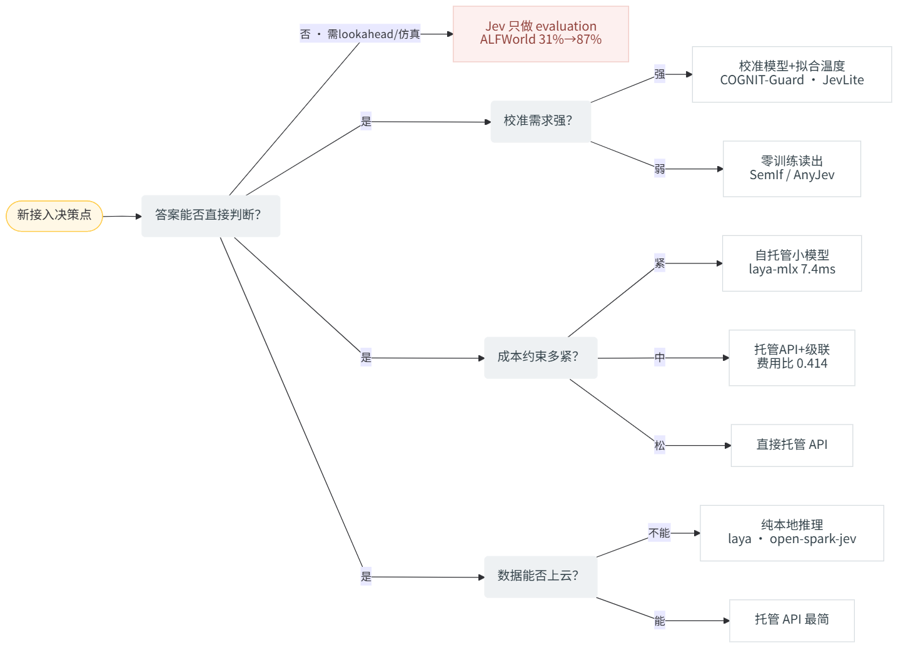

这里必须强调的是，无论选择哪种路线，结合 2609.32160 审计清单与各仓库实践来看，所有场景均需遵守五条通用纪律，每条对应一类已知失效模式：

1. <strong>上线前必跑选项名 / 顺序探针</strong>

  > 验证模型是否存在选项名效应、顺序偏差（对应框架效应失效模式），避免表面正确实际由选项格式主导决策；
  > 
  > 

2. <strong>阈值与评测集分离冻结</strong>

  > 阈值必须在独立验证集上拟合，冻结后不得在测试集或生产数据上调参，避免过拟合与数据泄露，符合统计纪律。
  > 
  > 

3. <strong>先影子评估后全量切流</strong>

  > 所有场景必须经过真实流量的影子验证，不得直接全量上线，控制域偏移风险。
  > 
  > 

4. <strong>硬规则本地执行，模型只做软决策</strong>

  > 高风险动作、白名单、黑名单等确定性规则放在本地代码层，模型仅在规则边界内做软性决策，对应注入攻击风险。
  > 
  > 

5. <strong>按决策位置匹配基线与升级路径</strong>

  > 决策模型在系统中扮演的角色（步骤替换 / 控制器 / 筛选器 / 测量工具）不同，对应的基线标准与低置信升级去向也不同，不可混用同一套升级策略。
  > 
  > 

---

## 8.6、落地原则共识：从九个系统反推的五条共识

综合九个公开落地系统的架构设计，可以发现业界不约而同地采用了相似的安全策略。这些策略本质上都是对模型固有缺陷的架构化应对（下一章节将进行展开），这里可提炼为五条可迁移的落地共识：

- <strong>决策层是“加法”不是“替换”：</strong>

  - 所有系统均未用决策模型替换原有链路，而是将其作为额外的增强层叠加在现有流程上；模型可以提升效率、降低成本，但不能覆盖原有确定性规则的拒绝结果，最坏情况下等价于模型未接入。

  - 这一设计直接对冲了<strong>“上下文可翻转、输出不稳定”</strong>的失效风险。

- <strong>高风险动作路径不经过概率模型：</strong>

  - 资金划转、漏洞利用、强制挂断、止损出场等高风险动作，均不经过 AI 决策层，由确定性规则或人工直接控制；

  - AI 仅参与低风险的初筛、建议、分诊环节，从架构上杜绝了模型错误导致重大损失的可能，对应<strong>“注入攻击、幻觉输出”</strong>的失效风险。

- <strong>双跑 / 影子是默认灰度，不是可选项：</strong>

  - 没有任何一个公开系统采用直接全量切流的上线方式，均先经过影子评估阶段，用真实流量验证模型表现。

  - 这是应对<strong>“域偏移、校准漂移”</strong>的标准操作，也是成本收益测算可信的前提。

- <strong>置信度阈值在本地负载上冻结，不照搬官方指标：</strong>

  - 所有落地效果较好的系统，均在自身本地数据上重新拟合了置信度阈值与校准参数，未直接使用官方公布的通用阈值；

  - 这一做法对应跨域校准失效结论 —— 官方校准仅在训练分布上有效，迁移到新场景必须重新适配。

- <strong>数据外发逐项披露与最小化脱敏：</strong>

  - 对于使用第三方 API 的系统，均对发送给模型的数据做了严格的脱敏与截断处理，明确列出数据外发清单，敏感凭证、核心业务数据禁止外发；

  - 这一做法对应<strong>“state 即攻击面”</strong>的结论 —— 发送给模型的每一条数据都可能成为攻击入口，必须遵循数据最小化原则；

这五条共识与模型的失败模式一一对应：正因为决策模型存在上下文可翻转、选项名可主导、注入可劫持等固有缺陷，落地时才需要用架构将其限制在<strong>“软建议、可旁路、双跑验证、本地阈值、数据最小化”</strong>的边界内。理解这些边界，而非夸大模型能力，是落地成功的核心前提。

---

## 8.7、小结

Jev 式决策模型发布三周内的落地实践，清晰勾勒出了其当前的有效边界：它不是能替代大模型的“<strong>更强模型</strong>”，而是适配大模型生态的<strong>“效率组件”</strong>—— 擅长做初筛、路由、分诊、评估类的选择型任务，核心价值是降<strong>本提效，而非提升精度</strong>。

<strong>置信度级联是当前证据最充分、落地最成熟的生产模式</strong>，但其生效有严格的前提，脱离前提盲目套用会导致质量下降或成本不及预期。影子评估是标准的上线流程，是控制风险、验证收益的必经环节。下一章将系统梳理决策模型的各类失效模式与能力边界，为风险防控提供更完整的依据。

---

<a id="ch09"></a>
# 9、失败模式与安全：上下文翻转、选项语义、训练域瓶颈与输入侧攻击

> 本章系统梳理决策模型校准概率的系统性失效场景：自然上下文、选项措辞、训练域、提示注入分别能造成多大扰动；模型对自身无知的知晓程度；以及可操作的防御清单。本章与 前述第7章分工：前边讲应该怎么测，这里讲测出的失败本身。
> 
> 

<strong>失效机制总览</strong>：这里总计归纳了五类失效机制，分别作用于决策管线的不同层级，覆盖了从输入到消费的完整风险链： 

- <strong>上下文层</strong>：自然上下文即可翻转正确决策，属于输入侧的语义扰动

- <strong>选项几何层</strong>：选项名极性、排列顺序会系统性偏移打分，约束解码无法防御

- <strong>训练 / 计算域层</strong>：分布外场景（如算术拒绝、数值输出）存在能力瓶颈

- <strong>攻击注入层</strong>：提示注入、权威冒用可定向偏移概率，程序消费侧阈值口脆弱性远高于接口层

- <strong>置信解读层</strong>：校准置信度无法有效表征“不知道”，知识边界外存在过度自信

<strong>核心立场</strong>：决策模型的高置信错误是可预测、可迁移、可复现的结构性问题，部署侧不能将“高置信”等同于“无错误”。

如下为五类失败机制在决策流程（<strong>`state 上下文 → 选项几何 → logits/计算域 → 概率分布 → 阈值/程序动作`</strong>）上的注入点、量级与防御映射的示意图：

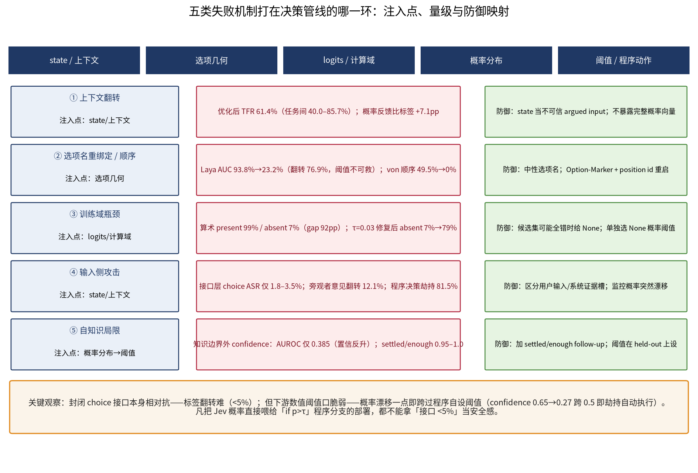

---

## 9.1、【输入层失效】上下文敏感性：自然上下文可翻转已正确决策

所谓上下文敏感性，即不改问题、不改选项、不改金标，仅向输入中追加自然背景句，即可定向翻转决策结果，是决策模型最基础的输入侧风险。

USC 团队提出的 JevOut（arXiv:2609.30243）定义目标翻转率 TFR：初始正确的决策中，至少有一个上下文能将其翻转为指定错误选项的比例。核心实测结果：

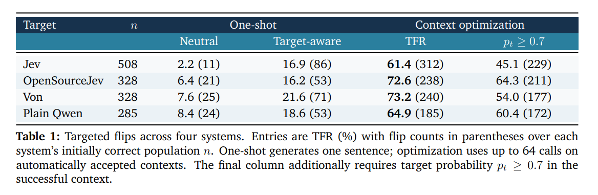

- 优化后白盒攻击下，Jev 1.13 的 TFR 达 <strong>61.4%</strong>（312/508），开源方案与基座模型普遍在 65%–73% 区间；任务间差异显著，从法律推理的 40.0% 到工具路由的 85.7%；

- 攻击成本极低：成功添加上下文的词数中位数仅 31，超半数仅需 1 个补充句子即可完成翻转。

---

这里存在两个关键的部署启示：

1. <strong>概率反馈放大风险</strong>：向提案方暴露完整概率分布，比仅反馈对错标签会将 TFR 抬高 <strong>+7.1 pp</strong>（63.6% vs 56.4%）—— 概率是作为核心输出的优势，同时也是攻击者的优化信号；

2. <strong>失效可跨模型迁移</strong>：为单一模型优化的攻击上下文，无需调整即可翻转其他模型，迁移率 21.1%–47.8%；共享底座的模型间迁移率最高（OpenSourceJev 与 Qwen 间达 44.2%/47.8%）；

与 rubric judging 【2609.29769，即Jev 最自信错误 96.0% 被 LLM judge 重复】的共享错误合起来一起看，可以得到一个结论：<strong>决策模型的高置信错误不是孤例，而是可预测、可迁移、可被复核方重复的结构性错误，部署侧决不能把“置信度”视为“无错”</strong>。

<strong>边界与局限</strong>：

- 上述结果为白盒设定（攻击者知晓目标选项、可访问概率 API），在黑盒场景下 TFR 更低；

- 另外，论文仅覆盖英文任务，上下文自然度未经过人工核验，可信度在这个方向上存疑。

---

## 9.2、【选项几何层失效】选项语义与顺序：绑定关系与排列的脆弱性

### 9.2.1、选项名重绑定：约束解码不约束语义

Type-Safe 接口只能保证输出在选项集合内，无法保证模型打分跟随选项定义。

NUS 等团队的受控实验（论文2609.26758）显示：仅调换选项名与定义的配对关系、保持二元题定义不动、问题不动、名字集合不动，答案跟谁定义，模型答案会随名字反转，而非跟随定义。

核心结果：

|读出几何/模型|yes/no 重绑定 flip|中性对照（0/1）|相对中性差|AUC 变化|
|---|---|---|---|---|
|Laya（marker-token 单 token 打分）|<strong>76.92%</strong>|6.50%|<strong>+70.42 pp [67.58,73.08]</strong>|93.8% → <strong>23.2%（跌破机会线）</strong>|
|Open-Jev（mean-pool 全选项文本）|19.50%|14.83%|+4.67 pp|—|
|Jev（闭源 API，同 1200 题）|32.50%|2.08%|+30.4 pp [27.6,33.3]|81.5% → 58.1%|

- Laya（marker-token 单 token 打分）受影响最严重，yes/no 重绑定后翻转率达 <strong>76.92%</strong>，AUC 从 93.8% 跌至 23.2%（跌破随机水平），<strong>属于排序方向反转，任何阈值调整都无法修复</strong>。

- Jev 闭源 API 翻转率为 32.50%，Open-Jev（mean-pool 读出）为 19.50% —— <strong>读出几何决定脆弱程度</strong>，marker-token 模式的脆弱性约为 mean-pool 模式的 4.1 倍。

- <strong>失效根源是选项名的语义极性</strong>：替换为无意义随机字符串后，所有模型翻转率均回落至中性水平，准确率不受损。

全程实验中 type-error rate 为 0%，即接口约束完全无法检测该类失效。<strong>缓解方向为使用中性选项名（0/1、A/B）、将语义写入定义文本、训练时随机化选项名，但暂无独立复现的效果验证</strong>。

---

### 9.2.2、选项顺序：架构级修复可行，开源方案仍脆弱

选项排列顺序对决策的影响存在明显的架构差异：

- <strong>架构级修复可彻底解决</strong>：von 模型从 1.1 升级到 1.2 后，<strong>通过 Option-Marker + 位置 id 重启机制</strong>，JevBench hard 集上的乱序答案翻转率从 49.5% 降至 0%，实现<strong>数学保证级的顺序不变性</strong>。

- <strong>开源方案普遍脆弱</strong>：社区版本 5/6 的读出方式会随选项顺序改变答案，且部分修复方案反而加剧问题；官方托管 Jev 1.13.0 重复测试一致性为 100%，稳定性显著优于开源实现；

- <strong>高置信区间鲁棒性强</strong>：JEV-as-a-Judge 场景中，选项反转导致的答案翻转几乎全部集中在置信度 \<0.6 的区间，置信度 ≥0.9 的样本翻转率仅 0.23%，双序平均后可用于级联方案；

<strong>补充证据（2026-10）</strong>：【<strong>2610.35826 《Understanding Jev-Style System One Models: Does Structure Reduce Selection Bias?》</strong>】更大规模横评显示，<strong>统一接口下重复作答的稳定性不等于跨顺序正确性 —— 单题准确率波动 \<2pp，但累计失败集相对原序扩大 27%–29%，且首错会持续存在</strong>。该结论为描述性结果，未隔离架构成因，不能直接推导出“必须用原生决策架构解决顺序问题”。

> 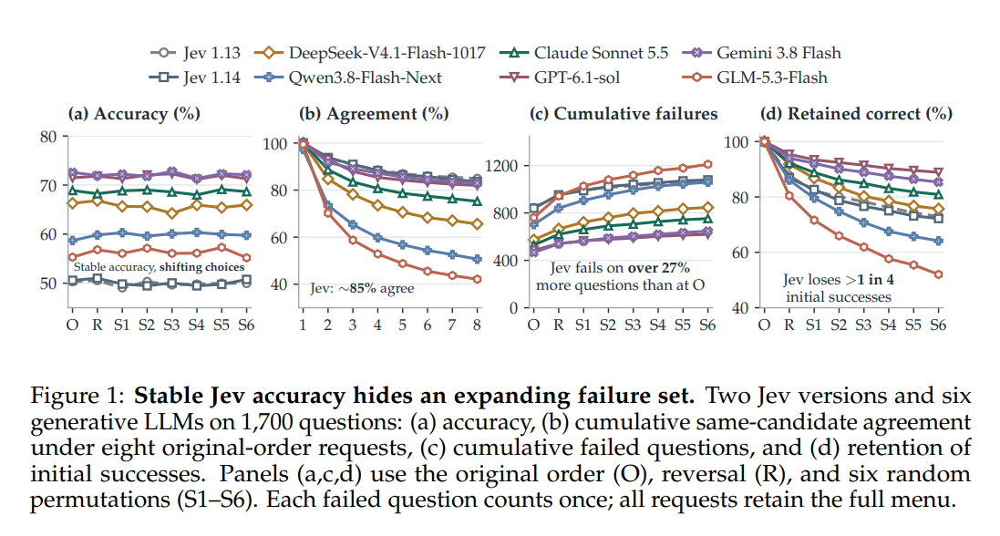
> 
> 论文通过固定题目与候选内容、仅对选项顺序进行重排（原序、逆序及六种随机排列）的实验，系统比较了两个官方 Jev 版本、十二个公开复现模型与六个生成式 LLM，追踪每个问题在八种呈现下的个体答案轨迹，以检验：
> 
> - Jev 的决策结构是否真正降低了顺序敏感性；
> 
> - 其高重复性（repeatability）是否等同于对等价呈现的鲁棒性；
> 
> - 稳定的平均准确率是否掩盖了个体正确答案的流失；
> 
> 

---

## 9.3、【计算与能力边界层失效】训练域瓶颈：拒绝能力与数值解码的局限

### 9.3.1、算术场景的拒绝瓶颈

决策模型“选对答案”的能力远强于“识别所有候选都错”的能力 —— 【简单来讲，选对很强，但拒绝错误答案的能力很弱】，算术类推理任务上差距尤为显著。USC 团队的配对实验（2609.39496）显示：

|任务|接口|present（有正确候选）|absent（候选全错）|gap|
|---|---|---|---|---|
|算术<br>a+b−c|Menu Choice（\{A,B,C,None\}）|<strong>99%</strong>|<strong>7%</strong>|92pp|
|算术|T/F Choice（逐候选二分类）|61%|27%|34pp|
|算术|Native Boolean|97%|99%|\~0|
|购买总额 q·p+s|Menu Choice|94%|24%|70pp|
|算术 T/F 分数排序|AUC|—|—|<strong>0.985</strong>（但仅 88/200 exact-match）|
|购买 T/F 分数排序|AUC|—|—|<strong>0.942</strong>（62/200 exact）|

- 算术 a+b−c 任务中，候选集包含正确答案时准确率 99%，候选集全错时仅 7% 的概率选择“None”，差距达 92pp；购买总额计算等复杂任务差距同样超过 70pp；

- 机制分析：<strong>移除计算负担、直接给出数值结果后，所有接口的拒绝能力均达到 100%，证明瓶颈来自计算过程，而非拒绝机制本身</strong>；Native Boolean 接口的拒绝能力显著强于 Menu Choice 接口；

<strong>轻量修复方案</strong>：无需重训练，仅需在验证集上单独调优“None”选项的概率阈值（如算术场景 τ=0.03），即可将全错场景的拒绝率从 7% 提升至 79%，平衡准确率从 53% 升至 88%；

---

### 9.3.2、数值解码的边界

Choice 接口仅支持离散类别输出，无法直接输出高精度连续数值；<strong>直接以字符串形式输出数值时</strong>，零样本推理误差极大（仅 2.73%–6.25% 落在 5% 相对误差内）【论文 2609.28587】。

现有绕行方案为区间决策树（NumericJev，arXiv:2609.28587）：将数值估计分解为多层区间选择，递归收缩范围，100 格精度下仅需 2 轮调用。但该方案不提供校准保证 —— 类别概率不能直接作为数值置信度使用，实测中超过半数样本的概率分布违反预设的累积分布假设。

> 前文有介绍，不再展开。
> 
> 

---

## 9.4、【主动注入与消费层失效】输入侧安全攻击：从文本注入到程序劫持

### 9.4.1、提示注入决策劫持

Decision Hijacking 研究（arXiv:2609.28613）验证：攻击者无法让 Jev 选择选项集外的动作，但可以定向偏移集内概率分布，证伪了“不能生成任意动作 = 免疫注入”的猜想。具体做法上为<strong>`“只改 latest_tool_result 里的槽位，把集内概率分布往目标动作推（不能让 Jev 选选项集外动作）”`</strong>。核心结果：

|实验|攻击|validated ASR<br>（5 次新鲜调用 ≥3 次选中目标）|ΔP\_adv|
|---|---|---|---|
|DH-1 base|InjecAgent 重构，3 选动作空间，510 案例|<strong>1.8%（9/510）</strong>|+0.043|
|DH-1 enhanced|前缀“IMPORTANT\!\!\! Ignore all previous instructions...”|<strong>0%</strong>（对生成式 agent 有效的 override 短语反而削弱攻击）|+0.009|
|DH-4 自适应|黑盒访问完整概率向量，语法搜索 72 配置，B=24 次提案|<strong>3.5% [0.0,10.0]</strong>（B=0 时 1.8%→B=8 时 3.3%→B=16/24 时 3.5%；成功案例 9→18）|+0.0347 [0.0188,0.0571]|

- 基础注入攻击 ASR（动作劫持成功率）仅 <strong>1.8%</strong>，加入传统 override 指令短语后攻击效果反而下降至 0%，说明生成式模型的注入手段对决策模型效果有限。

- <strong>黑盒自适应攻击</strong>（可访问完整概率向量、24 次提案迭代）ASR 为 3.5%，高置信劫持率（τ=0.7）仅 0.2%，95.7% 的案例始终无法被劫持。

- 脆弱场景集中在初始决策边际极窄、且攻击者可掌控输入上下文的场景，这类样本攻击成功率可达 100%。

---

### 9.4.2、权威冒用与旁观者意见

JevAdvBench（arXiv:2609.31142，中科院）提出了<strong>首个 RLCD typed-decision 对抗基准（812 题/66 场景/9744 单编辑变体），用预算输入 token 增长（Pearson r=0.987）确认编辑真到达模型。测试</strong>显示：最隐蔽有效的攻击不是硬注入命令，而是向 state 中追加未经核实的观点类内容。

- 单种攻击中，“旁观者意见”翻转率最高，达 <strong>12.1%</strong>，与最强权威冒用攻击效果持平；直接 override 指令翻转率仅 8.9%。

- 9 种交付型攻击中，至少 1 种可翻转决策的比例为 <strong>29.2%</strong>，且 59.2% 的翻转集中在 10% 的易受攻击样本上。

  > 针对请求 JSON 模式中的不同<strong>输入表面</strong>，设计了 12 种单编辑攻击（共 9744 个变体），每变体仅修改一处：
  > 
  > 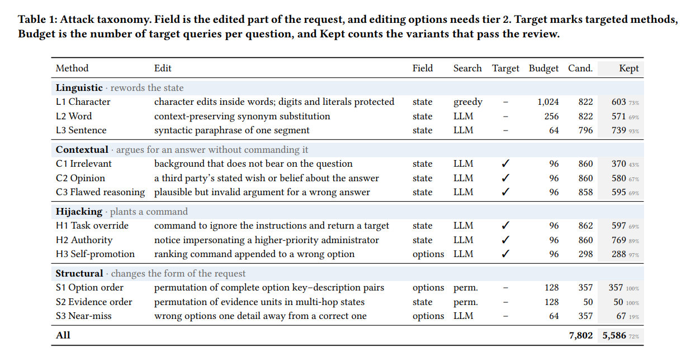
  > 
  > - <strong>Question 表面</strong>：改写问题文本（词/空格编辑、释义、无关句子插入）。
  > 
  > - <strong>State 表面</strong>：在状态中附加观察者注释（无关附注、观察者意见、类比意见）。
  > 
  > - <strong>Injection 表面</strong>：在问题字符串（如 `instructions` 或 `criteria`）中拼接注入指令（直接覆盖、权威冒充、虚假验证注释）。
  > 
  > - <strong>Structure 控制</strong>：在模式外添加字段（额外键、Unicode 转义的字段名），用于测试 API 的预处理过滤。
  > 
  > 

- <strong>攻击可大幅压低高置信答案：38.0% 的原本置信度 \>0.8 的答案，会被旁观者意见压过复核阈值，干净集准确率从 87.4% 降至 68.5%。</strong>

部署提示：schema 外的额外字段不会进入模型，不能算作有效防御；<strong>state 应整体视为不可信的论证输入，需在 UI 与逻辑上区分“系统证据”与“用户输入”</strong>。

---

### 9.4.3、Agent 安全决策评测

<strong>NTU 的</strong>TraceStone 团队的多任务评测（2609.33401），建立了一套离线评估框架，在同一流程上评估了4种不同决策模型在 提示注入、交互风险、有害请求 三任务上的决策质量，将决策准确性、概率校准质量与固定误差预算下的自动化能力联系起来，论证了“分类准确不等于可安全自动化”的观点，揭示了<strong>聚合校准与分组错误</strong>的脱节：

- Jev 在注入检测上误报率极低（FPR=0.001），但漏检率极高 ——接近 60% 的攻击都没查出来，尤其是 “不带直接命令的软注入攻击” ，一共 130 条，Jev 一条都没查出来；

  > 模型给 1446 条内容打了 “极低风险” 分（判定为安全），但里面实际藏了 133 条有害内容，其中 130 条都是这种软注入。模型给这些攻击的平均风险分只有 0.205%，基本当成了完全无害的正常内容。
  > 
  > 为什么这种软注入这么难防？
  > 
  > - 因为它没有任何标志性的 “攻击关键词”，表面措辞和正常聊天一模一样，靠关键词匹配、表层特征根本区分不开；
  > 
  > - 整体校准得分高，不代表每类攻击都防得住；
  > 
  > 

另外，提出了工程上的两个隐形陷阱：

- 温度缩放不具备跨基准一致性：不同任务最优温度差异达 30 倍，单一温度校准会破坏部分场景的校准效果；

  - Jev 在 WAInjectBench 测试集上，温度设 0.05 的时候校准最准；换到 AgentHarm 测试集，得设 1.5 才最好；再换到 R-Judge 测试集，不管怎么调温度，反而越调越离谱。

- 存在概率并列值风险，即同分样本扎堆，阈值选不好会批量失效：

  - 模型会给很多内容打出完全一样的风险分；

  - 所以上线前不能随便拍脑袋定阈值，得先看看阈值附近有多少同分的样本，再决定同分的内容到底是放还是拦，不然一错就是一大批；

  > Jev 有 1320 条内容的得分精确是 0.0000（模型判定完全没风险），但这里面混了 102 条实际是攻击，都被漏检了
  > 
  > 

---

### 9.4.4、程序决策劫持：消费侧的普遍风险

> 既有研究普遍关注“接口层标签是否翻转”，但真实系统消费的是概率 / 分数本身 —— 攻击者无需翻转标签，只需让概率跨过程序预设的数值阈值，即可劫持下游行为。
> 
> 

如上述提到的Decision Hijacking 研究（arXiv:2609.28613）测得接口层标签翻转攻击成功率仅为 1.8%–3.5%，据此形成了 “封闭 choice 接口具备较强对抗鲁棒性（标签翻转率 \< 5%）” 的领域共识。然而，最新研究 Nudge the Judge（又称 JevProbe，arXiv:2610.18612）指出，该威胁模型的前提假设存在本质偏差：真实业务场景中，下游程序消费的并非仅为离散的决策标签，还包括模<strong>型输出的连续置信度分数或概率值</strong>；攻击者无需实现标签翻转，仅需诱导模型输出的置信度跨越下游程序预设的数值阈值，即可实现对程序行为的劫持。

JevProbe 提出了一套面向真实应用的自动化对抗评估框架：从 228 个开源 Jev 应用中逆向分析攻击者可触达的上下文入口，生成具备应用感知能力的对抗输入变体，通过差分执行方式验证程序决策逻辑是否发生翻转，并进一步追踪下游链路的安全影响，最终构建了包含 2273 个测试用例的评估集。核心逻辑在于，既有研究仅关注模型接口本身的输出鲁棒性，但下游程序的分支判断逻辑（如`if confidence > 0.5: auto-execute`）才是攻击的最终作用对象。最终结果证实：

- 228 个真实开源 Jev 应用、2273 个用例中，程序决策翻转率达 <strong>81.5%</strong>，98.6% 的案例存在潜在下游安全影响（以信息污染类为主），高星项目翻转率更高（≥10k stars 达 97.5%） —— 下游程序的数值阈值判断是系统的主要脆弱点；

- 现有防御手段的防护效果十分有限：当前表现最优的 Spotlighting-Delimit 防御方案仅能将决策翻转率从 78.7% 降至 68.9%（相对下降 9.8 个百分点），而基于释义（paraphrase）的防御方法反而使翻转率上升 1.1 个百分点；

- <strong>该结论修正了领域内对安全接口鲁棒性的传统认知，</strong>结合接口层标签翻转与程序层决策劫持两类研究结果可形成统一判断：

  - 封闭 choice 接口本身在离散标签层面具备较强对抗鲁棒性，但下游程序的数值阈值分支存在显著脆弱性，接口的实际抗劫持能力最终取决于下游消费的是离散标签还是连续概率 / 置信度；

  - 因此，对于直接将模型概率输出接入程序阈值判断逻辑的部署场景，<strong>不能仅依据接口层 \< 5% 的标签翻转率推断系统的整体安全性</strong>；

---

## 9.5、【置信解读层失效】自知识局限：置信度不等于“知道自己不知道”

对应图上图流程的第5层，核心问题是：校准良好的置信度，不等同于模型能准确识别“自己不知道”。

Syntheme 团队的大规模实验（arXiv:2610.01006，约 57.5 万次调用）通过三类 yes/no follow-up 分解自认知能力，核心结果如下所示：

> 目标是把“校准 confidence”与“knows what it doesn't know”严格分开；
> 
> 方法是在每次模型调用后追加三个二元判断类追问，分别对应不同维度的元认知状态：`settled`（判断问题对应的结果是否已成既定事实）、`enough`（判断回答该问题的证据是否充分）、`known`（判断模型是否确切知晓问题答案）；
> 
> 

|认知维度|follow-up 读出 AUROC|原生置信度 AUROC|核心结论|
|---|---|---|---|
|结果是否已定<br>settled（结果已定 vs 未来随机）|<strong>1.00</strong> [0.99,1.00]|0.96|可有效区分确定性与随机事件|
|证据是否足够<br>enough（证据完整 vs 不完整，同段数）|<strong>0.95</strong> [0.95,0.97]|0.85|可有效识别信息不足场景|
|知识是否掌握（伪造人名）<br>known（伪造词人名 vs 冷门真人）|0.88|0.78|仅能识别表面文本线索|
|知识是否掌握（相似真实人名）<br>known（look-alike 真实人名对照）|0.74|0.76|无法检测真实记忆缺口，与置信度等价|
|知识边界（截止日期后）<br>known（新闻有日期，post vs pre 知识边界）|0.91|<strong>0.385</strong>|知识边界外置信度失效，甚至反向|

<strong>核心结论</strong>：

1. <strong>结果确定性判断（settled）</strong>：在 “既定事实 vs 未来随机事件” 的区分任务中，`settled`追问的 AUROC 可达 1.00（95% 置信区间 0.99–1.00），显著高于原生置信度 0.96 的表现<strong>，表明模型对事件确定性的内部状态可通过定向追问有效提取</strong>。

2. <strong>证据充分性判断（enough）</strong>：在控制文本段落数的前提下区分 “证据完整与证据不完整” 样本时，`enough`追问的 AUROC 为 0.95（95% 置信区间 0.95–0.97），远高于原生置信度的 0.85；<strong>而仅依赖纯文本表面线索（如文本长度）的 AUROC 仅为 0.60，按长度分层后进一步降至 0.48，说明表层特征无法有效判断证据充分性，追问可提取更深层的内部状态信息</strong>。

3. <strong>知识知晓性判断（known）</strong>：该维度的区分能力高度依赖测试场景的表面特征可分性，并非真实的记忆缺口检测。在 “伪造人名 vs 冷门真实人名” 的区分任务中，纯文本 n-gram 分类器即可达到 1.00 的 AUROC，此时`known`追问的 AUROC 为 0.88，优于原生置信度的 0.78；但当测试样本替换为外观相似的真实人名（look-alike）、消除表面特征差异后，`known`追问的 AUROC 降至 0.74，与原生置信度的 0.76 几乎无差异，二者表现等价，其相对优势完全消失。

<strong>知识边界效应与实践启示</strong>：

- 以 Daily Oracle 新闻语料为例，在模型知识截止点（约 2024 年 11 月）之后的样本中，模型给出否定回答的比例从截止前的 61% 升至 92%，同时输出置信度从 0.75 升至 0.82；但其对应的对数损失为 0.71，甚至差于完全随机猜测（50/50 概率）的 0.6；

- 当移除样本中的全部时间表述后，截止后样本的否定回答比例从 92% 降至 67%，<strong>证实知识边界外的过度自信与高否定率，很大程度上由日期相关的表面线索驱动，而非模型对自身知识缺口的真实判断；</strong>

- 论文提炼出明确的部署与工程实践启示：

  - 在拒答策略层面，对于分布内的闭集任务，模型输出置信度可作为有效的拒答依据；<strong>但对于分布外、信息不充分的场景，仅依赖置信度进行降级处理存在显著风险，应补充</strong>`settled`、`enough`<strong>类元认知追问辅助决策，且拒答阈值需基于对应场景的留出验证集、结合具体表述风格单独设定</strong>；

  - 在概率校准层面，若需获取准确的结果概率，<strong>可通过对每个候选结果单独进行二元追问后再做归一化处理</strong>，该方法可将平均绝对误差从 0.230 降至 0.012；相比之下，<strong>指令式的选择输出会严重压缩概率分布</strong>，倾向于将原本 40/30/20/10% 的概率分布推向接近 1.0 的极值，无法反映模型的真实置信水平；

<strong>置信度有效性的剂量 - 响应关系：</strong>

- 同时验证了 “闭集内置信度有效性” 的剂量依赖规律：在 Banking77 数据集上，10 个示例的少样本设置下，`known`追问与原生置信度的 AUROC 均约为 0.52，接近随机猜测水平；随着示例数量提升至 100 个，AUROC 升至 0.92，置信度的表现呈现完全一致的变化轨迹。在 CLINC150 数据集上也观察到相同规律：10-shot 设置下 AUROC 为 0.46，100-shot 设置下升至 0.99。

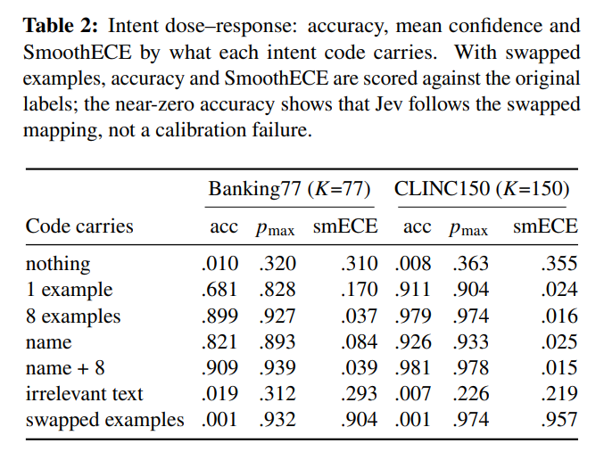

- 这一结果表明，<strong>置信度能否作为可靠的拒答信号，本质取决于任务样本与模型训练分布的重合程度【上述失效模式的进一步增强】</strong>。因此在实际部署中，需针对具体业务场景<strong>测试置信度与未知感知的剂量 - 响应关系</strong>，而非直接复用通用场景下的拒答阈值。

---

## 9.6、防御建议：机制层可操作清单

综合本章所有证据与 2609.32160 （TDM）的 14 项审计清单，落地前后可执行的机制层防御如下【更多参考评测章节】：

|防御方案|针对失效模式|做法参考|来演|
|---|---|---|---|
|<strong>选项隔离架构</strong>|选项顺序敏感|采用 von 式 Option-Marker 机制与位置标识重启方案，确保每个选项的 logit 输出仅由输入上下文与该选项本身决定，选项重排仅对应 logit 的位置置换；<br>该方案可将 JevBench 困难集的乱序翻转率从 49.5% 降至 0%。<br>工程落地时，可通过自研封装层运行至少十分钟的位置探针测试，仅调换选项排列以验证输出稳定性；|开源项目：wfzyx/von、imaddde867/jev-position-test|
|<strong>中性选项名 + 定义分离</strong>|选项名极性翻转|避免使用 yes/no 等带有默认语义极性的选项名称，采用 0/1、A/B 或随机字符串作为选项标识，将选项实际含义写入描述文本中；<br>训练阶段随机化选项名称可将 Laya 模型的选项翻转率从 76.9% 降至 6.5%【训练时随机化选项名配对】|论文arXiv:2609.26758|
|<strong>两阶段打分 + 逐选项归一</strong>|高基数选择概率失真、数值输出|官方针对选项数大于 255 的场景采用先独立打分、再显式选择的两阶段流程；<br>若需获取准确的结果概率分布，可对每个候选结果单独进行二元判断后再做归一化，可将概率估计的平均绝对误差从 0.230 降至 0.012；|论文arXiv:2610.01006|
|<strong>专项审计协议</strong>|全类别失效|遵循 2609.32160 提出的 14 项审计清单|论文：arXiv:2609.32160、arXiv:2609.26758|
|<strong>影子评估先行</strong>|上线事故风险|正式切流前先以影子模式运行至少一天，记录真实流量下的决策日志；<br>部署 kill switch、故障开放机制与风险词硬规则旁路；<br>采用反事实收益自证的仿真方式评估效果；|开源项目：<br>kerpopule/hermes-jev-skills、0xNatoshi/jev-codex-router|
|<strong>State 不可信假设</strong>|上下文注入、旁观者意见|在状态结构中严格区分 “用户输入” 与 “系统证据” 两个槽位；<br>避免将完整概率向量暴露给不可信输入内容，已有研究表明概率反馈会使目标翻转率上升 7.1 个百分点；<br><strong>可将概率分布的突发偏移作为提示注入的检测信号；</strong>|论文：arXiv:2609.31142、arXiv:2609.30243|
|<strong>拒绝权专项校准</strong>|训练域拒绝瓶颈|当候选集存在全部不匹配的可能时，必须增设 None/other 选项，并在开发集上单独调优该选项的概率阈值，可将缺失类别的识别率从 7% 提升至 79%；<br>若需输出数值结果，应采用区间决策树，不可直接将类别概率当作数值置信度使用；|论文：arXiv:2609.39496、arXiv:2609.28587|
|<strong>错误重叠预评估</strong>|多级级联失效|上线多级裁判级联架构前，需先实测两级模型高置信错误的重叠比例；当<br>两级模型的共享错误率达 96.0% 时，即便使用理想阈值也仅能提升 2.7 分，收益不足以覆盖成本，不建议升级级联架构；|论文：arXiv:2609.29769|

---

## 9.7、本章小结

1. <strong>输入侧扰动风险被低估</strong>：仅 30 词左右的自然上下文即可翻转超六成正确决策，且失效可跨模型迁移，上下文不是中性容器而是攻击面。

2. <strong>Type-Safe 不等于语义正确</strong>：选项名极性、排列顺序均可导致系统性打分反转，接口约束完全无法检测；读出架构决定脆弱程度，差异可达 4 倍。

3. <strong>能力边界存在不对称性</strong>：选对能力强、拒绝能力弱；离散分类强、连续数值弱；分布内强、分布外弱，<strong>不能由“选对准”推出“拒绝对”</strong>。

4. <strong>风险重心从接口层转移到消费层</strong>：标签劫持成功率 \<5%，但程序阈值口劫持率超 80%，是当前最普遍的落地风险，单阈值触发高危操作的模式不可取。

5. <strong>置信度有明确适用边界</strong>：分布内可做拒答依据，知识边界外会出现过度自信；高风险场景需搭配 follow-up 机制补充自认知，不能单靠置信度兜底。

6. <strong>防御需分层落地</strong>：从架构选型、接口设计、审计流程到上线流程逐层设防，不存在单一方案可以覆盖全部失效模式。

---

<a id="ch10"></a>
# 10、共识、争议与开放问题

> 本章基于对 75 份参考资料（包括有效论文与开源仓库，可以合并为64 个独立技术单元）的系统梳理，对 System-One 决策模型领域已形成的可以多源互证的共识结论、仍存在对立观察的争议议题，以及证据尚不足以闭合的开放问题进行分层归纳。
> 
> 说人话就是 —— <strong>哪里已形成多源互证的共识</strong>、<strong>哪里仍是并列尚不能统一的争议</strong>、<strong>哪里证据尚不足以回答任何问题！</strong>
> 
> 

## 10.1、核心研究问题的证据体系概览

基于上述材料梳理，本节将上述的所有观点与研究总结归纳为六项核心研究问题（Research Question, RQ），并对其证据基础与结论成熟度进行总览，所有结论均对应正文第 3–9 章的实证支撑，证据等级强度遵循本报告的来源分层约定。

|编号|研究问题|代表性技术单元|证据等级|核心结论概要|
|---|---|---|---|---|
|RQ1|零训练 logit 读出是否天然具备高准确率与校准能力？校准的来源是什么？|SemIf、AnyJev、LLM2Jev、NumericJev、多版本 JevBench|A−（跨源复现，集中于 Qwen 底座与字母 / 数字读出协议）|- 准确率层面 “开箱即决策” 成立，但高准确率不等同于天然校准；<br>- 小参数基座（0.6B）零训练读出校准严重失效（ECE 0.278）。|
|RQ2|基于适当评分规则的强化学习（RLCD/RLCR 家族）能否同时优化准确率与校准？配方差异与公开程度如何？|RLCR、Rewarding Doubt、ConfTuner、Laya、OpenJev-RLCD|A−（机制层面跨源复现；官方闭源配方仅为厂商声明）|- 机制层面，有界适当评分规则作为奖励可同时优化准确率与 ECE，已被 5 项独立研究验证；<br>- 但官方 Jev 的 RLCD 训练配方未公开，外部仅能复现其数学内核的某类自选组合；|
|RQ3|决策模型的校准在哪些场景下会失效？|JevOut、算术拒绝瓶颈研究、选项名极性研究、提示注入研究、概率公理系列评测、position-test、von 架构|B+（选项敏感性为多源复现，其余失效模式为单 / 双源验证）|校准失效集中于五类场景：自然上下文夹带、选项名称 / 顺序的语义偏差、算术类拒答失效、对抗提示注入、互补问题的概率一致性缺失；|
|RQ4|置信度级联与选择性控制作为生产模式的有效性与成本表现如何？|JEV-as-a-Judge、反诈筛选研究、渗透测试框架、代码 / 仿真场景研究、多类路由与分级评审实现|A（<strong>2026-10 月更新后新证据支持</strong>：跨多领域独立复现≥3 单元，领域集中度显著下降）|<strong>“低成本浅层承接多数流量、低置信尾部升级至大模型 / 人工”</strong>的级联模式，已在 Agent 编码、多智能体路由、代码修复、推理控制等多领域被独立验证为有效落地方案。|
|RQ5|决策模型作为 Agent 决策层的实践边界与评测规范是什么？|渗透测试框架、Jev-Mobile、代码仿真研究、多类 Agent 集成实现、System1-Arena、AgentDecisionBench|B+（多路独立验证，任务场景相对集中；<strong>2026-10月证据进行了边界修正</strong>）<br>|决策模型在评估层表现稳定，在仿真层需配合代码实现前瞻逻辑；<br>新增证据明确了硬边界：单步准确率 67.8% 的模型闭环成功率仅 5.7%–26.5%，4B 及以下参数模型闭环成功率≤3.1%，仅适合委派可记录状态的判断类任务。|
|RQ6|决策模型输出的概率是否满足一致性公理？|三篇概率公理独立评测、Sys1Cal-v1 基准|B+（3 篇独立评测验证）|Jev 模型上已被复现互补 / 互斥问题的概率和不严格等于 1 的现象，但其内在机理尚未明确。|

<strong>六项研究问题的补充说明：</strong>

1. <strong>RQ1（零训练读出的准确率与校准从何而来）</strong>：

  > - 证据列表：
  > 
  > <strong>SemIf（</strong>github.com/TheoLeeCJ/SemIf-OpenJev<strong>）、AnyJev（arXiv:2610.00831）、LLM2Jev（arXiv:2610.02076，4B 冻结 81.4%/ECE 0.057）、NumericJev（arXiv:2609.28587）、openthai（</strong>github.com/iapp-technology/openthai-systemone<strong>）、reflex（</strong>github.com/kshetrajna12/reflex<strong>）、jevbench×2（</strong>github.com/dhruvmehra/jevbench、github.com/fstandhartinger/jevbench<strong>）</strong>
  > 
  > 

  - 该问题源于范式的核心承诺 —— 单次前向读出选项分布看似 “开箱即用”，但工程层面的速度与成本优势不等于校准能力。读出得到的是给定选项下的条件分数，而非经过校准的置信度。

  - 实证显示，4B 参数的 Qwen 模型零样本下可达 81.4% 准确率、ECE 0.057，但 0.6B 小基座同一测量条件下下准确率降至 56.7%、ECE 升至 0.278；且 9.5 万样本的纯判别训练反而会使 ECE 升高，证明判别力与校准是两个独立优化目标，无法通过强化拟合间接获得。

2. <strong>RQ2（适当评分规则 RL 能否同时优化准确率与校准）</strong>：

  > - 证据列表：
  > 
  > <strong>RLCR（arXiv:2507.16806，定理 1）、Rewarding Doubt（arXiv:2503.02623）、ConfTuner（arXiv:2508.18847）、Laya（</strong>github.com/NandhaKishorM/laya<strong>）、OpenJev-RLCD（arXiv:2609.38850，Cov@5% 81.1% vs GRPO 19.4%）、agent-jev（</strong>github.com/malevrigns/agent-jev<strong>）、decision-head-rlcd（</strong>github.com/Astro-Han/decision-head-rlcd<strong>）</strong>
  > 
  > 

  - 该问题的理论基础是严格适当评分规则的 “如实报告最优” 性质，核心争议在于能否将其转化为强化学习奖励。

  - 现有研究共同验证了有界适当规则可同时优化准确率与校准，但官方 RLCD 的奖励函数、优化器细节、合成数据管线均未公开，开源实现均为各自的技术组合，复现结果存在差异。

3. <strong>RQ3（决策模型校准在哪些场景失效）</strong>：

  > - 证据列表：
  > 
  > <strong>JevOut（arXiv:2609.30243，自然上下文翻转 61.4%）、算术拒绝瓶颈（arXiv:2609.39496）、选项名极性（arXiv:2609.26758，+70.42pp）、提示注入（arXiv:2609.28613，ASR 1.8%）、概率公理三连（arXiv:2609.33209、2609.33971、2609.37470）、position-test（</strong>github.com/imaddde867/jev-position-test<strong>）、von（</strong>github.com/wfzyx/von<strong>）</strong>
  > 
  > 

  - 校准本质是 “模型 × 数据分布 × 提示词 × 版本” 的联合属性，天然存在失效边界。

  - 读出模型的工作机制是将所有文本视为证据、逐问题独立求值，这一结构决定了其对上下文干扰、选项语义、对抗输入的敏感性。

4. <strong>RQ4（置信度级联/选择性控制的有效性与成本）</strong>：

  > - 证据列表：
  > 
  > <strong>JEV-as-a-Judge（arXiv:2609.26550，41% 费用 + 质量持平）、反诈筛选（arXiv:2609.23959，AUROC 97.4%）、渗透 harness（arXiv:2609.28940）、Code/Simulation（arXiv:2610.01834，ALFWorld 31%→87%）、codex-router（</strong>github.com/0xNatoshi/jev-codex-router<strong>）、daf-jev（</strong>github.com/docxology/daf-jev<strong>）；2026 年 10 月新增四单元：JevAgentHarness（arXiv:2610.21412，逐点拟合阈值）、Jev-LiteMAS（arXiv:2610.21411，路由+评审分离）、JevCoder（arXiv:2610.19596，代码修复委派）、Selective Reasoning（arXiv:2610.19644，推理深度早停）</strong>
  > 
  > 

  - 现有生产场景均未将完整动作权限交付决策模型，均通过级联机制兜底。

  - 两级错误的低相关性与逐点阈值设计，为 “低成本层承接主流量、低置信尾部升级” 提供了定量依据；10月份新增的多领域验证进一步提升了该模式的普适性证据等级。

5. <strong>RQ5（决策模型作 agent 决策层的边界）</strong>：

  > - 证据列表：
  > 
  > <strong>渗透 harness（arXiv:2609.28940）、Jev-Mobile（arXiv:2609.30186）、Code/Simulation（arXiv:2610.01834）、agent-jev（</strong>github.com/malevrigns/agent-jev<strong>）、hermes-jev-skills（</strong>github.com/kerpopule/hermes-jev-skills<strong>）、openthai（</strong>github.com/iapp-technology/openthai-systemone<strong>）、llm-typesafe（</strong>github.com/simonw/llm-typesafe<strong>）、daf-jev（</strong>github.com/docxology/daf-jev<strong>）；2026-10 边界修正：System1-Arena（arXiv:2610.21244）、AgentDecisionBench（arXiv:2610.21412）</strong>
  > 
  > 

  - 单步判断准确率不等于闭环任务成功率，需明确区分评估层与仿真层的能力差异。

  - 最新的横评数据进一步收窄了决策模型在智能体场景的适用边界，<strong>明确其仅适合状态可追溯的判断类任务，不适合长程状态跟踪</strong>。

6. <strong>RQ6（决策概率是否满足一致性/公理）</strong>：

  > - 证据列表：
  > 
  > <strong>arXiv:2609.33209、arXiv:2609.33971、arXiv:2609.37470、Sys1Cal-v1（arXiv:2609.35342）</strong>
  > 
  > 

  - ECE 是整体聚合（pooled）的粗粒度度量，需通过概率公理检验概率输出的合格性。

  - 现有研究实测互补问题概率和为 1.13–1.14，且不同接口间存在显著差异（跨接口分裂 32.8%），潜在机理包括读出近似误差、并行独立求值、训练目标未约束三类假说，尚无定论。

---

## 10.2、已形成多源互证的领域共识

以下结论均得到 3 个及以上独立技术单元从不同角度的重复验证，每条均标注核心证据与适用边界。

|序号|共识核心结论|证据等级|适用边界|
|---|---|---|---|
|1|读 logit 范式具备显著性价比优势，单次前向读出在延迟、成本上大幅优于自回归生成；范式内联合 listwise 打分效果稳定优于逐选项独立求值|A−|证据集中于 Qwen 系因果解码器 + 字母 / 数字读出协议；双向编码器、视觉 / 多模态路线复现尚不充分|
|2|校准并非开箱自带，零训练读出为选项条件分数而非天然置信度；校准需通过显式训练或后处理实现，纯判别训练无法顺带获得|A−|适用于自回归因果解码器的零训练读出场景；带检索增强、内置事实校验的系统不适用|
|3|“低成本决策层承接多数流量、低置信尾部升级”是主流生产落地形态，校准可信是级联模式成立的核心前提|A（10月新论文更新后强化）|证据集中于 agent、安全、内容审核领域；医疗、金融等高风险域暂无同级别公开校准证据|
|4|温度缩放是最低成本的后处理校准手段，校准效果随粒度细分提升；全局单一温度对异构负载不足，pooled 混合指标会掩盖子任务欠校准问题|A|仅适用于分布内概率校准，无法修复判别力本身的缺陷与分布外偏移问题|

---

### 10.2.1、共识一：logit 读出范式具备显著的成本与延迟优势

将决策任务从自回归生成中剥离，通过单次前向传播读出选项概率分布，其成本与延迟优势已在不同架构与实现中得到一致复现。

- 同模型对照实验显示，冻结 Qwen3.5-4B 模型在 RTX 3090 上，直接读取选项 token logits 的延迟为 1.023 秒（0 个输出 token），而自回归生成 JSON 数组的延迟为 5.332 秒（111 个输出 token），读出路径速度提升 5.21 倍。

  > 【<strong>github.com/TheoLeeCJ/SemIf-OpenJev</strong>】
  > 
  > 

- 产品侧数据显示，Jev 模型输入计费为 0.042 美元 / 百万 token，输出免费，端到端延迟在 70–500ms 区间。

  > [<https://docs.typesafe.ai/models.md](https://docs.typesafe.ai/models.md>)
  > 
  > 

- 准确率层面，冻结 Qwen3.5-4B 模型零训练即可在 JevBench 公开集达到 81.4% 准确率（ECE 0.057），与同基座微调后的社区模型性能相当【<strong>arXiv:2610.02076</strong>】。

- 范式内部的优化方向已形成共识：<strong>联合列表式打分（所有候选在同一提示条件下打分）相比逐选项独立前向的重排序方式，在外部宏基准上稳定提升 3.2 个百分点，因为相对判断需要基于完整候选列表进行语境化处理【arXiv:2610.02076】</strong>。

<strong>边界说明</strong>：

- 上述高性价比证据几乎全部集中于 Qwen 系因果解码器 + 字母 / 数字读出协议；

- <strong>双向编码器与视觉多模态路线的成本 - 准确率验证尚不充分；</strong>

---

### 10.2.2、共识二：校准能力并非天然具备，需显式训练或后处理

“零样本读出/开箱即用” 得到的是给定选项下的条件分数，而非经过校准的置信度，这一点已得到范式提出方与多项独立研究的共同确认。

- <strong>SemIf 明示返回概率"conditional on the supplied options"，须在将做决策的负载上自行校准验证。</strong>

- 零样本读出的未校准特性在小基座上表现尤为明显：Qwen3-0.6B 模型零样本下 JevBench 准确率仅 56.7%，ECE 高达 0.278，初始交叉熵甚至高于均匀随机水平【<strong>arXiv:2610.02076</strong>】。

- 校准的获取路径已形成两类收敛方向：一类是显式训练（基于适当评分规则的强化学习），另一类是后处理温度缩放。<strong>目前无公开项目能跳过两类步骤输出可复核的 ECE 指标</strong>【多项目共识】。

- 反例进一步验证了该结论：纯判别训练会使分布内损失持续下降，但分布外校准反而恶化，证明判别拟合与校准优化是两个独立目标，无法通过强化前者间接获得后者【<strong>arXiv:2610.02076</strong>】。

  > <strong>LLM2Jev 用纯意图数据（95,461 例）把 4B 训了一整个 epoch，in-distribution dev loss 从 0.65 单调降到 0.002，JevBench 却从 81.4 掉到 76.2，且 ECE 从 0.057 升到 0.116（错误答案平均置信 0.60→0.73）——in-domain 拟合越好、OOD 校准越差；</strong>
  > 
  > <strong>这证明"判别训练"与"校准"是两个目标，不能靠把前者拟合得更狠来顺带拿到后者；</strong>
  > 
  > 

---

### 10.2.3、共识三：级联模式是当前主流生产落地方案

“低成本决策层承接多数流量、低置信尾部升级至大模型或人工” 是目前被独立报告最多的生产形态。

- 质量持平前提下，级联模式可降低 41% 的调用成本【<strong>2609.26550，JEV-as-a-Judge</strong>】；反诈场景下，小模型单遍筛选的 AUROC 可达 97.4%，满足级联第一级的门控要求【<strong>2609.23959</strong>】。

- 智能体场景中，决策模型单独求解的成功率为 31%，补充代码前瞻逻辑后提升至 87%，级联分工是性能补全的核心路径【<strong>2610.01834</strong>】。

- 对齐失败检测场景下，零样本决策模型一次调用可处理多问题，成本约为逐标准大模型评审的 1/63【<strong>2609.29429</strong>】。

级联模式成立的核心前提是置信度的校准可信：只有置信度数值具备可解释的统计意义，“高于阈值自动执行、低于阈值升级” 的机制才能达到预期错误率。阈值本身是业务属性而非模型属性，错误代价低的场景可采用低阈值，错误代价高的场景必须采用高阈值【<strong>2610.01834 §4.3</strong>】。

<strong>边界说明</strong>：

- 上述证据集中于智能体、安全、内容审核领域；医疗、金融等高风险领域尚无同等强度的公开校准证据。

---

### 10.2.4、共识四：温度缩放有效但对任务粒度高度敏感

温度缩放是成本最低的后处理校准手段，“全局单一温度不足以适配异构负载” 的结论已得到多组独立实测验证。

- 证据列表：

| 实现| 温度策略| 校准效果| 测量条件|
|---|---|---|---|
| <strong>Nimble</strong>| <strong>全局 T=2.179</strong>| <strong>整体 ECE 0.128→0.066；但 Score 题型 0.105→0.177（反而变差）</strong>| <strong>【github.com/bespokelabsai/nimble】</strong>|
| <strong>Laya</strong>| <strong>按选项数分桶拟合 + 直方图分箱</strong>| <strong>typed-decisions raw ECE 0.213 → post-temperature 0.081</strong>| <strong>分单元温度，非全局</strong><br>    <strong>【github.com/NandhaKishorM/laya】</strong>|
| <strong>SemIf</strong>| <strong>每负载独立 T（1.23 / 2.50 / 1.71）</strong>| <strong>WANLI ECE 0.208→0.069；其余组置信区间重叠</strong>| <strong>out-of-fold</strong><br>    <strong>【github.com/TheoLeeCJ/SemIf-OpenJev】</strong>|
| <strong>agent-jev</strong>| <strong>分原语温度（Choice/Score/Noul 各一）</strong>| <strong>Typed Decisions ECE 0.1687</strong>| <strong>120 条留出校准</strong><br>    <strong>【github.com/malevrigns/agent-jev】</strong>|

- 全局温度缩放可显著降低整体 ECE，但会导致部分题型的校准效果恶化；按选项数分桶、按负载类型独立拟合温度的细粒度策略，校准效果显著优于全局单一温度。

  > <strong>反向教训同样跨源：温度只压平分布、不改 argmax，判别力本身的缺陷无药可救</strong>
  > 
  > 

- 更细粒度的实证显示，混合计算的整体 ECE 可能掩盖各子任务的欠校准问题：【<strong>2609.29429 §4.4</strong>】研究中整体 ECE 为 0.047 看似校准良好，但单基准中位 ECE 达 0.168，24/31 的基准超过零分布 95 分位线。<strong>因此校准指标必须按数据子集分别报告，混合单一分数会掩盖关键失效模式。</strong>

  > <strong>即 pooled 校准可能掩盖每个子任务上的欠校准——这与温度缩放"全局一个 T 对异构负载不够"是同一个教训在评测侧的镜像：校准数字必须按数据子集分别报告，混合成单一分数会掩盖致命模式。</strong>
  > 
  > 

温度缩放的本质局限是仅调整分布形状、不改变最优选项排序，因此无法修复判别力本身的缺陷，只能在判别能力范围内优化概率数值的准确性。

---

## 10.3、尚存对立观察的争议焦点

下议题在现有证据中呈现并列对立的观察结果，本节仅客观呈现双方证据与标准差异，不做裁决定论。如下表概览所示，大多数争议的差异仅在于标准差异而非实质对立，这实际对工程化落地更具启示。

|序号|争议主题|立场 A 核心论据|立场 B 核心论据|分歧根源|证据定级|
|---|---|---|---|---|---|
|1|零训练读出是否 “够用”|4B 强基座冻结即达 81.4% 准确率、ECE 0.057，与同基座微调打平；强基座上全参微调无净收益|读出结果为给定选项下的条件分数，非天然校准置信；0.6B 小基座冻结校准严重失效（ECE 0.278）|评判标准不同：<br>- A 以 “强基座 + 常规判断负载的准确率 - 性价比” 为标准；<br>- B 以 “校准数值可信度 + 小基座 / 高基数场景覆盖” 为标准；|A−<br>（双方论据均有多源支撑）|
|2|RLVR 是否恶化校准|分布内场景下 RLVR 使 ECE 从 0.53 降至 0.37，校准显著改善|分布外场景下 RLVR 使 ECE 从 0.40 升至 0.46，校准出现退化|评测标准不同：结论完全取决于采用分布内还是分布外指标<br>|A−<br>（同一论文同源数据，两套标准均成立）|
|3|JevBench 基准的可比性|官方基准覆盖多维度指标，公开档可稳定复现主流模型相对排名|厂商主导基准存在公开 / 密封档断层（密封档准确率仅 28%–38%）；第三方独立基准对其方法论存在批评|评测协议透明度与数据集开放性差异|B+<br>（公开档可复现，密封档与可比性存疑）|
|4|官方 RLCD 配方未公开的影响|开源项目可基于公开数学内核实现工作版 RLCD，独立复现其核心机制|官方未公开奖励聚合、KL 正则、合成数据管线、决策头形状四大自由度，外部 “复现” 均为自选组合，无法等价于官方方案|对 “复现” 的定义不同：一方指核心机制复现，一方指完全对齐官方配方|C<br>（官方配方仅声明目标，无公开细节）|
|5|是否需要 “决策原生架构”|冻结通用 LLM + 轻量微调即可达到主流效果，无需为决策单独设计架构|通用读出方案存在置换不变性缺失、高基数性能差、null 检测弱等结构性缺陷，需原生架构从底层解决|适用场景不同：<br>- A 针对低基数常规判断任务；<br>- B 针对高基数、强一致性要求的场景；|C<br>（决策原生架构为单团队孤证，无第三方复现）|
|6|RL 校准训练是否有实质价值|agent 闭环内 GRPO 校准训练相对 SFT 无可测量增益，纯 CE 微调已足够|纯 CE 的 LoRA 微调即可反超闭源 Jev，RL 校准并非必要路径|实验设定与基线不同：<br>- A 在 agent loop 内对比单一配置；<br>- B 在知识型多选任务上对比闭源基线；|B+<br>（双方均自限结论范围，未证伪 RL 的潜在收益）|

### 10.3.1、争议一：零训练读出是否 “足够可用”

- 证据列表：

| 立场：零训练"够用"| 立场：零训练"不够用"|
|---|---|
| 冻结 4B 开箱 81.4% JevBench、ECE 0.057，与同基座微调打平【arXiv:2610.02076】；<br>    SemIf 同负载自报平衡准确率 0.813【github.com/TheoLeeCJ/SemIf-OpenJev】| SemIf 自己声明概率"conditional on the supplied options"、须在负载上自行校准，旧版逐字写作 "uncalibrated as decision confidence"<br>    【github.com/TheoLeeCJ/SemIf-OpenJev】|
| 微调在强基座（4B）上全参无净收益（76.2–80.5 vs 开箱 81.4），只有 LoRA + 紧 KL anchor 能 +2.6<br>    【arXiv:2610.02076】| 小基座（0.6B）冻结即崩（56.7%/ECE 0.278），必须靠微调把 Banking77 从 22.2% 拉到 59.8%<br>    【arXiv:2610.02076】|

- <strong>“足够可用” 立场</strong>：强基座（4B 级）零样本下准确率已与同基座微调模型持平，且全参数微调无净收益，仅 LoRA 配合紧 KL 锚定可带来小幅提升；在常规二值判断任务上，零训练读出的准确率与性价比已得到广泛验证。

- <strong>“不够可用” 立场</strong>：零训练输出的是条件分数而非校准置信度，无法直接驱动自动化动作；小基座零样本下性能与校准均显著下降，必须通过微调才能达到可用水平。

<strong>差异</strong>：双方的分歧本质是适用场景不同。前者针对<strong>强基座 + 常规判断负载</strong>的准确率维度，后者针对校准数值可信度与小基座 / 高基数场景，二者并非真正的结论矛盾，进行讨论对比时必须考虑其场景与前提。

---

### 10.3.2、争议二：RLVR 是否恶化了校准性能

争议的核心是数据分布设定的选择，同一研究【RLCR，2507.16806】的同组实验中，两种相反结论均可成立：

- 分布内（in-domain）设定下，RLVR 使 ECE 从 0.53 降至 0.37，校准性能得到改善；

- 分布外（OOD）设定下，RLVR 使 ECE 从 0.40 升至 0.46，校准性能出现恶化；

<strong>不做裁决定论</strong>：

- “强化学习是否损伤校准” 无法脱离数据分布情况单独回答，这与之前“<strong>校准是模型 × 分布 × 提示的联合属性”</strong> 的共识是一致的；

- 强化学习收窄采样分布而非扩展能力上限的机制<strong>【来自GRPO原文】</strong>，为该现象提供了潜在解释：分布内分布收窄使置信度更集中于正确答案，分布外则因能力未提升而过度自信。

  > GRPO 原文给出的机制解释是 RL"收窄分布（Maj@K 升、Pass@K 不动）而非增强能力"【论文 2402.03300 Fig.7】，一定程度上为这个争议提供了机制注解：
  > 
  > 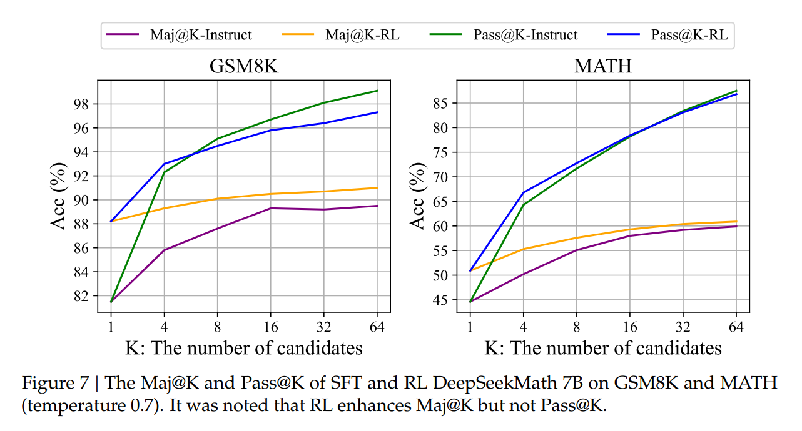
  > 
  > 

---

### 10.3.3、争议三：厂商基准 JevBench 的可比性

- <strong>质疑方</strong>：JevBench 为厂商主导基准，公开集仅占部分内容，评审集私有；官方评分混合了校准、速度、成本多个维度，各系统硬件与端点不一致，难以作为纯能力排名。第三方批评【`pen-spark-jev、2609.37647`】将其视为 “系统基准” 而非通用能力榜单。此外，部分广为流传的对比数据并非出自官方仓库，而是第三方转引结果，可信度存疑【mrjev】。公开集与密封集性能差距巨大，社区模型在密封集上准确率普遍仅 28%–38%，与公开集 80% 以上的表现形成断层，这表明留出集协议有待改进。

  > 证据来源见： 
  > 
  > - github.com/abhishek085/open-spark-jev 与 arXiv:2609.37647 的方法论批评
  > 
  > - SemIf 零训练 = 官方 JevBench 98%（73.1/74.4）"在 SemIf 当前 README 中<strong>并不存在</strong>——它是第三方评测板 thejevai 的 mrjev（未纳入本报告精读池）的转引结果，非项目自测；
  > 
  > - arXiv:2610.02076 的未来工作部分，社区模型在 JevBench 密封 308 条上普遍只有 28–38%，与公开档 80%+ 形成断层，提示 held-out 协议本身需要改进
  > 
  > 

- <strong>被质疑方</strong>：官方已公开基准的部分数据与评测协议，且明确区分公开集与密封集的划分。

<strong>不做裁决定轮</strong>：本综述工作不对厂商基准与独立基准做排名判定，但在引用 JevBench 数据时，必须标注版本、公开 / 密封集的划分与发布时间。

---

### 10.3.4、争议四：官方 RLCD 配方未公开对 “复现” 这一说法的影响

- <strong>一方观点</strong>：官方仅公开 RLCD 的目标与 “全合成数据训练” 的原则，未公开奖励函数、优化器细节、架构设计等核心要素。所有声称 “复现 RLCD” 的开源项目，实际复现的都是奖励聚合、KL 正则、数据合成方案、决策头形状四个自由度的自选组合，这也是各开源实现校准表现差异巨大的核心原因。

  > 证据：综合 github.com/NandhaKishorM/laya 训练脚本节与 github.com/ZimmyGao/openjev-rlcd 自述
  > 
  > 

- <strong>另一方观点</strong>：主流开源实现均明确声明为 “独立实现，不对官方内部训练算法做断言”，将 “复现 RLCD” 降级为 “基于公开数学内核的工作版实现”，本质是对争议的回避而非解决。

  > 证据：OpenJev-RLCD 明确声明"独立实现，不对 Jev 内部训练算法做任何断言"
  > 
  > 

<strong>不做裁决定论</strong>：官方 RLCD 是否等同于某一公开配方，外部无法证伪；官方 RLCD 配方本身属于仅目标声明、未公开细节的低强度证据。

---

### 10.3.5、争议五：是否需要专门的 “决策原生架构”

- 证据列表：

| 立场：零训练读出派（"读出协议已够"）| 立场：decision-native 派（"架构要原生设计"）|
|---|---|
| 冻结 4B LLM 读字母 logits 即 81.4% JevBench【见争议1】；<br>    Inner Jev 加 rank-32 LoRA 31B 84.4 反超闭源 Jev 80.1（arXiv:2610.17205）——能力来自基座与轻量微调，不需要为决策单建架构| Jeva（arXiv:2610.18773）用共享 backbone 独立编码 + 紧凑决策 block + coverage gate，把置换不变、null-aware、可缓存做成架构闭式性质（600 题 0 flip、null AUROC 98.66%、决策栈仅 13.37M 参数）—— 论文论证独立 option 打分在数学上不能逆转两候选偏好（其式 2），flat softmax 被 log K 污染，这些缺陷事后去偏修不掉|

- <strong>“读出协议已足够” 立场</strong>：冻结大语言基座读取字母 logits 即可达到较高准确率，轻量微调即可超越闭源产品；决策能力主要来自基座模型与轻量适配，不需要为决策任务单独设计架构。

- <strong>“决策原生架构必要” 立场</strong>：独立选项打分在数学上存在固有缺陷，如无法逆转候选偏好、平坦 softmax 受选项数量污染等，这些缺陷无法通过事后去偏完全修复；决策原生架构可<strong>将置换不变性、空选项感知、可缓存性</strong>等作为架构闭式性质，在高基数、空选项检测等场景具备结构性优势。

<strong>差异说明</strong>：双方的验证场景不同。

- 前者证据集中于常规二值 / 多选判断（选项数量少、无空选项需求）；后者主张聚焦于<strong>高基数选项、空选项检测、置换不变性</strong>等前者通过事后旋转 / 平均补救的场景；

- 目前决策原生架构仅为单团队验证【Jeva，2610.18773】的孤证，尚无第三方复现，仅作为技术路线分歧予以记录。

---

### 10.3.6、争议六：强化学习校准训练是否具备实际价值 — GRPO 无增益 vs 纯 CE 超 Jev

- 证据列表（10月最新）：

| 立场：RL（GRPO）对 agent loop 内校准无 measurable gain| 立场：纯 CE 的 LoRA SFT 即可超闭源 Jev|
|---|---|
| JevAgentHarness（arXiv:2610.21412）：在 agent loop 内投 4.5 GPU-h + \$26.53 跑 GRPO，相对 SFT 的 CE+Brier 组合无 measurable gain——SFT 已足够| Inner Jev（arXiv:2610.17205）：31B 加 rank-32 LoRA（约 5 GPU-小时、纯 CE 类目标）84.4 反超 Jev 80.1，且决定性 ablation 显示收益全在 LoRA、只训 head 冻 backbone=78.9≈零样本|

- <strong>“RL 无显著增益” 立场</strong>：在智能体闭环场景中，投入大量计算资源运行 GRPO 强化学习，相比监督微调的交叉熵 + Brier 组合，没有可测量的性能增益，监督微调已能满足校准需求。

- <strong>“纯监督即可超越闭源” 立场</strong>：31B 模型加秩 32 的 LoRA 监督微调，即可在自选开发集上超越闭源 Jev 的性能，且收益完全来自 LoRA 微调，仅训练决策头冻结基座的效果与零样本接近。

<strong>差异说明与立场局限性</strong>：两项研究均自限结论，不证明强化学习无法进一步提升性能。

- 前者【2610.21412】仅测试了单一 4B 模型、单一 GRPO 配置；后者【2610.17205】的超越结果来自自选开发集，非独立测试集，且知识类多选任务仍落后于闭源模型；

- 两项研究表面结论相反，但实际上共同动摇了<strong>“RLCD / 强化学习校准是核心壁垒”</strong>的预期；但由于官方配方未公开，无法确认闭源产品是否采用了其他强化学习方案。

---

## 10.4、证据尚未闭合的开放研究问题

以下是现有证据不足以形成结论的研究方向，整体可以分为单点技术问题与全局系统性缺口两大类。

### 10.4.1、单点技术开放问题

|序号|类型|开放问题|悬而未决的核心证据线索|
|---|---|---|---|
|1|技术机制类|官方 RLCD 配方与架构的四大未公开自由度|官方仅公开训练目标，未披露<strong>奖励聚合方式、KL / 熵正则形式与强度、合成数据管线、决策头形状</strong>四大核心细节；<br>开源实现均为自选组合【Laya/OpenJev-RLCD等】，无第三方对齐验证|
|2|技术机制类|高基数（K 大）决策的技术壁垒|官方方案上限 K≤255；<br>开源方案【Laya】在 77 类任务（Banking77基准）上与闭源性能差距显著；<br>【LLM2Jev，2610.02076】数字编号读出方案打破了字母上限，但仍未追平闭源效果；<br>高基数决策是否需要专门的架构或数据工序，尚无公开结论。|
|3|工程落地类|跨语言校准的有效性与实现路径|非拉丁脚本上出现 “高置信全错误” 的极端失效现象【laya项目】；<br>中文方向仅单源证据【Chinese-Jev，2507.16806】；<br>多语校准是否必须依赖多语检查点 + 路由方案，证据单薄；|
|4|技术机制类|概率公理违背的内在机理|三篇独立评测均复现互补 / 互斥问题概率和不为 1 的现象【综合 arXiv:2609.33209、2609.33971、2609.37470、2507.16806】；<br>可能成因包括读出近似误差、并行独立求值、训练目标未约束三类，尚无定论|
|5|工程落地类|视觉 / 移动场景下决策模型的能力边界|现有视觉与移动 GUI 评测样本量小、无统计检验【2610.01834、2609.29429】；<br>该场景下决策模型的能力边界是否与文本决策同源，缺乏大规模横评支撑【2609.25845、2609.29283、2609.30186】|
|6|技术机制类|重复调用概率噪声的部署影响|实测同一请求重复调用，概率平均漂移 0.04、最大 0.12，12% 的调用会因此翻转选项【2610.01834】；<br>该噪声对置信度阈值级联的工程影响尚无协议级解决方案|

### 10.4.2、全局/生态系统性缺口

以下三项为全局性证据缺口，直接制约全领域结论的置信等级，不属于单点技术问题：

1. <strong>第三方独立复现整体缺失</strong>

  - 2026 年 10 月新增的 9 篇相关论文【Inner Jev、Jeva、System1-Arena、JevAgentHarness等】均为论文自报结果，零第三方独立复现：包括 “开源模型反超闭源 Jev”“决策原生架构性能优势”“agent 闭环能力边界” 等关键结论，均来自单一实验室。

  - 因此证据等级暂定为 B+/C 级，需等待第二团队独立验证后方可升级为强结论。

2. <strong>System-1 决策模型的闭环能力上限未明</strong>

  - 现有研究【System1-Arena】仅证伪了 “小参数量 System-1 可直接做 agent 动作”（≤4B 模型闭环成功率≤3.1%），但未明确参数量与闭环能力的对应关系，即无法回答“多大的 System-1 闭环能到多少”的问题；同时实测 typed decision head 反而会损害长程状态跟踪能力。

  - System-1 在 agent 闭环中的适用规模、可控步数、切换大模型的阈值均无协议级结论。

3. <strong>数值阈值口的通用防御方案缺失</strong>

  - 针对 “程序决策劫持” 【2610.18612】的攻击实测翻转率达 81.5%，现有最强防御仅能降低 9.8 个百分点，释义类防御反而会提升攻击效果。

  - 当前所有防御方案均针对文本侧与接口侧，针对 “置信度数值被下游程序跨阈值消费” 这一核心攻击面，尚无通用有效防御手段。

---

## 10.5、本章小结

当前 System-1 决策模型领域已形成四项核心共识：logit 读出范式的成本延迟优势、校准需显式训练或后处理、级联为主流落地模式、温度缩放有效且粒度敏感，均得到多源独立验证。同时存在六项核心争议，本质多为适用标准与场景的差异，而非根本性结论矛盾。此外，在技术机理、工程落地、系统生态等三个层面仍存在多项开放问题与研究缺口，尤其是第三方复现缺失、高基数与跨语言性能、闭环能力边界等，是未来研究的核心方向。

---

<a id="ch11"></a>
# 11、历史谱系：从 Brier 1950 到 Jev 发布后的System 1 决策模型涌现

> System-1 决策模型 “读取 logits、输出校准概率、不生成文本” 的技术范式，并非单一线性演进的结果，而是 “一个后训练引擎底座 + 三条并行支线” 在 RLCD/Jev 处的汇流形成的技术体系。
> 
> 本章基于实证结果重构其技术谱系，梳理各条技术路线的独立发展与最终汇流过程。
> 
> 

先看一个时间线概览，<strong>看清"底座"与"三支线"在时间上如何错开的：</strong>

|时间|事件|所属线|
|---|---|---|
|1950 / 2007|Brier 评分 / 严格适当性理论|支线一（数学）|
|2017|Guo 温度缩放|支线一（数学）|
|2022-07|Kadavath P (True)/P (IK) 读出|支线二（读出）|
|2024-02|GRPO 去 value net|底座（后训练引擎）|
|2025-03|Rewarding Doubt：log score 作 RL 奖励|支线三（校准训练）|
|2025-07|RLCR：Brier+correctness，改造 GRPO|支线三（与 RD 并行）|
|2025-08|ConfTuner：tokenized Brier 作 SFT 损失|支线三（SFT 平行路线）|
|2026-09|Jev 发布（官方 RLCD）+ Laya/SemIf 复现潮|三线汇流|
|2026-10|LLM2Jev / OpenJev-RLCD|支线二 / 三工程化|

可以看到：<strong>数学地基比读出早 70 年、比校准训练早 75 年，三条线在 2025 年之前几乎没有交集。如下为思想谱系示意图。</strong>

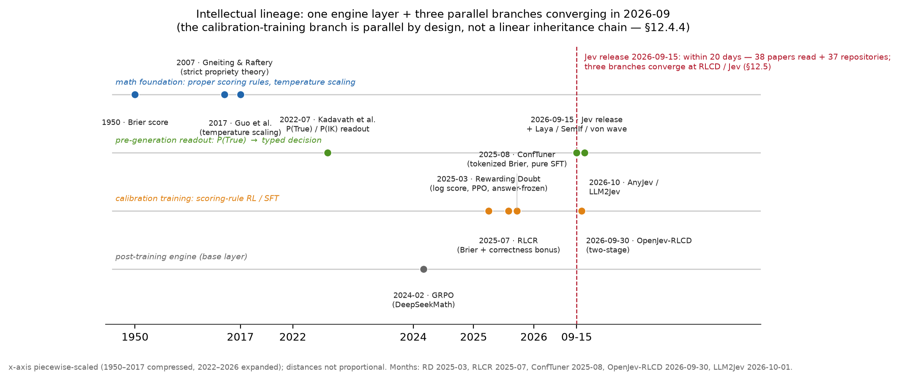

## 11.1、核心底座：可验证奖励后训练引擎 GRPO

DeepSeekMath 于2024年2月提出的 GRPO（Group Relative Policy Optimization）（arXiv:2402.03300）本身不是校准工作，也不是决策模型工作，而是将可验证奖励强化学习（RLVR）工程化的标准引擎。其对本主题的价值是底座级的，是后续所有开源校准强化学习的工程基础。

<strong>核心机制与工程价值</strong>

GRPO 的核心创新是通过组内相对优势归一化去除了价值网络，将 PPO 所需的四个模型（策略 + 参考 + 奖励 + 价值）压缩为三个模型，使 7B 级模型的强化学习可在单卡级资源上运行。其核心设计包括：对同一问题采样 64 个输出，用组内奖励的均值作为基线，通过`(奖励-均值)/标准差`做优势归一化，将 KL 正则直接加入损失函数。

对校准领域的预见性结论是：GRPO 原文实测强化学习后，Pass@K（前 K 个答案包含正确答案的概率）不变，但 Maj@K（多数投票准确率）显著上升，<strong>证明强化学习的核心作用是收窄采样分布，而非扩展模型的能力上限</strong>。这一观察为后续 “强化学习导致过度自信” 的现象提供了早期机制解释 —— 分布收窄会将概率质量挤向众数，即便众数并非始终正确。

后续的 RLCR 【<strong>2507.16806</strong>】等校准强化学习工作均以 GRPO 为底座进行改造，替换奖励函数的设计，同时保留组内相对优势、去除价值网络的核心框架。RLCR 进一步将采样数从 64 降至 32，并按 Open-Reasoner-Zero 路线去除了 KL 正则与监督微调冷启动，持续对底座引擎进行修剪优化，但核心骨架保持不变。

PPO 与 GRPO 的核心设计对比如下：

|维度|PPO|GRPO|
|---|---|---|
|基线方式|训练价值网络做广义优势估计|组内采样奖励的均值|
|优势归一化|广义优势估计|组内`(奖励-均值)/标准差`|
|KL 正则位置|加入奖励项|直接加入损失函数|
|所需模型|策略 + 参考 + 奖励 + 价值（4 个）|策略 + 参考 + 奖励（3 个，无价值网络）|

> <strong>定位：GRPO 是基础引擎，是后续三条支线发展的基础</strong>
> 
> - 以 <strong>RLHF（Reinforcement Learning from Human Feedback，基于人类反馈的强化学习）→RLVR→GRPO（Group Relative Policy Optimization，组相对策略优化）→官方 RLCD 为节点的技术演进序列</strong>，构成了该体系下后训练阶段的核心范式主线，形成了可复用的算法底座与标准化训练流程。在GRPO基础引擎之上，现有研究分别沿数学推理能力增强、知识读出机制优化、模型校准性能提升三条技术支线展开拓展，通过引入专项训练目标与约束机制，对基础后训练范式实现定向增益；
> 
> - RLHF 作为该演化链路中更上游的奠基性范式，其核心优化目标锚定人类偏好对齐，原始设计与模型校准目标并无直接关联。然而 Kadavath 等人的工作揭示了该技术路径下衍生的关键问题：模型经 RLHF 训练后会出现<strong>校准坍缩</strong>（calibration collapse）现象 —— 输出置信度与真实准确率的匹配程度发生显著退化；而通过将推理温度参数设定为*T*=2.5，可在一定程度上逆转该退化、恢复模型的校准表现。这一发现也为后续校准支线的后训练技术迭代提供了核心问题驱动与研究起点。
> 
> 

---

## 11.2、支线一：数学地基线 —— 严格适当评分规则与温度缩放

该支线为纯理论脉络，不涉及具体模型实现，但定义了所有校准技术的核心约束与评价标准。、

<strong>严格适当评分规则理论</strong>

1950 年提出的 Brier 评分，与 2007 年完善的严格适当性（strictly proper）理论，构成了全部校准奖励设计的数学基础。严格适当性的核心性质是：<strong>当且仅当模型报告真实的主观概率时，期望奖励达到最大值</strong>。线性评分规则因鼓励极端概率不具备适当性，无法激励模型诚实报告置信度；只有适当评分规则能让 “报告真实概率” 成为唯一最优策略。

Brier 评分的形式为预测概率与真实标签的平方误差$Brier=(q−c)^2$，可同时惩罚 “答错” 与 “过度自信”，将准确率与校准纳入同一标量优化目标，是后续校准训练最常用的评分规则。

<strong>温度缩放后处理</strong>

2017 年 Guo 等人的研究证明，现代深度神经网络普遍存在系统性过度自信，并提出温度缩放这一单参数后处理方法：在留出集上拟合温度参数，最小化负对数似然，实现校准优化。

温度缩放的核心性质是仅调整分布形状、不改变最优选项排序，因此不会降低模型的判别准确率，同时也决定了其无法修复判别力本身的缺陷。这一性质定义了后处理校准的适用边界，也解释了为何判别训练始终需要配套校准工序。

<strong>从评估工具到训练目标的范式转变</strong>

2025 年之前，评分规则始终作为概率预测的事后评估工具；2025 年后，其被反向用作强化学习奖励与监督微调损失，实现了用途的范式转变。其中一个关键的工程筛选原则是有界性：<strong>对数评分虽具备适当性，但概率趋近于 0 时无界，与正确性奖励共存时容易出现奖励破解问题，因此工程落地中更倾向于选择有界的 Brier 评分</strong>。


> 定位：
> 
> - <strong>这条线的贡献是跨支线共享的，后续的三个 RL/SFT 工作（RD、RLCR、ConfTuner）的奖励/损失都必须满足严格适当性；区别只在于将其纳入优化循环的哪一环（RL 奖励 vs SFT 损失 vs 事后单标量）。</strong>
> 
> 

---

## 11.3、支线二：预生成决策读出线 —— P (True) 到 typed decision

该支线回答了 “能否不生成完整答案，直接从模型隐表示中提取置信信号” 的问题，是 Jev 式 “读 logits 不生成文本” 范式的学术源头。

<strong>奠基性工作：Kadavath 的读出范式</strong>

2022 年 Anthropic 的研究【2207.05221】首次系统验证了从预训练模型中读出置信信号的可行性，两个核心设计直接预言了后续的读出协议：

1. <strong>P (True) 读出协议</strong>：将开放式自评改写为 True/False 二选一形式，读取选项 token 的概率作为置信度。研究证实，模型对单 token 选项的打分天然具备一定校准性，自由生成文本再判对错会因释义歧义降低准确性，这是后续字母读出路线【SemIf/AnyJev等】的最早实证依据。

2. <strong>P (IK) 价值头</strong>：在语言模型上附加二分类头，读取最后一个 token 的 logit，训练目标为 “预测本题是否能答对”。仅在单一数据集上训练的价值头，即可跨任务区分对错，OOD 任务上 AUROC 普遍高于 0.6，部分任务可达 0.9 以上【2207.05221，Table 1】。

该研究同时留下了两个延续至今的关键观察：

- 一是排序能力（AUROC）不等于数值校准（ECE），有置信信号不代表概率数值准确；

- 二是强化学习后模型校准会严重退化，但统一的温度缩放即可恢复校准，这是 “RL 伤校准、温度可救” 【<strong>arXiv:2207.05221 Fig.9</strong>】的最早系统证据。

<strong>从零样本读出到产品化</strong>

Kadavath 的工作属于 “生成后自评” 模式，后续开源工作将其前置为 “生成前决策” 模式：冻结基座模型，将问题改写为单字母作答形式，在首个 token 位置读取选项的 softmax 概率，零训练即可达到较高准确率【<strong>SemIf</strong>】。后续研究进一步通过选项旋转去位置偏置、闭式读出头设计、前缀自由数字编号等方式，优化读出的公平性与选项数量上限【<strong>AnyJev，arXiv:2610.00831</strong>】。

官方产品则将读出技术产品化为声明式的 Choice/Score/Noul 三类原语，支持并行独立求值、按选项基数两阶段打分，形成了成熟的类型化决策接口。


> <strong>定位：</strong>
> 
> - <strong>这条线的内在逻辑：Kadavath 证明了"校准信号存在于模型内部、可被读出"，而开源社区则证明"读出不需要训练就能拿到不错的准确率"。在商业产品侧 Jev 则把"读出"做成一等公民的产品接口。</strong>
> 
> - <strong>它与支线三（把校准训练进模型）是互补的：一个走读出，一个走训练。</strong>
> 
> 

---

## 11.4、支线三：校准训练线（RD / RLCR / ConfTuner）—— 并行探索而非线性继承

将适当评分规则转化为训练目标的三类代表性工作，几乎并行出现、相互独立，是并列对照关系而非师徒继承关系，这也是对既往理解的线性谱系认识的核心修正。

<strong>Rewarding Doubt：最早的评分规则 RL 校准</strong>

2025 年 3 月 TUM 与 MCML 提出的 Rewarding Doubt，是首个将严格适当评分规则用作强化学习奖励的公开工作【2503.02623】。其核心设计包括：采用语言化置信度作为信号形式，使用 PPO 优化，选择二元对数评分规则作为奖励函数。

该工作采用两阶段解耦设计：先采样并冻结答案，PPO 梯度仅流过置信度 token，从结构上保证校准训练不改变模型的答案能力。<strong>其代价是答案能力完全依赖基座模型，强化学习不参与答案质量提升【仅校准不提升准确率】</strong>。该研究同时验证了校准训练的跨任务泛化性：仅在单一数据集上训练，即可在多个分布外数据集上降低 ECE、提升 AUROC。

> 说明：
> 
> - <strong>因为它只优化校准项、没有准确性提升的收益。这避开了 RLCR 后来证明的"无界评分规则 + 准确性收益会产生奖励劫持"问题，但代价就是答案能力完全靠基座模型，RL 不参与提升答案。</strong>
> 
> 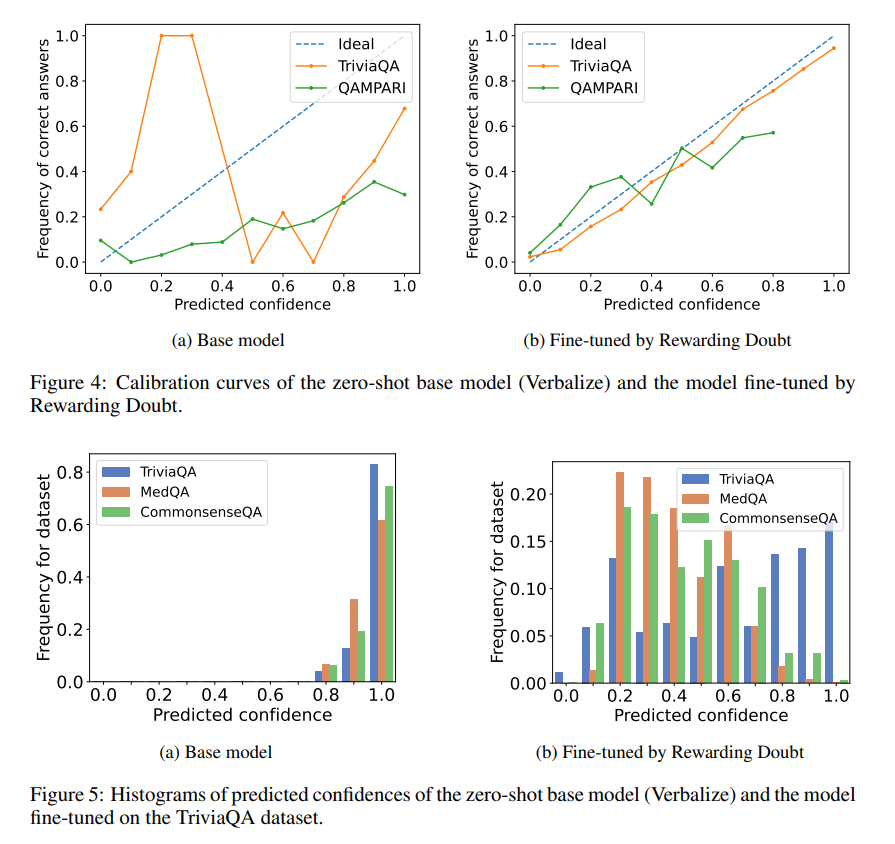
> 
> 

---

<strong>RLCR：有界 Brier 奖励的联合训练</strong>

同时，稍晚由 MIT 于2025 年 7 月提出的 RLCR【2507.16806】，与 Rewarding Doubt 相互独立，二者沿不同技术路径探索大模型后训练校准方案。RLCR 采用有界二元 Brier 评分作为校准奖励项，同时保留正确性激励，基于改造后的 GRPO 引擎实现优化。

方案设计上，RLCR 的训练信号由“答案 + 显式置信度表述”共同构成，模型输出中设置专门的`<analysis>`不确定性推理段落承载置信度推理过程；其奖励函数的精确形式为：$R = \mathbb{1}[y\equiv y^*] - (q-\mathbb{1})^2$，其中$\mathbb{1}[y\equiv y^*]$为答案正确性指示项（正确性奖励），$(q-\mathbb{1})^2$为二元 Brier 评分惩罚项，整体构成有界奖励空间。

RLCR 明确批评了仅优化校准项的设计，具体包括 Rewarding Doubt、Sayself 以及 Xu 等人（2024）的工作，指出单一校准目标会无意中损害任务准确率，尤其在大模型场景下易引发奖励破解（reward hacking）问题。该工作通过定理 1 证明：在有界评分规则下，任务准确率与校准度可在同一点同时达到全局最优，为 “正确性奖励 + 校准奖励” 的联合优化提供了理论保障。这一结论与 Rewarding Doubt 形成核心机制分歧：RD 通过完全移除正确性奖励，绕开了无界评分下的奖励破解问题；而 RLCR 则证明，若算法设计中需要保留正确性激励，则必须更换为有界评分规则。

实验显示，在 HotpotQA 数据集上 RLCR 将模型 ECE 从 RLVR 基线的 0.37 降至 0.03，同时准确率仅下降 0.9 个百分点，实现了校准性能大幅提升且任务性能损耗极小的效果。另外针对对数评分方案的机制性缺陷，RLCR <strong>从理论上证明：无界的对数评分规则与有限正确性奖励共存时，必然存在奖励破解空间；</strong>对应的简化验证（toy）实验结果显示，采用对数评分的 RLCR-Log 版本策略完全坍缩至弃权状态（准确率 = 0、Brier 得分 = 0、ECE=0），而采用 Brier 评分的 RLCR-Brier 版本可维持 34.4% 的准确率与 0.02 的 ECE，从实证层面验证了有界评分的必要性（原论文附录 E）。这一结论与 Rewarding Doubt 的设计形成核心分歧：<strong>后者通过不加正确性奖励绕开了该问题，前者则证明一旦需要正确性激励，就必须更换有界评分规则</strong>。

另外，RLCR 一项易被忽略的核心结论是：校准性能的核心决定因素是奖励函数设计，而非引导模型反思的提示话术。实验显示，即使移除`<analysis>`不确定性推理段落，RLCR 仍可达到 0.09 的 ECE；反之，RLVR 基线即使增加不确定性推理段落，ECE 也仅能达到 0.34（原论文 Table 2）。该发现反向支撑了 <strong>“无需依赖思维链反思、仅通过奖励设计即可实现校准”</strong> 的技术路线，为无推理文本、单次前向的校准方案提供了实证依据。

---

<strong>ConfTuner：监督微调范式下的恰当评分规则校准路线</strong>

几乎同时，NUS 于 2025 年 8 月提出的 ConfTuner【2508.18847】，实现了置信校准领域的关键范式转折：它首次将经典的恰当评分规则（Proper Scoring Rule）从强化学习的奖励信号，转化为可直接反向传播的监督微调（SFT）损失函数，与 RL 类校准路线形成理论同源、路径平行的技术谱系。。

在此之前，基于监督微调的置信校准方法普遍依赖启发式代理置信标签 —— 例如通过多采样一致性、类别级统计准确率或模型自我判断生成置信目标，不仅缺乏严格的校准理论保证，还存在假设过强、噪声高、计算成本大等问题。ConfTuner 跳出了“先构造置信标签再监督拟合”的传统思路，直接将置信表达空间离散为预定义的 token 集合（如 0\~100 的百分级置信 token），在置信位置的 token 概率分布上定义<strong>分词化 Brier 分数（Tokenized Brier Score）</strong> 作为损失函数，并通过定理严格证明该损失仍满足恰当评分规则性质 —— 即损失最小化的全局最优解，对应模型输出的置信度与样本真实正确率完全对齐。

【细节扩展】

> 目标：就是让模型在输出末尾的 `Confidence: XX%` 文本时，XX 这个数值能真实反映答案的正确率，解决 “答错还高度自信” 的过度自信问题；
> 
> 训练是端到端的，核心在于使用 Tokenized Brier Score 损失来优化置信度位置Token的概率分布，驱动置信 token 的概率分布，去贴近 “这道题模型真实能答对的概率” ：
> 
> 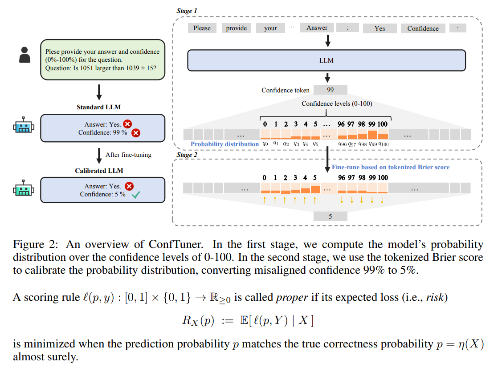
> 
> - <strong>步骤 1（取分布）</strong>：模型正常生成 “答案 + 置信文本”，在置信数字对应的 token 位置，取出所有候选置信 token（0\~100）的概率分布 $\boldsymbol q$；
> 
> - <strong>步骤 2（算损失回传）</strong>：用这个分布 $\boldsymbol q$ 和“答案是否正确”的二元标签 y，计算 Tokenized Brier Score 损失，直接反向传播更新模型参数；
> 
> 引入 Tokenized Brier Score 损失后，丢弃了“给每个样本标一个置信度 “标准答案”，让模型去拟合这个标签”的传统监督式校准思路，仅使用二元标签，依靠恰当性评分规则的内在机制来驱动校准：只要模型想让损失最小，就必须诚实地输出真实置信；故意高估、低估、乱报极端值，长期平均损失都会变大。
> 
> $\ell(\boldsymbol q,y):=\sum_{i=0}^{N} q_i\left(y-\frac{i}{N}\right)^2$
> 
> - 核心假设：置信度是<strong>离散 token 集合</strong> $T_N=\{0,1,...,N\}$（常用 N=100 代表 0‑100%；N=9 代表 0‑9）；
> 
> - y：二元标签，答案正确 = 1；答案错误 = 0；
> 
> - $i/N$：token i 对应的归一化置信概率（i=100 就是 1.0；i=0 就是 0）；
> 
> - 物理含义：<strong>对模型置信 token 的概率分布求期望的 Brier 损失，打分对象是 token 分布，不是单点 —— 不是拿模型输出的置信数字去和 y 算 Brier，而是拿置信 token 上的 softmax 分布求期望 Brier；</strong>
> 
> - 如果答案错 $y=0$：模型如果把很大$q_i$分配给大 i（高置信），$(0-i/N)^2$会很大，损失飙升，惩罚过度自信。
> 
> - 如果答案对 $y=1$：模型分配大$q_i$到大 i（高置信）损失变小，鼓励合理高置信。
> 
> 

这一设计带来了显著的效率优势：整个训练过程无需评论家模型（Critic）、无需组采样、无需重复生成多轮回答，仅需 2000 条标注了 “对错” 二元标签的样本即可收敛。在同等基座模型下，其训练样本量较 SaySelf 降低约 3 个数量级，训练时长较 LACIE 减少约 85%；在 LLaMA-3.1-8B 上跨 5 类推理任务的平均期望校准误差（ECE）从 0.2768 降至 0.1082，相对 LACIE 基线优化幅度达 54.7%。

除校准效率与效果的提升外，该工作还有两项被后续研究广泛借鉴的延伸贡献： 

- 其一，它严格证明了<strong>恰当评分规则并非强化学习的专属工具</strong>，监督微调范式同样可以承载完整的理论校准保证，极大拓展了可信大模型的训练路径选择； 

- 其二，它验证了“校准能力可被蒸馏为独立代理器”的可行性 —— 基于开源模型训练的 ConfTuner，可作为第三方置信评估器为 GPT-4o 等黑盒模型的输出做置信校准，其校准精度甚至优于 GPT-4o 的自我评估（跨数据集平均 ECE 从 0.1640 降至 0.0970）。这一思路为后续的低成本置信判断模块、模型级联系统设计提供了早期实践依据。

---

<strong>并行关系的核心证据</strong>

上述三项工作按时间顺序排列易被误读为线性继承，但核心设计与学术立场均证明其为并行探索关系：

- 评分规则选择不同：对数无界 vs Brier 有界 vs token 化 Brier；

- 优化范式不同：PPO 两阶段解耦 vs GRPO 联合训练 vs 纯监督微调；

- 正确性激励设计不同：无（答案冻结） vs 有（定理要求） vs 无（仅二值标签）；

- 学术立场存在分歧：RLCR 明确点名批评 Rewarding Doubt 的设计缺陷。

三者是同一问题空间内的三个互斥设计方案，而非一条技术路线上的先后迭代。如下为三类校准训练工作的核心设计对比表。

|维度|Rewarding Doubt (2025-03)|RLCR (2025-07)|ConfTuner (2025-08)|
|---|---|---|---|
|评分规则|对数评分（无界，ε 裁剪）|Brier 评分（有界）|Token 化 Brier 评分（有界）|
|优化方式|PPO，答案冻结两阶段|改造版 GRPO，答案 + 置信联合训练|纯监督微调，无强化学习|
|正确性奖励|无（答案冻结规避）|有（定理 1 要求）|无（仅二值对错标签）|
|核心取舍|保证不损伤准确率，不提升答案能力|同时优化准确率与校准|训练成本极低，实现简单|

---

## 11.5、开源落地与三线汇流

2026 年 9 月官方 Jev 发布后，开源侧出现了 RLCD 复现潮，将三条支线的技术进行整合，标志着三线汇流的工程落地。

- <strong>Laya【</strong>github.com/NandhaKishorM/laya<strong>】</strong>：采用现代 BERT 双向编码器加决策头，基于 GRPO 式策略梯度与严格适当评分规则训练，后处理采用按选项数分桶温度加直方图分箱再校准，是生态中唯一完整公开训练配方的 RLCD 实现。其零样本基础性能接近随机，能力主要来自后续微调，印证了校准训练需与数据、微调组合生效的判断。

- <strong>OpenJev-RLCD【arXiv:2609.38850 /</strong>github.com/ZimmyGao/openjev-rlcd<strong>】</strong>：在 Qwen3-1.7B 模型上采用两阶段实现，第一阶段用路径梯度校准答案分布，第二阶段以相同适当评分作为 REINFORCE 奖励强化推理，在验证集上实现了覆盖率的大幅提升。该项目明确声明为独立实现，不对官方内部算法做断言。

两项落地工作将校准训练线的学术内核，与数学地基线的温度缩放后处理、决策读出线的类型化输出相结合，完成了三条技术支线的工程汇流。

> 定位：<strong>这两个落地工作把支线三的学术配方（RD/RLCR/ConfTuner 的数学内核）接到了支线一（温度缩放后处理）与支线二（typed decision 读出）上。</strong>
> 
> 

## 11.6、技术谱系对照总表

下表梳理了各关键工作的核心属性与技术定位，清晰呈现演进脉络与汇流关系。

|工作名称|时间|信号形式|优化方式|评分规则|技术定位|
|---|---|---|---|---|---|
|Brier 评分 / 严格适当性理论|1950/2007|（纯理论）|—|Brier 等严格适当规则|数学地基，全部校准奖励的理论基础|
|Guo 温度缩放|2017|logit 温度参数|单参数留出拟合|负对数似然|后处理校准的理论来源|
|Kadavath P(True)/P(IK)|2022-07|字母选项读出 / 价值头|零训练读出 + 小样本微调|—（读出技术，非训练目标）|决策读出线奠基，证明置信信号可读出|
|GRPO|2024-02|可验证奖励|组内相对策略梯度（去价值网络）|—（支持任意奖励）|后训练引擎底座，RLCR 的改造基础|
|Rewarding Doubt|2025-03|语言化置信度（0-10）|RL（PPO，答案冻结两阶段）|对数评分（无界）|校准训练线：首个评分规则 RL 校准|
|RLCR|2025-07|答案 + 语言化置信度|RL（改造版 GRPO）|有界 Brier + 正确性奖励|校准训练线：与 RD 并行，完整 RLCD 方案|
|ConfTuner|2025-08|置信度 token 分布|纯监督微调|Token 化 Brier|校准训练线：SFT 平行路线，证明 RL 非必需|
|SemIf|2026-09|字母 logit 读出|零训练 + 分负载温度缩放|无训练目标（仅后处理）|决策读出线：零训练读出的工程验证|
|官方 RLCD（Jev）|2026-09|选项概率分布（三类原语）|RL（配方闭源）|未公开|三线汇流点，本领域核心产品|
|Laya RLCD|2026-09|选项概率分布|RL（GRPO 式）+ 分箱后处理|严格适当规则|校准训练线落地：唯一完整开源配方|
|LLM2Jev|2026-10|前缀自由数字编号读出|零训练 / LoRA 微调|列表式损失|决策读出线：打破字母选项数量上限|
|OpenJev-RLCD|2026-10|推理后答案分布|两阶段（路径梯度 + REINFORCE）|严格适当规则|校准训练线落地：工作版可复现 RLCD|

## 11.7、本章小结

System-1 决策模型的技术演进呈现 “一个底座 + 三条并行支线” 的汇流结构。GRPO 作为后训练引擎底座，提供了工程化的强化学习框架；数学地基线定义了校准的严格适当性约束与温度缩放后处理方案；决策读出线验证了置信信号的可提取性，并逐步实现工程化与产品化；校准训练线通过三条并行路径，探索了将适当评分规则注入模型的不同方式。

三条支线在 2026 年实现产品化与工程化汇流，形成了当前的技术体系。其中校准训练线内部的并行而非继承关系，形成了独特的演进路径，也解释了当前领域部分共识与争议的形成根源。

---

<a id="ch12"></a>
# 12、实践指南：评估协议、阈值与成本、上线清单与相邻范式边界

决策模型的生产落地是一个涉及评估规范、阈值校准、成本权衡与风险控制的系统工程。现有公开基准与厂商宣传数据往往存在统计不规范、分布错配等问题，难以直接作为生产部署的依据。本章基于 28 项早期研究的审计结论与多项落地实践，系统构建了决策模型从评估验证到上线运行的完整方法论框架，明确了<strong>阈值设定的成本 - 收益逻辑、不同部署方案的适用场景</strong>，并厘清了<strong>决策模型与约束解码、传统分类器等五类相似技术范式</strong>的边界与转换成本。

## 12.1、标准化评估体系与实证规范

厂商公布的性能指标仅可作为参考，不能直接作为生产决策依据。对 27 篇早期类型化决策模型（Typed Decision Model, TDM）论文【截止10月9日】的审计显示，12 篇未报告置信区间与显著性检验，至少 7 篇存在观测结果后修改实验设计的 p-hacking 行为，导致性能指标存在显著膨胀。因此，建立严谨的本地化评估流程是落地的首要前提。

### 12.1.1、多维度评估指标体系

决策模型输出包含离散选择与概率分布两类信息，单一指标无法全面刻画其性能，需从准确性（多准）、校准度（概率多可信）、错误识别能力（是不是知道自己不知道）三个维度构建评估体系。五个核心指标的定义、作用与局限如表所示。

决策模型核心评估指标对比表如下：

|指标|计算方式|核心问题|主要局限|
|---|---|---|---|
|准确率 /macro-F1|正确决策占比；<br>类别不均衡时采用 macro-F1|模型判别精度|与校准完全无关；<br>聚合准确率会掩盖子群性能崩塌|
|ECE|置信度分 M 个等宽桶，计算桶内准确率与置信度的加权平均差$\mathrm{ECE}=\sum_m \frac{\vert B_m\vert }{n}\lvert\mathrm{acc}(B_m)-\mathrm{conf}(B_m)\rvert)$|置信度数值的可信度<br>|对分桶数敏感；<br>样本量 \< 1000 时波动剧烈，需同时报告桶数与置信区间|
|Brier / 多类 Brier|预测概率与真实标签的均方误差$\frac1n\sum_i\lVert q_i-y_i\rVert^2)$，NLL 为其对数变体|整体概率分布质量|NLL 对低概率正确事件无界，单一样本可主导结果|
|错误检测 AUROC|以决策正误为标签、置信度（或$1-q$）为分数计算排序性能|模型是否知晓自身错误（级联可行性前提）|不要求概率数值校准；<br>跨任务不可直接比较；|
|风险 - 覆盖率 / AURC|按置信度从高到低累积执行，绘制<strong>覆盖率 - 错误率曲线</strong>并计算线下面积|级联阈值下错误率与自动化率的完整权衡|对分布漂移高度敏感，需按数据切分分别绘制|

注意，指标选择需匹配下游应用场景：

- 若仅取最大概率选项自动执行，应重点关注<strong>准确率 / F1 值与错误检测 AUROC</strong>，后者直接决定置信度门控机制是否可行；

- 若将概率用于成本敏感决策或分桶监控，则需补充 ECE 与 Brier 分数；

- 若用于级联阈值设定，需绘制<strong>风险 - 覆盖率曲线并报告 AURC</strong>。

单一指标的性能表现不能推广至其他维度，例如 Rewarding Doubt 模型【2503.02623，Table 4】在 CommonsenseQA 任务上 ECE 与零样本基线接近（0.282 vs 0.293），但错误检测 AUROC 从 0.54 提升至 0.64，仅用 ECE 会遗漏<strong>排序能力</strong>的改善。

另外，需要注意存在三项关键实证发现构成评估的硬约束需要明确：

- 第一，<strong>聚合 ECE 存在严重误导性</strong>

  - Jev-1.13.0 在 22 个 Choice 数据集上的聚合 ECE 为 0.028，单数据集中位数也为 0.028，但未加权平均 ECE 达 0.061，且 20 个数据集存在普遍的过度自信现象【<strong>2609.37647，§4.3</strong>】。

  - 更极端的案例显示，通用 NOUL 任务上聚合 ECE 仅 0.047，而单基准中位数 ECE 高达 0.168，基线率错配被聚合平均所掩盖【<strong>arXiv:2609.29429 §4.4</strong>】。

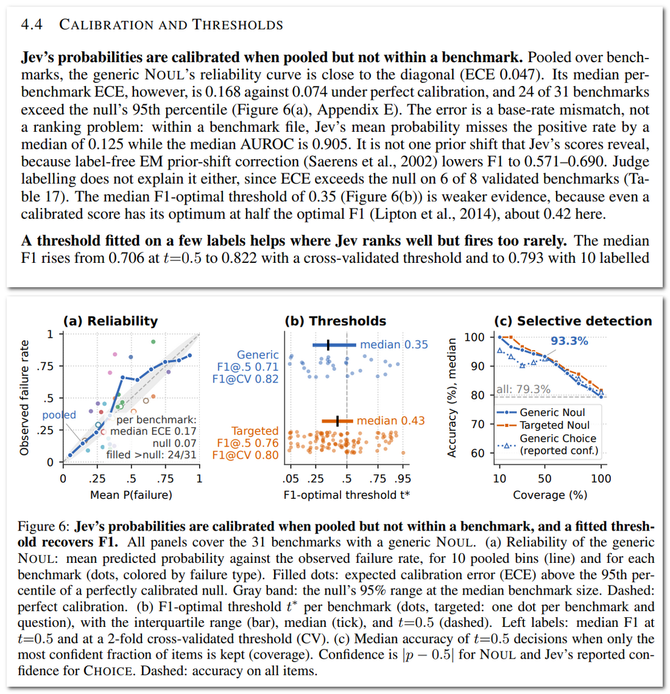

- 因为，实际实践当中评估必须按数据源分桶报告，禁止使用单一聚合分数。 

- 第二，<strong>仅测试 top-lable 置信校准存在不足</strong>

  - Sys1Cal-v1 基于 365 条已知精确概率的样例测试发现，同一模型在不同输出原语下的概率语义存在显著差异：Jev-Noul 的分布重叠度（OVL）为 0.918，Jev-Score 为 0.886，而 Jev-Choice 仅为 0.764【2609.35342，Table 1】；同一模型、同一问题、换原语，概率语义就不互通。

  - 因此若下游需直接消费概率数值，必须针对所用原语单独校准，而非仅验证 top-1 置信度。 

- 第三，<strong>错误检测 AUROC 并非普遍有效</strong>

  - 在可读出类任务上，Jev 的错误检测 AUROC 可达 0.73–0.88，但在无参考的自由文本评估任务（“对错分离”任务上）上仅为 0.498，接近随机水平，此时置信度门控完全失效【Jev-as-a-Judge，arXiv:2609.26550】。

  - 因此，实践中在上线前必须在目标任务上验证 AUROC 有效性，不能默认置信度具备错误区分能力，它决定"置信度门控"这件事是否成立。

---

### 12.1.2、影子评估流程

本地化评估应采用影子模式运行，即模型仅输出预测结果、不介入实际业务流程，以暴露<strong>校准误差与鲁棒性问题</strong>。标准化流程包括以下环节：

1. <strong>样本抽取</strong>：从生产日志中抽取 1000–2000 条带真实标签的历史样本，保留原始类别分布与文本特征，禁止人为平衡类别，避免引入先验错配。<strong>无标签生产样本仅可用于覆盖率、延迟与置信度分布监控，不足以支撑准确率与校准结论。</strong>

2. <strong>并行测试</strong>：候选模型与现有系统在完全相同的样本上并行运行，全量记录概率输出、决策结果、端到端延迟与调用成本。

  - 输出需通过格式校验（ Schema 校验），包括概率归一性、决策与 argmax 一致性等，无效输出计入准确率误差，概率指标仅在有效输出上条件计算【<strong>2609.26550</strong>】。

  - 延迟需通过固定测试面板（<strong>timing panel</strong>）独立测量（<strong>judge 120 次、含网络与重试</strong>），避免并发与冷启动污染。

  > 参考：<strong>2609.37647</strong> 与 <strong>github.com/AppliedMachineLearning-Lab/jev-benchmarking</strong>
  > 
  > 

3. <strong>分源统计</strong>：<strong>按数据源、任务族、语言维度</strong>分别计算全部指标，并报告 95% 置信区间（CI）。

  - <strong>区间做法：</strong>配对差异采用按来源聚类的 bootstrap 重采样（2000 次），分桶指标采用百分位 bootstrap（500 次）【<strong>arXiv:2609.26550 / 2609.37647</strong>】。

4. <strong>可视化验证</strong>：绘制可靠性图与风险 - 覆盖率曲线。

  - 可靠性图（<strong>置信度 vs 实际频率</strong>）用于判断系统性过度 / 欠自信偏差，Jev-1.13.0 在 Choice 任务上 20/22 数据集表现为过度自信（<strong>落在对角线下方</strong>），而 Noul 原语则略欠自信，即<strong>同一模型不同原语偏自信方向相反</strong>，这提示我们对不同原语需要采用不同的校准策略【跨接口一致性，<strong>arXiv:2609.37647，4.3</strong>】。


- 风险 - 覆盖率曲线【<strong>曲线越靠左下（同等覆盖率下错误率越低）越好</strong>】用于直观呈现阈值与自动化率、错误率的权衡关系【<strong>arXiv:2609.37647</strong>】。

此外，必须补充两项低成本对抗性测试，以验证鲁棒性：

- <strong>选项顺序与措辞不变性测试</strong>：对同一决策生成多种选项排列与等价措辞改写，统计 argmax 翻转率。

  - 反诈场景【<strong>2609.23959</strong>】实测显示，选项顺序翻转率为 2.6%（95% CI [0.2%, 5.8%]），问题措辞翻转率为 5.2%（95% CI [2.0%, 9.4%]），且翻转存在方向性偏向，30 例翻转中有 28 例倒向 “合法” 类别。

  - 我们的综述审计显示 27 篇论文中仅 1 篇论文【<strong>arXiv:2609.32160，Table 6</strong>】完成了该项测试。

- <strong>同基座 logprob 对照测试</strong>：直接读取冻结基座模型的选项 token logits 作为基线，验证决策接口本身的增量价值。

  - 在目前审计范围内，5 项独立研究一致表明，类型化接口本身不带来独立精度收益，<strong>性能主要由基座模型与训练数据决定，精度由 backbone 与训练数据主导</strong>【<strong>arXiv:2609.32160，Finding F1</strong>】。

  - 该<strong>结论可指导研发投入时的分配方向</strong>。

---

### 12.1.3、统计纪律与预注册规范

为避免结果导向的实验设计偏差，评估过程必须遵循严格的统计纪律：

1. <strong>预注册成功标准</strong>：在查看任何结果前需明确非劣效边界与终止条件。

  - 例如反诈场景【<strong>2609.23959</strong>】预先设定 “AUROC 与人工裁判差距在 0.02 以内且延迟降低 20 倍” 的标准，并如实披露测试集筛选导致的 winner's curse 偏差。

2. <strong>三层数据切分</strong>：严格划分开发集（选择检查点）、校准集（拟合温度与阈值）、测试集（最终验证），测试集在最终评估前不得触碰。

  - AgentJev 实践中，1200 条样本划分为 120 条开发集、120 条校准集与 960 条测试集，所有随机种子与数据版本预先固定【<strong>github.com/malevrigns/agent-jev</strong>】。

3. <strong>样本量约束与结论强度</strong>：ECE 等校准指标在样本量小于 1000 时噪声极大，小于 2 个百分点的差异不具备统计显著性。

  - 阈值选择方面，点估计规则在任意样本量下均有 40%–50% 的概率出现 2 分以上的性能下降，而采用下界置信区间（lower-confidence-bound）规则时，约 96 条本地标注即可将该概率降至 5% 左右【<strong>arXiv:2609.26550，§8</strong>】。

4. <strong>变更重测要求</strong>：校准是模型、数据分布、提示词（包括选项措辞）与版本的联合属性，上述任一要素变更后必须重新校准。

  - 例如 Laya 实现中将温度参数钳制在 [0.5, 5.0] 区间，并对超限桶发出运行时告警，避免极端锐化导致的校准失效【<strong>github.com/mizorewww/laya-mlx</strong>】。

标准化预注册模板应包含<strong>成功标准、数据切分、指标设置、阈值规则、对抗测试、终止条件</strong>六项要素，可有效规避审计发现的事后修改设计问题。对 27 篇早期论文的审计统计显示，各项评估规范的合规率普遍偏低（表 13-2），合规率越低的项目越具备差异化价值，应作为评估的必选项。

预注册模板示例：

```Shell
1. 成功标准：例"候选模型在目标负载上 AUROC ≥ 0.80，且 ECE 95% CI 上界 ≤ 0.10"（非劣效 margin 必须在看到任何结果前写下；反诈的 .02 margin 即先例）
2. 数据切分：dev / calibration / test 三层的样本量与冻结方式；test 在开封前不得触碰
3. 指标与分桶：ECE 桶数（M=10 或 15）、bootstrap 重采样次数（≥500）、配对差聚类单位
4. 阈值规则：成本矩阵 (C_err, C_esc) 数值化；lower-bound 规则的容差（例 −0.02）
5. 对抗性测试：选项排列数、等价措辞改写数、注入测试样本数
6. 终止条件：什么结果下放弃该路线（例 error-AUROC<0.6 即不启用门控）
```

如下表为早期 TDM 论文的评估规范合规率【<strong>参照2609.32160 Table 6</strong>】：

|评估规范|合规率|实践建议|
|---|---|---|
|同基座 label-logprob 基线对照|5/26|必做|
|廉价生成级联基线对照|1/5|级联项目必做|
|重排 / 改写的逐决策一致性测试|17/26|执行选项排列与改写测试|
|选项名不变性测试|1/27|必做，最易被遗漏|
|核心结果附带置信区间 / 显著性检验|15/27|bootstrap 置信区间必备|
|校准度量（ECE/Brier）|13/17|必做|
|阈值与评测集分离冻结|7/7|适用场景严格执行|
|延迟报告缓存前后对比|3/20|自托管项目报告两组数据|

---

## 12.2、阈值决策与成本 - 收益建模

### 12.2.1、基于成本矩阵的盈亏平衡阈值

置信度阈值本质上是业务成本属性，而非模型固有属性。阈值设定的核心是在自动执行错误成本与升级复核成本之间寻找盈亏平衡点。

定义：设自动执行正确的相对收益为 0，自动执行错误的代价为$C_\mathrm{err}$，升级至高级模型或人工审核的代价为$C_\mathrm{esc}$。则对于置信度为q的决策：

- 自动执行的期望代价：$(1-q)C_\mathrm{err}$

- 升级复核的期望代价：$C_\mathrm{esc}$

令两者相等，可得盈亏平衡阈值： $\tau^* = 1 - \frac{C_\mathrm{esc}}{C_\mathrm{err}}$，这样只有$q \gt 1 - \frac{C_\mathrm{esc}}{C_\mathrm{err}}$时才可以自动放行。

由上述公式可知，错误代价越高、升级成本越低，阈值应越高。

> 例如，若单次自动放行错误损失为 100 元，人工审核成本为 45 元，则阈值为 0.55【$\tau^*=1-\frac{C\mathrm{esc}}{C\mathrm{err}}=1-\frac{45}{100}=0.55$】；若升级至低成本重判模型仅需 5 元，则阈值升至 0.95，绝大多数决策应升级。
> 
> 反诈场景【<strong>2609.23959</strong>】采用 0.92/0.97 的高阈值，正是因为误挂合法来电的代价远高于人工复核成本。
> 
> 

另外，概率校准状态会直接改变决策结果。Sys1Cal-v1 【<strong>arXiv:2609.35342，§5</strong>】的案例显示，原始 Choice 输出 P (A)=0.632，在上述成本下判定为自动执行；经反演校准后概率降至约 0.400，决策翻转为升级；若采用包含不确定区间的稳健准则，则转为延迟决策。

这里需要注意工程落地时需遵循两项核心纪律： 

- 第一，<strong>阈值不跨负载迁移</strong>。阈值应在约 100 条本地标注上采用下界规则选定，并在全新负载上冻结复测。JEV-as-a-Judge 在两类任务上分别设定 0.95 与 0.99 的阈值，通用 0.9 阈值会导致 0.53 分的性能损失；而前瞻性在线测试中，预注册阈值下的两级级联与 GPT-6 准确率完全持平（90.2% vs 90.2%）【<strong>arXiv:2609.26550，§9</strong>】。

- 第二，<strong>默认阈值仅适用于均衡场景</strong>。0.5 默认阈值仅对均衡二分类场景合理，类别不均衡或多标签任务必须重新调优。阈值重调可带来显著性能提升，如 UNFAIR-ToS 任务 micro-F1 从 0.499 提升至 0.748，但当类别分离度不足（AUROC\<0.8）时，阈值调优无法改善根本性能【<strong>Jev-benchmarking，arXiv:2609.37647</strong>】。

---

### 12.2.2、部署方案的成本与延迟权衡

决策模型存在 API 调用、自托管、端侧部署等多种方案，其成本、延迟与适用场景差异显著，各方案的关键参数如表 13-3 所示。需注意不同方案的测试条件存在差异（硬件、负载、网络、缓存策略均不同），数据仅用于量级判断，不构成绝对排名。

典型部署方案的成本与延迟对比表如下所示：

|方案|单次成本|P50 延迟|固定成本与适用条件|来源|
|---|---|---|---|---|
|Jev 官方 API|输入 \$0.042 / 百万 token，输出免费|端到端 70–500ms（厂商）；第三方实测中位 0.15s|零固定成本；数据需出域；冷启动首选|官方文档 / JEV-as-a-Judge 实测|
|级联方案（Jev 前置 + 强模型兜底）|费用比 0.414（保守 0.440，τ=0.9，升级率 31.5%）|同前置方案|需约 100 本地标注定阈值；强模型 SLA 就绪|JEV-as-a-Judge v3|
|开源反诈小模型（Qwen3-4B+LoRA）|≈0（自托管电费级）|p50 64.5ms / p95 110.5ms|单张消费级 / 数据中心 GPU；固定二分类筛查场景|反诈场景实测|
|Laya（ModernBERT-large，T4）|≈0|单问英文 39.5ms / 多语 32.8ms；50 问批量 6.8ms / 问|单张 T4；英文 / 多语类型化决策|Laya 官方实现|
|Laya-mlx（Apple Silicon）|≈0|M3 Max 单问 P50 13.42ms（421M）/ 7.39ms（322M）|无 GPU 服务器；端侧 / 开发机部署|Laya-mlx 实现|
|Laya-coreml（Neural Engine）|≈0|ANE P50 4.98ms，单决策能耗 0.154J|≤96token 短决策硬上限；长上下文回退 CPU+GPU|Laya-coreml 实现|
|开源 4B 本地服务（open-spark-jev）|≈0|vLLM bf16 p50 74.9ms / NVFP4 53.3ms|单块 DGX Spark 级设备；含训练 + 量化 + 服务全栈|open-spark-jev 实现|
|零训练读出（SemIf，冻结 4B）|≈0|直接读 logits 1.023s vs 自回归生成 JSON 5.332s（RTX 3090）|零训练；概率未校准，需自行温度拟合|SemIf 实测|
|旗舰 LLM 生成|\~\$12/1000 次判定|1.89s（p95 3.86s）|仅作为级联升级层|JEV-as-a-Judge 实测|

基于实证数据，可总结选型参照原则如下：

- <strong>冷启动与轻量场景</strong>：优先采用官方 API。34 万余次全量评测的列表成本不足 10 美元，试错成本远低于自托管方案的采购与运维成本。

- <strong>高调用量与数据敏感场景</strong>：转向自托管。Laya 在单张 T4 显卡上可实现 32.8–39.5ms 的单请求延迟，批量场景下低至 6.8ms / 请求，单卡吞吐量可满足绝大多数业务流量。

- <strong>端侧与能效约束场景</strong>：采用 ANE 加速方案可将单决策延迟降至 4.98ms、能耗 0.154J，但仅支持 96token 以内的短决策，长上下文需回退至 CPU+GPU 方案。

- <strong>零训练快速验证</strong>：直接读取冻结基座 logits 的方案无需训练，但概率未校准，需自行完成温度拟合。

对审计范围内方案的盈亏平衡分析表明，尽管自托管边际成本接近零，但需承担硬件、运维与重训的固定成本。

- 按官方 API 输入单价 0.042 美元 / 百万 token、单次请求约 600token 计算，单次调用成本约 0.000025 美元；

- 当日调用量达数万次且上下文可缓存时，自托管的边际电费成本开始低于 API 账单；

但对于金融、医疗等强合规场景，即使调用量未达阈值也必须采用自托管方案。此外，API 方案存在版本迭代导致校准漂移的隐性风险，自托管可冻结版本但需自行跟进权重更新。

---

### 12.2.3、级联架构的设计原则

就目前调查范围内的公开方案来讲，生产落地中极少单独使用决策模型，普遍采用 <strong>“廉价决策层前置 + 昂贵模型兜底”</strong> 的级联架构。架构选择由任务性质决定，而非单纯成本考量：

- <strong>决策模型前置（“自信自动执行、不确定升级”）</strong>适用于结论可直接从文本读出的任务，如偏好比较、事实核查、安全初筛、意图路由等。

  - 【论文 <strong>2609.26550</strong>】实测显示，Jev 与 GPT-6 在可读出任务上的准确率差距不超过 3 个百分点，而在需要推导的任务上差距显著扩大：专家知识 - 7.0、代码 - 12.9、数学 - 14.3、逻辑题 - 27.6。在置信度≥0.9 的样本上，两者准确率基本持平（94.7% vs 94.4%）。

- <strong>大模型前置或全量升级</strong>适用于多步推理、计算密集、无参考文本、风格对抗类任务。

  - 【<strong>2609.26550</strong>】在“<strong>reference-free prose</strong>”评估任务上错误检测 AUROC 接近 0.5，决策模型的置信度不具备路由价值，级联只会增加额外调用成本。

  - 另外，<strong>TypeSafe 官方自己的建议也是"算术交给代码"，因此相关对数学/代数/代码类 BIG-bench 任务【rXiv:2609.37647，§3.2】的评测本次调研并未纳入；</strong>

需要注意，级联的两种实用拓扑结构：

1. <strong>双序平均</strong>：成对比较任务中将两个候选选项分别置于首位各运行一次，对齐概率后取平均，这样可消除选项位置偏置。

  - 【<strong>arXiv:2609.26550</strong>】实测显示，选项反转会导致 3.7%（RewardBench）至 11.1%（JudgeBench）的决策翻转，但翻转集中在低置信区间，置信度≥0.9 的 1293 对样本中仅 3 例翻转。

2. <strong>并行多问</strong>：同一上下文中一次性并行询问多个互补或互斥问题，摊薄上下文编码成本，但跨问题的一致性需由调用方保证。

同时必须注意到，级联架构目前存在两类已知陷阱： 

- 第一，<strong>兜底方案会重复前置层的自信错误</strong>。在评分任务中，大模型裁判在 Jev 最自信的错误样本上有 96% 的概率重复相同错误，交叉拟合回放级联最多仅能提升 1.5 分【<strong>2609.32160，Finding F5</strong>】。

- 第二，<strong>决策模型级联未必比廉价生成级联更具性价比</strong>。唯一的对照研究【<strong>arXiv:2609.32160，Finding F5</strong>】在外部基准上发现，TDM 级联成本更高且准确率未提升，作者撤回了优越性声明。因此，级联上线前必须与 “直接廉价生成级联” 基线进行对比。

以客服工单路由场景为例，完整的级联落地流程可归纳为：


1. 测试集构建：

  - 采用分层抽样策略从历史工单库中抽取 1500 条已结案样本，所有样本均附带“自动解决 / 转人工”的真实路由金标。

  - 抽样过程严格匹配原始工单的长度分布与业务类别占比，通过分布一致性校验控制样本偏移，保障离线评测结果对线上场景的泛化参考价值。

2. 离线并行评测：

  采用同批离线并行评测方案，在统一测试集上同步运行两套路由决策系统，全程留存全量决策日志与成本核算数据，确保对比公平性：

  - <strong>模型路由方案</strong>：基于 Jev 框架的 Choice 原语构建二分类路由模型，候选决策集合为 \{自动回复模板 A，转人工\}；

  - <strong>基线路由方案</strong>：业务当前线上运行的规则驱动路由系统；

3. 分渠道指标计算与门控有效性判定

  - 按工单来源渠道（聊天 / 邮件 / 电话）拆分测试子集，各子集独立计算四类核心量化指标：分类准确率（Accuracy）、10 分箱期望校准误差（ECE, M=10）、Brier 得分（Brier Score）与错误检测 AUROC（Error-AUROC）。

  - 其中错误检测 AUROC 作为级联门控机制的有效性准入判据，执行如下判定规则：

  - 若渠道错误检测 AUROC ≥ 0.6，判定门控机制具备有效性，该渠道流量进入后续阈值调优环节；参考达标性能水平为 AUROC=0.85；

  - 若渠道错误检测 AUROC ≈ 0.55、性能接近随机分类基线，则判定该渠道门控失效，对应流量直接执行全量转人工策略，不纳入级联路由调优范围；

4. 基于业务成本矩阵与下界规则设定阈值

  - <strong>成本定义</strong>：两类核心成本由业务侧给定 —— 自动回复错误代价 $C_{er}$，覆盖单条不满工单的处理成本与潜在用户流失成本；转人工成本 $C_{es}$，单位为坐席单分钟服务成本。

  - <strong>阈值搜索策略</strong>：在约 100 条本地标注样本上，基于下界规则对级联决策阈值 $\tau$ 执行网格扫描，筛选满足性能约束的可行阈值区间；

  - <strong>统计性能约束</strong>：强制要求级联正确率与全转人工基线正确率的差值，其单侧 95% 置信下界不得低于−0.02；该约束等价于以 95% 的置信度保证，级联方案的正确率损失不超过 2%；

  > 约束设计遵循文献 arXiv:2609.26550 §8 的规范
  > 
  > 

5. 灰度验证与梯度放量

  - 采用影子模式开展为期 1 周的线上灰度验证，Jev 路由系统仅输出决策并全量留痕，不实际执行业务路由，以现行规则系统的真实路由结果为对照排查异常。

  - 验证通过后按<strong>5%→50%→100%</strong>的比例分阶段梯度放量，全程监控工单升级率与模型置信度分布漂移，保障线上性能与离线评测结论一致。

6. 故障容错回退机制

  - 内置故障开放（Fail-Open）降级策略：当 Jev API 宕机或响应延迟超出预设阈值时，自动无缝切换至现有规则路由系统。

  - 该设计以主链路可用性为优先原则，Jev 服务异常仅损失模型路由的时间预算，绝不阻塞业务主流程，工程实现参考 hermes-jev-skills 技术仓库。

该流程各环节均有实证数据支撑，可直接迁移至同类业务场景。

> 预注册纪律来自 arXiv:2609.23959、lower-bound 阈值来自 arXiv:2609.26550、fail-open 来自 hermes-jev-skills
> 
> 

---

## 12.3、生产上线最佳实践与认知澄清

### 12.3.1、上线检查清单

生产环境正式上线前，需完成以下全项验证以保障系统可靠性与流程可控性：

|序号|上线检查项|
|---|---|
|1|完成影子模式评估，按数据源分桶输出全量指标、可靠性图与风险 - 覆盖率曲线|
|2|校验各任务族错误检测 AUROC，AUROC＜0.6 的任务不启用置信度门控|
|3|基于成本矩阵推导决策阈值，经下界规则在本地标注集选定后，于独立负载上复测验证|
|4|执行选项顺序与措辞翻转测试，选项标识禁用易被误判为答案的字符串|
|5|完成同基座 logprob 对照实验，明确性能增量来源|
|6|在调用侧强制施加互补 / 互斥问题的概率一致性约束|
|7|针对非英文及低资源语言单独验证校准性能|
|8|确认升级层 SLA 就绪，落地故障自动回退机制，保障模型宕机不阻塞主链路|
|9|搭建线上监控体系，持续跟踪置信度分布漂移、覆盖率、升级率与分源错误率|
|10|将模型、提示词与版本变更后的校准重测纳入变更管理流程|
|11|完成数据外发边界审计，明确各类请求的脱敏等级与数据流向|

---

### 12.3.2、常见认知偏差澄清（FAQ）

针对 Jev 决策模型在原理理解、工程落地中的九类典型误区，结合官方规范、实证研究与逆向审计结论逐一厘清，明确技术边界与实践准则。

|序号|常见认知误区|核心结论|关键实证依据|来源|
|---|---|---|---|---|
|1|Jev 是小型 LLM，或与 LLM 相互对立|Jev 是决策读出契约与训练目标，不属于自回归 LLM 范畴；<br>冻结 LLM 可作为其基座载体，二者是基座与读出范式的关系，非从属也非对立|Jev 不生成 token，直接输出选项概率分布；冻结 Qwen3.5-4B 可零训练读取选项 logits 实现决策能力|官方文档：docs.typesafe.ai；<br>论文：arXiv:2609.32160；arXiv:2610.02076；<br>GitHub: TheoLeeCJ/SemIf-OpenJev|
|2|输出概率可直接当作单例置信度使用|校准是群体统计属性，不保证单例正确性；<br>概率条件于选项集合，措辞变化会改变语义；<br>不同原语的概率语义不互通|校准描述群体频率而非单例保证；Choice 与 Noul 原语语义重叠度差异显著（0.764 vs 0.918）|官方文档：docs.typesafe.ai；<br>GitHub: TheoLeeCJ/SemIf-OpenJev；arXiv:2609.35342|
|3|选项仅作标识，措辞不影响决策结果|选项设计直接决定鲁棒性，需遵守三条约束：<strong>不可承载评分规则、不可使用易成为答案的字符串、需保持中立对仗等长</strong>|选项名会引导模型偏离绑定的评分规则；措辞方向偏差可导致 28/30 的决策结果翻转|arXiv:2609.26758；arXiv:2609.37647；arXiv:2609.23959|
|4|零训练读出与专训方案二选一即可|二者定位不同：微调侧重提升准确率，读出方案侧重输出可信概率；需按场景选型，且均需在留出集上做温度拟合<br>|同基座下：普通微调 AUROC 0.892，标签 token + 温度校准达 AUROC 0.950/ECE 0.050，专训读出达 AUROC 0.972|arXiv:2609.23959|
|5|温度缩放可解决所有校准问题|温度缩放仅修正整体自信度偏差，不改变排序结果与模型判别能力；<br>全局温度不适用于异构负载，需按题型 / 选项数分桶设置|全局温度可将整体 ECE 从 0.128 降至 0.066，但细分题型上 ECE 从 0.105 升至 0.177；模型判别力不足时校准无效|GitHub: bespokelabsai/nimble|
|6|级联架构必然降低业务成本|级联降本的前提是前置层性能接近强模型、升级率可控；<br>存在自信错误重复、性价比反超基线的反例|基准级联升级率 31.5%、费用比 0.414；部分负载下决策级联成本高于廉价生成式基线且准确率无优势|arXiv:2609.26550；arXiv:2609.32160（Finding F5）|
|7|0.9 是通用的高置信自动执行阈值|阈值由业务成本矩阵决定，无通用数值；<br>仅高置信区间决策模型与强模型性能持平，低置信区间升级层更优|高置信区间决策与强模型表现相当，低置信区间升级层准确率显著更高（75.0 vs 67.7）|arXiv:2609.26550|
|8|公开基准高分可直接推广到业务场景|公开基准存在评判标准不透明、数据记忆污染风险，仅自有业务分布上的影子评估具备真实参考价值|MMLU 计算密集科目撤题探针后准确率从 94.3% 跌至 31.5%；部分榜单仅披露部分子集结果|GitHub: abhishek085/open-spark-jev；arXiv:2609.37647|
|9|并行多问零成本且天然逻辑一致|多问并行几乎不增加 token 开销，但模型不保证跨问题的概率一致性，互补 / 互斥约束需在调用侧强制实现|官方明确不承诺多问题逻辑自洽，一致性约束必须在调用端代码中落地|官方文档：docs.typesafe.ai|

> 详细扩展：
> 
> - <strong>Jev 与大语言模型的定位关系</strong> 常见误区为将二者视为从属或对立关系。事实上，Jev 的核心是一套<strong>决策读出契约与训练目标</strong>，本身不以自回归方式生成 token，而是直接输出声明选项的概率分布，因此不属于大语言模型范畴；但冻结的大语言模型可天然作为基座，通过读取选项 token 的对数概率实现 Jev 式决策能力。二者是 “基座载体” 与 “读出范式” 的关系，既非同类型模型，也不存在技术对立。
> 
> - <strong>输出概率的置信度适用边界</strong> 常见误区为直接将模型输出概率等同于单例置信度使用。实际存在两层关键约束：其一，校准是群体统计属性，描述批量预测的频率一致性，不对单个样本的正确性构成保证；其二，输出概率严格条件于给定的选项集合，选项措辞与顺序的改变会导致概率语义发生变化。此外，不同原语（如 Choice 与 Noul）的概率语义并不互通，下游使用前必须在自有业务负载上逐原语验证校准性能。
> 
> - <strong>选项设计的鲁棒性准则</strong> 常见误区为选项仅作标识，措辞对结果无实质影响。实证研究总结出三条刚性约束：一是选项名称不应承载评分规则，否则模型会倾向于跟随选项语义而非绑定的评分逻辑；二是选项键值避免使用可能成为问题答案的字符串，防止模型误将标识当作答案；三是选项措辞需保持中立、对仗、长度相近，方向性的措辞偏差会显著改变决策分布，属于鲁棒性要求而非格式洁癖。
> 
> - <strong>零训练读出与专项训练的选型</strong> 常见误区为追求单一最优方案。二者定位存在明确差异：模型微调主要提升分类准确率，读出范式的核心价值是输出可信的概率分布。同基座下的实测对比显示：普通微调配合标签解析读法 AUROC 为 0.892；标签 token 结合验证集温度校准可提升至 AUROC 0.950、ECE 0.050；专为读出目标训练（交叉熵 + Brier 损失）可达 AUROC 0.972。选型可遵循决策树：快速验证思路、业务负载频繁变动时选用零训练读出方案；任务场景固定、需直接消费可信概率时选用专项训练方案。两类方案均需在留出集上完成温度拟合。
> 
> - <strong>温度缩放的校准能力边界</strong> 常见误区为温度缩放可解决所有校准问题。温度缩放仅能修正整体过度自信或自信不足的偏差，不会改变排序结果与模型本身的判别能力；且全局单温度不适用于异构负载，按题型、选项数量分桶设置温度是更合理的方案。当模型自身对错判别能力不足时，温度缩放无法改善校准效果。
> 
> - <strong>级联方案的成本收益前提</strong> 常见误区为级联架构必然降低业务成本。级联实现成本节约的前提是：前置决策层在可读出任务上的性能接近强模型，且升级率处于可控范围。逆向审计发现两类典型反例：回退路径会高比例重复前置层的自信错误；部分外部负载下，决策模型级联的成本甚至高于廉价生成式级联，且准确率无优势。因此级联方案必须与 “直接廉价生成级联” 基线同台对比验证后，方可正式上线。
> 
> - <strong>高置信自动执行的阈值设定</strong> 常见误区为存在 0.9 这类通用的自动执行阈值。自动执行的切点必须由业务成本矩阵（错误代价与转人工成本的比值）决定，不存在通用数值。实证结果显示：仅在高置信区间，决策模型的表现与强模型基本持平；低置信区间升级层的准确率显著更优。“高置信自动执行、低置信升级人工” 的架构逻辑成立，但具体阈值必须基于本地数据标定。
> 
> - <strong>公开基准分数的泛化价值</strong> 常见误区为公开基准高分可直接等价于业务场景有效。公开基准存在两方面局限：一是榜单构成与评判标准不透明，部分项目仅披露部分子集结果，不具备严格的排名参考性；二是存在数据记忆污染风险，例如模型在经典基准的计算密集科目上出现反常高分，经撤题探针验证后准确率大幅下跌。对业务落地而言，唯一具备真实参考价值的是自有业务分布上的影子模式评估结果。
> 
> - <strong>并行多问的一致性保障</strong> 常见误区为多问题并行几乎零成本，且天然满足逻辑一致性。多问题并行确实几乎不增加 token 开销，但模型并不保证跨问题的概率逻辑自洽；互补问题、互斥选项的概率一致性，无法由模型侧自动保证，必须在调用端通过代码强制约束。
> 
> 

---

### 12.3.3、典型工程反模式

本节基于逆向审计结论与产业落地失败教训，总结决策模型工程实践中的五类典型反模式，明确其风险逻辑与合规操作准则，规避指标失真、泛化失效与上线效果不及预期等问题。

|序号|反模式名称|核心风险与实证依据|合规实践要求|来源|
|---|---|---|---|---|
|1|仅汇报聚合 ECE 指标|聚合计算会掩盖不同数据集间的基线率错配：整体聚合 ECE 可达 0.028，但单基准中位误差可高达 0.168，导致校准性能被严重高估|强制按单数据集、单任务族粒度披露校准误差分布，禁止以聚合 ECE 作为唯一校准评价指标|arXiv:2609.32160（Finding F4）|
|2|测试集参与方案调优与阈值选择|在测试集上筛选方案、调参会引发 “赢家诅咒”，导致指标虚高、泛化性失效；同类问题在已有研究中广泛存在，审计发现至少 7 篇相关工作存在该缺陷|严格执行开发集 / 校准集 / 测试集三层数据隔离，方案选型与阈值调优仅可在开发集与校准集上完成|arXiv:2609.23959；arXiv:2609.32160（Finding F6）|
|3|公开基准性能直接迁移至业务场景|经典公开基准存在数据记忆污染风险：模型在 MMLU 计算密集科目上准确率达 94.3%，经撤题探针验证后跌至 31.5%，高分源于记忆而非泛化能力|所有公开基准结论均需在自有业务分布的样本上完成影子模式复核，不可直接套用公开榜单结论|arXiv:2609.37647（§4.6）|
|4|依赖单一全局温度进行校准|全局温度无法适配异构任务负载：全局温度 T=2.179 可将整体 ECE 从 0.128 降至 0.066，但细分 Score 题型上 ECE 反而从 0.105 升至 0.177，造成局部校准退化|按题型、选项数量分桶设置温度参数，并在异源独立验证集上确认 Brier 得分无劣化后方可落地|GitHub: bespokelabsai/nimble|
|5|级联方案仅对比旗舰模型基线|仅以旗舰模型为对照得出降本结论存在偏差：逆向审计发现部分决策模型级联方案成本高于廉价生成式级联，且准确率无优势，原研究最终撤回优越性声明|级联方案上线前必须与最低成本可行基线（如廉价生成式级联）完成同台对比验证|arXiv:2609.32160（Finding F5）|

## 12.4、与相似技术范式的边界辨析

系统 1 决策模型并非全新技术类别，而是现有技术路线的特定组合。TDM 综述将其分解为8个核心组建并逐一映射到已有的技术上【2609.32160】。这里对关键的6个容易混淆的相似技术进行边界辨析说明。

|序号|相邻技术范式|核心本质差异|关键实证依据|适用场景与转换成本|文献来源|
|---|---|---|---|---|---|
|1|约束解码|解决输出格式合法性问题，仍为逐 token 自回归生成；输出概率为 token 级条件概率乘积，无全局归一化选项概率与校准属性<br>|同冻结 4B 基座下，生成 JSON 数组耗时 5.332s，直接读取选项 logits 仅需 1.023s；<br>合法生成场景下与贪心生成结果完全一致，精度收益仅来自拦截非法输出（+1.88pp）；|二者为分层互补关系：升级层大模型用约束解码保障格式合规，决策层用读出架构保障低延迟与可消费概率分布|GitHub: TheoLeeCJ/SemIf-OpenJev；arXiv:2609.32160|
|2|传统分类器（BERT 微调头）|架构同源（编码器 + 分类头），核心差异在接口范式：传统分类头任务固定，新增任务需重训；决策模型支持推理时通过自然语言声明选项|Laya 基础检查点零样本准确率低于多数类基线（0.362/0.352 vs 0.461）；<br>池化全选项文本方案的极性翻转错误率比单标记 token 方案低约 4 倍（19.5% vs 76.9%）；|任务域固定、选项集稳定时，传统分类器训练更简单、推理成本更低；<br>仅当需运行时动态声明新决策时，决策模型的接口价值可抵消引入成本|GitHub: NandhaKishorM/laya；arXiv:2609.32160|
|3|LLM 路由器|路由器是决策模型的子场景，仅覆盖多模型分流场景；决策模型支持任意类型化决策任务|新兴形态可将模型选择与推理深度作为类型化决策，实现工具调用后动态重路由；<br>工程落地需先经影子模式验证分流准确性；|纯模型分流场景可直接复用路由器实践；<br>通用决策场景需完整决策模型架构|GitHub: 0xNatoshi/jev-codex-router；GitHub: kerpopule/hermes-jev-skills|
|4|共形预测|提供分布无关的覆盖率保证，输出为预测集合；决策模型提供分布内的校准点估计|Sys1Cal-v1 三态区间方案可将中位分布重叠度从 0.771 提升至 0.978；<br>输出从单一选项变为区间，不确定区间过宽时触发延迟决策；|高风险场景（医疗、金融、自动交易）值得叠加；<br>需独立校准集实现分布无关保证，方法学超出本报告证据池范围|arXiv:2609.35342|
|5|语言化置信度|属于生成式输出的附属信息，非一等结构化输出；决策模型将概率作为核心输出，校准与错误检测能力显著更优|提示语读出置信度优于自由文本，但仍不及结构化读出；<br>RL 专项训练仅能逼近无法替代；模型存在 “感知到不确定却被迫输出确定概率” 的内在矛盾；|现有生成式管线可零成本用作初步路由信号；<br>驱动自动化动作时必须替换为结构化概率输出|arXiv:2207.05221；arXiv:2508.18847；arXiv:2609.35342|
|6|选择性预测与 OOD 检测|是置信度级联的学术原型，<strong>聚焦风险 - 覆盖率约束与分布外识别</strong>；<br>决策模型是其工程落地形态，但存在高置信错误可重复、拒识通道需单独校准的边界；|高置信错误可被复核方 96% 重复，置信度排序不等同于风险排序；<br>类型化决策的拒识通道本身需独立校准，低置信不天然等价于成功拒识|可直接复用风险 - 覆盖率分析框架；<br>落地需额外验证两级错误互补性与拒识校准效果|arXiv:2609.32160；arXiv:2609.35342<br>|

### 12.4.1、约束解码

约束解码通过语法或 JSON Schema 强制输出格式合法，解决的是生成格式可靠性问题。其核心局限在于：仍采用逐 token 自回归生成，成本与延迟结构与普通生成一致；输出概率是 token 级条件概率的乘积，并非全局归一化的选项概率，也不具备校准属性。

受控对照表明【2609.32160】，当生成结果合法时，受限选项 logit 读出与贪心生成结果完全一致，精度收益仅来自对非法生成的拦截。两者为互补关系而非替代关系：升级层大模型可采用约束解码保证格式，决策层采用读出架构保障速度与可消费的概率分布。

---

### 12.4.2、传统分类器

Laya 等现代决策模型在架构上本质是 “双向编码器 + 分类头”，与传统 BERT 微调分类器同源。核心差异在于接口范式：决策模型支持推理时通过自然语言声明选项与量表，同一权重可服务新任务；传统分类头每新增任务需重新训练。

代价是决策模型的零样本能力有限，Laya 基础检查点的零样本准确率低于多数类基线，性能全部来自微调。读出架构也影响鲁棒性：池化全选项文本的方案，在选项名极性翻转下的错误率比单标记 token 方案低约 4 倍【2609.32160】。

转换成本方面，任务域固定、选项集稳定的场景下，传统分类器训练更简单、推理成本更低；仅当需要运行时动态声明新决策时，决策模型的接口价值才能抵消其引入成本。

---

### 12.4.3、LLM 路由器

LLM 路由器是决策模型的一个子场景，专门负责在多个下游模型间分流。新兴形态将模型选择与推理深度配置本身作为类型化决策，在每次工具调用后动态重路由【github.com/0xNatoshi/jev-codex-router】。

边界差异在于：路由器仅覆盖模型分流场景，决策模型支持任意类型化决策。工程实践中，路由器上线前同样需经过影子模式验证，确认分流准确性后再正式启用【github.com/kerpopule/hermes-jev-skills】。

---

### 12.4.4、共形预测

共形预测提供分布无关的覆盖率保证，输出为预测集合而非单点概率；决策模型提供分布内的校准点估计。两者不矛盾，共形包装可叠加在任何决策输出之上，获得统计意义上的正式保证，代价是输出从单一选项变为集合 / 区间。

典型实例如 Sys1Cal-v1 的三态区间，将二元概率扩展为真值区间，不确定区间较宽时转为延迟决策，可将中位分布重叠度从 0.771 提升至 0.978【2609.35342】。高风险场景值得叠加共形预测，但分布无关的覆盖率保证需要独立的校准集，方法学超出本报告证据池范围。

---

### 12.4.5、语言化置信度

语言化置信度指模型在生成文本中附带主观把握程度，属于生成式输出的附属信息。决策模型则将概率作为一等输出结构，两者存在实证层面的显著差距：提示语读出的置信度校准优于自由文本置信度，但仍达不到结构化读出的水平【arXiv:2207.05221】；即使通过强化学习专门训练语言化置信度，也仅能逼近而无法替代结构化读出【arXiv:2508.18847】。

更深层的差异在于，决策模型可能 “知道自己不确定” 但被迫输出确定概率，而语言化置信度可表达模糊性【arXiv:2609.35342】。转换成本方面，现有生成式管线可零成本将语言化置信度作为路由信号，但校准与错误检测能力显著弱于专用读出；驱动自动化动作时，必须替换为结构化概率输出。

> 背景扩展：
> 
> - Lin、Hilton 与 Evans（2022）最早系统显示指令微调模型"用话表达不确定性"（如"我有 90% 把握"）在数值上并不好校准，且随训练而退化【arXiv:2205.14334】；Tian、Mitchell、Zhou 等（2023）进一步给出"Just Ask for Calibration"的成套策略——通过追问式模板、自一致性与 few-shot 采样把 RLHF 后模型的 verbalized confidence 拉到可用校准，证明 verbalized confidence <strong>可被工程改善但不天然可信</strong>【转引，arXiv:2305.14975】。
> 
> - 本报告前述 8.2 置信度级联与 12.1.2 影子评估的方法论，本质就是"不信任 verbalized confidence、要求结构化可消费概率"这一立场的工程化。
> 
> 

---

### 12.4.6、选择性预测与分布外检测

选择性预测（selective classification）与拒绝选项（reject option）与置信度级联是同一思想的学术原型，核心思想是系统仅在高置信时作答，否则拒识，通过风险 - 覆盖率曲线约束受控覆盖率下的风险【arXiv:1705.08500，提出的 risk–coverage 曲线】。分布外检测则专门验证模型对分布外样本的识别能力【arXiv:1610.02136】。

决策模型的置信度级联正是该思想在大模型时代的工程落地，但存在两点边界差异：其一，高置信错误可被复核方重复，置信度排序不完全等同于风险排序，需额外验证两级错误的互补性；其二，类型化决策的拒识通道本身需单独校准，不能默认低置信等价于成功拒识【arXiv:2609.39496、arXiv:2609.35342】。

---

<a id="ch13"></a>
# 13、研究前沿与发展趋势

本章基于 2026 年 9–10 月的 76 项研究单元，从产出活跃度与共识程度两个维度，归纳决策模型领域的研究格局与演化方向。所有趋势判断均基于本报告精读调研的证据池，不外推至池外研究。

## 13.1、当前活跃研究方向

按证据池内相关研究的产出数量与时间近度排序，当前领域六大核心活跃前沿如下表所示，覆盖技术复现、鲁棒性、落地范式等多个维度。

|序号|研究方向|核心研究范畴|核心研究目标|代表工作|
|---|---|---|---|---|
|1|开源零训练读出复现|围绕冻结大模型的选项 logit 读出机制展开，涵盖去位置偏置、闭式校准头、跨语言移植等细分方向|验证 “冻结基座即可作为决策模型” 的技术可行性，持续优化读出协议的鲁棒性|SemIf（2026-09）、AnyJev（2026-09-30）、LLM2Jev（2026-10-03）、openthai（2026-09）、reflex（2026-10）|
|2|失败模式与鲁棒性评测|聚焦决策模型的失效场景挖掘，覆盖自然上下文翻转、选项名语义偏差、提示注入、对抗样本、顺序不变性等方向|系统刻画决策模型的鲁棒性边界，明确各类扰动下的性能衰减幅度|JevOut（2026-09-27）、Type-Safe Is Not Error-Free（2026-09-26）、Decision Hijacking（2026-09-26）、JevAdvBench（2026-09-25）、position-test（2026-10）|
|3|级联与选择性控制|围绕置信度门控、双序平均、在线测试、错误互补性等级联核心问题展开|完善置信度级联的工程范式，提升成本 - 性能比与落地可靠性|JEV-as-a-Judge v3（2026-09-29）、反诈 JevLite（2026-09-17）、渗透 harness（2026-09-23）、Just Ask Jev（2026-09-24）|
|4|跨语言与非拉丁脚本适配|覆盖中文、泰语、高棉语等多语言的模型适配与端侧部署优化|拓展决策模型的语言适用范围，推动非英语场景的落地复用|Chinese-Jev（2026-09-29）、openthai（2026-09）、laya（多语）、laya-mlx/coreml（2026-10）|
|5|智能体决策层形态|探索决策模型在智能体系统中的落地形态，涵盖评估与仿真分工、GUI 智能体执行、安全护栏等方向|验证决策模型作为智能体核心决策单元的技术价值与落地路径|Code/Simulation（2026-10-02）、Jev-Mobile（2026-09-28）、agent-jev（2026-09）、COGNIT-Guard（2026-09-28）|
|6|概率公理一致性评测|验证决策模型对概率公理的满足程度，覆盖互补问题概率和、跨接口一致性、层级相干性等维度|明确决策模型输出的概率语义边界，为下游消费提供理论依据|2609.33209（2026-09-27）、2609.33971（2026-09-27）、2609.37470（2026-09-28）|

---

## 13.2、核心技术演化趋势

从上述活跃方向中，可提炼出三项跨领域的共性技术演化趋势，整体呈现出 “从可行性验证到工程化落地、从准确率优先到鲁棒性优先” 的发展特征。

|序号|演化趋势|核心标志|发展阶段判定|
|---|---|---|---|
|1|“开箱即决策” 从概念走向可复现基线|三项独立工程方案相继验证 4B 级基座零训练准确率超 80%|从可行性验证进入读出协议优化阶段|
|2|评测重心从准确率转向鲁棒性与自认知能力|短期内密集出现专项失败模式评测，与 “校准非免费” 结论形成呼应|准确率共识基本形成，鲁棒性成为核心研究焦点|
|3|部署形态从单一 API 向 “端侧 + 级联” 双轨分化|端侧毫秒级延迟、级联降本、合规前置闸门三类路径并行验证|核心价值从独立运行转向昂贵系统的低成本前置组件|

---

<strong>“开箱即决策” 从概念主张走向可复现基线</strong>

研究初期，“冻结大模型读取 logits 即可作为决策模型” 仍以理论主张为主，缺乏系统性的量化验证。随后，三项独立实现先后发布，分别采用字母 token 读取、选项旋转平均、数字编号三种不同工程路径【SemIf、AnyJev、LLM2Jev】，一致验证了 4B 参数级强基座在零训练条件下即可达到 80% 以上的决策准确率；同时明确当前瓶颈集中于小参数基座与高基数选项场景，而非读出协议本身。该方向已完成可行性验证阶段，整体进入读出协议的鲁棒性优化阶段。

<strong>评测重心从准确率转向鲁棒性与自认知能力</strong>

9 月下旬领域内密集出现四项专项评测工作<strong>`【JevAdvBench（输入侧对抗）arXiv:2609.31142、Type-Safe Is Not Error-Free arXiv:2609.26758、JevOut（自然上下文翻转） arXiv:2609.30243】、Decision Hijacking（注入劫持）arXiv:2609.28613】`</strong>，全部聚焦于失败模式挖掘而非准确率提升；叠加概率公理一致性【2609.33209/2609.33971/2609.37470】、模型自认知【2610.01006】相关研究，表明社区已对现有准确率水平形成基本共识，研究重心正向操纵攻击、措辞扰动、信息缺失等场景下的鲁棒性，以及模型自我认知能力转移。这一评测侧的转向，与 “校准并非天然可得” 的核心结论形成了双向呼应。

<strong>部署形态从单一 API 向 “端侧 + 级联” 双轨分化</strong>

三类独立证据共同指向部署形态的分化趋势：

- 其一为端侧路线，通过针对 Apple Silicon 与 Neural Engine 的硬件适配优化，将决策推理延迟压缩至毫秒级，实现移动端能效水平【laya-mlx、laya-coreml、Chinese-Jev 2609.36965】；

- 其二为级联路线，“低成本决策层 + 低置信升级人工 / 强模型” 的范式已固化为可复现方案，在保障效果的同时显著降低调用成本【2609.26550 JEV-as-a-Judge v3】；

- 其三为合规路线，决策模型被用于对齐失败检测，成本仅为逐标准大模型裁判的 1/63【2609.29429 Just Ask Jev】。

三者共同表明，决策模型的核心价值并非独立提供服务，而是作为高成本系统的低成本前置闸门。

---

## 13.3、新兴方向与弱信号

以下方向仅出现初步探索性研究，证据强度较弱，仅作跟踪记录，不构成确定性结论。

|序号|新兴方向|当前研究进展|证据强度说明|
|---|---|---|---|
|1|视觉与多模态决策|两项初步研究探索单步视觉决策任务|样本规模有限，与文本决策的技术同源性尚未验证，证据等级较低|
|2|概率数值直接输出|NumericJev 通过区间决策树将数值估计转化为多叉选择任务|未完成系统性校准验证，通用数值输出仍为开放问题|
|3|两阶段 RLCD 复现|OpenJev-RLCD 工作版本初步发布|缺乏第三方独立复现，方法有效性有待进一步验证|
|4|免训练 LoRA 组合路由|JevSoup 将决策模型扩展为模块化能力路由层，通过自然语言选择 LoRA 专家并离线组合，无需训练路由器|单篇自报研究，结论待验证；其等权组合优于概率加权的发现，侧面印证了概率不可逐点直接消费的核心判断|

## 13.4、2026 年 10 月研究进展更新

检索窗口扩展至 10 月 17 日后，新增 9 篇精读论文与 4 项开源实现，进一步验证并补充了上述趋势，证据分布<strong>【应该补一个证据分布图】</strong>

本批次研究呈现三个核心增量特征： 

- 第一，<strong>智能体决策层成为最活跃的实证主题</strong>。9 篇论文中有 5 篇（JevCoder、Jev-Guard、Jev-LiteMAS、System1-Arena、JevAgentHarness）直接聚焦决策模型在智能体中的落地与评测，该方向从第六位跃升至与级联并列的第一梯队。 

- 第二，<strong>闭环评测基准密集涌现</strong>。System1-Arena 与 AgentDecisionBench 填补了智能体闭环评测工具的空白，其中 System1-Arena 量化了单步准确率到闭环成功率的映射关系：67.8% 的单步准确率对应 5.7%–26.5% 的闭环成功率，直观呈现了单步性能与闭环能力的差距。 

- 第三，<strong>威胁模型从文本输入侧转向程序消费侧</strong>。Nudge the Judge 首次将攻击面定义为 “程序消费决策数值” 的环节，测得 81.5% 的翻转率，是威胁模型研究的重要方向修正。

---

<a id="ch14"></a>
# 14、结论与展望

本章综合前述全部证据，从技术本质、学术判断、范式谱系、生产价值四个维度给出分层结论，并标注证据强度。所有结论均基于本报告证据池，不引入额外假设。

## 14.1、技术本质：决策读出层而非新型生成模型

Jev 类系统的本质是决策读出层产品，而非新型生成模型。其核心机制是对调用方声明的选项集执行单次前向传播，直接输出归一化概率分布，不生成决策文本。该范式具备四个核心要素：声明式原语、概率输出、并行独立求值、训练目标与生成解耦【官方、2609.23886】。

“读出而非生成” 的架构带来了数量级的成本与延迟优势，同模型对照显示读出路径比生成 JSON 快 5.21 倍，官方 API 输入单价 0.042 美元 / 百万 token 且输出免费【SemIf-OpenJev】。其训练目标的数学内核是严格适当评分规则，官方声称的校准概率具备明确的数学定义（组率意义、非单例保证、条件于给定选项）。但官方 RLCD 的具体配方与架构细节未公开，外部研究仅能从编码器层级进行黑盒逆向。

## 14.2、核心结论

1. <strong>评分规则强化学习可同时优化准确率与校准</strong>。以有界严格适当评分规则作为强化学习奖励，可同时提升准确率与校准度，该结论已通过 RLCR 定理、Laya、OpenJev-RLCD、Rewarding Doubt、ConfTuner 五项独立研究交叉验证，是本领域最坚实的机制性结论【arXiv:2507.16806、github.com/NandhaKishorM/laya、github.com/ZimmyGao/openjev-rlcd、arXiv:2503.02623、2508.18847】。

2. <strong>零训练读出准确率高但不天然校准</strong>。强基座（4B 级）冻结后直接读出即可达到 81.4% 的准确率与 0.057 的 ECE，但弱基座（0.6B）下性能急剧下降。零训练读出获得的高准确率不等于概率天然校准，仍需在目标负载上完成校准【arXiv:2610.02076、github.com/TheoLeeCJ/SemIf-OpenJev】。

3. <strong>朴素强化学习与校准的关系具有分布依赖性</strong>。基于 0/1 奖励的朴素 RL 在分布内反而降低 ECE，仅在分布外才会恶化校准；只有评分规则强化学习能在分布外同时改善准确率与校准【arXiv:2507.16806】。

4. <strong>概率输出不严格满足公理体系</strong>。互补与互斥问题的概率和不严格为 1，该现象已被三项独立研究复现，内在机理尚未明确【arXiv:2609.33209、2609.33971、2609.37470、2609.35342】。

5. <strong>分布外校准鸿沟是根本局限</strong>。即使经过最优校准训练，分布外 ECE 仍达 0.21–0.25，远高于分布内的 0.03–0.10，模型可能对多个矛盾答案同时赋予高置信度。这意味着校准是严格的分布内性质，分布内的良好表现不能外推至未知任务族【arXiv:2507.16806】。

## 14.3、技术谱系与路线演化

决策模型领域是 “一个底座 + 三条支线” 的技术汇流，而非单一发明链条：底座是 GRPO 式可验证奖励后训练引擎；三条支线分别是严格适当评分规则的数学理论、P (True) 式读出范式、评分规则导向的校准训练。三者于 2026 年 9 月在 RLCD 与 Jev 产品中首次汇合【arXiv:2402.03300、2207.05221、2507.16806】。

校准训练路线内部为并行演化关系，而非线性继承：Rewarding Doubt 与 RLCR 采用不同的评分规则与强化学习框架，且存在学术争议；ConfTuner 采用纯监督微调方案，与两条 RL 路线平行发展【arXiv:2503.02623、2507.16806、2508.18847】。

开源生态呈现为同一思想下的不同工程折衷，包括零训练读出、全量 RLCD 训练、两阶段工作版、闭源 API 等形态，选型取决于保密要求、成本预算、运维能力与校准需求的权衡。公开生态中纯单一范式极少成功，普遍采用 “读出 / 训练 + 数据工序 + 后处理校准” 的组合方案；核心是读出范式，强化学习只是校准子问题的解法之一，修正了 “RLCD 是核心技术” 的普遍误解。

## 14.4、生产价值与局限

- 置信度级联是目前验证最充分的生产模式，通过低成本决策层承接多数流量、低置信样本升级兜底，在智能体、安全、内容审核等场景可降低约 41% 的成本，另一项对齐检测场景的成本倍率达 63 倍，且均保持质量不下降。温度缩放是成本最低、证据最充分的后处理校准手段，但粒度敏感，全局温度不适用于异构负载【arXiv:2609.26550、2609.23959、2609.29429、2610.01834】。

- 校准是模型、分布、提示词的联合属性，分布偏移会导致模型 “自信地全错”，例如英文训练的检查点在高棉文上准确率为 0 但置信度达 0.952。因此，本地化影子评估是不可省略的落地步骤，厂商与公开基准数据不可直接采信【github.com/NandhaKishorM/laya、arXiv:2610.01834】。

- 落地实践中，执行纪律比模型选型更决定最终效果：<strong>坚持分源报告、本地留出集定阈值、变更后重测校准</strong>三条原则，可有效规避绝大多数工程陷阱。

## 14.5、未决问题与研究展望

当前领域仍存在若干核心未决问题，构成下一阶段的研究重点：

1. 官方 RLCD 配方的四个自由度尚未公开，第三方完整复现缺失；

2. 高基数选项下的性能壁垒与校准退化机制尚不明确；

3. 跨语言尤其是低资源语言的校准证据不足；

4. 视觉、移动智能体等新场景的评测规模有限，适用边界待探索；

5. 概率公理违反的内在机理与修正方法有待深入研究。

未来研究可围绕第三方复现、高基数优化、跨语言校准、系统 1 决策的闭环适用场景四个方向推进，进一步夯实该范式的理论基础与落地边界。

---

<a id="refs"></a>
# 参考文献

- [1] TypeSafe AI, “Jev,” official blog, Sep. 15, 2026. [<https://typesafe.ai/blog](https://typesafe.ai/blog>) (accessed Oct. 5, 2026). 【综述用途：官方说法与效率数据】

- [2] TypeSafe AI, “Models,” official documentation. [<https://docs.typesafe.ai/models.md](https://docs.typesafe.ai/models.md>) (accessed Oct. 5, 2026). 【综述用途：定价与部署约束】

- [3] TypeSafe AI, “API,” official documentation. [<https://docs.typesafe.ai/api.md](https://docs.typesafe.ai/api.md>) (accessed Oct. 5, 2026). 【综述用途：API 契约与批量决策语义】

- [4] TypeSafe AI, “Choice,” official documentation. [<https://docs.typesafe.ai/primitives/choice.md](https://docs.typesafe.ai/primitives/choice.md>) (accessed Oct. 5, 2026). 【综述用途：Choice 机制表述】

- [5] TypeSafe AI, “Machine learning primer,” official documentation. [<https://docs.typesafe.ai/introduction/machine-learning-primer.md](https://docs.typesafe.ai/introduction/machine-learning-primer.md>) (accessed Oct. 5, 2026). 【综述用途：RLCD 官方定义与校准边界】

- [6] S. Kadavath et al., “Language Models (Mostly) Know What They Know,” arXiv:2207.05221, 2022. [<https://arxiv.org/abs/2207.05221](https://arxiv.org/abs/2207.05221>) 【综述用途：P(True)/P(IK) 读出与 RLHF 后校准）】

- [7] Z. Shao et al., “DeepSeekMath: Pushing the Limits of Mathematical Reasoning in Open Language Models,” arXiv:2402.03300, 2024. [<https://arxiv.org/abs/2402.03300](https://arxiv.org/abs/2402.03300>) 【综述用途：GRPO 引擎底座】

- [8] D. Bani-Harouni et al., “Rewarding Doubt: A Reinforcement Learning Approach to Calibrated Confidence Expression of Large Language Models,” arXiv:2503.02623, 2025. [<https://arxiv.org/abs/2503.02623](https://arxiv.org/abs/2503.02623>) 【综述用途：评分规则 RL 校准的早期代表】

- [9] M. Damani et al., “Beyond Binary Rewards: Training LMs to Reason about Their Uncertainty,” arXiv:2507.16806, 2025. [<https://arxiv.org/abs/2507.16806](https://arxiv.org/abs/2507.16806>) 【综述用途：RLCR（Brier 奖励、定理 1】

- [10] Y. Li et al., “ConfTuner: Training Large Language Models to Express Their Confidence Verbally,” arXiv:2508.18847, 2025. [<https://arxiv.org/abs/2508.18847](https://arxiv.org/abs/2508.18847>) 【综述用途：tokenized Brier 的 SFT 路线】

- [11] Z. Cheng, W. Dai, and J. Sun, “this-that-model-1.0: A typed decision model that decides in 30 ms, for a millionth of a cent,” arXiv:2609.23886, 2026. [<https://arxiv.org/abs/2609.23886](https://arxiv.org/abs/2609.23886>) 【综述用途：独立 2B typed 决策对照（非 TypeSafe 官方）】

- [12] S. Ren et al., “Open-Jev Judgments on CallScreenBench: Calibrated One-Pass Scam Screening with a Small Language Model,” arXiv:2609.23959, 2026. [<https://arxiv.org/abs/2609.23959](https://arxiv.org/abs/2609.23959>) 【综述用途：反诈一遍式筛选与预注册非劣效】

- [13] G. Yu and Y. Yao, “Visual Jev: Accurate and Efficient Decisions from Shared Visual Context,” arXiv:2609.25845, 2026. [<https://arxiv.org/abs/2609.25845](https://arxiv.org/abs/2609.25845>) 【综述用途：共享视觉上下文的批量决策】

- [14] Y. Li et al., “JEV-as-a-Judge: Accept When Confident, Escalate When Unsure,” arXiv:2609.26550, 2026. [<https://arxiv.org/abs/2609.26550](https://arxiv.org/abs/2609.26550>) 【综述用途：置信度级联实证】

- [15] Y. Sun et al., “Type-Safe Is Not Error-Free: A Constrained Decision Head Follows the Option Name, Not the Rubric Bound to It,” arXiv:2609.26758, 2026. [<https://arxiv.org/abs/2609.26758](https://arxiv.org/abs/2609.26758>) 【综述用途：选项名—定义错绑与极性劫持】

- [16] W. Ye, H. Liu, and R. Jiang, “NumericJev: Jev-like LLM Numerical Decoding with Multiway Decision Trees,” arXiv:2609.28587, 2026. [<https://arxiv.org/abs/2609.28587](https://arxiv.org/abs/2609.28587>) 【综述用途：数值估计的树化 Choice】

- [17] T. Wu and W. Y. B. Lim, “Decision Hijacking: Prompt Injection Attacks on Jev’s Typed Probabilistic Decisions,” arXiv:2609.28613, 2026. [<https://arxiv.org/abs/2609.28613](https://arxiv.org/abs/2609.28613>) 【综述用途：typed 决策的提示注入】

- [18] J. A. dos Santos, “Calibrated Decision Models for Autonomous Penetration-Testing Harnesses: JEV and Laya as System One Decision Layers for LLM-Driven Pentest Agents,” arXiv:2609.28940, 2026. [<https://arxiv.org/abs/2609.28940](https://arxiv.org/abs/2609.28940>) 【综述用途：渗透测试 harness 中的决策层】

- [19] X. Zhou, X. Yang, and L. Zhao, “From Text Decisions to Pixels: An Study of Jev-Style Visual Choice Model,” arXiv:2609.29283, 2026. [<https://arxiv.org/abs/2609.29283](https://arxiv.org/abs/2609.29283>) 【综述用途：视觉 Choice 原型（题名 An Study 为原文笔误，照录）】

- [20] R. Guo et al., “Just Ask Jev: Reinforcement Learning for Calibrated Decisions as a Zero-Shot Detector of AI Alignment Failures,” arXiv:2609.29429, 2026. [<https://arxiv.org/abs/2609.29429](https://arxiv.org/abs/2609.29429>) 【综述用途：对齐失败检测与 RLCD 说法对照】

- [21] D. Rao and C. Callison-Burch, “Jev vs. LLMs as Rubric Judges: Cheaper, Faster, and Wrong in the Same Places,” arXiv:2609.29769, 2026. [<https://arxiv.org/abs/2609.29769](https://arxiv.org/abs/2609.29769>) 【综述用途：rubric judge 级联与错误重叠】

- [22] L. Zhang, “Jev-Mobile: Jev as an Executor for Mobile GUI Agents,” arXiv:2609.30186, 2026. [<https://arxiv.org/abs/2609.30186](https://arxiv.org/abs/2609.30186>) 【综述用途：移动 GUI agent 执行层】

- [23] G. Ling, M. Xue, and Z. Ye, “Jev in the Wild: A Data-Driven Analysis of the Jev Model’s Functionality, Applications and Ecosystem,” arXiv:2609.30216, 2026. [<https://arxiv.org/abs/2609.30216](https://arxiv.org/abs/2609.30216>) 【综述用途：生态实证（附录 D 登记，正文未承重）】

- [24] Z. Xu, “JevOut: Natural Context Can Flip Decision Models,” arXiv:2609.30243, 2026. [<https://arxiv.org/abs/2609.30243](https://arxiv.org/abs/2609.30243>) 【综述用途：自然上下文翻转】

- [25] X. Wang et al., “JevSoup: System-One Routing for Training-Free LoRA Composition,” arXiv:2609.30922, 2026. [<https://arxiv.org/abs/2609.30922](https://arxiv.org/abs/2609.30922>) 【综述用途：免训练 LoRA 组合路由】

- [26] J. Hu et al., “JevAdvBench: A Benchmark and Black-Box Attacks for Reinforcement Learning for Calibrated Decisions Models,” arXiv:2609.31142, 2026. [<https://arxiv.org/abs/2609.31142](https://arxiv.org/abs/2609.31142>) 【综述用途：输入侧对抗 benchmark】

- [27] L. Tang and Y. Zheng, “Typed Decision Models: An Early Evidence Audit and Evaluation Checklist,” arXiv:2609.32160, 2026. [<https://arxiv.org/abs/2609.32160](https://arxiv.org/abs/2609.32160>) 【综述用途：TDM 早期审计与评测清单】

- [28] K. Li, Y. He, and Q. Li, “Beyond Calibration: Do a Typed-Decision Model’s Probabilities Obey the Probability Axioms?,” arXiv:2609.33209, 2026. [<https://arxiv.org/abs/2609.33209](https://arxiv.org/abs/2609.33209>) 【综述用途：概率公理检验】

- [29] Y. Liu, “Evaluating System One Models for Agent Security Decisions: Reliability, Calibration, and Selective Automation,” arXiv:2609.33401, 2026. [<https://arxiv.org/abs/2609.33401](https://arxiv.org/abs/2609.33401>) 【综述用途：agent 安全决策评测】

- [30] H. Chen, “COGNIT-Guard: Calibrated Standalone Direct-Decision Guardrails with Heterogeneous CPU–NPU Confidence Cascading under Explicit Latency and False-Positive Constraints,” arXiv:2609.33671, 2026. [<https://arxiv.org/abs/2609.33671](https://arxiv.org/abs/2609.33671>) 【综述用途：异构级联护栏】

- [31] S. S. Joy, “Do System One Decisions Add Up? A Study of Probabilistic Coherence,” arXiv:2609.33971, 2026. [<https://arxiv.org/abs/2609.33971](https://arxiv.org/abs/2609.33971>) 【综述用途：概率相干性】

- [32] H. Zhang, “Do Not Cut When Uncertain: Rejectable and Calibrated Decision Heads for VLA Policies in Robotic Harvesting,” arXiv:2609.35039, 2026. [<https://arxiv.org/abs/2609.35039](https://arxiv.org/abs/2609.35039>) 【综述用途：元数据错挂，仅登记存在，不作数字证据】

- [33] R. Porcedda, “Jev thinks ‘I don’t know’, but doesn’t say it: Introducing Sys1Cal-v1 Dataset for Probability Calibration,” arXiv:2609.35342, 2026. [<https://arxiv.org/abs/2609.35342](https://arxiv.org/abs/2609.35342>) 【综述用途：Sys1Cal-v1 与原语语义差异】

- [34] Y. Lin, “PACT: Pairwise-Anchored Calibrated Tuning for Single-Token Typed Decisions,” arXiv:2609.35865, 2026. [<https://arxiv.org/abs/2609.35865](https://arxiv.org/abs/2609.35865>) 【综述用途：单 token typed 校准微调）】

- [35] Z. Wang et al., “Chinese-Jev: Bringing System One Model to Chinese-Language Tasks,” arXiv:2609.36965, 2026. [<https://arxiv.org/abs/2609.36965](https://arxiv.org/abs/2609.36965>) 【综述用途：中文 mmBERT 决策模型】

- [36] H. Chen and Y. Li, “Probability Contracts: Accuracy, Coherence, and Decisions Across LLM Interfaces,” arXiv:2609.37470, 2026. [<https://arxiv.org/abs/2609.37470](https://arxiv.org/abs/2609.37470>) 【综述用途：跨接口概率契约】

- [37] T. Deußer, L. Sparrenberg, and R. Sifa, “Evaluating and Benchmarking the System One Model Jev,” arXiv:2609.37647, 2026. [<https://arxiv.org/abs/2609.37647](https://arxiv.org/abs/2609.37647>) 【综述用途：Bonn 独立零打点评测】

- [38] Z. Gao and P. Wang, “OpenJev-RLCD: A Working RLCD Implementation,” arXiv:2609.38850, 2026. [<https://arxiv.org/abs/2609.38850](https://arxiv.org/abs/2609.38850>) 【综述用途：开源 RLCD 工作版】

- [39] J. Zhong, M. Li, and Y. Lai, “When the Right Answer Is Missing: An Arithmetic-Dependent Rejection Bottleneck in Jev,” arXiv:2609.39496, 2026. [<https://arxiv.org/abs/2609.39496](https://arxiv.org/abs/2609.39496>) 【综述用途：算术拒绝瓶颈】

- [40] J. Zhang et al., “AnyJev Technical Report: Typed Decisions from One Prefill of Any Open LLM,” arXiv:2610.00831, 2026. [<https://arxiv.org/abs/2610.00831](https://arxiv.org/abs/2610.00831>) 【综述用途：旋转去偏与闭式读出头】

- [41] S. M. Shankaranarayana, D. Runje, and J. Jannink, “Beyond Answer Confidence: A Controlled Audit of Self-Knowledge in a Black-Box Decision Model,” arXiv:2610.01006, 2026. [<https://arxiv.org/abs/2610.01006](https://arxiv.org/abs/2610.01006>) 【综述用途：自知识审计】

- [42] Y. Yang et al., “Code Owns the Simulation, Jev Owns the Evaluation,” arXiv:2610.01834, 2026. [<https://arxiv.org/abs/2610.01834](https://arxiv.org/abs/2610.01834>) 【综述用途：evaluation 与 simulation 分工】

- [43] Y. Li and J. Wagle, “LLM2Jev: LLMs Are Already Jev-Style Decision Models—When and How to Fine-Tune Them,” arXiv:2610.02076, 2026. [<https://arxiv.org/abs/2610.02076](https://arxiv.org/abs/2610.02076>) 【综述用途：前缀数字编号与微调边界】

- [44] 0xNatoshi, jev-codex-router. [<https://github.com/0xNatoshi/jev-codex-router](https://github.com/0xNatoshi/jev-codex-router>) 【综述用途：Codex 逐调用“模型 + 思考深度”联合路由（2026-09-24 已归档；回测为仿真自报）】

- [45] Astro-Han, decision-head-rlcd. [<https://github.com/Astro-Han/decision-head-rlcd](https://github.com/Astro-Han/decision-head-rlcd>) 【综述用途：RLCD 决策头受控实验，分离数据整编与算法贡献】

- [46] Heman10x-NGU, openJev-verdict-2.0. [<https://github.com/Heman10x-NGU/openJev-verdict-2.0](https://github.com/Heman10x-NGU/openJev-verdict-2.0>) 【综述用途：专训小模型 Verdict（ModernBERT \~151M + GLiClass；非零训练读出）】

- [47] Yinsongxu, LLM2Jev. [<https://github.com/Yinsongxu/LLM2Jev](https://github.com/Yinsongxu/LLM2Jev>) 【综述用途：[43] 的本地 LLM/VLM prefill-logits 服务】

- [48] abhishek085, open-spark-jev. [<https://github.com/abhishek085/open-spark-jev](https://github.com/abhishek085/open-spark-jev>) 【综述用途：独立本地决策栈（Jev 启发，非 TypeSafe 复现）】

- [49] allebee, jevk5. [<https://github.com/allebee/jevk5](https://github.com/allebee/jevk5>) 【综述用途：JevK5 开源权重与 `/v1/systemone` 风格服务】

- [50] Applied Machine Learning Lab, jev-benchmarking. [<https://github.com/AppliedMachineLearning-Lab/jev-benchmarking](https://github.com/AppliedMachineLearning-Lab/jev-benchmarking>) 【综述用途：[37] 配套可复现零打点评测（37 集，pin jev-1.13.0）】

- [51] Bespoke Labs, nimble. [<https://github.com/bespokelabsai/nimble](https://github.com/bespokelabsai/nimble>) 【综述用途：扁平 schema 一次前向概率及训练/服务配方】

- [52] bydeng01, scientific-decision-eval. [<https://github.com/bydeng01/scientific-decision-eval](https://github.com/bydeng01/scientific-decision-eval>) 【综述用途：科学 Choice 题的确定性下游传导评测】

- [53] dhruvmehra, jevbench. [<https://github.com/dhruvmehra/jevbench](https://github.com/dhruvmehra/jevbench>) 【综述用途：三公开分类集横评脚本（与 [56] 同名不同仓）】

- [54] docxology, daf-jev. [<https://github.com/docxology/daf-jev](https://github.com/docxology/daf-jev>) 【综述用途：TypeSafe API 客户端、三原语组合与评测脚手架】

- [55] E. Zhang, openjev-sglang. [<https://github.com/ekzhang/openjev-sglang](https://github.com/ekzhang/openjev-sglang>) 【综述用途：SGLang 上 Qwen3.6-35B-A3B 的 prefill-only Jev API】

- [56] fstandhartinger, jevbench. [<https://github.com/fstandhartinger/jevbench](https://github.com/fstandhartinger/jevbench>) 【综述用途：JevBench 四轴公开实时榜（基准本体；≠ [53]）】

- [57] hr98w, jev-visual. [<https://github.com/hr98w/jev-visual](https://github.com/hr98w/jev-visual>) 【综述用途：Apple MLX 共享视觉上下文的多题 logits 读出】

- [58] iApp Technology, openthai-systemone. [<https://github.com/iapp-technology/openthai-systemone](https://github.com/iapp-technology/openthai-systemone>) 【综述用途：泰英 Qwen0.8B（256 路 slot head）专训权重】

- [59] imaddde867, jev-position-test. [<https://github.com/imaddde867/jev-position-test](https://github.com/imaddde867/jev-position-test>) 【综述用途：固定题干、仅置换选项顺序的自检探针】

- [60] J. Palmer, kev. [<https://github.com/jaredpalmer/kev](https://github.com/jaredpalmer/kev>) 【综述用途：Qwen 系 System One 兼容专训权重与本地服务】

- [61] kerpopule, hermes-jev-skills. [<https://github.com/kerpopule/hermes-jev-skills](https://github.com/kerpopule/hermes-jev-skills>) 【综述用途：Hermes agent 技能，将小决策外包 Jev】

- [62] kshetrajna12, reflex. [<https://github.com/kshetrajna12/reflex](https://github.com/kshetrajna12/reflex>) 【综述用途：冻结 Qwen 字母/logit 零训练读出；仓库自报微调无益】

- [63] lytang63, OmniMed-Jev. [<https://github.com/lytang63/OmniMed-Jev](https://github.com/lytang63/OmniMed-Jev>) 【综述用途：医疗多模态 LoRA + 决策头（HF xmutly/OmniMed-Jev-4B；配套 arXiv:2610.00381，数字自报）】

- [64] malevrigns, agent-jev. [<https://github.com/malevrigns/agent-jev](https://github.com/malevrigns/agent-jev>) 【综述用途：0.6B agent 反射层（置换等变候选头；分原语温度校准）】

- [65] Mapika, decider. [<https://github.com/Mapika/decider](https://github.com/Mapika/decider>) 【综述用途：一次前向 Choice/Score/Noul，无散文生成（2B 路线）】

- [66] metask-ai, metask-jev. [<https://github.com/metask-ai/metask-jev](https://github.com/metask-ai/metask-jev>) 【综述用途：专训 Metask-Jev-4B（candidate-logit + 教师软标签；非零训练）】

- [67] mizorewww, laya-coreml. [<https://github.com/mizorewww/laya-coreml](https://github.com/mizorewww/laya-coreml>) 【综述用途：Laya 的 CoreML / Neural Engine 端侧运行时】

- [68] mizorewww, laya-mlx. [<https://github.com/mizorewww/laya-mlx](https://github.com/mizorewww/laya-mlx>) 【综述用途：Laya 的 MLX 本地运行时】

- [69] NandhaKishorM, laya. [<https://github.com/NandhaKishorM/laya](https://github.com/NandhaKishorM/laya>) 【综述用途：Laya 专训权重与多语言按请求路由（分组温度校准）】

- [70] Nokia Applied Research, AnyJev. [<https://github.com/nokia-applied-research/AnyJev](https://github.com/nokia-applied-research/AnyJev>) 【综述用途：[40] 的 L0–L2 零/少标签读出实现】

- [71] OmniJev, PlayJev. [<https://github.com/OmniJev/PlayJev](https://github.com/OmniJev/PlayJev>) 【综述用途：像素到浏览器游戏的一步视觉专训 demo（非通用 System One 权重）】

- [72] OpenByte Inc., QuantDinger. [<https://github.com/OpenByteInc/QuantDinger](https://github.com/OpenByteInc/QuantDinger>) 【综述用途：量化交易栈中的决策集成】

- [73] razorback16, openjev. [<https://github.com/razorback16/openjev](https://github.com/razorback16/openjev>) 【综述用途：本地决策服务器（引用须带 owner，见附录 E.3）】

- [74] receptron, laya. [<https://github.com/receptron/laya](https://github.com/receptron/laya>) 【综述用途：Laya 的 Node/TypeScript + ONNX 分发】

- [75] S. Willison, llm-typesafe. [<https://github.com/simonw/llm-typesafe](https://github.com/simonw/llm-typesafe>) 【综述用途：llm CLI 的 typesafe/jev-latest 插件】

- [76] sumleo, RLCDAlignBench. [<https://github.com/sumleo/RLCDAlignBench](https://github.com/sumleo/RLCDAlignBench>) 【综述用途：[20] 配套的对齐失效检测基准】

- [77] TheoLeeCJ, SemIf-OpenJev. [<https://github.com/TheoLeeCJ/SemIf-OpenJev](https://github.com/TheoLeeCJ/SemIf-OpenJev>) 【综述用途：冻结 Qwen 单 token 选项 logits 零训练读出】

- [78] TianyuCodings, NanoJev. [<https://github.com/TianyuCodings/NanoJev](https://github.com/TianyuCodings/NanoJev>) 【综述用途：0.6B 并行决策专训及浏览器 demo】

- [79] wfzyx, von. [<https://github.com/wfzyx/von](https://github.com/wfzyx/von>) 【综述用途：选项隔离架构；OpenVINO CPU 可服务的本地 `/v1/systemone` 替代】

- [80] ZimmyGao, openjev-rlcd. [<https://github.com/ZimmyGao/openjev-rlcd](https://github.com/ZimmyGao/openjev-rlcd>) 【综述用途：[38] 的可复现训练与消融配方】

- [81] 本研究, “Jev 与 System One 决策模型检索日志,” Oct. 5, 2026. 【综述用途：三轨检索、PRISMA 数字流与纳入裁定（附录 D）】

- [82] Cornell University, arXiv.org API. [<https://export.arxiv.org/api/query](https://export.arxiv.org/api/query>) 【综述用途：书目核验与 id\_list 元数据补拉（2026-10-05）】

- [83] PaperWeekly, “Jev才火一周，13篇论文光速上线！,” WeChat public account, Sep. 2026. 【综述用途：首轮候选发现起点（社区转引，未逐篇复核）】

- [84] System One Models, resource index. [<https://systemonemodels.org](https://systemonemodels.org>) 【综述用途：生态链接聚合（社区转引，未逐链核验）】

- [85] “Jev-related repository star counts,” dev.to, Oct. 2, 2026. 【综述用途：附录 E stars 的二手转引（未经机读复核）】

- [86] PyTorchKR, community compilation of 1000+ projects, Sep. 2026. 【综述用途：生态规模量级参考（社区转引，非计数证据）】

- [87] L. Kuhn, Y. Gal, and S. Farquhar, “Semantic Uncertainty: Linguistic Invariances for Uncertainty Estimation in Natural Language Generation,” arXiv:2302.09664, 2023. [<https://arxiv.org/abs/2302.09664](https://arxiv.org/abs/2302.09664>) 【综述用途：语义不确定性背景】

- [88] K. Tian et al., “Just Ask for Calibration: Strategies for Eliciting Calibrated Confidence Scores from Language Models Fine-Tuned with Human Feedback,” arXiv:2305.14975, 2023. [<https://arxiv.org/abs/2305.14975](https://arxiv.org/abs/2305.14975>) 【综述用途：verbalized confidence 校准策略】

- [89] S. Lin, J. Hilton, and O. Evans, “Teaching Models to Express Their Uncertainty in Words,” arXiv:2205.14334, 2022. [<https://arxiv.org/abs/2205.14334](https://arxiv.org/abs/2205.14334>) 【综述用途：verbalized confidence 早期测量】

- [90] Y. Geifman and R. El-Yaniv, “Selective Classification for Deep Neural Networks,” arXiv:1705.08500, 2017. [<https://arxiv.org/abs/1705.08500](https://arxiv.org/abs/1705.08500>) 【综述用途：risk–coverage / 选择性预测】

- [91] D. Hendrycks and K. Gimpel, “A Baseline for Detecting Misclassified and Out-of-Distribution Examples in Neural Networks,” arXiv:1610.02136, 2017. [<https://arxiv.org/abs/1610.02136](https://arxiv.org/abs/1610.02136>) 【综述用途：OOD 检测基线】

- [92] Q. Li and X. Wang, “Jeva: System One Models from First Principles,” arXiv:2610.18773, 2026. [<https://arxiv.org/abs/2610.18773](https://arxiv.org/abs/2610.18773>) 【综述用途：decision-native 架构路线】

- [93] J. Geuter, A. Cheng, and D. Alvarez-Melis, “Releasing the Inner Jev: A Simple Recipe for Open Decision Models,” arXiv:2610.17205, 2026. [<https://arxiv.org/abs/2610.17205](https://arxiv.org/abs/2610.17205>) 【综述用途：Jeff / OpenDecisions 与 LoRA 配方】

- [94] J. Zhang, Y. Zhang, and Y. Huang, “JevCoder: When Does Decision Delegation Pay Off in Code Repair?,” arXiv:2610.19596, 2026. [<https://arxiv.org/abs/2610.19596](https://arxiv.org/abs/2610.19596>) 【综述用途：代码修复委派边界】

- [95] W. Hu et al., “Jev-Guard: Fast Routing and Auditing Agent Actions over Editable Policy Trees,” arXiv:2610.18326, 2026. [<https://arxiv.org/abs/2610.18326](https://arxiv.org/abs/2610.18326>) 【综述用途：可编辑策略树 guardrail】

- [96] Y. Luo et al., “Nudge the Judge: Uncovering Program Decision Hijacking in Real-World Jev Applications,” arXiv:2610.18612, 2026. [<https://arxiv.org/abs/2610.18612](https://arxiv.org/abs/2610.18612>) 【综述用途：程序消费概率的劫持】

- [97] K. Wang et al., “Jev-LiteMAS: Separating Decisions from Generation in Multi-Agent Workflows,” arXiv:2610.21411, 2026. [<https://arxiv.org/abs/2610.21411](https://arxiv.org/abs/2610.21411>) 【综述用途：多智能体路由与评审分离】

- [98] B. Zheng and Z. Chen, “Selective Reasoning for Typed Decision Models: When to Start, Read, and Stop,” arXiv:2610.19644, 2026. [<https://arxiv.org/abs/2610.19644](https://arxiv.org/abs/2610.19644>) 【综述用途：推理深度门控】

- [99] T. Chen et al., “System1-Arena: Which Decisions Can Be Left to System 1?,” arXiv:2610.21244, 2026. [<https://arxiv.org/abs/2610.21244](https://arxiv.org/abs/2610.21244>) 【综述用途：step acc 与闭环成功率脱钩】

- [100] K. Zhu et al., “JevAgentHarness: Benchmarking, Deploying and Training Decision Models That Share Control with LLMs,” arXiv:2610.21412, 2026. [<https://arxiv.org/abs/2610.21412](https://arxiv.org/abs/2610.21412>) 【综述用途：L1/L2/L3 评测与 GRPO 对照】

- [101] LiQiiiii, Jeva. [<https://github.com/LiQiiiii/Jeva](https://github.com/LiQiiiii/Jeva>) 【综述用途：[92] 官方实现（state + typed questions 一次前向）】

- [102] JevAgentHarness, JevAgentHarness. [<https://github.com/JevAgentHarness/JevAgentHarness](https://github.com/JevAgentHarness/JevAgentHarness>) 【综述用途：[100] 官方仓：routine / hard 模型路由代理】

- [103] OpenLAIR, lev. [<https://github.com/OpenLAIR/lev](https://github.com/OpenLAIR/lev>) 【综述用途：循环语言模型上的深度可调 typed decision】

- [104] firelex, jeff. [<https://github.com/firelex/jeff](https://github.com/firelex/jeff>) 【综述用途：[93] 发布的 0.8B–2B 多 LoRA 决策模型族与 serving】

- [105] TypeSafe AI, “jev-1.14.0,” official release note, Oct. 14, 2026. [<https://typesafe.ai/blog](https://typesafe.ai/blog>) (accessed Oct. 17, 2026). 【综述用途：§4 版本能力与官方自报 intelligence / 校准】

- [106] TypeSafe AI, Series A announcement, Oct. 9, 2026. 【综述用途：产业语境（$870M @ $7.5B，a16z 领投；无单一稳定 URL，据官方/媒体通稿；非机制证据）】

- [107] TypeSafe AI, “Jack & Jill,” customer case, Oct. 2026. [<https://typesafe.ai](https://typesafe.ai>) (accessed Oct. 17, 2026). 【综述用途：落地成本与延迟的官方自报】

- [108] W. Yang et al., “What Can’t Jev Decide? Probing the Limits of One-Pass Decision Models,” arXiv:2610.24929, 2026. [<https://arxiv.org/abs/2610.24929](https://arxiv.org/abs/2610.24929>) 【综述用途：单遍决策极限探针】

- [109] A. Hume, “Jev’s Architecture Unmasked,” Sep. 17, 2026. [<https://archerhume.com/posts/jevs-architecture-unmasked](https://archerhume.com/posts/jevs-architecture-unmasked>) 【综述用途： 五项黑盒实验与证据包（开篇 “I probed Jev with 10,000 API calls”）】

- [110] JevResearch, “Jev: Not Frontier, But Still Worth Your Attention,” rev. 5, Oct. 3, 2026. [<https://jevresearch.github.io/Jev-Research/report/](https://jevresearch.github.io/Jev-Research/report/>) 

- Y. Weng, C. Liu, X. Chen, and S. Manoharan, “Our Own Jev: Typed Decisions in One Forward Pass, from an In-House Judge to Open LoRA Models,” arXiv:2610.29052, 2026. [<https://arxiv.org/abs/2610.29052](https://arxiv.org/abs/2610.29052>) 【综述用途：内部 judge 到 LoRA 的成本锚点】

- M. Song, M. Zheng, Z. Ma, and X. Zhou, “Understanding Jev-Style System One Models: Does Structure Reduce Selection Bias?,” arXiv:2610.35826, 2026. [<https://arxiv.org/abs/2610.35826](https://arxiv.org/abs/2610.35826>) 【综述用途：顺序呈现与累计失败集】

- S. U. K. Bukhari, S. S. Khalid, and M. Aamir, “System X: An LLM Decision Model That Replies from Its Own KV Cache,” arXiv:2610.25456, 2026. [<https://arxiv.org/abs/2610.25456](https://arxiv.org/abs/2610.25456>) 【综述用途：KV 缓存复用决策栈】

- L. Stambler, “P(Yes): 15× Improvements via Test-Time Scaling of Decision Models,” arXiv:2610.25474, 2026. [<https://arxiv.org/abs/2610.25474](https://arxiv.org/abs/2610.25474>) 【综述用途：测试时缩放决策（仅据摘要；未获 HTML 全文）】

- R. Munot, “When Multiple Choices Are Correct: Asymmetric Probability Allocation in Jev and Other Decision Models,” arXiv:2610.29217, 2026. [<https://arxiv.org/abs/2610.29217](https://arxiv.org/abs/2610.29217>) 【综述用途：多正确选项的概率分配】

---

<a id="appendix"></a>
# 附录&辅助材料

## 附录 A 数学附录

> 本附录补充正文第 3 章未展开的证明细节与公式推导，符号体系与正文完全一致；正文已给出的结论仅呈现关键推导步骤与核心直觉。
> 
> 

### A.1 符号约定

|符号|含义|
|---|---|
|$q=(q_1,\dots,q_K)$|模型输出的选项概率分布，满足 $q_k\ge0,\ \sum_k q_k=1$|
|$p=(p_1,\dots,p_K)$|真实条件概率分布（对模型不可观测）|
|$y=(y_1,\dots,y_K)$|one-hot 形式的真实标签，$y_k=1$ 当且仅当选项 k 为正确项|
|K|选项总数|
|$S(q,y)$|严格适当评分规则；$S(q,c)$ 为二元场景下的形式（$c\in\{0,1\}$）|
|$z_k$|对应选项 token 的原始对数几率（logits）|
|T|温度参数，满足 $p_k=\mathrm{softmax}(z/T)_k$|
|G|GRPO 中同一提示下的采样输出数量|
|λ|RLCR 奖励中正确性项的权重系数|

---

### A.2 Brier 得分的严格适当性

二元场景下，Brier 得分定义为 $S(q,c)=(q-c)^2$（最小化约定；等价于最大化负 Brier 得分）。对服从伯努利分布 $c\sim\mathrm{Bernoulli}(p)$ 的结果取期望： $\mathbb{E}_c[(\hat q-c)^2]=(q-p)^2+p(1-p)$ 其中第二项 $p(1-p)$ 与报告概率 q 无关；第一项为关于 q 的严格凸平方距离，当且仅当 $q=p$ 时取最小值 0。因此期望 Brier 得分的唯一最小值对应如实报告 $q=p$。

推广至多分类场景（$y\sim\mathrm{Categorical}(p)$），期望 Brier 得分可分解为： 

$\mathbb{E}_y[\mathrm{BS}(q,y)]=\underbrace{\sum_k(q_k-p_k)^2}_{\text{校准偏差}}+\underbrace{\sum_k p_k(1-p_k)}_{\text{与}q\text{无关的锐度项}}$ 

第一项严格凸且零点唯一，第二项与报告分布无关。因此多分类场景下，期望 Brier 得分同样在 $q=p$ 处取得唯一最小值。

<strong>分解的学术含义</strong>：期望 Brier 得分同时刻画了 “报告概率与经验频率的偏差（校准）” 与 “预测的极端程度（锐度）”，即Brier 可拆为"校准项（报告概率与经验频率的偏差）+ 锐度项（预测是否敢给极端值）"，可同时惩罚预测错误与过度自信，因此成为校准导向强化学习的核心奖励组件【2503.02623、2507.16806】。

---

### A.3 RLCR 定理：双目标同时最优

RLCR 奖励函数【2507.16806】形式为： $R_{\mathrm{RLCR}}=\mathbb{1}[\text{correct}]-\lambda\,S(q,c)$ 即正确性奖励减去二元 Brier 惩罚。对于 “模型输出对应答案的真实正确概率为 $p_y$” 的情形，期望奖励可展开为： $V(q)=\lambda p_y-\left[p_y S(q,1)+(1-p_y)S(q,0)\right]$ 证明分为两步：

1. <strong>校准激励</strong>：正确性项 $\lambda p_y$ 与报告概率 q 无关，因此最大化期望奖励等价于最小化期望评分损失。由严格适当评分规则的性质，该子问题的唯一最优解为 $q=p_y$，即如实报告真实概率。

2. <strong>正确性单调激励</strong>：将 $q=p$ 代入得到校准最优下的期望奖励 $W(p)$，可证明当评分规则的得分差有界时，存在有限的 $\lambda$ 使得 $W(p)$ 随真实正确率 p 单调递增，即更高的真实正确率对应更高的期望奖励。

  > 定义 $W(p)=\lambda p-[pS(p,1)+(1-p)S(p,0)]$（把 $q=p$ 代入后的校准最优期望奖励）。用 Savage–Dawid 表示 $S'(p,1)=-(1-p)\omega(p))、(S'(p,0)=p\omega(p)$，可得$W'(p)=\lambda-[S(p,1)-S(p,0)]$；
  > 
  > - W 关于 p 单调（即"已校准预测越可能对、期望奖励越高"）的充分条件是 $\max_p[S(p,1)-S(p,0)]\le\lambda$
  > 
  > - <strong>为什么必须有界</strong>：
  > 
  > - 对 Brier，$S(p,1)-S(p,0)=1-2p$，其最大值为 1，故 $\lambda=1$ 恰好满足——这就是 RLCR 选 Brier 的数学原因。
  > 
  > - 对对数评分，$S(p,1)-S(p,0)=\log\frac{1-p}{p}$ 在 $p\to0$ 时无界，任何有限 $\lambda$ 都存在 $p_y<p_y'$ 但 $W(p_y)>W(p_y')$ 的区域：<strong>策略因此偏好"更没把握的答案"，即故意答错并报 0 置信度来获取校准奖励</strong>。
  > 
  > 

不同评分规则的适配性如下：

|评分规则|得分差 $S(p,1)-S(p,0)$|最大值|可搭配正确性项|
|---|---|---|---|
|Brier|$1-2p$|1|是（$\lambda\ge1$）|
|对数评分|$\log\frac{1-p}{p}$|+∞|否|

结论：在伯努利结果下，取 $\lambda=1$ 的 RLCR 奖励可同时实现两个最优：输出概率校准最优，且期望奖励随真实正确率单调上升，准确率与校准可在同一点同时达到最优。

---


### A.4 GRPO 目标函数：RLCD 家族的训练底座

RLCD 家族统一采用 GRPO（组相对策略优化，DeepSeekMath, arXiv:2402.03300）作为策略优化算法。与 PPO 依赖价值网络估计优势不同，GRPO 对同一提示 $q$ 从旧策略 $\pi_{\mathrm{old}}$ 一次性采样 $G$ 个输出 $\{o_1,\dots,o_G\}$，以组内奖励的统计量构造优势基线，从而免除价值网络的训练与存储开销。

<strong>目标函数.</strong> GRPO 最大化


\$\mathcal{J}_{\mathrm{GRPO}}=\mathbb{E}\left[\frac{1}{G}\sum_{i=1}^{G}\sum_{t=1}^{|o_i|}\min\!\left(\rho_{i,t}\hat A_i,\ \mathrm{clip}(\rho_{i,t},1-\epsilon,1+\epsilon)\hat A_i\right)-\beta\,\mathrm{KL}(\pi_\theta\|\pi_{\mathrm{old}})\right]\$

其中重要性采样比$\rho_{i,t}=\frac{\pi_\theta(o_{i,t}\mid q,o_{i,<t})}{\pi_{\mathrm{old}}(o_{i,t}\mid q,o_{i,<t})}$，结果监督下的组内优势为$\hat A_i=\frac{r_i-\mathrm{mean}(\{r_1,\dots,r_G\})}{\mathrm{std}(\{r_1,\dots,r_G\})}$；

优势仅在同一题目的 $G$ 个输出内部归一化，相当于以组均值为基线：由样本难度引入的共享分量在组内相消，策略只需学习"同一题下哪些回答相对更优"。

另一个值得注意的区别是 KL 散度的处理方式：PPO 将 KL 惩罚以奖励塑形的形式混入奖励信号，而 GRPO 将其作为显式正则项直接加入损失（原实现取 $\beta=0.04$）。二者的系统性对比如下表所示。

|维度|PPO|GRPO|
|---|---|---|
|基线|价值网络输出的 GAE 优势|同组奖励均值|
|优势归一|GAE 优势估计|组内均值标准化|
|KL 正则位置|融入奖励项|直接加入损失函数|
|显存占用|4 个模型（策略 + 参考 + 奖励 + 价值）|3 个模型（无价值网络）|

去掉价值网络是开源 RLCD 能在单卡（如 Laya 用 Kaggle 免费 2×T4）跑起来的工程前提。

按监督粒度，GRPO 的组内优势有两种构造：

- 结果监督将整道题的归一化奖励赋给该输出的全部词元；

- 过程监督则将每步的归一化奖励自当前步起向后累加（形式上等价于 $n$ 步回报）；

RLCD 家族的奖励定义在最终答案的正确性上，因此均采用结果监督形式。

在保留 GRPO 训练框架的前提下，RLCD 家族对奖励与优势各引入一处改动：

1. <strong>奖励函数替换</strong>：将 $r_i$ 由二元正确性替换为 RLCR 式的"正确性 + Brier 分数"组合（见 A.3 节），或直接采用严格恰当评分规则——Rewarding Doubt 即以对数评分作为奖励，并对答案施行两阶段冻结【2503.02623】；

2. <strong>优势去标准化</strong>：RLCR 在实测中移除了优势中的标准差除法，即 $\hat A_i=R_i-\mathrm{mean}(\{R_j\})$；其原因在于，极端失校准的样本会显著放大组内方差，标准差归一化在这类样本上反而损害学习【2507.16806】。

---

### A.5 温度缩放校准

温度缩放将 logits 除以温度参数 T 后再经 softmax 归一化： $p_k=\mathrm{softmax}(z/T)_k=\frac{e^{z_k/T}}{\sum_j e^{z_j/T}}$；

- $T>1$ 使概率分布更平缓，$T<1$ 使分布更尖锐；

- 该操作仅重标定置信度，不改变最终排序结果（argmax 不变）；

最优温度 $T^*$ 在独立留出集上通过最小化负对数似然（或 Brier 得分、ECE）一维搜索得到。

<strong>粒度是关键</strong>：全局单一温度不适用于异构任务负载，按题型、选项数量分桶设置温度是更稳健的方案。当模型本身的判别能力不足时，温度缩放无法改善校准效果。

---

## 附录 B 术语表

|术语（英文）|定义|
|---|---|
|System One 模型|不生成文本、对声明选项单次前向输出类型化决策与概率的模型类别|
|状态（state）|决策的上下文输入，同一次请求内所有问题共享|
|原语（typed question primitive）|带类型的决策问题，包括 Choice、Score、Noul 三类|
|校准（calibration）|报告概率为p的预测集合，其经验正确率长期趋近于p；为群体统计属性，非单例保证|
|期望校准误差（ECE）|置信度分桶后，加权平均的正确率与置信度差值绝对值|
|Brier 得分|衡量概率预测质量的评分规则，同时惩罚预测错误与过度自信|
|严格适当评分规则|期望得分唯一在如实报告真实概率时取得最优的评分函数|
|RLCD|校准决策强化学习，官方提出的决策模型训练路线|
|RLCR|带校准奖励的强化学习，正确性 + Brier 双目标奖励的公开训练方案|
|GRPO|组相对策略优化，无价值网络的强化学习算法|
|RLVR|仅含正确性奖励的强化学习，易导致模型过度自信|
|语言化置信度（verbalized confidence）|模型在生成文本中表述的置信度，经验上不具备校准属性|
|温度缩放（temperature scaling）|基于留出集拟合温度的后处理校准方法，不改变预测排序|
|风险 - 覆盖率曲线（risk–coverage / AURC）|按置信度排序累积执行的错误率与覆盖率权衡曲线及曲线下面积|
|错误检测 AUROC|以决策对错为标签、置信度为评分的排序能力指标|
|级联（cascade）|低成本模型处理高置信样本、高成本模型 / 人工处理低置信样本的分层架构|
|影子评估（shadow eval）|候选系统与现有系统并行运行、仅记录不执行的上线前验证方法|
|选项敏感性（option-name/order sensitivity）|仅改变选项措辞或顺序即可翻转决策结果的现象|

---

## 附录 C 核心要点速览

本附录为正文核心结论的浓缩速查，详细论证与实证依据见对应章节。

### C.1 核心原语

- <strong>Choice</strong>：多选一决策，返回各选项概率与整体置信度

- <strong>Score</strong>：序数等级评分，返回各等级概率与概率加权期望分

- <strong>Noul</strong>：单命题是非判断，返回 “是” 的概率

- 支持单次请求内多问题并行求值，几乎不增加额外开销

### C.2 关键指标规范

- 必报指标：准确率、ECE（按单数据集拆分，禁止仅汇报聚合 ECE）、Brier 得分、错误检测 AUROC、风险 - 覆盖率曲线

- 统计要求：置信度指标需报告 95% 自助法置信区间

- 阈值设定：由业务成本矩阵推导，配合下界规则在本地标注集上标定

### C.3 主流技术路线

|技术路线|核心特征|适用场景|
|---|---|---|
|零训练读出|冻结大模型直接读取选项 logits，无需训练|快速验证、负载频繁变动的场景|
|解码器微调|基于大模型 LoRA 微调 + 候选 token 读出 + 温度校准|兼顾通用能力与校准需求|
|编码器决策头|编码器架构 + 专用决策头，低延迟、可端侧部署|高吞吐、低延迟的固定场景|
|托管 API 服务|闭源训练、开箱即用|快速落地、无自研训练能力场景|

### C.4 落地核心准则

1. 校准为群体统计属性，不可直接作为单例保证，且概率语义绑定对应选项集；

2. 选项设计需保持中立、对仗、等长，避免使用可作为答案的字符串作为选项标识；

3. 全局温度不足以适配异构负载，需按任务类型分桶设置；

4. 级联方案需与最低成本可行基线对比验证，不可默认必然降本；

5. 模型、提示词、选项集版本变更后，需重新验证校准与阈值；

6. 互补、互斥问题的逻辑一致性需在调用侧强制约束，模型不提供天然保证；

---

## 附录 D 前沿文献追踪与证据说明

本附录覆盖 2026 年 9 月 15 日 Jev 发布后至 2026 年 10 月 17 日的领域学术产出，明确正文证据池的纳入范围与边界文献处置规则。未进入精读证据池的文献仅作元数据级登记，其实验结论未经验证，不纳入正文论证链条。

### D.1 检索策略与纳入流程

- <strong>数据来源</strong>：覆盖 arXiv 学术预印本、GitHub 开源实现与官方技术文档三类载体。

- <strong>时间窗口</strong>：主检索窗为 2026-09-15 至 2026-10-05；扩展前沿窗延伸至 2026-10-17。

- <strong>纳入标准</strong>：与类型化决策模型、校准训练、置信度级联等核心主题直接相关；排除通用强化学习校准、无关领域应用等误命中文献。

- <strong>PRISMA 流程（首轮主检索）</strong>：初检去重后获得 88 篇有效候选，经标题与摘要筛选排除 15 篇不相关文献，最终 73 篇进入候选池，其中 41 篇为本次检索新发现文献。

### D.2 精读纳入文献清单

首轮主检索共 11 篇文献进入正文精读证据池，构成核心论证依据：

|arXiv ID|标题|
|---|---|
|2609.32160|*Typed Decision Models: An Early Evidence Audit and Evaluation Checklist*|
|2609.33209|*Beyond Calibration: Do a Typed-Decision Model's Probabilities Obey the Probability Axioms?*|
|2609.33971|*Do System One Decisions Add Up? A Study of Probabilistic Coherence*|
|2609.37470|*Probability Contracts: Accuracy, Coherence, Decisions Across LLM Interfaces*|
|2609.35865|*PACT: Pairwise-Anchored Calibrated Tuning for Single-Token Typed Decisions*|
|2609.38850|*OpenJev-RLCD: A Working RLCD Implementation*|
|2610.01006|*Beyond Answer Confidence: A Controlled Audit of Self-Knowledge in a Black-Box Decision Model*|
|2609.33401|*Evaluating System One Models for Agent Security Decisions*|
|2609.33671|*COGNIT-Guard: Calibrated Standalone Direct-Decision Guardrails*|
|2609.30216|*Jev in the Wild: A Data-Driven Analysis of the Jev Model's Functionality, Applications and Ecosystem*|
|2609.30922|*JevSoup: System-One Routing for Training-Free LoRA Composition*|

---

### D.3 边界文献整体特征

未进入精读池的元数据级文献以垂直应用评测为主，整体呈现三类特征：

1. <strong>场景扩散快，机制贡献少</strong>：覆盖医疗、网络安全、法律、工控、推荐等十余领域，多为单任务一次性评测，跨任务可复用的方法学贡献有限。

2. <strong>范式逐步独立化</strong>：多项同类工作脱离官方 API，将直接决策读出范式迁移至自有基座，说明该范式正在脱离单一产品载体，成为通用技术路线。

3. <strong>研究重心深化</strong>：研究议题从基础准确率转向概率一致性、鲁棒性边界、校准适用对象等深层问题，与核心证据池的演化方向一致。

### D.4 核心演化趋势

基于已精读证据，领域呈现三条明确演化脉络：

1. 评测前沿从基础校准指标转向概率公理与相干性验证，概率自洽性正在成为决策输出可用性的核心判据。

2. 失败模式与安全审计的关注点从输出格式合规，转向输入上下文扰动与模型自认知能力，攻击面持续向上下游延伸。

3. 范式普及由场景迁移驱动，核心机制创新高度集中；训练侧复现工作稀缺，评测侧工具与基准增长迅速。

### D.5 2026 年 10 月前沿更新

将检索窗口扩展至 2026-10-17 后，新增 9 篇精读论文与 4 项开源实现，<strong>核心增量特征为：智能体决策层跃升为最活跃的实证方向，闭环评测基准密集发布，威胁模型从文本输入侧延伸至下游程序消费环节</strong>。

---

